# polyend-tracker-lab

Experimental firmwares for the **original Polyend Tracker**, built on
[OpenTracker](https://github.com/sandlbn/polyend-tracker-re). None of them is a
tracker: each one turns the Tracker into a different instrument, from idea to
finished WAV (sound sources, sequencing, arrangement, mixing, stems).

| Firmware | What it is | Image | Manual |
|---|---|---|---|
| [GRAF](#graf) | Modular synth: pin matrix + patch graph, 37 modules | [`PolyendTrackerGRAFMD.ptf`](firmwares/graf/release/PolyendTrackerGRAFMD.ptf) | [MANUAL](firmwares/graf/MANUAL.md) |
| [FLIPPER](#flipper) | The song is a pinball machine: physics + Markov | [`PolyendTrackerFLIPPR.ptf`](firmwares/flipper/release/PolyendTrackerFLIPPR.ptf) | [MANUAL](firmwares/flipper/MANUAL.md) |
| [BULUT](#bulut) | Granular clouds: live buffers, gestures, freeze | [`PolyendTrackerBULUTG.ptf`](firmwares/bulut/release/PolyendTrackerBULUTG.ptf) | [MANUAL](firmwares/bulut/MANUAL.md) |
| [KONSOL](#konsol) | Clip/scene workstation: 8 tracks, 10 engines, generators | [`PolyendTrackerKONSOL.ptf`](firmwares/konsol/release/PolyendTrackerKONSOL.ptf) | [MANUAL](firmwares/konsol/MANUAL.md) |
| [DATAMATICS](#datamatics) | Ryoji-Ikeda-style data music from any file on the card | [`PolyendTrackerDATAMT.ptf`](firmwares/datamatics/release/PolyendTrackerDATAMT.ptf) | [MANUAL](firmwares/datamatics/MANUAL.md) |
| [MAKAM](#makam) | Turkish makam meets jungle: usul-cut breaks, microtonal bass and lead | [`PolyendTrackerMAKAMJ.ptf`](firmwares/makam/release/PolyendTrackerMAKAMJ.ptf) | [MANUAL](firmwares/makam/MANUAL.md) |
| [PLATFORM](#platform) | Lua scripts and native apps from the SD card (norns-style) | [`PolyendTrackerPLATFM.ptf`](firmwares/platform/release/PolyendTrackerPLATFM.ptf) | [MANUAL](firmwares/platform/MANUAL.md) |

> **Status: v0.1, not yet tested on a real Tracker.** Every image passed the
> lab gate (below) in the simulator and under QEMU. Keep a stock image in
> `/Firmware` when you try one.

## Install

1. Copy the `.ptf` to `/Firmware` on the SD card. Keep the file name: the
   bootloader only accepts 24-character names.
2. Install it like any firmware: **Config > Firmware update** on stock or
   OpenTracker, or **Config > Firmware** (F2) on any lab firmware.
3. Going back: every lab firmware lists and installs any `.ptf` in
   `/Firmware` from **Config > Firmware**. OpenTracker's escape hatch works
   too: put an image name into `/Firmware/ot_restore.txt` and power-cycle.
   Keep only one lab image plus stock in `/Firmware`: the rear reset button
   installs a random `.ptf` from that folder.

Common to every lab firmware: **Play** starts/stops, **Config** opens the
settings (tempo, MIDI clock in/out, input line/radio/mic, master, recorder),
**Shift + Rec** records the master (plus up to 4 stems) to
`/Lab/<NAME>/Rec/` on the card. Each has its own boot animation (Settings >
Boot intro turns it off).

---

## GRAF

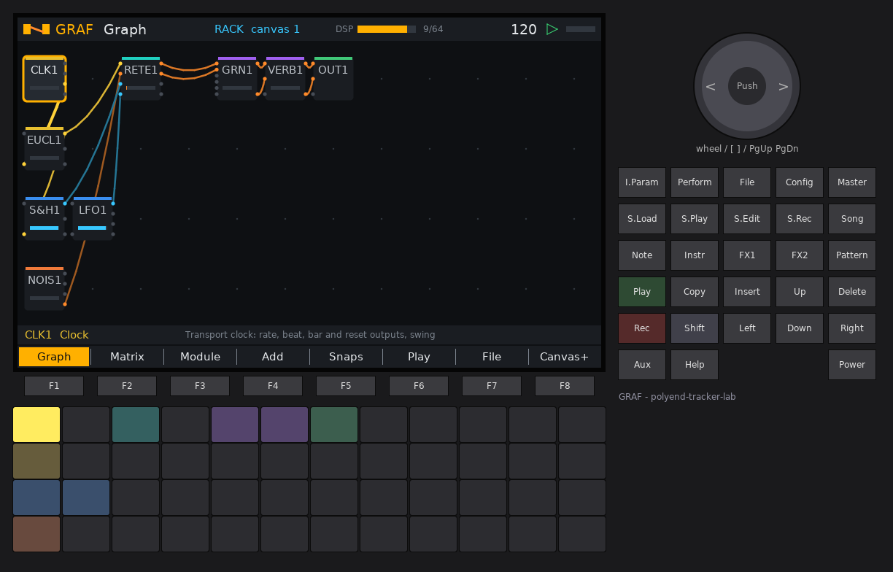

A modular synthesizer. The same patch is shown twice: as a **VCS3-style pin
matrix** on the pads (rows are outputs, columns are inputs) and as a **node
graph** on the screen, with cables coloured by signal type.

- **37 modules**, east and west coast:
  - **Sources:** VCO, complex oscillator, wavetable, noise, sampler.
  - **Sequencers:** Turing machine, Markov, Euclidean, step sequencer, Pinball ball sequencer.
  - **Control:** Maths-style function generator, LPG, wavefolder.
  - **Filters and effects:** ladder, SVF, delay, plate reverb, granular.
  - **I/O:** MIDI-to-CV.
- **RETICULUM**: a macro module rebuilt from a Eurorack noise patch (forsitan
  rete + random values + manual gate): four resonant noise nodes in a
  recurrent net with random / walk / drunk modulation.
- Two polyphony models (a setting): **Rack** (one big patch) or **8 patches**
  (one per MIDI channel).
- Songs are **snapshots that morph** into each other along a 32-step timeline.
- A CPU guard refuses a module that would not fit.

| Matrix | Module page |
|---|---|
| 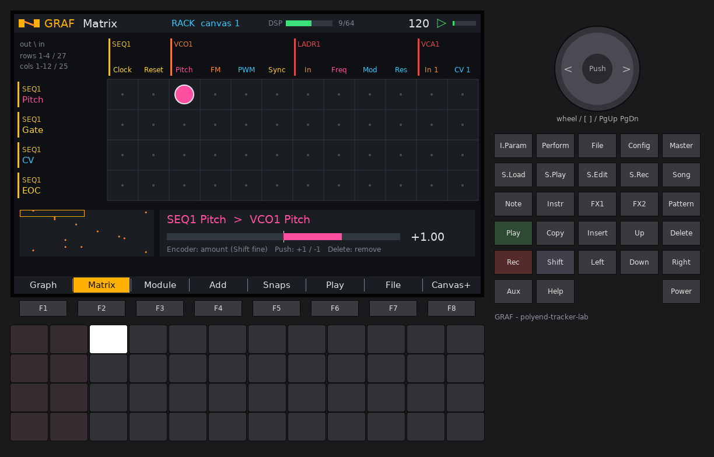 | 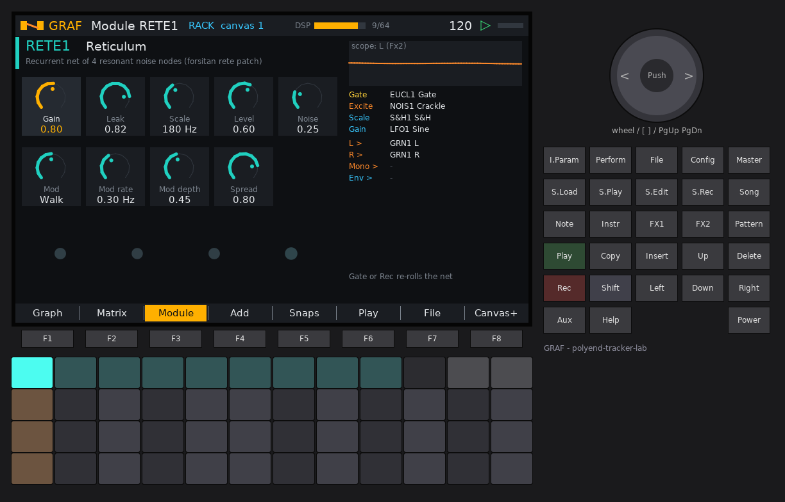 |

[Manual](firmwares/graf/MANUAL.md) · [Image](firmwares/graf/release/PolyendTrackerGRAFMD.ptf)

---

## FLIPPER


The song is a pinball machine. Each **table** is a section: bumpers are
instruments, ramps fire effects, holes and targets are events.

- Two ball modes (a setting):
  - **Hybrid:** real physics on screen while the pads show the same ball
    jumping cell to cell by Markov weights.
  - **Markov only:** tempo-locked steps, like the Pinball 2 Max for Live device.
- **8 tables** linked by a Markov graph, with percentages on screen. Jackpots,
  multiball, holes and game over also move the song on.
- Game rules: score, combo, heat, tilt, multiball, ball save. The music
  never stops at game over.
- You play the flippers. When you let go, an **auto-player** with a skill
  setting takes over.
- **Sounds:** 8 engines (drums, Karplus pluck, FM bell, bass/lead, sampler).
  Every hit is also sent as MIDI.
- **Capture** turns a good run into a loop that replays note for note.

| Markov graph between tables | Table editor |
|---|---|
|  |  |

[Manual](firmwares/flipper/MANUAL.md) · [Image](firmwares/flipper/release/PolyendTrackerFLIPPR.ptf)

---

## BULUT

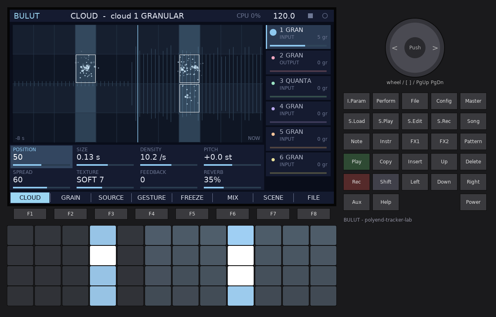

*Bulut* is Turkish for cloud. Tracks are **six clouds**, each fed by line in,
FM radio, BULUT's own output (resampling feedback) or a WAV from the card.

- **Two engines per cloud:**
  - **GRANULAR:** position, size, density, pitch, spread, 16 window shapes, feedback.
  - **QUANTA:** microsound particles (glisson, gabor, pulsar, trainlet) with
    Poisson, Gauss, Cauchy and chaotic onset laws.
- **Pads:** a position × density map of the last 8 seconds of the buffer.
- **Gestures** instead of notes: pad and encoder movements are recorded and loop.
- **Spectral freeze**, with a library of 16 frozen moments.
- The **resample loop** renders a cloud to WAV and feeds it to the next cloud.
- **Arrangement:** 8 morphing scenes and a 32-step timeline.

| Freeze library | Gestures |
|---|---|
| 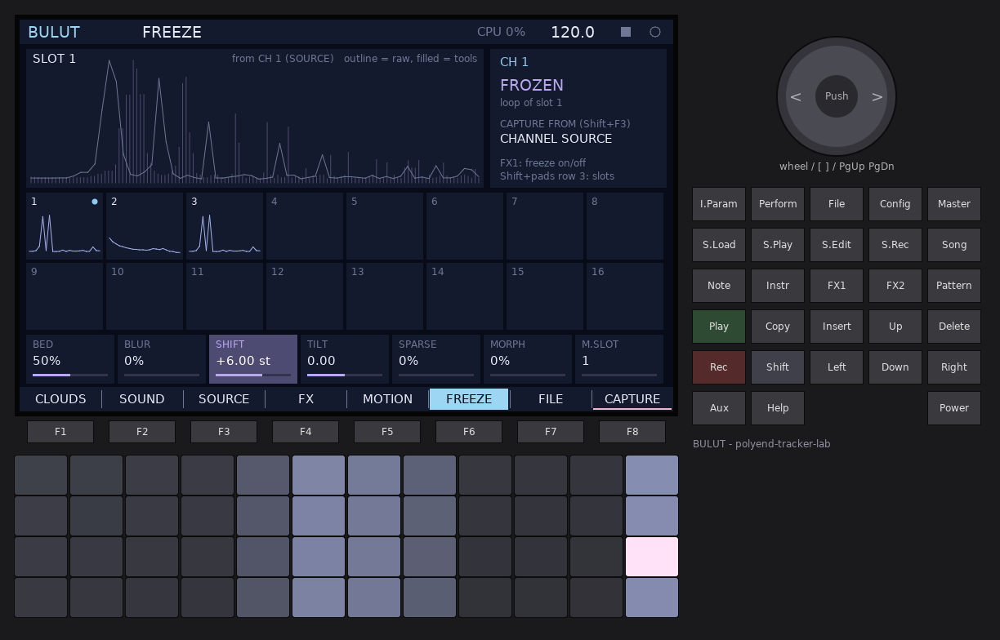 | 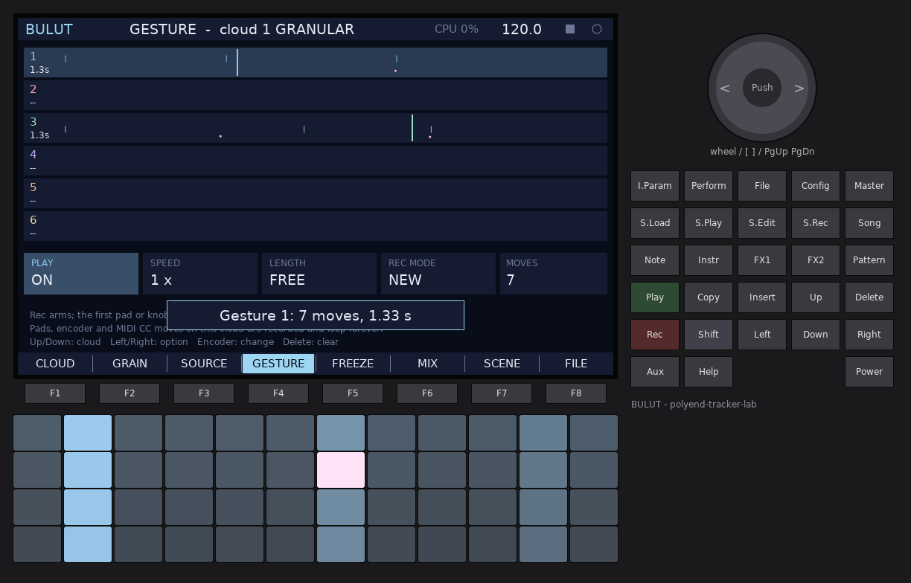 |

[Manual](firmwares/bulut/MANUAL.md) · [Image](firmwares/bulut/release/PolyendTrackerBULUTG.ptf)

---

## KONSOL

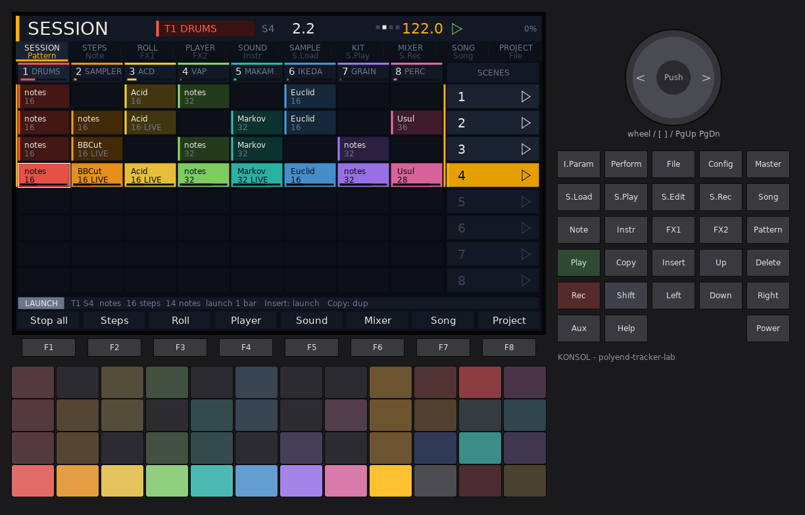

A clip/scene production workstation: **8 tracks × 16 scenes**. Engines (what
sounds) and players (what plays) are chosen separately per track.

- **10 engines:** sampler, grain, analog-style drums, Ikeda (sine/click/noise),
  makam synth (24-tone / 53-TET), and OpenTracker's ACD, VAP, FAT, WTFM and PERC.
- **10 players:** notes, Euclid, Usul (aksak cycles), Pinball, Markov, and the
  generators Acid, Call+Response, BBCut, Turnaround, Genotype and Station.
  - **Write** puts a generator's output into the clip once.
  - **Live** makes a new variation every N loops.
  - **To roll** freezes the current take into the piano roll.
- **Step pads** with per-step locks, a **piano roll**, quantised live recording.
- Song arrangement, a mixer with delay/reverb sends and a master compressor.
- Every track goes to one of 4 stem groups.

| Piano roll | Mixer |
|---|---|
| 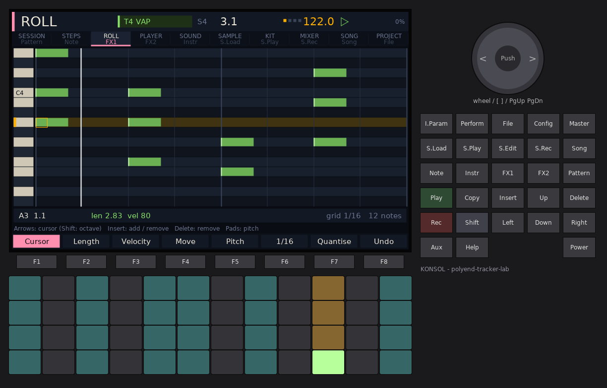 | 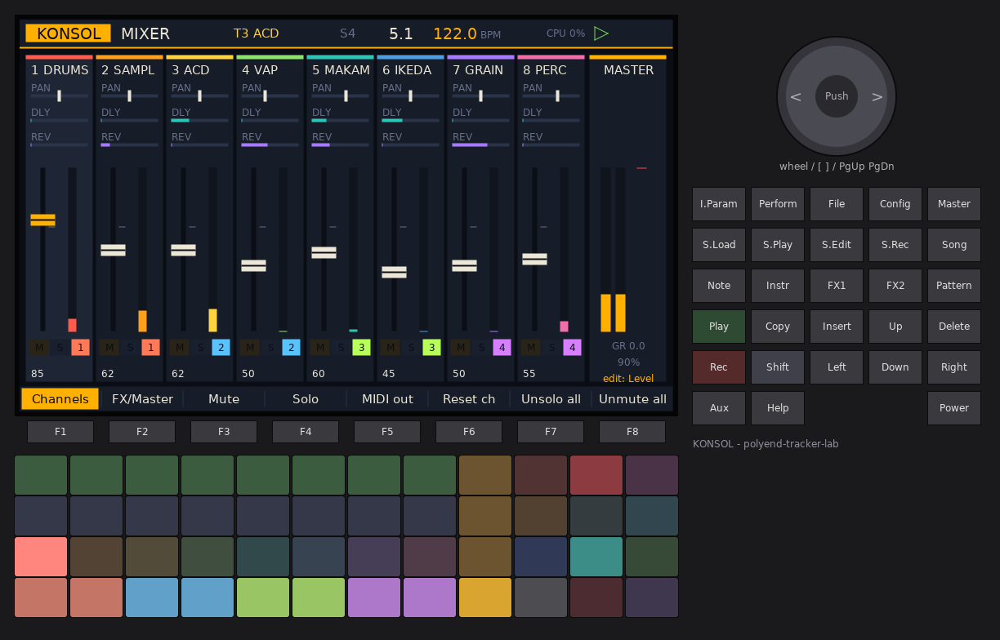 |

[Manual](firmwares/konsol/MANUAL.md) · [Image](firmwares/konsol/release/PolyendTrackerKONSOL.ptf)

---

## DATAMATICS

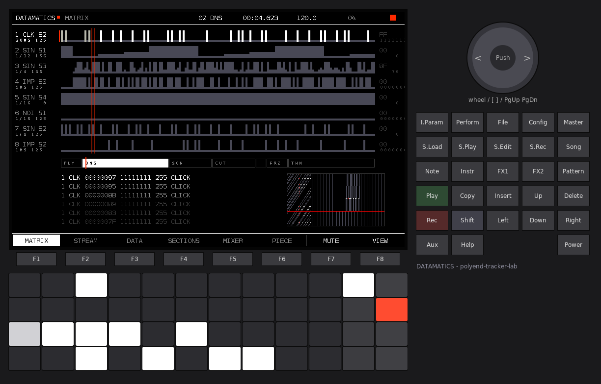

Data music in the spirit of Ryoji Ikeda's *datamatics* and *test pattern*:
only sine tones, clicks, noise and single-sample impulses, on millisecond
grids, played by data. Any file on the card becomes sequence data through
seven reading modes (raw bytes, bits, image pixels from BMP/PGM, WAV, MIDI,
text, or automatic); five built-in data sets play without a card.

- **8 streams** on 4 data slots, each with its own read order, a 1-2000 ms or
  beat grid, threshold and sound; sines from 1 Hz to 21 kHz.
- **Sample-accurate** starts and hard cuts, integer grid maths: no drift.
- **Sections** in Ikeda's structure: PLAY, SCAN, DENSIFY, THIN, SILENCE, CUT,
  FREEZE, arranged into a piece and cued from the pads or MIDI.
- Black and white with one red accent; a full-screen waterfall view reacts to
  the data and the sound.

| Waterfall view | Data browser |
|---|---|
| 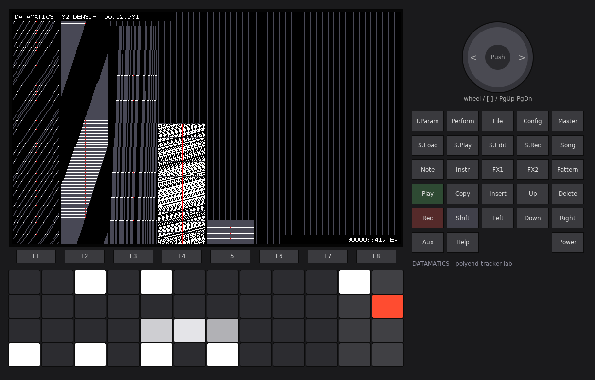 | 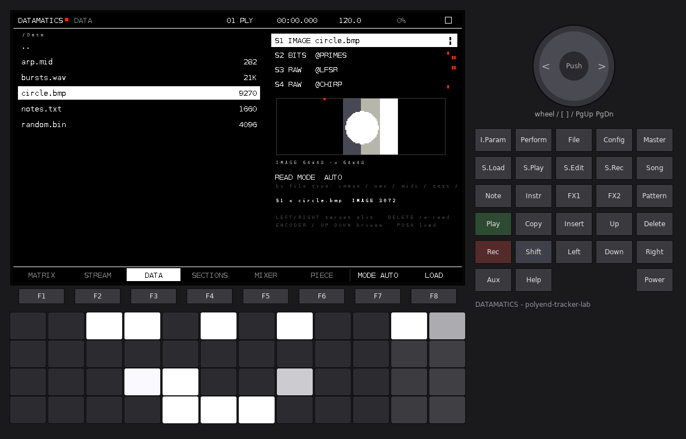 |

[Manual](firmwares/datamatics/MANUAL.md) · [Image](firmwares/datamatics/release/PolyendTrackerDATAMT.ptf)

---

## MAKAM

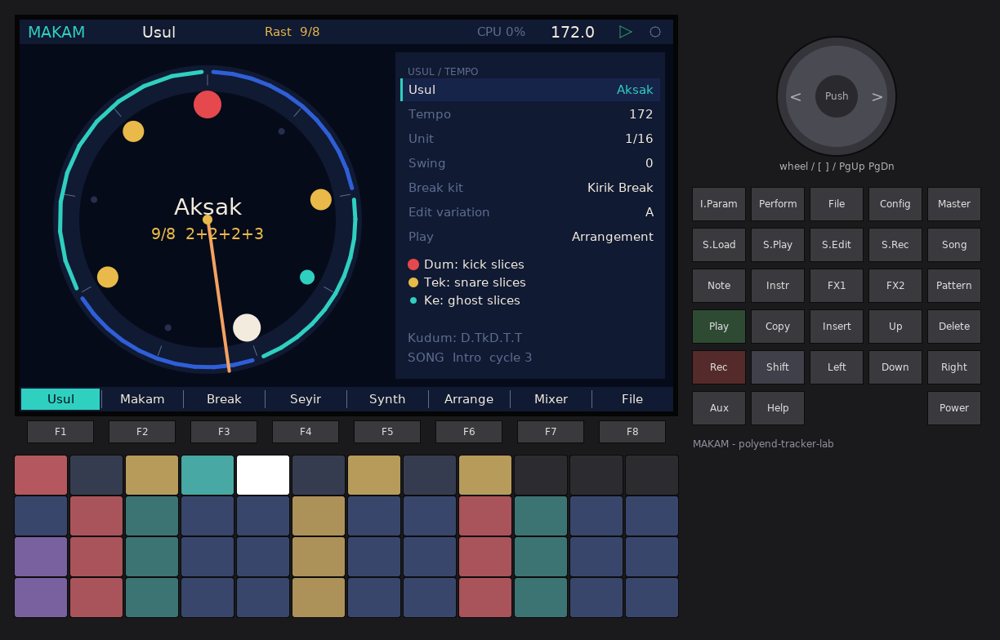

MAKAM-JUNGLE: Turkish makam music at jungle tempo. The **usul** (rhythmic
cycle) is a clock dial, the **makam** a ring of perdes at their comma positions.

- **Tuning:** Arel-Ezgi-Uzdilek 24-tone by default, 53-TET as an option, ahenk
  transpose.
- **25 makams** (Rast, Uşşak, Hüzzam, Hicaz, Saba, Nihavend, Kürdi, Segah,
  Karcığar, Hüseyni, Muhayyer, Hicazkar, Suzinak, ...) with karar, güçlü, yeden
  and seyir.
- **13 usuls** (Aksak 9/8, Curcuna 10/8, Devr-i Hindi 7/8, Sofyan, Düyek,
  Yürük Semai, Aksak Semai, Devr-i Turan, ...): dum strokes cut kick slices,
  tek snare slices, ke ghost notes.
- **Breaks:** three built-in synthesised breaks (no card needed) or WAVs from
  the card, with rolls, reverse, stutter and chaos edits.
- **Bass** (Reese, Sub, Growl) and **lead** (Ney, Kanun, Saz, Zurna) at
  microtonal pitch; MIDI out with pitch bend.
- **Seyir generator:** phrases that start where the makam starts, rest on the
  güçlü and cadence to the karar, live or written into an editable phrase.

| Makam ring (Rast) | Seyir generator |
|---|---|
| 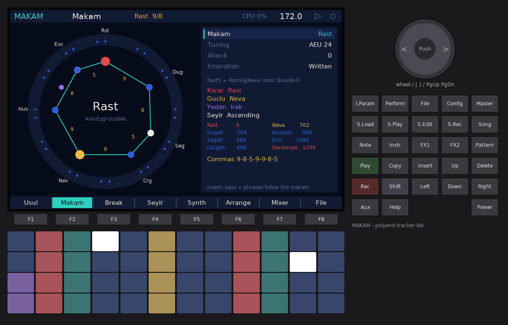 | 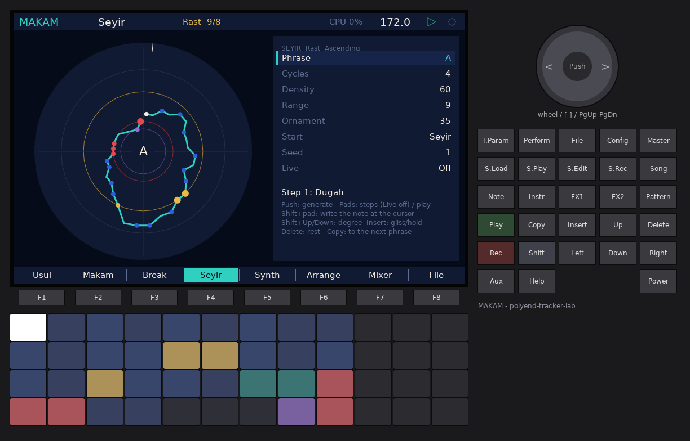 |

[Manual](firmwares/makam/MANUAL.md) · [Image](firmwares/makam/release/PolyendTrackerMAKAMJ.ptf)

---

## PLATFORM

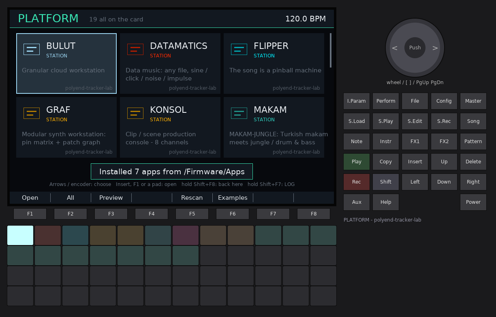

A platform instead of an instrument: it runs **Lua scripts** and **native
apps** from the SD card, like monome norns runs scripts.

- **Launcher:** cards for every script and app on the card. It reopens the
  last one at power-on; hold any key during the countdown for a safe boot.
- **Lua 5.4** with a norns-like API: `init`, `redraw`, `key`, `enc`, `pad`,
  `screen.*`, `grid`, `clock.run/sync/sleep`, `midi`, `params`, `metro`,
  `util`, `music`. A script error shows a readable error page, and an endless
  loop is stopped. It never freezes the Tracker.
- **Voice engine** for scripts: 16 voices (anti-aliased waves, noise, FM,
  sample, grain, click), filter, envelopes, delay and reverb. Notes from Lua
  clocks land on the exact sample.
- **Native apps** (`.papp`): compiled C++ loaded from the card at full speed,
  with an SDK and two examples (drone, step sequencer). Native apps have no
  memory protection: a faulty one needs a power cycle (safe boot recovers).
- **Five example scripts**: hello, steps, drift, euclid, arp.

| Lua script running | Error page |
|---|---|
| 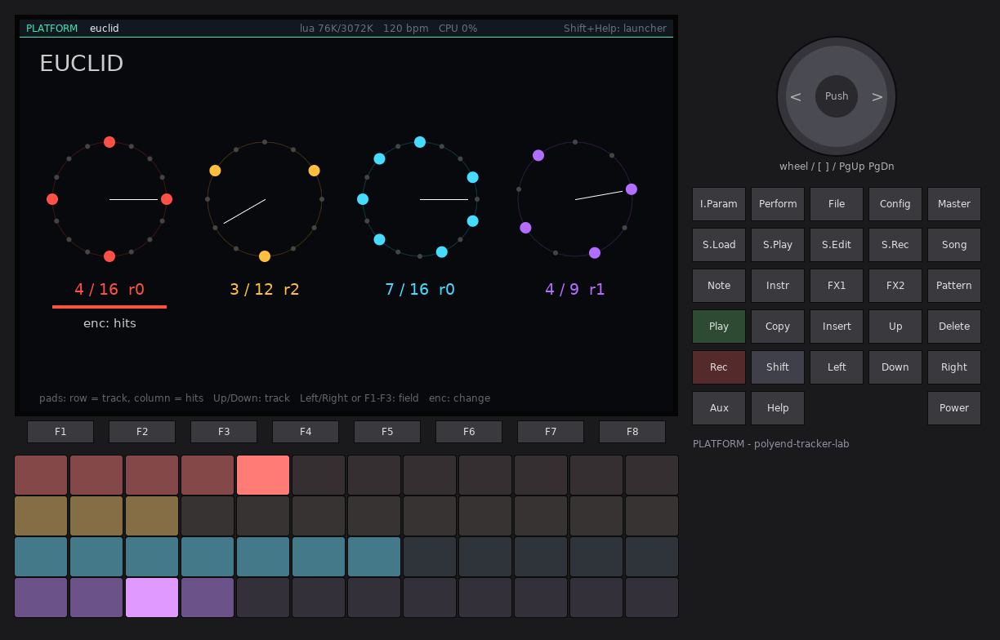 | 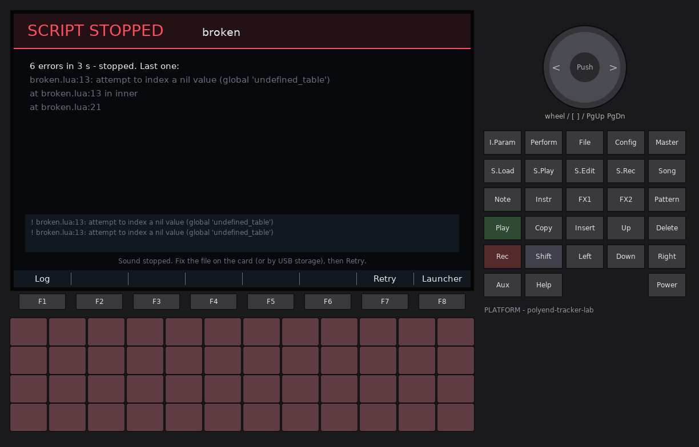 |

[Manual](firmwares/platform/MANUAL.md) · [Image](firmwares/platform/release/PolyendTrackerPLATFM.ptf)

---

## How it is built

Each folder in `firmwares/` is a complete, independent OpenTracker tree. The
tracker App is replaced by the **lab Shell** (`src/lab/`), which provides:

- the intro
- the settings page
- firmware update
- transport and MIDI clock
- audio input
- the recorder
- pad LEDs

The Shell runs one **workstation** (`src/ws/`). See
[WORKSTATION_GUIDE.md](WORKSTATION_GUIDE.md) and [LAB.md](LAB.md).

Every released image passed **`make lab-gate`**:

- **Image checks:** flash under 720,000 B, float-only libm, at least 90 KiB of
  stack headroom.
- **Host tests** under AddressSanitizer and UndefinedBehaviorSanitizer.
- **CPU:** the worst audio block of every load scenario stays under 180,000
  Cortex-M4 instructions, measured under QEMU (about 67 % of the real budget).
- **Simulator check:** sound, and every frame within the FT81x display-list budget.

GitHub CI runs the same gate with Arm GNU 14.2 for every firmware.

```
cd firmwares/graf
make -j2            # build/PolyendTrackerGRAFMD.ptf
make lab-sim        # desktop simulator: build/sim/lab-sim
make lab-gate       # everything above
```

## Credits

- [OpenTracker](https://github.com/sandlbn/polyend-tracker-re) by sandlbn: a
  clean-room firmware with no Polyend code. Not affiliated with or endorsed by
  Polyend. Upstream has no LICENSE file yet, so ask its author before
  redistributing images.
- KONSOL's generators:
  - Call & Response after Nordl3's generator (MIT).
  - BBCut procedures after Nick Collins' BBCut, via BBenCut.
  - Acid after TB-3PO.
- Third-party algorithms per firmware are listed in each folder's `THIRD_PARTY.md`.
