# polyend-tracker-lab

Eight experimental firmwares for the **original Polyend Tracker**, built on
[OpenTracker](https://github.com/sandlbn/polyend-tracker-re). None of them is a
tracker: each one turns the Tracker into a different instrument, from idea to
finished WAV (sound sources, sequencing, arrangement, mixing, stems).

| Firmware | What it is | Image | Manual |
|---|---|---|---|
| [GRAF](#graf) | Modular synth: pad patching, 49 modules (Plaits, rete net, Open303...), templates, undo | [`PolyendTrackerGRAFMD.ptf`](firmwares/graf/release/PolyendTrackerGRAFMD.ptf) | [MANUAL](firmwares/graf/MANUAL.md) |
| [FLIPPER](#flipper) | The song is a pinball machine: physics + Markov | [`PolyendTrackerFLIPPR.ptf`](firmwares/flipper/release/PolyendTrackerFLIPPR.ptf) | [MANUAL](firmwares/flipper/MANUAL.md) |
| [BULUT](#bulut) | Granular: 4 deep channels (Granular, Quanta, Beads, Tape), quick sample browser | [`PolyendTrackerBULUTG.ptf`](firmwares/bulut/release/PolyendTrackerBULUTG.ptf) | [MANUAL](firmwares/bulut/MANUAL.md) |
| [KONSOL](#konsol) | Clip/scene workstation: 8 tracks, 16 engines (Plaits, TB303...), kits, time-stretch | [`PolyendTrackerKONSOL.ptf`](firmwares/konsol/release/PolyendTrackerKONSOL.ptf) | [MANUAL](firmwares/konsol/MANUAL.md) |
| [DATAMATICS](#datamatics) | Ryoji-Ikeda-style data music from any file on the card | [`PolyendTrackerDATAMT.ptf`](firmwares/datamatics/release/PolyendTrackerDATAMT.ptf) | [MANUAL](firmwares/datamatics/MANUAL.md) |
| [MAKAM](#makam) | Turkish makam meets jungle: usul-cut breaks, microtonal bass and lead | [`PolyendTrackerMAKAMJ.ptf`](firmwares/makam/release/PolyendTrackerMAKAMJ.ptf) | [MANUAL](firmwares/makam/MANUAL.md) |
| [TILT](#tilt) | Pinball 2 Markov sequencer: 17x17 matrix, 8 sample/synth channels | [`PolyendTrackerTILTPB.ptf`](firmwares/tilt/release/PolyendTrackerTILTPB.ptf) | [MANUAL](firmwares/tilt/MANUAL.md) |
| [PLATFORM](#platform) | Lua scripts and native apps from the SD card (norns-style); hosts all six as apps | [`PolyendTrackerPLATFM.ptf`](firmwares/platform/release/PolyendTrackerPLATFM.ptf) | [MANUAL](firmwares/platform/MANUAL.md) |

> **Status: v0.1, not yet tested on a real Tracker.** Every image passed the
> lab gate (below) in the simulator and under QEMU. Keep a stock image in
> `/Firmware` when you try one.

## Install

1. Copy the `.ptf` to `/Firmware` on the SD card. Keep the file name: the
   bootloader only accepts 24-character names.
2. Install it like any firmware: **Config > Firmware update** on stock or
   OpenTracker, or **Config > Firmware** (F2) on any lab firmware.
3. Going back: every lab firmware lists and installs any `.ptf` in
   `/Firmware` from **Config > Firmware**. OpenTracker's escape hatch works
   too: put an image name into `/Firmware/ot_restore.txt` and power-cycle.
   Keep only one lab image plus stock in `/Firmware`: the rear reset button
   installs a random `.ptf` from that folder.

Common to every lab firmware: **Play** starts/stops, **Config** opens the
settings (tempo, MIDI clock in/out, input line/radio/mic, master, recorder),
**Shift + Rec** records the master (plus up to 4 stems) to
`/Lab/<NAME>/Rec/` on the card. Each has its own boot animation (Settings >
Boot intro turns it off).

### Common navigation (LABKIT)

The round-2 firmwares (KONSOL, GRAF, BULUT, DATAMATICS, MAKAM and TILT so far) share one
navigation layer, [LABKIT](labkit/NAV.md):

| Key | Action |
|---|---|
| **I.Param** | PARAM pads: the page's parameters on the pads. Hold a pad and turn the encoder to edit. |
| **Shift + I.Param** | MACRO: 8 open macros, each with up to 8 targets. Hold a macro pad and tap parameter pads to assign. |
| **Master** | MAP: every page and parameter on one screen. Tap to latch it; a pad jumps there. |
| **Shift + Master** | MOD: 4 LFOs, 2 random sources and the firmware's own sources. Hold an LFO pad and tap a parameter pad for a route; the encoder sets the depth. |
| **Shift + Config** | HELP for the current page. |
| **Shift + hold a param pad + move a CC** | MIDI learn |

The simulator panel also draws **Aux**, **Help** and **Push** keys. The real
Tracker has none of them, so no firmware uses them.

---

## GRAF

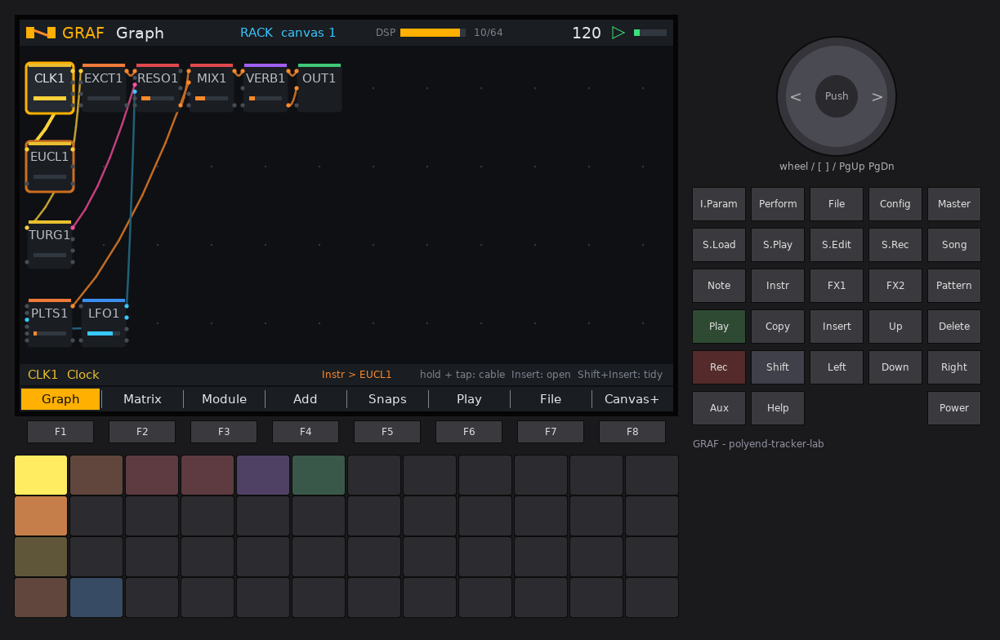

A modular synthesizer. The same patch is shown twice: as a **VCS3-style pin
matrix** and as a **node graph** on the screen, with cables coloured by signal
type.

- **Patching on the pads:** hold one module's pad and tap another to make a
  cable.
  - While holding, the encoder sets the amount, the arrows pick the jack, and a
    strip shows the cable with a scope.
  - Hold a module and tap an empty pad to move it.
  - Shift+Insert tidies the graph by signal flow; Pattern / Shift+Pattern are
    24-step undo and redo.
- **49 module types**, east and west coast:
  - **New this round:**
    - **Plaits:** the real Mutable Instruments code, 24 models, up to 4 at once.
    - **Rings / Elements-style:** a resonator and an exciter.
    - **From the user's own patches and plugins:** the original **rete
      circuit** with Random Values, MG-16 and Manual Gate (RETICULUM), an
      Open303 **ACID** voice / 303 filter, **FLOATER** drums and **QUANTA**
      particles.
    - **Generators:** chaos, Bernoulli gate.
  - **From round 1:** VCOs, complex osc, wavetable, Turing / Markov / Euclid /
    Pinball sequencers, Maths-style function generator, LPG, folder, ladder,
    SVF, delay, plate, granular, quantiser, clock divider, S&H, slew, VCA, mixer.
- **Add page:**
  - categories, recent modules and the CPU share on each tile;
  - "add and patch";
  - 9 templates: East voice, West bongo, Reticulum noise, Plaits voice, Rings
    pluck, Acid line, Drum kit, Particle cloud, FX chain.
- **Module page:** one module per screen, big knobs, the top pad row as its
  knobs, and a dot where modulation moves each knob.
- **LABKIT:** every knob (640 parameters) can be reached by macros, LFOs and
  MIDI learn. Module outputs can be marked as modulation sources (TAP1-8),
  along with the sequencer lanes.
- **Snapshots:** they morph along a 32-step timeline, plus an A/B crossfader.
- **Polyphony:** two models (a setting): **Rack** (one big patch) or **8
  patches** (one per MIDI channel).
- **CPU guard:** it refuses a module, or a Plaits model change, that would not
  fit.

| Add page with templates | Plaits module |
|---|---|
| 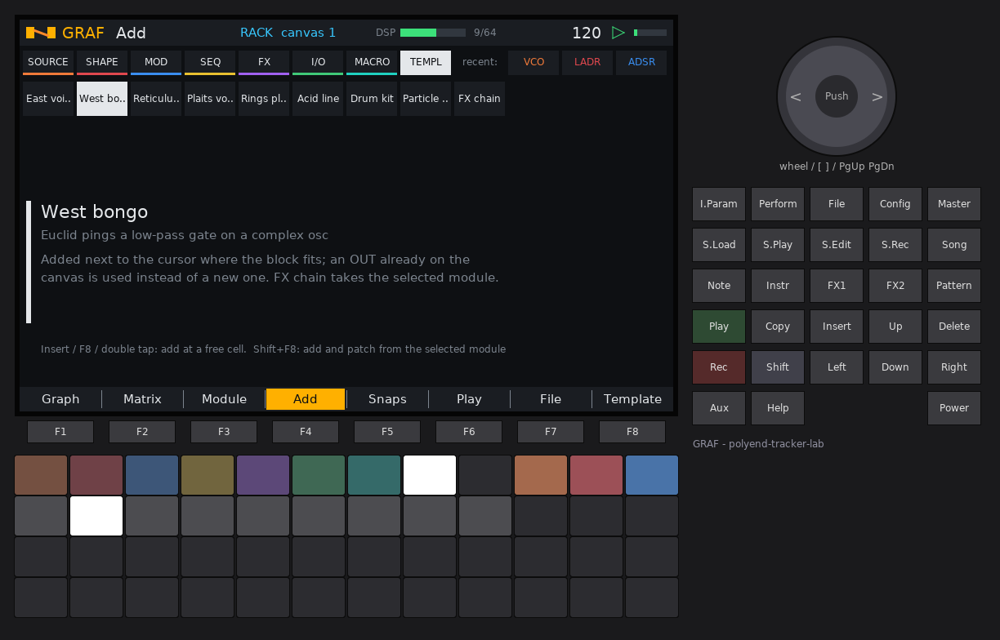 | 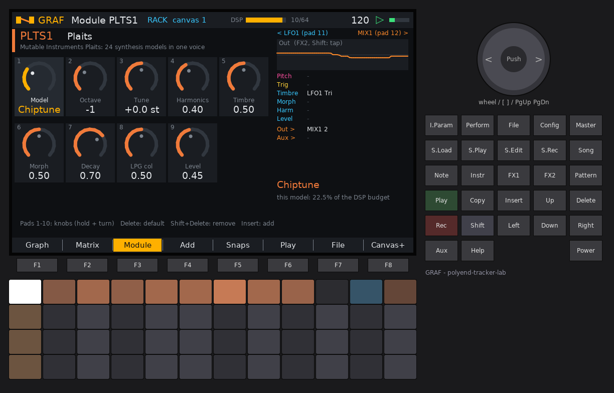 |

[Manual](firmwares/graf/MANUAL.md) · [Image](firmwares/graf/release/PolyendTrackerGRAFMD.ptf)

---

## FLIPPER


The song is a pinball machine. Each **table** is a section: bumpers are
instruments, ramps fire effects, holes and targets are events.

- Two ball modes (a setting):
  - **Hybrid:** real physics on screen while the pads show the same ball
    jumping cell to cell by Markov weights.
  - **Markov only:** tempo-locked steps, like the Pinball 2 Max for Live device.
- **8 tables** linked by a Markov graph, with percentages on screen. Jackpots,
  multiball, holes and game over also move the song on.
- Game rules: score, combo, heat, tilt, multiball, ball save. The music
  never stops at game over.
- You play the flippers. When you let go, an **auto-player** with a skill
  setting takes over.
- **Sounds:** 8 engines (drums, Karplus pluck, FM bell, bass/lead, sampler).
  Every hit is also sent as MIDI.
- **Capture** turns a good run into a loop that replays note for note.

| Markov graph between tables | Table editor |
|---|---|
|  |  |

[Manual](firmwares/flipper/MANUAL.md) · [Image](firmwares/flipper/release/PolyendTrackerFLIPPR.ptf)

---

## BULUT

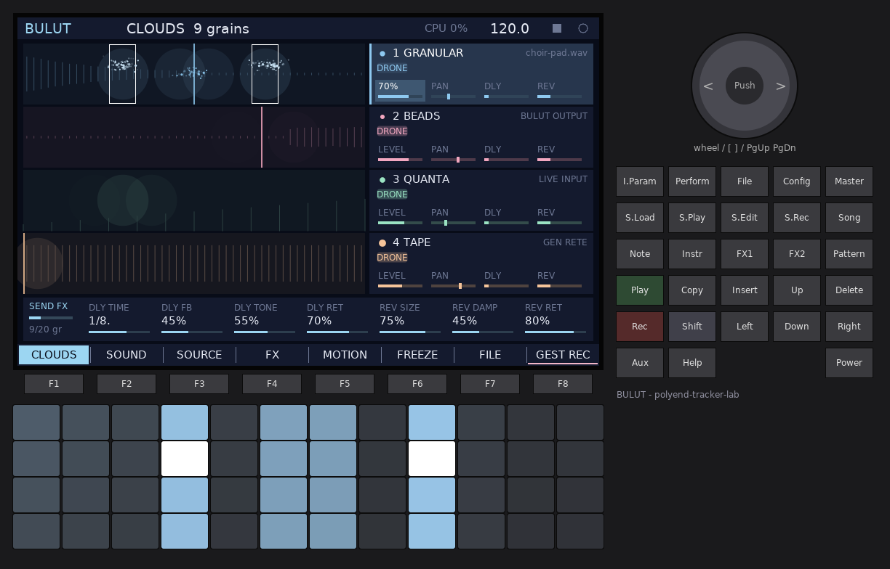

*Bulut* is Turkish for cloud. **Four deep channels**, each a full granular voice
with its own source, engine, effects and modulation.

- **Sources:**
  - line in or FM radio;
  - BULUT's own output (resampling feedback);
  - a WAV from the card;
  - a generator: RETE noise net, tone or noise.
- **Four engines:**
  - **GRANULAR** in the style of Clouds.
  - **QUANTA**: microsound particles.
  - **BEADS**: after Mutable Instruments Beads, with its four recording media.
  - **TAPE**: a moving playhead with separate speed and pitch.

  Each engine keeps its own knobs.
- **Per-channel chain:** drive, filter and one of 7 FX modes (Texture and Shifter
  from Clouds; Flanger, Panner, Crusher, Slicer and Freezer from artifex), an
  LFO, and delay and reverb sends.
- **Sample loading is quick now:**
  - the shared browser with auto-preview, waveform, favourites and letter jumps
    on the pads;
  - Copy / Shift+Copy steps to the next or previous WAV in the folder while
    playing;
  - pick a region by tapping a start pad and an end pad;
  - resampled takes load straight into a channel.
- **Gestures** (recorded pad and encoder moves that loop), **spectral freeze**
  with a library of frozen moments, 8 morphing scenes and a timeline.
- **LABKIT:** 158 parameters on 8 pages, PARAM pads, MAP, macros, two-pad
  modulation and MIDI learn, plus 17 BULUT modulation sources.
- A CPU guard with a per-channel badge keeps all four channels playable.

| Sample browser | BEADS engine |
|---|---|
| 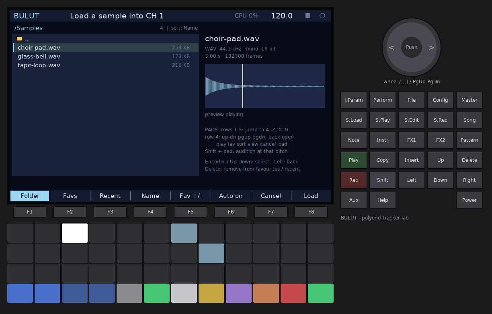 | 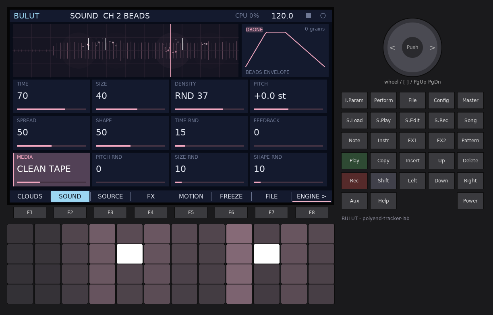 |

[Manual](firmwares/bulut/MANUAL.md) · [Image](firmwares/bulut/release/PolyendTrackerBULUTG.ptf)

---

## KONSOL


A clip/scene production workstation, Ableton-style: **8 tracks × 16 scenes**.
Engines (what sounds) and players (what plays) are chosen separately per track.

- **16 engines:**
  - **Synths:** Mutable Instruments **Plaits** (all 24 models), **TB303**
    (Open303, as in Schwung Acid), **NEURO** (NEUROSTACK's 12 bass models),
    **QUANTA** microsound particles, makam synth (24-tone / 53-TET), Ikeda,
    and OpenTracker's ACD, VAP, FAT and WTFM.
  - **Drums:** **FLOATER** kick / snare / perc voices, analog-style DRUMS,
    PERC, and **KIT** (16 pads).
  - **Samples:** stereo SAMPLER (one-shot, loop, slices) and GRAIN.
- **Samples:** a shared stereo sample pool with the LABKIT browser and
  preview.
  - **Warp** follows the tempo live (Beats / Texture).
  - **Offline time-stretch:** WSOLA, phase vocoder or repitch.
  - **Slice editor:** onset detection with a zoom view.
- **Kit builder:** turn a break's slices into a 16-pad kit. Slices are
  sorted kick / snare / hat by onset classification. Each pad has tune,
  decay, filter, choke and reverse.
- **10 players:** notes, Euclid, Usul, Pinball, Markov, and the generators
  Acid, Call+Response, BBCut, Turnaround, Genotype and Station (Write or Live).
  - Trig conditions, per-clip quantise, 16-level undo.
- **Mixer:** Hall / Shimmer / Gated reverbs, Tape / Lo-fi delays, master
  compressor, and 4 stem groups.
- **LABKIT:** PARAM pads, MAP, macros and two-pad modulation.

| Kit builder | Slice editor |
|---|---|
| 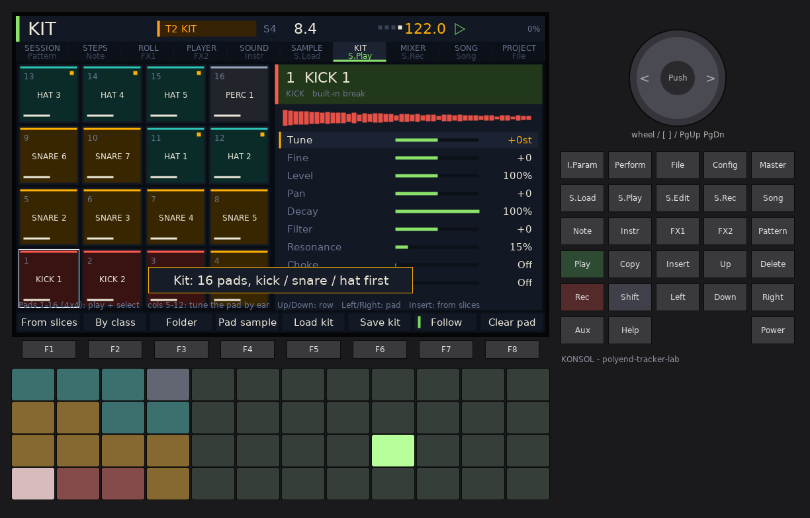 | 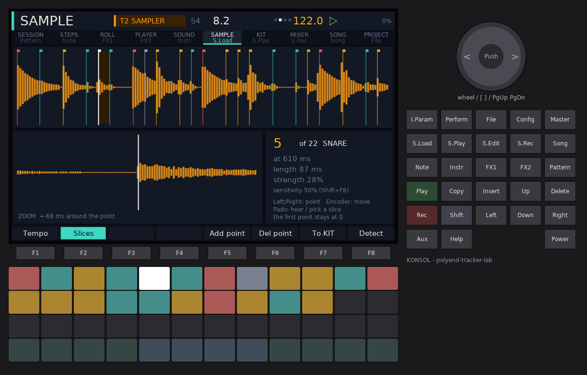 |

| Plaits | Piano roll |
|---|---|
| 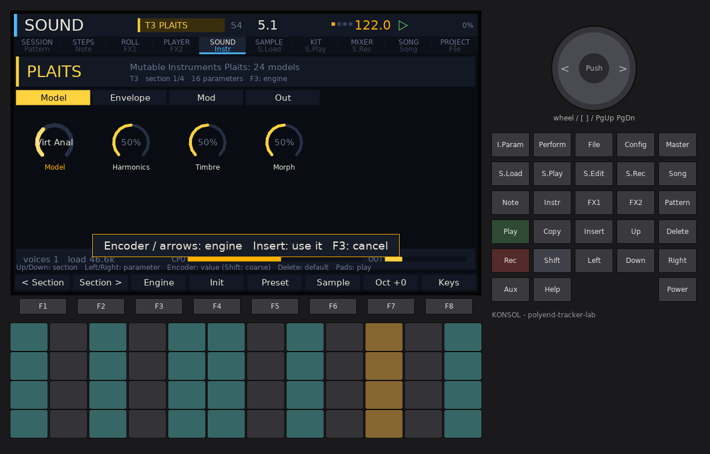 |  |

[Manual](firmwares/konsol/MANUAL.md) · [Image](firmwares/konsol/release/PolyendTrackerKONSOL.ptf)

---

## DATAMATICS

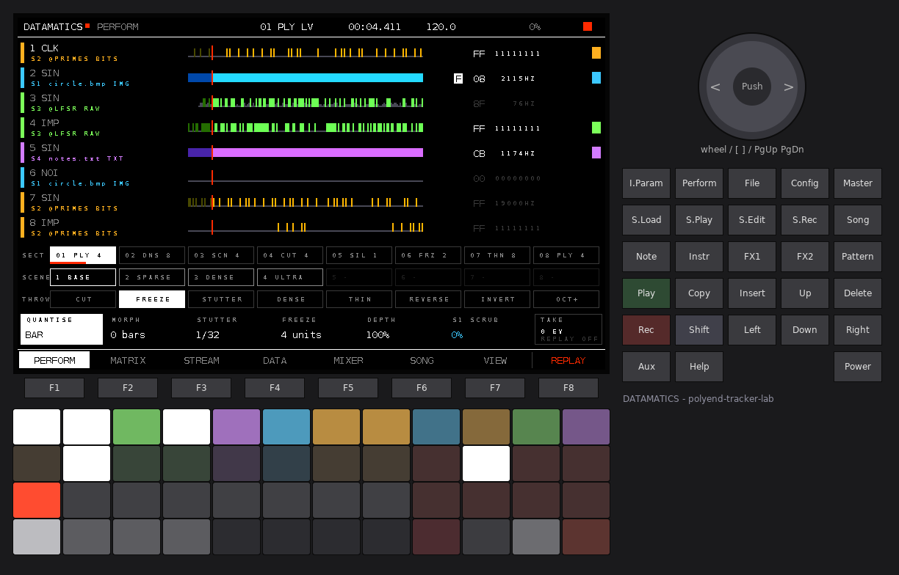

Data music in the spirit of Ryoji Ikeda's *datamatics* and *test pattern*: only sine tones,
clicks, noise and single-sample impulses on millisecond grids, played by data. Any file on the
card becomes sequence data through seven reading modes (raw bytes, bits, image pixels from
BMP/PGM, WAV, MIDI, text, auto); five built-in data sets play without a card.

- **PERFORM** is the home page: stream mutes / solos, held fills, 8 throws (cut, freeze,
  stutter, dense, thin, reverse, invert, octave), quantised section launches, 8 morphing
  scenes, live scrubbing of a slot's data, and a performance recorder with replay.
- **4 data slots, 8 streams**, each slot with its own colour everywhere (labels, matrix,
  pads, mixer, visuals); patch a slot to streams with pads on the DATA page.
- Sample-accurate starts and hard cuts; sections PLAY, SCAN, DENSIFY, THIN, SILENCE, CUT,
  FREEZE as a live set or a chain.
- Black and white with one red accent; five full-screen visual modes (stream waterfall,
  barcode, transit, grid, spatial).

| Data slots and patching | Grid view |
|---|---|
|  | 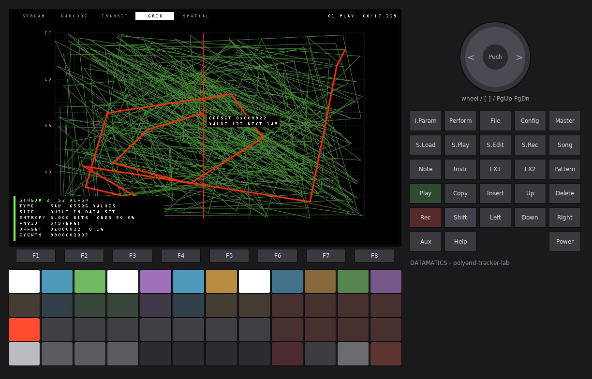 |

[Manual](firmwares/datamatics/MANUAL.md) · [Image](firmwares/datamatics/release/PolyendTrackerDATAMT.ptf)

---

## MAKAM


MAKAM-JUNGLE: Turkish makam music at jungle tempo. The **usul** (rhythmic
cycle) is a clock dial, the **makam** a ring of perdes at their comma positions.

- **Tuning:** Arel-Ezgi-Uzdilek 24-tone by default, 53-TET as an option, ahenk
  transpose.
- **25 makams** (Rast, Uşşak, Hüzzam, Hicaz, Saba, Nihavend, Kürdi, Segah,
  Karcığar, Hüseyni, Muhayyer, Hicazkar, Suzinak, ...) with karar, güçlü, yeden
  and seyir.
- **13 usuls** (Aksak 9/8, Curcuna 10/8, Devr-i Hindi 7/8, Sofyan, Düyek,
  Yürük Semai, Aksak Semai, Devr-i Turan, ...): dum strokes cut kick slices,
  tek snare slices, ke ghost notes.
- **Breaks:**
  - Three built-in synthesised breaks, or WAVs from the card (picked in the
    browser with preview). Card WAVs are cut at their onsets.
  - Rolls, reverse, stutter and chaos edits.
  - Four cut modes per section: Usul, BBCut, Warp and DNA (GENOTYPE-style).
  - Phrase-end fills (TURNAROUND-style) at 4, 8 and 16 cycles.
- **Bass:**
  - Reese, Sub and Growl, plus NEUROSTACK's Talk, FM and Hoover with a
    Motion control and a sine sub.
- **Lead:** Ney, Kanun, Saz and Zurna, at microtonal pitch.
- **MIDI out:** with pitch bend.
- **Seyir generator:**
  - Phrases start where the makam starts, rest on the güçlü and cadence to
    the karar, live or written into an editable phrase.
  - A Call + Response form: the call ends on the güçlü, the answer on the
    karar.
  - Optional practice intonation (e.g. Saba's Hicaz +2 commas).
- **Dub sends:**
  - A delay: Clean, Tape (wow/flutter), Lo-fi or Ping-pong.
  - A reverb: Plate, Hall or Gated.
- **Scenes:** 8 scenes with morph time.
- **LABKIT:** four ready macros on first boot (DUB, SWEEP, NEURO, SPACE). Usul
  position, dum/tek hits, slice, energy and seyir are modulation sources.

| Makam ring (Rast, comma steps) | Break page |
|---|---|
|  | 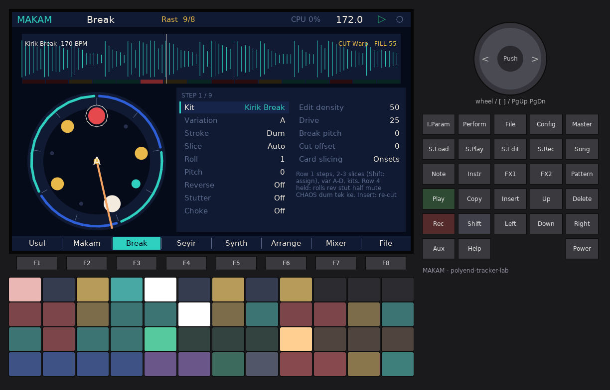 |

[Manual](firmwares/makam/MANUAL.md) · [Image](firmwares/makam/release/PolyendTrackerMAKAMJ.ptf)

---

## TILT

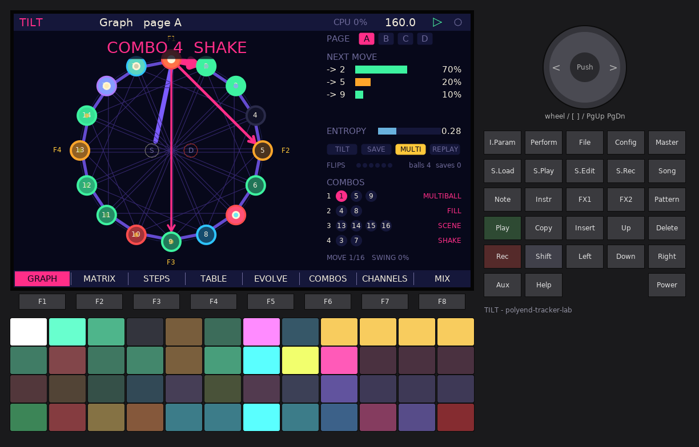

The renewed **Pinball 2** Markov sequencer as a whole instrument. It has 16 steps
and a **17×17 probability matrix**: the ball lands on a step and fires one of
**8 channels** (each a sample or a synth), then bounces to the next step drawn
from that step's row.

- **The table around the walk:**
  - flippers (pads or MIDI notes);
  - bumpers (ratchets);
  - ramps (fixed licks inside the random walk);
  - 4 combos (multiball, fill, note, CC, shake, scene);
  - multiball (red main ball, blue extra balls);
  - tilt (freeze or shake), ball save and gravity;
  - edge properties per move (transpose, delay, velocity).
- **Evolution:**
  - memory (fatigue or reinforcement, recovering each bar);
  - mutation (up to 24 weights by ±30 per bar);
  - a 4×4 meta matrix over pages A–D;
  - melody mode (scale degrees, legato, octave-up);
  - rules;
  - matrix shapes, and a randomizer with locks.
- **Channels:**
  - samples from the card (through the browser) or built-in;
  - Plaits analog/synthetic kick, snare and 808 hat;
  - a 303-style acid voice and a 2-op FM voice;
  - mixer, choke groups, delay/reverb sends and stems.
- **Pattern JSON** after the TILT plug-in's model, saved to and loaded from
  `/Lab/TILT/Patterns`, plus **15 factory patterns** (one per idea). Not yet
  checked against the plug-in's `FORMAT.md`.
- **Views:** a graph view with heat, trail, next-move odds and entropy.
- **Capture:** the last 1–8 bars, saved as a MIDI file.
- **LABKIT:** 13 pages of parameters, and 9 modulation sources (ball, ball X/Y,
  heat, entropy, balls, tilt, page, velocity) for LFOs and macros.

| 17×17 matrix | MAP |
|---|---|
| 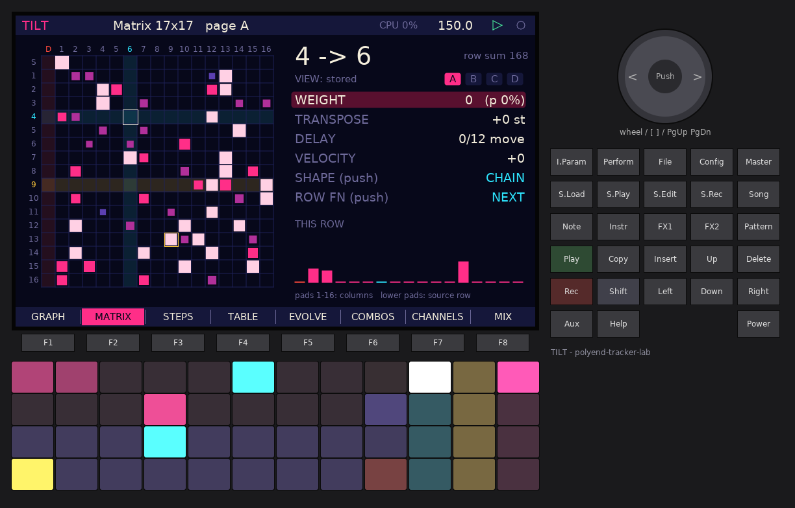 | 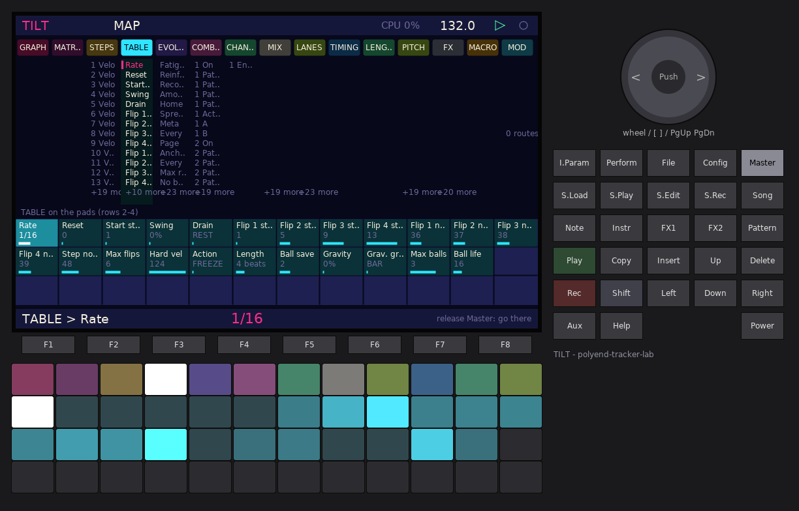 |

[Manual](firmwares/tilt/MANUAL.md) · [Image](firmwares/tilt/release/PolyendTrackerTILTPB.ptf)

---

## PLATFORM


A platform instead of an instrument: it runs **Lua scripts** and **native
apps** from the SD card, like monome norns runs scripts.

- **Launcher:** cards for every script and app on the card. It reopens the
  last one at power-on; hold any key during the countdown for a safe boot.
- **Lua 5.4** with a norns-like API: `init`, `redraw`, `key`, `enc`, `pad`,
  `screen.*`, `grid`, `clock.run/sync/sleep`, `midi`, `params`, `metro`,
  `util`, `music`. A script error shows a readable error page, and an endless
  loop is stopped. It never freezes the Tracker.
- **Voice engine** for scripts: 16 voices (anti-aliased waves, noise, FM,
  sample, grain, click), filter, envelopes, delay and reverb. Notes from Lua
  clocks land on the exact sample.
- **Native apps** (`.papp`): compiled C++ loaded from the card at full speed,
  with an SDK and two examples (drone, step sequencer). Native apps have no
  memory protection: a faulty one needs a power cycle (safe boot recovers).
- **Five example scripts**: hello, steps, drift, euclid, arp.
- **Stations:** the six workstations above also run *inside* PLATFORM as
  native apps, built unchanged from their own source
  ([`release/Apps/`](firmwares/platform/release/Apps)). Copy `release/` to
  `/Firmware` on the card; PLATFORM installs the apps at boot. Every station
  passed its own CPU scenarios while hosted (worst: BULUT 174,520 of 180,000
  instructions).

| Lua script running | GRAF as a station inside PLATFORM |
|---|---|
|  | 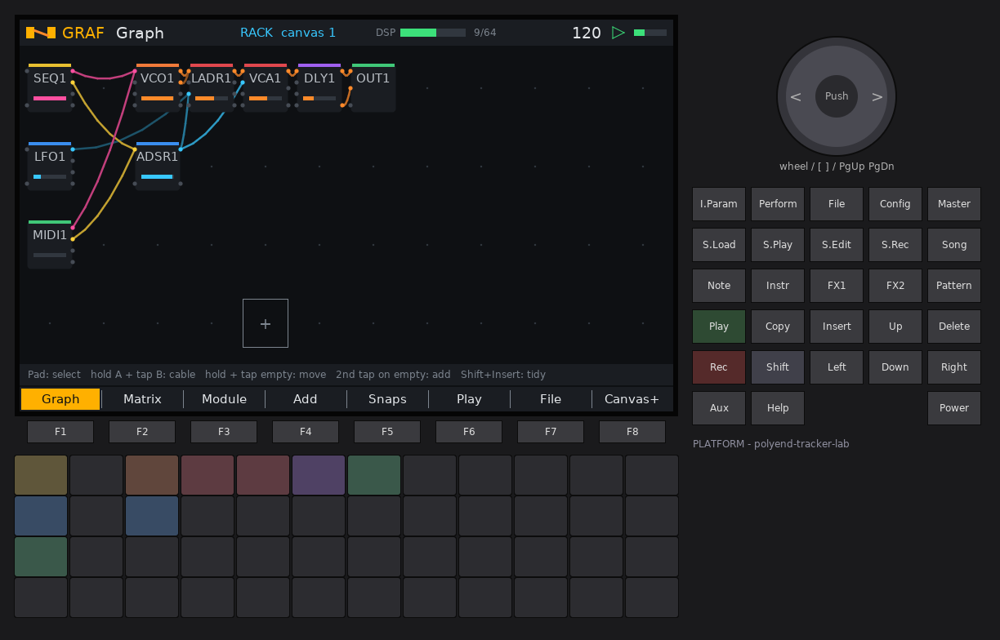 |

[Manual](firmwares/platform/MANUAL.md) · [Image](firmwares/platform/release/PolyendTrackerPLATFM.ptf)

---

## How it is built

Each folder in `firmwares/` is a complete, independent OpenTracker tree. The
tracker App is replaced by the **lab Shell** (`src/lab/`), which provides:

- the intro
- the settings page
- firmware update
- transport and MIDI clock
- audio input
- the recorder
- pad LEDs

The Shell runs one **workstation** (`src/ws/`). See
[WORKSTATION_GUIDE.md](WORKSTATION_GUIDE.md) and [LAB.md](LAB.md).

Every released image passed **`make lab-gate`**:

- **Image checks:** flash under 720,000 B, float-only libm, at least 90 KiB of
  stack headroom.
- **Host tests** under AddressSanitizer and UndefinedBehaviorSanitizer.
- **CPU:** the worst audio block of every load scenario stays under 180,000
  Cortex-M4 instructions, measured under QEMU (about 67 % of the real budget).
- **Simulator check:** sound, and every frame within the FT81x display-list budget.

GitHub CI runs the same gate with Arm GNU 14.2 for every firmware.

```
cd firmwares/graf
make -j2            # build/PolyendTrackerGRAFMD.ptf
make lab-sim        # desktop simulator: build/sim/lab-sim
make lab-gate       # everything above
```

## Credits

- [OpenTracker](https://github.com/sandlbn/polyend-tracker-re) by sandlbn: a
  clean-room firmware with no Polyend code. Not affiliated with or endorsed by
  Polyend. Upstream has no LICENSE file yet, so ask its author before
  redistributing images.
- KONSOL's generators:
  - Call & Response after Nordl3's generator (MIT).
  - BBCut procedures after Nick Collins' BBCut, via BBenCut.
  - Acid after TB-3PO.
- Third-party algorithms per firmware are listed in each folder's `THIRD_PARTY.md`.
