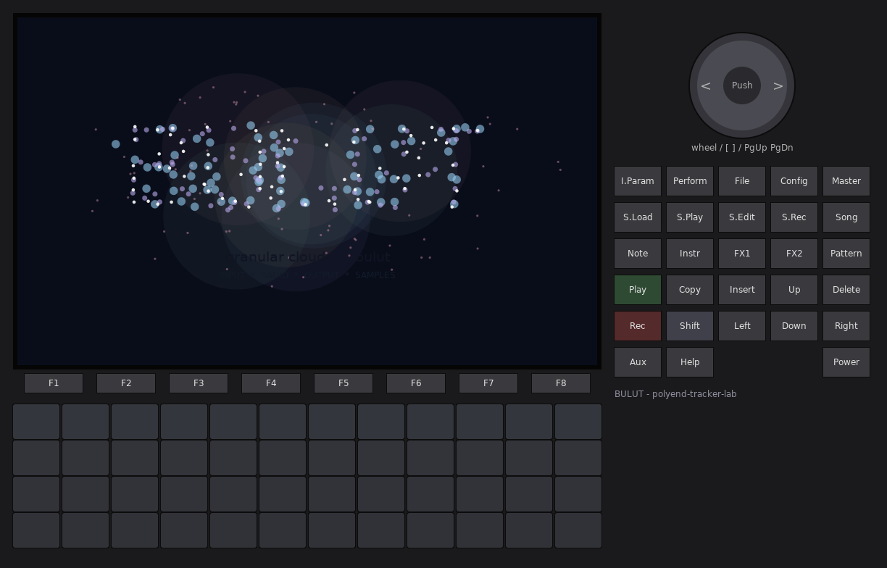
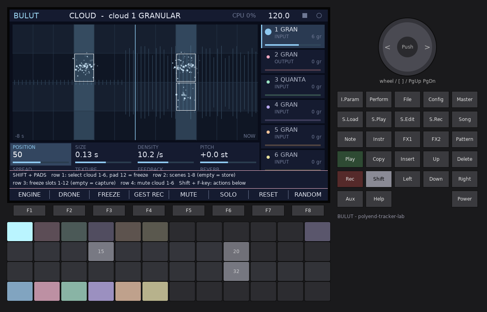
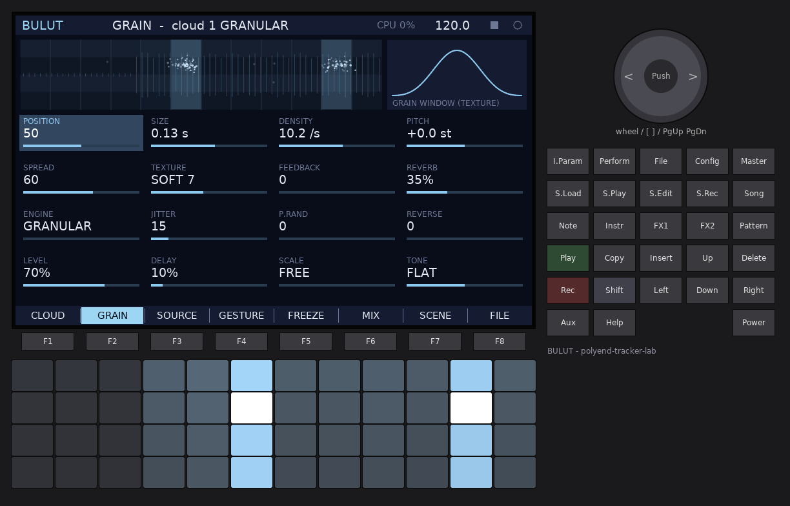
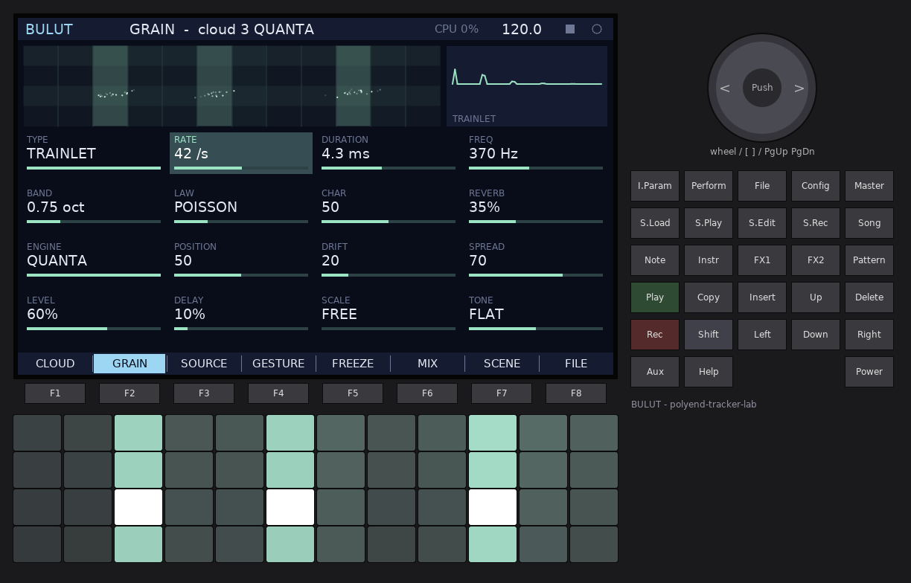
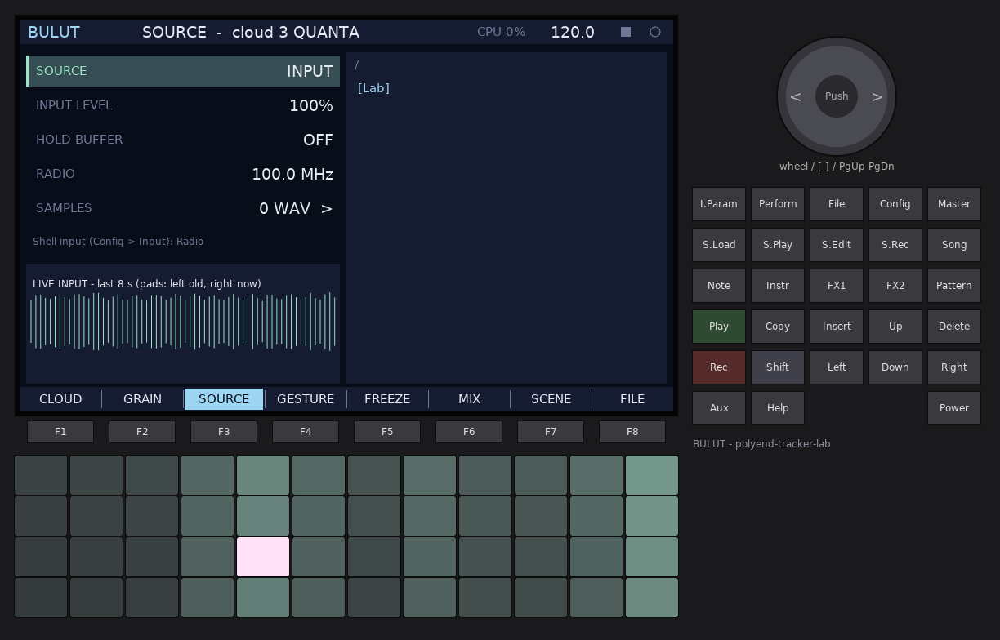
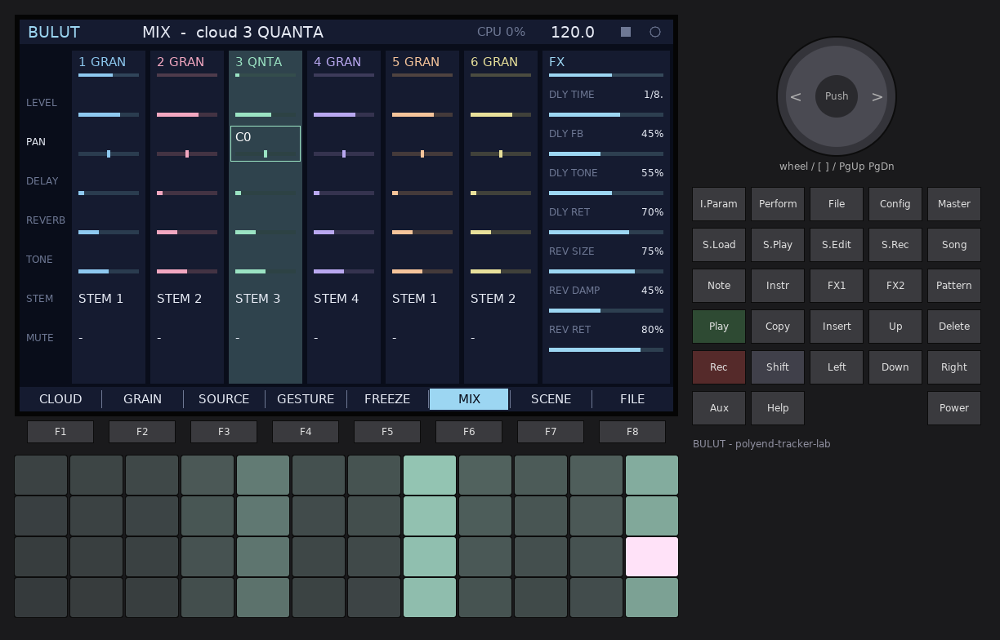
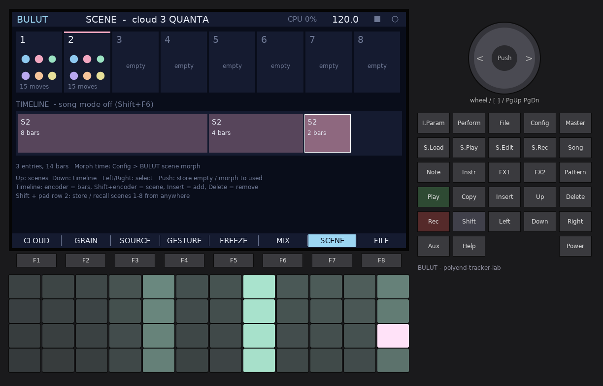
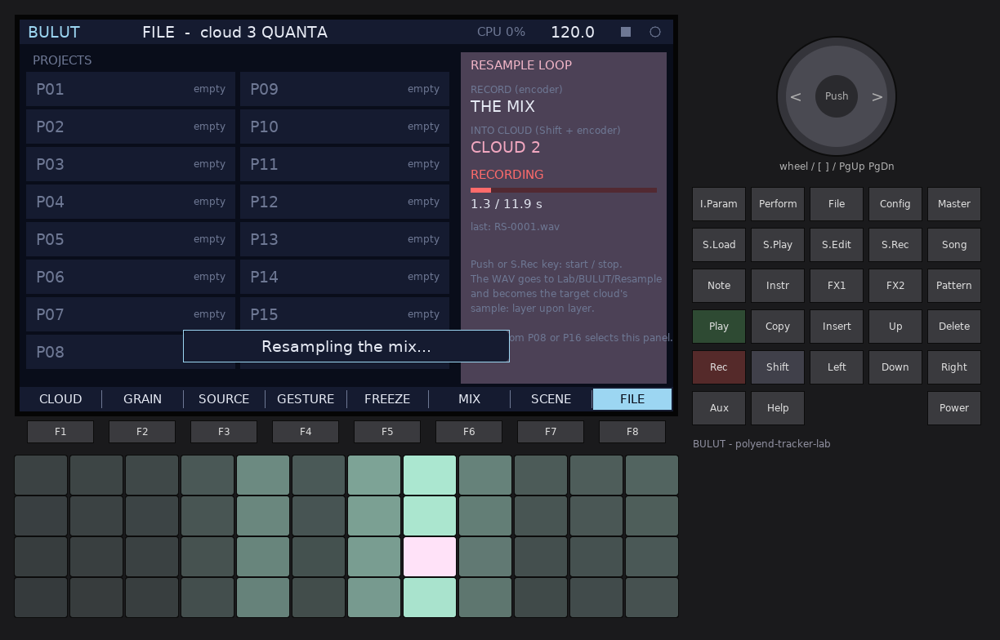

# BULUT

**A granular cloud workstation for the original Polyend Tracker.**
*Bulut* is Turkish for *cloud*.

BULUT has no notes and no pattern grid. Its tracks are six **clouds**: each one
listens to a source (the line input, the FM radio, BULUT's own output, or a
WAV from the card) and turns it into a cloud of grains. You play a cloud with
the 48 pads, and you sequence it by recording **gestures**: your pad presses
and knob turns, looped. You can freeze a moment into a sustained spectral loop
and keep a library of them, record the result back into a new cloud
(**resample loop**), and arrange everything with scenes and a timeline.



---

## Contents

1. [Quick start](#1-quick-start)
2. [Concepts](#2-concepts)
3. [The panel at a glance](#3-the-panel-at-a-glance)
4. [Pages](#4-pages)
   CLOUD, GRAIN, SOURCE, GESTURE, FREEZE, MIX, SCENE, FILE
5. [The two engines](#5-the-two-engines)
6. [Gestures](#6-gestures)
7. [Spectral freeze and the library of frozen moments](#7-spectral-freeze-and-the-library-of-frozen-moments)
8. [The resample loop](#8-the-resample-loop)
9. [Scenes and the timeline](#9-scenes-and-the-timeline)
10. [MIDI](#10-midi)
11. [Settings (Config)](#11-settings-config)
12. [Files on the card](#12-files-on-the-card)
13. [Limits](#13-limits)
14. [Tips](#14-tips)
15. [Control reference](#15-control-reference)

---

## 1. Quick start

1. Plug a source into **line in** (or choose the radio, see step 6) and power on.
   The intro plays for about three seconds (any key skips it).
2. You are on the **CLOUD** page with cloud 1 selected. Its source is the
   input: whatever comes in fills its buffer continuously.
3. **Hold a pad.** Grains appear on screen as particles and you hear them.
   - The 12 **columns** choose *where* in the buffer the grains come from:
     left = 8 seconds ago, right = right now.
   - The 4 **rows** choose *how dense* the cloud is: top row densest.
   - Hold several pads: up to four at once per cloud.
4. Turn the **encoder** to change the highlighted parameter (Left / Right
   picks another one). Try SIZE, PITCH and TEXTURE.
5. Press **Rec**, then play a few pads and turn the encoder: you are recording
   a **gesture**. Press **Rec** again: it loops on its own.
6. To use the radio: **Config** > *Input* = *Radio*, close Config, go to the
   **SOURCE** page (F3) and tune with the encoder on the RADIO row.
7. Press **FX1** to freeze the sound into a sustained loop. Press **FX1** again
   to unfreeze.
8. **F8** (FILE), then **Shift + F1** saves the project in slot P01.

---

## 2. Concepts

### Clouds

There are **6 clouds**. Each has:

- a **source** (INPUT, BULUT OUTPUT or a SAMPLE) feeding an 11.9-second buffer,
- an **engine**: GRANULAR (Clouds / Beads style) or QUANTA (microsound particles),
  with 16 parameters each,
- a **gesture** loop,
- a **freeze** (a spectral loop from the library) with its own level ("bed"),
- a **drone** switch: the cloud keeps emitting grains with nobody touching it,
- a mixer channel: level, pan, delay and reverb sends, tone, stem, mute.

One cloud is **selected** at a time (cloud number in the header). The pads, the
encoder, MIDI and gesture recording act on the selected cloud. Gestures of all
clouds play at the same time.

### Grains are particles

Every grain BULUT starts is drawn as a small puff of particles, at the column it
reads from and the row of the pad that started it. Bright particles come from
pads, MIDI notes and gestures; dimmer ones from a drone. The pad LEDs glow
where grains are being born.

### Sources

| Source | What fills the buffer |
|--------|-----------------------|
| **INPUT** | The Shell's input: line in, FM radio or mic, chosen in Config > *Input*. |
| **BULUT OUTPUT** | BULUT's own master mix: a feedback cloud that re-granulates everything you hear. |
| **SAMPLE** | A WAV from the card (any rate, mono or stereo; stereo plays its left channel; up to 11.9 s). |

Live buffers keep recording all the time. **HOLD BUFFER** (SOURCE page) stops
the recording and keeps the last 8 seconds still, like a captured moment.

---

## 3. The panel at a glance


| Control | Function |
|---------|----------|
| **F1..F8** | Pages: CLOUD, GRAIN, SOURCE, GESTURE, FREEZE, MIX, SCENE, FILE |
| **Shift + F1..F8** | The current page's actions (the bar under the screen shows them while Shift is held) |
| **Pads** | Play the selected cloud (position x density map) |
| **Shift + pads** | Select clouds, scenes, freezes, mutes (see below) |
| **Encoder** | Change the highlighted value; **Shift + encoder** = fine steps |
| **Push** (encoder) | The page's main action (reset a parameter, load, recall...) |
| **Arrows** | Move the highlight |
| **Rec** | Arm / stop gesture recording on the selected cloud |
| **FX1** | Freeze on / off for the selected cloud |
| **FX2** | Drone on / off for the selected cloud |
| **Instr** | Switch the selected cloud's engine (GRANULAR / QUANTA) |
| **Note** | Next cloud (**Shift + Note**: previous) |
| **S.Rec** | Resample loop: start / stop |
| **Insert** | Store the current scene (on the SCENE timeline: insert an entry) |
| **Delete** | Clear the gesture (CLOUD / GESTURE), the freeze slot (FREEZE), the scene or timeline entry (SCENE) |
| **Play** | Transport: gestures restart, the timeline runs in song mode |
| **Shift + Rec** | The Shell's recorder: master (and stems) to the card |
| **Config** | Settings, firmware update, about |

Module keys jump to pages too: **Perform** = CLOUD, **I.Param** / **S.Play** =
GRAIN, **S.Load** = SOURCE, **Pattern** = GESTURE, **S.Edit** = FREEZE,
**Master** = MIX, **Song** = SCENE (**Shift + Song** toggles song mode),
**File** = FILE.

### The pad map



**Without Shift**, the pads play the selected cloud:

- **Columns 1..12 = position.** Live sources: column 1 is 8 seconds ago,
  column 12 is now. Samples: start to end. Frozen clouds: across the loop.
  QUANTA synthetic particles: the column is a pitch step (see QUANTA).
- **Rows = density.** The row adds to the DENSITY (or RATE) parameter:
  top row +0.30, second +0.12, third -0.08, bottom -0.25.
- **Velocity** sets the grain level (Settings > *BULUT pad velocity*).
- Up to **4 pads** at once per cloud; a fifth replaces the first.

LEDs: the column brightness follows the buffer's loudness there; held pads are
white (red while recording a gesture), gesture "ghost" pads are pink, and
columns flash where grains are born.

**With Shift held**, the pads become a control surface:

| Row | Pads | Function |
|-----|------|----------|
| 1 | 1..6 | Select cloud 1..6 |
| 1 | 12 | Freeze on / off |
| 2 | 1..8 | Scene 1..8: empty = store, used = morph to it |
| 3 | 1..12 | Freeze slot 1..12: empty = capture, used = recall onto the selected cloud |
| 4 | 1..6 | Mute cloud 1..6 |

---

## 4. Pages

### CLOUD (F1)

The main performance page (screenshot above): the selected cloud's field with
its particles, the six cloud cards on the right and eight key parameters below.

- **Field:** the buffer overview with the pad grid over it. The thin vertical
  line is the POSITION parameter (used by the drone and MIDI notes). Held pads
  are framed white, gesture pads pink.
- **Cloud cards:** engine, source, running grains, output meter. Letters:
  **F** frozen, **D** drone, **G** gesture playing, **M** muted. The **G** flashes
  white each time that cloud's gesture loops.
- **Strip:** GRANULAR shows Position, Size, Density, Pitch, Spread, Texture,
  Feedback, Reverb; QUANTA shows Type, Rate, Duration, Freq, Band, Law, Char,
  Reverb.

| Control | Function |
|---------|----------|
| Left / Right | Select a parameter of the strip |
| Up / Down | Select the previous / next cloud |
| Encoder | Change it (Shift: fine) |
| Push | Reset it to its default |
| Shift+F1 ENGINE | Switch GRANULAR / QUANTA |
| Shift+F2 DRONE | The cloud breathes on its own (uses POSITION and DENSITY) |
| Shift+F3 FREEZE | Freeze on / off |
| Shift+F4 GEST REC | Arm / stop a gesture |
| Shift+F5 MUTE | Mute the cloud |
| Shift+F6 SOLO | Solo the cloud (again: unsolo) |
| Shift+F7 RESET | All parameters of the current engine to default |
| Shift+F8 RANDOM | Random sound parameters (level and sends are kept) |

### GRAIN (F2)

All 16 parameters of the selected cloud's engine, and a picture of its grain:
the window shape for GRANULAR, the particle waveform for QUANTA.




| Control | Function |
|---------|----------|
| Arrows | Move in the 4 x 4 grid |
| Encoder | Change (Shift: fine) |
| Push | Reset to default |
| Shift+F1..F8 | Same actions as CLOUD |

The parameters are explained in [The two engines](#5-the-two-engines).

### SOURCE (F3)



| Row | Encoder / Left-Right |
|-----|----------------------|
| SOURCE | INPUT, BULUT OUTPUT, SAMPLE |
| INPUT LEVEL | 0..200 % into the live buffer |
| HOLD BUFFER | ON stops recording: the buffer keeps its last 8 seconds |
| RADIO | Tune 87.5..108.0 MHz in 0.1 MHz steps |
| SAMPLES | The WAV browser (right half) |

The radio plays only when Config > *Input* is *Radio* (the page reminds you).
The browser starts in `/Samples` (or the card's root if that folder does not
exist) and shows folders and `.wav` files. On the SAMPLES row: Up / Down or the
encoder select, **Right** or **Push** opens a folder or loads the file into the
selected cloud, **Left** goes up a folder.

| Shift + | Action |
|---------|--------|
| F1 INPUT / F2 OUTPUT / F3 SAMPLE | Choose the source |
| F4 HOLD | Hold the buffer |
| F5 SEEK - / F6 SEEK + | Radio seek down / up |
| F7 CLEAR | Clear the buffer |
| F8 LOAD | Load the highlighted file |

### GESTURE (F4)


One lane per cloud: pad presses as ticks (height = pad row), parameter moves as
dots, the playhead as a bar. Below, the selected cloud's options:

| Option | Values |
|--------|--------|
| PLAY | ON / OFF (the loop keeps its place) |
| SPEED | 1/4 x, 1/2 x, 1 x, 2 x, 4 x |
| LENGTH | FREE, BEAT, BAR: how the next recording's length is rounded (at the current tempo) |
| REC MODE | NEW (replace) or OVERDUB (add to the loop) |

Up / Down select the cloud, Left / Right the option, the encoder changes it,
**Push** = Rec, **Delete** clears the gesture.

| Shift + | Action |
|---------|--------|
| F1 REC/STOP | Same as Rec |
| F2 NEW/ODUB | Switch the record mode |
| F3 CLEAR | Clear this cloud's gesture |
| F4 PLAY | Play on / off |
| F5 SLOWER / F6 FASTER | Speed |
| F7 ALL ON / F8 ALL OFF | Play every gesture / none |

See [Gestures](#6-gestures).

### FREEZE (F5)


Top left: the spectrum of the highlighted library slot. Top right: the selected
cloud's freeze state, its **bed level** (encoder) and where captures come from.
Below: the 16 slots of the **library of frozen moments**. A dot marks the slot
the selected cloud is playing.

| Control | Function |
|---------|----------|
| Arrows | Select a slot |
| Encoder | Bed level of the selected cloud (Shift: fine) |
| Push | Empty slot: capture; used slot: recall onto the selected cloud |
| Delete | Delete the slot |
| Shift+F1 CAPTURE | Capture a moment into the slot (overwrites) |
| Shift+F2 RECALL | Load the slot into the selected cloud and freeze it |
| Shift+F3 FREEZE | Freeze on / off |
| Shift+F4 DELETE | Delete the slot |
| Shift+F5 FROM | Capture from the CLOUD SOURCE or THE MIX |
| Shift+F6 UNFREEZE | Freeze off |

See [Spectral freeze](#7-spectral-freeze-and-the-library-of-frozen-moments).

### MIX (F6)



Six cloud channels and the FX column. Left / Right pick a column (and select
that cloud), Up / Down a row, the encoder changes it (Shift: fine), **Push**
mutes the cloud.

| Row (clouds) | |
|--------------|---|
| LEVEL | Channel level (also the LEVEL parameter) |
| PAN | Left .. right |
| DELAY | Send to the tempo delay |
| REVERB | Send to the reverb |
| TONE | Below centre: low-pass (darker); above: high-pass (thinner); centre: flat |
| STEM | Which of the 4 recorder stems the cloud goes to |
| MUTE | On / off |

| Row (FX) | |
|----------|---|
| DLY TIME | 1/32, 1/16T, 1/16, 1/8T, 1/8, 1/8., 1/4, 1/4., 1/2 (follows the tempo) |
| DLY FB | Delay feedback |
| DLY TONE | Delay loop filter (darker .. brighter) |
| DLY RET | Delay level; the echoes also feed the reverb |
| REV SIZE | Reverb time |
| REV DAMP | Reverb damping |
| REV RET | Reverb level |

Shift+F1 MUTE, Shift+F2 SOLO (adds the cloud to the solo set), Shift+F3 UNSOLO.

The delay is OpenTracker's ping-pong delay; the reverb is OpenTracker's
Clouds-topology reverb. A gentle soft knee on the master keeps dense clouds
from clipping (the Shell's limiter follows).

### SCENE (F7)



Eight **scenes** at the top: each holds the complete state of all six clouds
(both engines' parameters, pan, freeze, drone, mute, stem, gesture play) and all
six gestures. Sources and samples are not part of a scene; frozen clouds get
their library slot back.

The **timeline** below is a list of entries *scene x bars* (up to 32).

| Control | Function |
|---------|----------|
| Up / Down | Focus the scenes / the timeline |
| Left / Right | Select a scene / an entry |
| Push | Scenes: store into an empty one, morph to a used one. Timeline: morph to the entry's scene |
| Encoder | Scenes: select. Timeline: the entry's bars (1..64); Shift + encoder: its scene |
| Insert | Scenes: store. Timeline: insert an entry after the cursor |
| Delete | Delete the scene / the entry |
| Shift+F1 STORE / F2 MORPH TO / F3 DELETE | Scene actions |
| Shift+F4 APPEND / F5 REMOVE | Timeline entries |
| Shift+F6 SONG | Song mode on / off |
| Shift+F7 CUT TO | Recall the scene at once (no morph) |

See [Scenes and the timeline](#9-scenes-and-the-timeline).

### FILE (F8)



16 project slots (P01..P16) and the **resample loop** panel. Arrows select a
slot (Left / Right jump between the two columns); Down past P08 or P16 reaches
the resample panel.

| Control | Function |
|---------|----------|
| Push | Project slot: load a saved one, save into an empty one. Resample panel: start / stop |
| Encoder | Project slot: select. Resample panel: what to record (THE MIX or CLOUD 1..6) |
| Shift + encoder | Resample panel: the target cloud |
| Shift+F1 SAVE | Save into the selected slot (overwrites) |
| Shift+F2 LOAD | Load the selected slot |
| Shift+F3 NEW | A fresh project (all clouds back to INPUT, defaults) |
| Shift+F4 RESAMPLE | Start / stop the resample loop |

---

## 5. The two engines

Every cloud has both parameter sets; **Instr** (or Shift+F1 on CLOUD / GRAIN)
switches which engine plays. Level, sends, tone and scale are shared.

### GRANULAR (Clouds / Beads style)

Overlapping windowed grains read from the buffer, pitch-shifted by
resampling.

| Parameter | Range | What it does |
|-----------|-------|--------------|
| POSITION | 0..100 | Where the drone and MIDI notes read (pads choose their own column) |
| SIZE | 10 ms .. 1 s | Grain length |
| DENSITY | 0.5 .. 120 grains/s | Grain rate per emitter (pad rows add to it) |
| PITCH | -24 .. +24 semitones | Transposition |
| SPREAD | 0..100 | Stereo scatter of the grains |
| TEXTURE | 0..15 | Grain window: 0-4 flat-topped (hard, "tape" grains), 5 Hann, 6-15 ever softer bells (cloudy) |
| FEEDBACK | 0..100 | The cloud's own output back into its live buffer (live sources) |
| REVERB | 0..100 % | Reverb send |
| ENGINE | GRANULAR / QUANTA | |
| JITTER | 0..100 | Random scatter of the read position around the pad column |
| P.RAND | 0..100 | Random pitch per grain (up to +-2 octaves), snapped to SCALE |
| REVERSE | 0..100 | Chance that a grain plays backwards |
| LEVEL | 0..100 % | Channel level |
| DELAY | 0..100 % | Delay send |
| SCALE | FREE, OCTAVE, FIFTH, MAJOR, MINOR, PENTA | Pitch grid for P.RAND (and QUANTA) |
| TONE | dark .. flat .. bright | Channel filter |

Grain levels are normalised by the expected overlap, so a dense cloud is as loud
as a sparse one.

### QUANTA (microsound particles)

Very short particles in swarms, after Curtis Roads' *Microsound*: their onsets
follow a stochastic **law** (after Xenakis), their pitch scatters inside a
**band**. Four particle types are synthesised; SAMPLE takes microscopic grains
from the buffer.

| Parameter | Range | What it does |
|-----------|-------|--------------|
| TYPE | SAMPLE, GLISSON, GABOR, PULSAR, TRAINLET | Particle type (below) |
| RATE | 1 .. 1500 particles/s | Mean particle rate per emitter (pad rows add to it) |
| DURATION | 0.5 .. 60 ms | Particle length (+-30 % random) |
| FREQ | 30 Hz .. 8 kHz | Base frequency |
| BAND | 0 .. 3 octaves | Gaussian pitch scatter around the frequency (SAMPLE: position scatter too) |
| LAW | SYNC, POISSON, GAUSS, CAUCHY, LOGISTIC | Inter-onset distribution |
| CHAR | 0..100 | Type-specific character (below) |
| REVERB | 0..100 % | Reverb send |
| ENGINE | | |
| POSITION | 0..100 | Read position for SAMPLE particles from the drone / MIDI |
| DRIFT | 0..100 | Slow random walk of the base frequency |
| SPREAD | 0..100 | Stereo scatter |
| LEVEL, DELAY, SCALE, TONE | | Shared with GRANULAR |

| Type | Particle | CHAR |
|------|----------|------|
| SAMPLE | A gaussian micro-grain of the buffer | Pitch -24 .. +24 semitones |
| GLISSON | A sine that glides during its life | Glide -3 .. +3 octaves (50 = none) |
| GABOR | A sine under a gaussian bell | Bell width: low = clicky, high = tonal |
| PULSAR | A train of pulsarets (one formant cycle, then silence) at FREQ | Formant / fundamental ratio 1..8 |
| TRAINLET | A band-limited impulse train at FREQ with its own decay | Number of harmonics 1..16 |

| Law | Onsets |
|-----|--------|
| SYNC | Exactly periodic (pitched buzz at high rates) |
| POISSON | Exponential intervals: natural, rain-like |
| GAUSS | Normal around the mean: loose pulse |
| CAUCHY | Heavy-tailed: clusters and long gaps |
| LOGISTIC | Logistic map at r = 3.91: deterministic chaos |

**Pads in QUANTA:** for the synthetic types the 12 columns are **pitch steps**
over FREQ: semitones 0..11 in FREE, or degrees of the chosen SCALE (MAJOR,
MINOR and PENTA continue into the next octave; OCTAVE gives three columns per
octave from -1 to +2 octaves; FIFTH alternates root and fifth upwards from one
octave below). The rows still add to the rate. For SAMPLE, columns are positions.

---

## 6. Gestures

A gesture is a loop of **movements** on one cloud: pad presses and releases
(with velocity), encoder moves of its parameters (any page), and MIDI CCs.

1. Select the cloud and press **Rec**. The header shows **ARMED**.
2. Nothing is recorded until you **move**: the first pad or encoder move starts
   the recording (header: **GESTURE n  x.x s**).
3. Press **Rec** again to close the loop. Its length is the time from the first
   move to the second Rec, rounded to beats or bars if LENGTH says so (at least
   0.1 s). Pads still held are released at the end of the loop.
4. It loops at once. Recording a NEW gesture stops the old one while you record.

**OVERDUB** (REC MODE, or Shift+F2 on GESTURE): your moves are added to the
playing loop at the loop position where they happen; the length stays.

Playback: the loop's pads become "ghost" emitters (pink on the pads and in the
field), its parameter moves change the cloud's parameters. Up to 4 ghost pads
per cloud at once. SPEED plays the loop at 1/4 .. 4 x. **Play** restarts every
gesture from its beginning. Switching to another cloud while recording closes
the recording.

Gestures are saved with projects and scenes. A gesture holds up to 1,016 moves;
parameter moves of the same parameter closer than 10 ms are merged.

---

## 7. Spectral freeze and the library of frozen moments

**Freezing** captures about 0.23 seconds of sound as an averaged spectrum
(4096-point FFT, 4 frames) and resynthesises it as a seamless **1.49-second
loop** with fresh random phases: a sustained, glassy version of that moment,
with no clicks and no movement. While a cloud is frozen:

- its **grains read the loop** instead of the buffer (pads and drone still
  sculpt it: position, size, pitch, texture all act),
- the loop also plays directly as a **bed** (two taps half a loop apart, one
  per side) at the **bed level** (FREEZE page encoder; 0 = grains only).

**FX1** freezes the selected cloud: the first time, it captures the moment from
the cloud's source into the first free library slot. The **library** holds 16
moments; capture from the cloud's source or from **the mix** (Shift+F5 FROM),
recall any of them onto any cloud, store them in projects. Scenes remember
which slot a frozen cloud plays. A captured moment is normalised, so any
moment, even a quiet one, plays at a usable level.

Capturing from a sample uses the part around the cloud's POSITION; from a live
buffer, the newest 0.23 s; from the mix, the last 0.23 s of the master.

---

## 8. The resample loop

Record a cloud or the whole mix to a WAV and make it a cloud's sample, then do
it again: layers transform layer by layer.

1. FILE page, go Down to the resample panel.
2. Encoder: what to record, **THE MIX** or **CLOUD n** (after its fader and tone).
   Shift + encoder: the **target cloud**.
3. **Push** (or the **S.Rec** key from any page) starts, again stops. Recording
   also stops by itself after 11.9 seconds.
4. The WAV is written to `Lab/BULUT/Resample/RS-nnnn.wav` (mono, 16-bit,
   44.1 kHz) and loaded into the target cloud as its SAMPLE source.

Without a card the recording still goes straight into the target cloud (it is
not saved, and a project cannot find it later).

Resampling the cloud you are recording into is allowed: the new sample replaces
the old one when the recording ends.

---

## 9. Scenes and the timeline

**Store** a scene (Insert, Shift + pad row 2, or the SCENE page), then **morph**
to it later: continuous parameters glide over the morph time (Settings > *BULUT
scene morph*: cut, 0.5, 1, 2, 4 or 8 s, smoothstep curve); switches (engine,
freeze, drone, mute, gesture play) and the gestures change at once.

The **timeline** turns scenes into a piece: entries of *scene x bars*. In **song
mode** (Shift+F6 on SCENE, or Shift + Song) **Play** runs the timeline from the
start, recalling each entry's scene with a morph as its bar arrives, and loops at
the end. The white line shows the song position.

---

## 10. MIDI

MIDI in (DIN and USB, channel set in Config > *MIDI in channel*):

| Message | Action |
|---------|--------|
| Note on / off | An emitter on the cloud (Settings > *BULUT MIDI notes play*: the selected cloud or cloud 1..6), pitched relative to C4 (note 60 = no shift), reading at POSITION |
| CC 1 (mod wheel) | POSITION (GRANULAR) / POSITION (QUANTA) |
| CC 20..35 | Parameter slots 1..16 of the current engine (order as on the GRAIN page) |
| CC 123 | All emitters off |

CC moves are recorded into gestures like encoder moves. Up to 4 notes per cloud
(shared with the pads). Clock in / out and transport: Config > *Clock*.

---

## 11. Settings (Config)

The Shell's rows (brightness, intro, tempo, clock, MIDI channels, **Input**,
input gain and monitor, **Radio**, master level and limiter, **Record stems**)
come first, then BULUT's own:

| Row | Values | Default |
|-----|--------|---------|
| BULUT grain budget | 8 .. 26 grains | 22 |
| BULUT grains per cloud | 2 .. 14 grains | 10 |
| BULUT pad velocity | On / Off (Off: every pad and note at 100) | On |
| BULUT MIDI notes play | Selected, 1 .. 6 | Selected |
| BULUT scene morph | Cut, 0.5 s, 1 s, 2 s, 4 s, 8 s | 1 s |
| BULUT pad LEDs | Low, Medium, High | High |
| BULUT restore last session | On / Off | On |

Config > **Save** (F6) saves the settings and the session. **Record stems**:
each cloud goes to the stem chosen on the MIX page; Shift + Rec then writes the
master and four stems.

---

## 12. Files on the card

```
/Samples/                        your WAVs (the browser starts here)
/Lab/BULUT/
  autosave.blt                   the last session (power off, Config > Save, every 5 minutes)
  bulut.cfg                      BULUT's settings rows
  settings.bin                   the Shell's settings
  Projects/P01.blt .. P16.blt    projects
  Resample/RS-0001.wav ...       resample loop recordings
  Rec/REC-0001.wav ...           Shift + Rec recordings (and -stem1..4)
/Firmware/                       .ptf images for Config > Firmware
```

A project (`.blt`, versioned chunk format "BLUT" v1) holds: all clouds' states
and **sources by path**, the six gestures, the FX settings, the tempo and song
mode, the 8 scenes (with their gestures), the timeline and the freeze library.
It does **not** contain the sample audio: keep the WAVs (including
`Resample/`) where they were. A missing sample shows a message and leaves that
cloud silent until you load another. Live buffers start empty after loading.
A project from a newer BULUT version is refused rather than misread.

---

## 13. Limits

| What | Limit |
|------|-------|
| Clouds | 6 |
| Grains playing at once | 26 (Settings: 8..26), up to 14 per cloud |
| New grains per audio block (2.9 ms) | 8, shared fairly between clouds |
| Emitters per cloud | 4 pads / notes + 4 gesture ghosts + the drone |
| Buffer per cloud | 11.9 s (live: the pads span the newest 8 s) |
| Sample length | 11.9 s (longer files are cut), any rate, stereo plays the left channel |
| Freeze loop | 1.49 s, 16 library slots |
| Gesture | 1,016 moves, any length |
| Scenes / timeline | 8 / 32 entries of 1..64 bars |
| Projects | 16 slots |
| Resample | 11.9 s mono |

When a budget is full, new grains are skipped (the sound thins rather than
glitches). High DENSITY / RATE with long grains on all six clouds will reach the
budget: that is the CPU guard working.

---

## 14. Tips

- **Radio clouds:** tune between stations for noise clouds, onto a station for
  voices. HOLD BUFFER catches a phrase; freeze it for a pad.
- **Feedback cloud:** set cloud 2 to BULUT OUTPUT with a long SIZE and some
  reverb send: it smears everything the others play.
- **FEEDBACK** above ~60 on a live cloud makes self-sustaining textures; the
  TONE filter tames them.
- **Glissons** with BAND 0 and RATE ~30 make bird-like chirps; **pulsars** at
  SYNC with a low FREQ are rhythmic.
- **CAUCHY** law with long DURATION gives bursts and silences, **LOGISTIC**
  repeating-but-not-quite patterns.
- Record a gesture at **1/4 x** speed and play it back at **4 x** for rapid
  scatter, or the other way round for slow drifts.
- **Resample loop:** record the mix into a cloud, freeze a moment of it, record
  again: a few passes turn any source into a slowly evolving drone.
- Use the four **stems** (MIX page STEM row + Config > Record stems) to record
  the clouds separately for a DAW.

---

## 15. Control reference

| Context | Control | Function |
|---------|---------|----------|
| anywhere | F1..F8 | Pages |
| anywhere | Shift + F1..F8 | Page actions |
| anywhere | Pads | Play the selected cloud |
| anywhere | Shift + pads | Row 1 clouds / freeze, row 2 scenes, row 3 freeze slots, row 4 mutes |
| anywhere | Rec | Gesture arm / stop |
| anywhere | Shift + Rec | Master / stem recorder |
| anywhere | FX1 / FX2 | Freeze / drone |
| anywhere | Instr | Engine switch |
| anywhere | Note / Shift + Note | Next / previous cloud |
| anywhere | S.Rec | Resample start / stop |
| anywhere | Insert | Store a scene |
| anywhere | Play | Transport (song mode runs the timeline) |
| anywhere | Shift + Song | Song mode on / off |
| anywhere | Config | Settings |
| CLOUD | Arrows / encoder / Push | Parameter / cloud / change / reset |
| GRAIN | Arrows / encoder / Push | 4 x 4 grid / change / reset |
| SOURCE | Arrows / encoder / Push | Rows and browser / change / load |
| GESTURE | Up-Down / Left-Right / encoder / Push / Delete | Cloud / option / change / Rec / clear |
| FREEZE | Arrows / encoder / Push / Delete | Slot / bed level / capture or recall / delete |
| MIX | Arrows / encoder / Push | Cell / change / mute |
| SCENE | Up-Down / Left-Right / encoder / Push / Insert / Delete | Focus / select / bars or scene / store or morph / add / remove |
| FILE | Arrows / encoder / Push | Slot or resample panel / select / load-save or start-stop |

---

*BULUT is a polyend-tracker-lab firmware on the clean-room OpenTracker base. Not
affiliated with Polyend. To go back to another firmware: Config > Firmware.*
