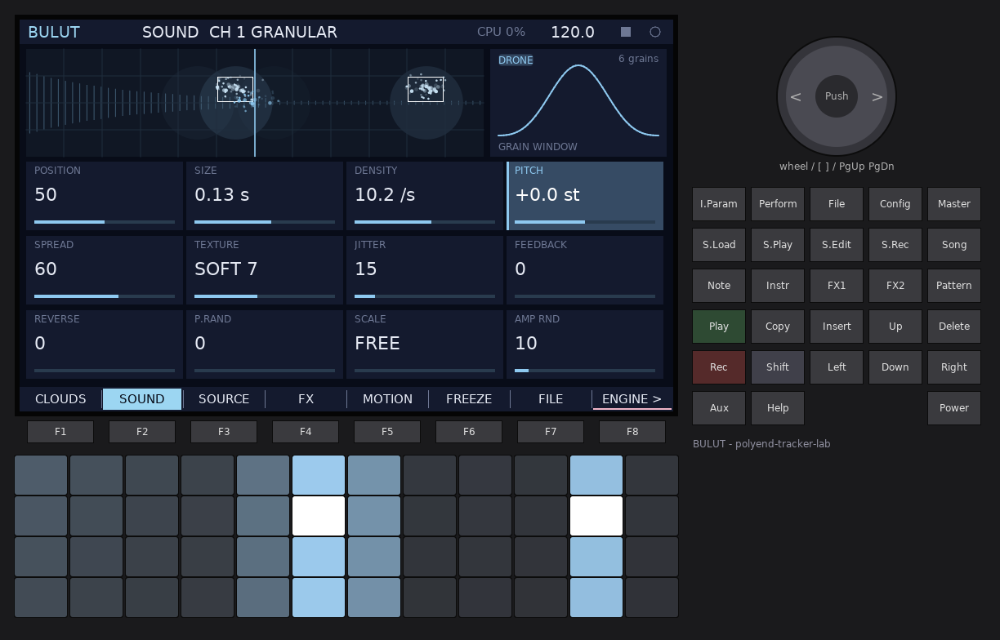
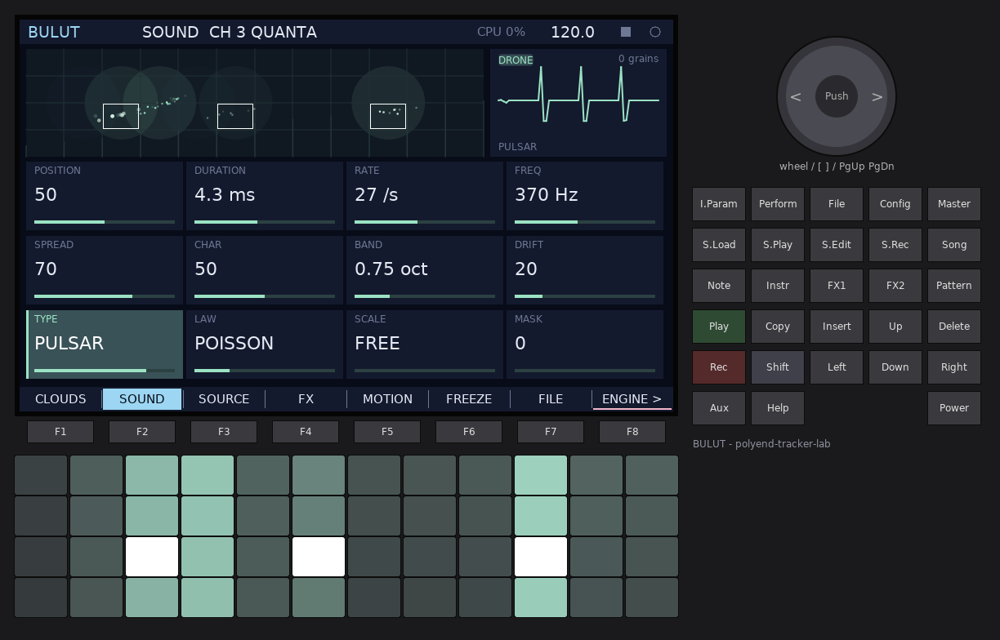
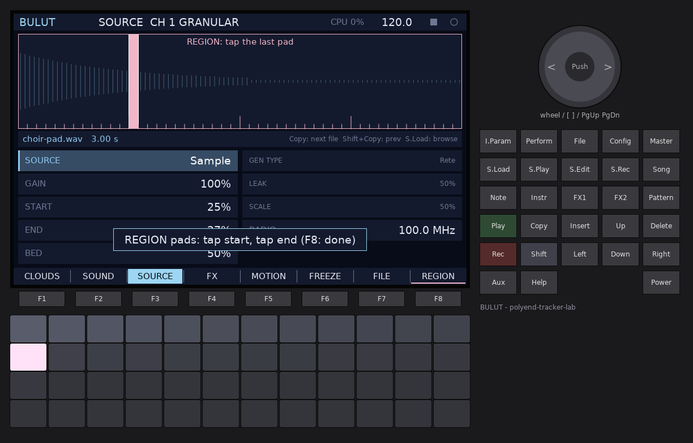
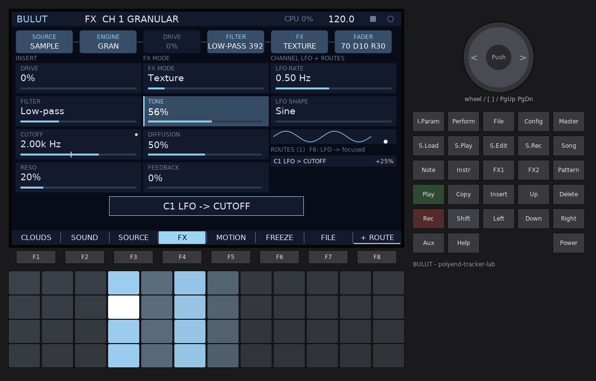
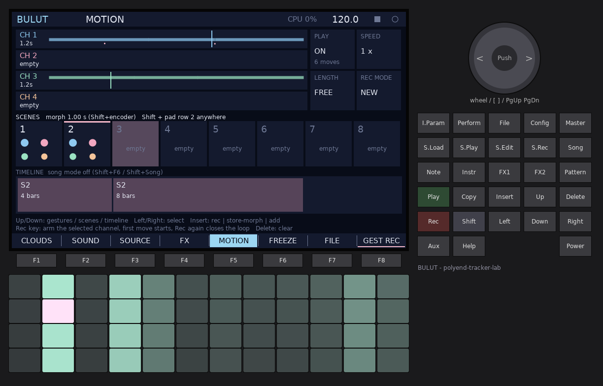
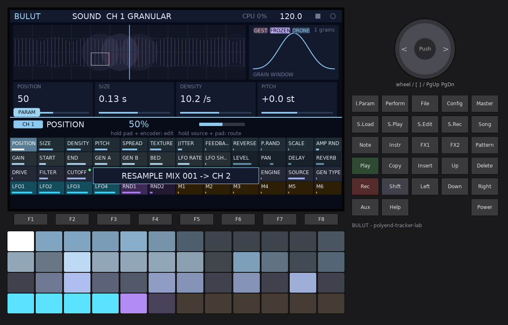
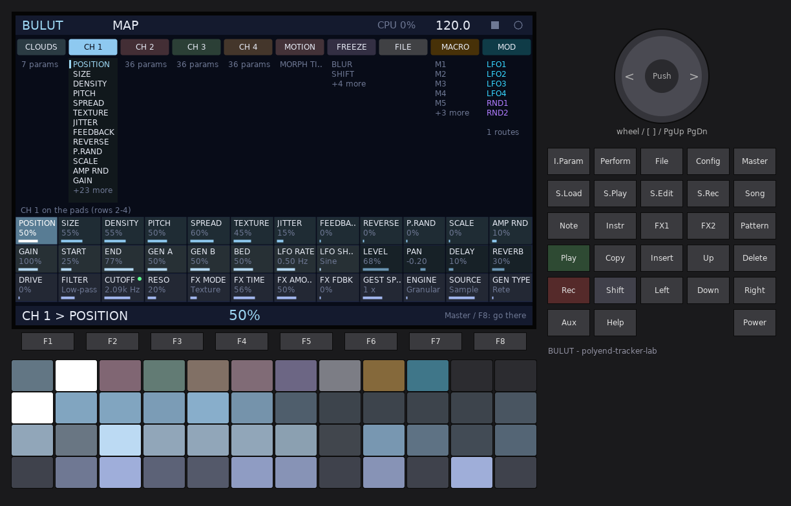

# BULUT

**A granular cloud workstation for the original Polyend Tracker.**
*Bulut* is Turkish for *cloud*.

BULUT has no notes and no pattern grid. It has **four deep channels**. Each one
takes a **source** (the line input or FM radio, BULUT's own output, a WAV from
the card, or a built-in generator), turns it into a cloud of grains with one of
four **engines** (GRANULAR, QUANTA, BEADS, TAPE), and runs it through its own
**insert chain** (drive, filter, an FX mode) with its own LFO. You play a
channel with the 48 pads and sequence it by recording **gestures** (your pad
presses and knob moves, looped). You can freeze a moment into a sustained
spectral loop, keep a library of them, record the result back into a channel
(**resample**), and arrange everything with **scenes** and a **timeline**.

BULUT runs on the polyend-tracker-lab Shell with **LABKIT v2**: every one of its
158 parameters is on the PARAM pads, the MAP, the macros, the modulation
routes and MIDI learn.


---

## Contents

1. [Quick start](#1-quick-start)
2. [Concepts](#2-concepts)
3. [The panel at a glance](#3-the-panel-at-a-glance)
4. [Pages](#4-pages): CLOUDS, SOUND, SOURCE, FX, MOTION, FREEZE, FILE
5. [The LABKIT views](#5-the-labkit-views): PARAM pads, MAP, MACRO, MOD, HELP
6. [The four engines](#6-the-four-engines)
7. [Sources, samples and generators](#7-sources-samples-and-generators)
8. [The insert chain, sends and modulation](#8-the-insert-chain-sends-and-modulation)
9. [Gestures](#9-gestures)
10. [Spectral freeze](#10-spectral-freeze)
11. [Resample](#11-resample)
12. [Scenes and the timeline](#12-scenes-and-the-timeline)
13. [MIDI](#13-midi)
14. [Settings (Config)](#14-settings-config)
15. [Files on the card](#15-files-on-the-card)
16. [Limits and the CPU guard](#16-limits-and-the-cpu-guard)
17. [Tips](#17-tips)
18. [Control reference](#18-control-reference)

---

## 1. Quick start

1. Power on. The intro plays for about three seconds (any key skips it). You
   land on **CLOUDS**: the four channels, one lane each.
   - **CH1** GRANULAR on the live input, **CH2** BEADS on BULUT's own output,
     **CH3** QUANTA on the live input, **CH4** TAPE on the RETE generator.
2. **Hold a pad.** It plays the selected channel (CH1). Grains appear as
   particles in its lane.
   - The 12 **columns** choose *where* in the source the grains come from
     (left to right across the *region*).
   - The 4 **rows** choose *how dense*: the top row is densest.
3. **CH4 sounds without any input**: select it with **Shift + pad 4** (top row)
   and hold a pad.
4. **Load a sample**: press **S.Load**. The LABKIT browser opens on
   `/Samples`, previews each WAV as you move (Up / Down, encoder) and shows its
   waveform; **Insert** (or Right / F8) loads it into the selected channel.
   **Copy** then steps to the next WAV in the same folder while you play
   (**Shift + Copy**: the previous one).
5. Press **Instr** to step the selected channel through the engines, **FX1** to
   freeze it, **FX2** to let it breathe on its own (drone).
6. Press **Rec**, play a few pads and turn the encoder, press **Rec** again:
   the gesture loops by itself.
7. **Shift + pad 13** (second row, first pad) stores scene 1; change things;
   **Shift + pad 13** again morphs back to it.
8. **F7** (FILE), **F8** saves the project in slot P01.

> The original Tracker has no encoder push, Aux or Help key. Wherever another
> firmware would "push", BULUT uses **Insert**; HELP is **Shift + Config**.

---

## 2. Concepts

### Channels

Four channels, each a complete instrument:

```
 SOURCE  ->  buffer (11.9 s)  ->  ENGINE (grains)  ->  DRIVE -> FILTER -> FX MODE  ->  fader / pan
 input / output /                 GRANULAR, QUANTA,                                     DLY send -> delay
 sample / generator               BEADS, TAPE                                          REV send -> reverb
```

Every channel has 36 parameters (one LABKIT page each): the engine's 12
**knobs**, the source and its **region**, the generator, the freeze **bed**,
an **LFO**, the mixer, the insert chain and the gesture speed. Each engine
keeps its own 12 knob settings: switching GRANULAR -> TAPE -> GRANULAR gives
you your GRANULAR settings back.

### The region

Every channel reads its source through a **region** (START .. END). The 12 pad
columns and the POSITION knob span the region, not the whole source: narrow it
to play a single word of a sample across 12 pads. Set it with two pad taps in
REGION mode (SOURCE page, **F8**) or with the START / END rows.

### Grains are particles

Every grain is drawn as a particle when it is born: where it reads from (left
to right), its pitch (up and down) and its length (how long it glows). Soft
halos mark where grains are being born right now; white frames show the pads
you hold, pink frames the gesture's ghost pads.

### What is happening, at a glance

Each lane (CLOUDS page) and the SOUND page carry badges: **REC / ARMED**
(gesture recording), **GEST** (a gesture loops, flashes at the loop start),
**FROZEN**, **DRONE**, **HOLD** (the live buffer is held), **MUTE**, **SOLO**
and **CPU** (the CPU guard bypassed this channel's FX or held its generator,
see [16](#16-limits-and-the-cpu-guard)). The header shows a red pill while a
gesture or a resample is recording.


---

## 3. The panel at a glance

| Key | Function |
|-----|----------|
| **F1 .. F7** | Pages: CLOUDS, SOUND, SOURCE, FX, MOTION, FREEZE, FILE |
| **F8** | The page's main action (its label is underlined in pink) |
| **Shift + F1 .. F8** | The page's other actions (the bar shows them while Shift is held) |
| **Pads** | Play the selected channel (velocity on) |
| **Shift + pads** | The pad map below (also lit on the LEDs) |
| **Encoder** | Change the focused value; with **Shift**: fine (or the page's second value) |
| **Arrows** | Move the focus on the page |
| **Insert** | Confirm / use: recall, load, store, add (replaces the encoder push) |
| **Delete** | Back to the default (Shift + Delete: also remove its modulation routes) |
| **Rec** | Gesture: arm / close the loop (Shift + Rec: the Shell's recorder) |
| **FX1** | Freeze on / off for the selected channel |
| **FX2** | Drone on / off |
| **Instr** / Shift + Instr | Next / previous engine |
| **Note** / Shift + Note | Next / previous channel |
| **Copy** / Shift + Copy | Next / previous WAV in the sample's folder |
| **S.Load** | The sample browser for the selected channel |
| **S.Rec** | Resample start / stop (any page) |
| **Perform / S.Play / S.Edit / Pattern / File** | CLOUDS / SOUND / SOURCE / MOTION / FILE |
| **Song** / Shift + Song | MOTION with the scenes focused / song mode on-off |
| **Play** | Transport (in song mode it runs the timeline) |
| **I.Param** / Shift + I.Param | LABKIT PARAM pads / MACRO |
| **Master** / Shift + Master | LABKIT MAP / MOD |
| **Config** / Shift + Config | Settings / HELP |

### The pad map (Shift + pads)

```
            columns 1-4          columns 5-8            columns 9-12
 row 1      select CH1-4         mute CH1-4             solo CH1-4
 row 2      scenes 1-8 (empty = store, lit = morph)     gesture REC CH1-4
 row 3      freeze library slots 1-12 (empty = capture from the selected channel, lit = recall)
 row 4      freeze CH1-4         drone CH1-4            gesture play CH1-4
```


---

## 4. Pages

### CLOUDS (F1)

The four channels as lanes: the region's waveform with the grains as
particles on the left; on the right the engine, the source (file name, LIVE
INPUT, BULUT OUTPUT or GEN ...), the badges and a mini mixer (LEVEL, PAN, DLY
and REV sends). The bottom row holds the **send FX** (delay time / feedback /
tone / return, reverb size / damping / return), the master meter and the grain
count against the current limit.

- **Up / Down**: channel (the row below CH4 is the send FX row). **Left /
  Right**: column. **Encoder**: value. **Delete**: default.
- **F8**: gesture REC on the selected channel.
- **Shift + F1..F8**: MUTE, SOLO, FREEZE, DRONE, HOLD (live buffer), STEM
  (1..4, for the Shell's stem recorder), GEST ON (gesture play), STORE SC.
- **Insert**: store the scene being played (or the first empty one).

### SOUND (F2)

The selected channel's engine: a large grain field (the region, pad grid,
particles), a picture of the engine (the grain window, the particle waveform,
the Beads envelope, the tape playhead) and its 12 knobs in three rows of four.
A pink dot on a knob means a modulation route lands on it; a pink tick on its
bar shows where the modulation takes it.

- **Arrows**: knob. **Encoder**: value (stepped knobs step).
- **F8**: next engine. **Shift + F1..F4**: GRANULAR, QUANTA, BEADS, TAPE.
  **Shift + F5**: reset the knobs, **Shift + F6**: randomise them, **Shift + F7**:
  drone, **Shift + F8**: freeze.





### SOURCE (F3)

The whole source as a big waveform: the region is the bright band between the
two white lines, live grains show as points inside it. Below: the file name and
length, then the rows

| Left column | Right column |
|-------------|--------------|
| SOURCE (INPUT, OUTPUT, SAMPLE, GEN) | GEN TYPE (RETE, TONE, NOISE) |
| GAIN (what goes into the buffer, 0..200 %) | GEN A (RETE: LEAK, TONE: PITCH, NOISE: COLOUR) |
| START, END (the region) | GEN B (RETE: SCALE, TONE: SHAPE, NOISE: DENSITY) |
| BED (the freeze bed level) | RADIO (tuning, 87.5 .. 108 MHz) |

- **Up / Down**: row. **Encoder** (or Left / Right): value.
- **Insert**: the sample browser. **Copy / Shift + Copy**: next / previous file.
- **F8**: **REGION pads**. The 48 pads become the whole source in 48 steps
  (the LEDs show its loudness and the current region): tap the first pad, then
  the last (either order). F8 again: the pads play again.
- **Shift + F1..F4**: source INPUT / OUTPUT / SAMPLE / GEN. **Shift + F5**:
  browse, **Shift + F6 / F7**: previous / next file, **Shift + F8**: HOLD (stop
  writing the live buffer).




### FX (F4)

The chain as boxes (SOURCE -> ENGINE -> DRIVE -> FILTER -> FX -> FADER with its
sends), then three columns: the insert (DRIVE, FILTER, CUTOFF, RESO), the FX
mode and its three knobs (named for the mode, see [8](#8-the-insert-chain-sends-and-modulation)),
and the channel LFO (RATE, SHAPE, drawn with its current value) with the list
of the routes that land on this channel.

- **Up / Down**: down a column, then into the routes list. **Left / Right**:
  jump columns. **Encoder**: value; on a route: its depth (Shift: fine).
- **F8 / Insert**: add a route: the channel LFO -> the focused parameter, 25 %.
- **Delete**: on a route, remove it. **Shift + F1**: FX off, **Shift + F2**:
  next FX mode, **Shift + F3**: next filter mode, **Shift + F4**: drive on / off,
  **Shift + F8**: remove the first route on the focused parameter.



### MOTION (F5)

Three rows: the four channels' **gestures** (pad presses as bars, parameter
moves as dots, the playhead), the **8 scenes** (four dots per scene: size =
level, ring = frozen), and the **timeline**. On the right: the selected
channel's gesture options PLAY, SPEED, LENGTH (FREE / BEAT / BAR) and REC MODE
(NEW / OVERDUB).

- **Up / Down**: gestures / scenes / timeline. **Left / Right**: option / scene /
  entry.
- **Encoder**: option value / scene (Shift: the morph time) / entry bars
  (Shift: entry scene).
- **Insert**: arm a gesture / store-or-morph the scene / add an entry after the
  cursor. **Delete**: clear the gesture / delete the scene / remove the entry.
- **F8**: gesture REC. **Shift + F1..F8**: NEW/ODUB, CLEAR, PLAY, ALL ON,
  ALL OFF, SONG, ADD TL (append the selected scene), STORE SC.



### FREEZE (F6)

The selected slot's spectrum (outline = as captured, filled = after the
spectral tools), the selected channel's freeze state and the capture source, the
16-slot library (a dot shows which channels play which slot) and the tools row:
BED, BLUR, SHIFT, TILT, SPARSE, MORPH, M.SLOT.

- **Left / Right**: slot. **Down**: the tools row (**Up**: back).
- **Encoder**: BED (library) / the focused tool.
- **F8**: capture the selected channel into the slot. **Insert**: recall it
  into the channel (empty slot: capture). **Delete**: delete the slot / reset
  the tool.
- **Shift + F1**: recall, **F2**: delete, **F3**: capture from the channel's
  SOURCE or the MIX, **F4**: unfreeze, **F5**: this slot is the morph target,
  **F6**: reset the tools.


### FILE (F7)

16 project slots and the resample panel.

- **Arrows**: slot (two columns; Down past P08 / P16 reaches the resample
  panel). **Encoder**: slot; on the panel: what to record (THE MIX or CH1..4,
  post FX) and, with Shift, the target channel.
- **F8**: save. **Insert**: load (on the panel: resample start / stop).
- **Shift + F1**: load, **F2**: new project, **F3**: resample, **F8**: save.


---

## 5. The LABKIT views

BULUT registers its parameters with LABKIT on 8 pages: **CLOUDS** (the send
FX), **CH 1 .. CH 4** (36 parameters each, in pad order: row 1 the 12 knobs,
row 2 GAIN, START, END, GEN A, GEN B, BED, LFO RATE, LFO SHAPE, LEVEL, PAN,
DELAY, REVERB, row 3 DRIVE, FILTER, CUTOFF, RESO, FX MODE, FX TIME, FX AMOUNT,
FX FEEDBACK, GEST SPEED, ENGINE, SOURCE, GEN TYPE), **MOTION** (morph time),
**FREEZE** (the spectral tools) and **FILE**. The knob names follow the
channel's engine.

| View | Key | What |
|------|-----|------|
| **PARAM pads** | I.Param (tap: stays open, hold: while held) | The current page's parameters on pad rows 1-3, the modulation sources on row 4. Hold a pad and turn the encoder to edit; hold a source pad and tap parameter pads to route. |
| **MAP** | Master | Every page as a column; release Master (or F8) to jump to the page of the focused parameter. |
| **MACRO** | Shift + I.Param | 8 macros, each with up to 8 targets and a window. |
| **MOD** | Shift + Master | 4 LFOs, 2 random sources, all routes. |
| **HELP** | Shift + Config | The page's help and its F-keys. |

BULUT adds its own **modulation sources** (usable in routes and as macro
targets' drivers): per channel **C1 LFO** (bipolar, its LFO RATE / SHAPE),
**C1 BUF** (the level written into its buffer), **C1 DENS** (running grains /
its budget) and **C1 GEST** (the gesture loop position, a ramp), the same for
C2..C4, and **MIX LVL** (the master level). Switches (ENGINE, SOURCE,
GEN TYPE, FILTER, FX MODE, the morph time and the spectral tools) take no
modulation.

The registry (every value, macro names, routes and MIDI learn) is saved in
each project as its **REGC** chunk.




---

## 6. The four engines

All four read the channel's buffer (or its freeze loop). Pad columns choose the
position in the region, pad rows the density (top = densest); for TAPE the rows
choose the loop length instead. Up to 4 pads / notes per channel at once,
plus 4 gesture ghosts and the drone.

### GRANULAR (Clouds style)

| Knob | Range | What |
|------|-------|------|
| POSITION | 0..100 | Where in the region (pads override it; the drone and MIDI use it) |
| SIZE | 10 ms .. 1 s | Grain length |
| DENSITY | 0.5 .. 120 /s | Grains per second (+ the pad row offset) |
| PITCH | -24 .. +24 st | Transposition |
| SPREAD | 0..100 | Stereo spread |
| TEXTURE | HARD 0 .. HANN 5 .. SOFT 15 | Grain window: narrow fades -> Hann -> narrowing Gaussians |
| JITTER | 0..100 | Position scatter |
| FEEDBACK | 0..100 | The channel's output back into its buffer |
| REVERSE | 0..100 | Chance that a grain plays backwards |
| P.RAND | 0..100 | Random pitch, snapped to SCALE |
| SCALE | FREE, OCT, FIFTH, MAJOR, MINOR, PENTA | Pitch quantiser |
| AMP RND | 0..100 | Random grain level |

### QUANTA (microsound particles)

Synthetic particles (no buffer needed) except TYPE = SAMPLE.

| Knob | What |
|------|------|
| POSITION | Where SAMPLE particles read |
| DURATION | 0.5 .. 60 ms |
| RATE | 1 .. 1500 particles/s |
| FREQ | 30 Hz .. 8 kHz base frequency (pad columns step it in SCALE) |
| SPREAD | Stereo spread |
| CHAR | Per type: glide (GLISSON), width (GABOR), formant ratio (PULSAR), harmonics (TRAINLET) |
| BAND | 0..3 octaves random frequency band |
| DRIFT | Slow random walk of the base frequency |
| TYPE | SAMPLE, GLISSON, GABOR, GRAINLET, PULSAR, TRAINLET |
| LAW | Onset law: SYNC, POISSON, GAUSS, CAUCHY, LOGISTIC |
| SCALE | Pitch grid of the pad columns |
| MASK | Stochastic masking: the chance a particle is skipped |

### BEADS (after Mutable Instruments Beads)

| Knob | What |
|------|------|
| TIME | Where in the region |
| SIZE | Beads' duration curve: left of a third the grains play **backwards**, up to 4 s long at the left end; shorter to the right |
| DENSITY | Left of noon: **regular** triggers (slower to the left), right of noon: **random** (denser to the right), **noon: only pad presses** (each press is one seed grain) |
| PITCH | -24 .. +24 st |
| SPREAD | Random pan per grain |
| SHAPE | Beads' grain envelope: click -> trapezoid -> slow swell |
| TIME RND / PITCH RND / SIZE RND / SHAPE RND | Per-grain randomisation of each |
| FEEDBACK | Output back into the buffer |
| MEDIA | **HI-FI**, **CLEAN TAPE** (soft-knee recording), **LO-FI** (12-bit recording, a darker output), **DIRTY TAPE** (mu-law recording, Beads' wow and flutter and a low pass on the output) |

Grain level follows Beads: 1 / sqrt(active grains + 1).

### TAPE (a playhead with time-stretch)

A playhead moves through the region at SPEED; two overlapping grains of GRAIN
length read it at PITCH, so speed and pitch are independent. A pad jumps the
playhead to its column and loops LENGTH from there (pad rows: 1, 1/2, 1/4, 1/8
of LENGTH).

| Knob | What |
|------|------|
| POSITION | Start of the playhead for the drone / MIDI |
| GRAIN | 20 .. 500 ms |
| SPEED | -2 .. +2 (detents at -1, 0, +1; 0 = frozen playhead) |
| PITCH | -24 .. +24 st (SCALE snaps it) |
| SPREAD | Stereo spread |
| SMOOTH | Grain window, Hann -> soft |
| JITTER | Playhead scatter |
| FEEDBACK | Output back into the buffer |
| LOOP | ONE-SHOT / LOOP |
| LENGTH | Loop length, part of the region |
| SCALE | Pitch quantiser |
| WOW | Slow speed wobble |

---

## 7. Sources, samples and generators

| Source | What fills the buffer |
|--------|-----------------------|
| **INPUT** | The Shell's input: line in or the FM radio (Config > *Input*), times GAIN. The pads span the newest 8 s. |
| **OUTPUT** | BULUT's own master output (a feedback channel: smear what the others play). |
| **SAMPLE** | A WAV from the card (any rate, mono or stereo: the left channel; up to 11.9 s, longer files are cut). |
| **GEN** | A generator: **RETE** (the forsitan rete feedback network: LEAK, SCALE), **TONE** (two detuned saws + a sine: PITCH, SHAPE), **NOISE** (white -> pink -> brown, sparse dust: COLOUR, DENSITY). |

**HOLD** (Shift + F8 on SOURCE, Shift + F5 on CLOUDS) stops writing a live
buffer: the grains keep playing what is in it.

### Loading samples

- **S.Load** (any page) or **Insert** on SOURCE opens the LABKIT browser for the
  selected channel, in the folder of its current sample (or `/Samples`). It
  previews each WAV automatically, shows its waveform and details, keeps
  **favourites** (F5 marks, F2 lists them) and **recent** files (F3), sorts (F4), and the pads jump to
  letters (rows 1-3) or move / open / load (row 4). **Insert / Right / F8**
  loads, **F7** cancels.
- **Copy / Shift + Copy** load the next / previous WAV of the same folder into
  the selected channel at once, while you play (the toast shows `name (n/N)`).
- Resample takes land straight in a channel with a clear name (`RESAMPLE MIX 003`).

---

## 8. The insert chain, sends and modulation

Each channel: **DRIVE** (a cubic soft clip) -> **FILTER** (OFF, LOW-PASS,
BAND-PASS, HIGH-PASS; a state-variable filter, CUTOFF 20 Hz .. 18 kHz, RESO) ->
**FX MODE** -> fader, pan, sends.

| FX mode | FX TIME | FX AMOUNT | FX FEEDBACK | Origin |
|---------|---------|-----------|-------------|--------|
| TEXTURE | tone of the loop | diffusion (wet mix) | smear (back into the diffuser) | Clouds diffuser (half rate) |
| SHIFTER | window | pitch -24 .. +24 st | shimmer | Clouds pitch shifter (half rate, 100 % wet) |
| FLANGER | rate 0.02 .. 50 Hz | depth | feedback | artifex |
| PANNER | rate 0.1 Hz .. 10 kHz | depth; top half: ring modulation | - | artifex |
| CRUSHER | sample rate 7.5 Hz .. 44.1 kHz | bits; top half: Gray-code mangling | loop around the hold | artifex |
| SLICER | rhythm pattern (32) | depth | random flips | artifex (tempo synced) |
| FREEZER | length: bar / 1..16 (left half), 20 .. 3.4 ms (right half) | catch (raise from zero to freeze) | roll (halves the loop) | artifex (simplified) |

**Sends**: DLY and REV per channel into BULUT's master delay (tempo-synced
time, feedback, tone, return) and reverb (size, damping, return).

**The channel LFO** (RATE 0.02 .. 20 Hz; SINE, TRI, SAW, SQUARE, S&H, DRIFT) is a
modulation source like the LABKIT LFOs: route it from the FX page (F8) or with
the PARAM pads (hold its source pad, tap targets).

---

## 9. Gestures

A gesture is a loop of what you did on a channel: pad presses (with velocity)
and parameter moves (from the pages, the PARAM pads, macros, MIDI CC and MIDI
learn).

- **Rec** (or F8 on CLOUDS / MOTION, or Shift + pads 21-24) arms the selected
  channel; the first pad press or move starts the recording; **Rec** again
  closes the loop. With LENGTH = BEAT / BAR the loop length is rounded to the
  tempo.
- **REC MODE = OVERDUB** (Shift + F1 on MOTION) merges new moves into the
  playing loop at its position.
- **GEST SPEED** (1/4 x .. 4 x) is a parameter: it can be morphed by scenes.
- Pad moves play as "ghost pads" (4 per channel) next to your own; parameter
  moves are applied to the registry, so PARAM pads, MAP and routes see them.
- **GEST ON** (Shift + F7 on CLOUDS, Shift + pads 45-48) mutes / unmutes a loop
  without clearing it; **Delete** on MOTION clears it.

---

## 10. Spectral freeze

**Capture** analyses a moment (10,240 samples: four 4096-point FFT frames,
averaged) of the channel's source (or of the mix) into a library slot.
**Recall** resynthesises it as a 1.49 s loop with random phases: it never
clicks and its spectrum never moves. A frozen channel's grains read that loop,
and the **BED** plays it continuously under them.

- **FX1** freezes the selected channel (a new capture into a free slot if it has
  none yet) and unfreezes it.
- The **spectral tools** reshape a slot when it is recalled: **BLUR** (smooth),
  **SHIFT** (-24 .. +24 st), **TILT** (dark .. bright), **SPARSE** (keep the
  peaks), **MORPH** towards **M.SLOT**.
- Capturing a silent source is refused (the slot stays as it was).

---

## 11. Resample

**S.Rec** (any page) records THE MIX or one channel (post FX, pre fader; chosen
on the FILE panel) for up to 11.9 s; **S.Rec** again stops. The take is written
to `Lab/BULUT/Resample/MIX-001.wav` (`CH2-004.wav` ...) and becomes the target
channel's sample (default CH2) under the name **RESAMPLE MIX 001**. Without a
card the take still goes into the channel (not saved).

---

## 12. Scenes and the timeline

A **scene** holds every channel's 36 parameters (including the engine knobs
and switches), the send FX, the channel states (freeze slot, drone, mutes, stem,
gesture on) and all four gestures.

- **Store**: Shift + pad 13..20 on an empty scene, Insert on MOTION (scenes row),
  Shift + F8 on CLOUDS / MOTION, Insert on CLOUDS / SOUND (the scene being
  played or the first empty one).
- **Recall**: Shift + pad on a stored scene, Insert on MOTION. Switches change at
  once; everything else **morphs** over the MORPH TIME (0 .. 8 s, MOTION:
  Shift + encoder on the scenes row; stepped knobs switch half way). Frozen
  channels get their library loop back.
- The **timeline** is a list of (scene, bars) entries. **Song mode**
  (Shift + Song or Shift + F6 on MOTION): **Play** runs the timeline from the
  start, recalling each entry's scene with a morph; it loops.

---

## 13. MIDI

MIDI in (DIN and USB, channel set in Config > *MIDI in channel*):

| Message | Action |
|---------|--------|
| Note on / off | An emitter on the selected channel (Settings > *BULUT MIDI notes play*: or CH1..4), pitched relative to C4, at POSITION |
| CC 1 | POSITION of the target channel |
| CC 20..55 | That channel's parameter 0..35 (pad order, see [5](#5-the-labkit-views); ENGINE and SOURCE excluded) |
| CC 123 | All emitters off |
| any CC | LABKIT MIDI learn (PARAM pads) maps any CC to any parameter |

CC moves are recorded into gestures. Clock and transport: Config > *Clock*.

---

## 14. Settings (Config)

The Shell's rows come first (brightness, intro, tempo, clock, MIDI, **Input**,
gain and monitor, **Radio**, master level and limiter, **Record stems**), then
BULUT's:

| Row | Values | Default |
|-----|--------|---------|
| BULUT grain budget | 8 .. 24 grains | 20 |
| BULUT grains per channel | 2 .. 14 grains | 10 |
| BULUT pad velocity | On / Off (Off: every pad and note at 100) | On |
| BULUT MIDI notes play | Selected, 1 .. 4 | Selected |
| BULUT pad LEDs | Low, Medium, High | High |
| BULUT restore last session | On / Off | On |

The session is saved on power off, by Config > **Save** and every 5 minutes
(not while the Shell records).

---

## 15. Files on the card

```
/Samples/                        your WAVs (the browser starts here)
/Lab/BULUT/
  autosave.blt                   the last session
  bulut.cfg                      BULUT's settings rows
  Projects/P01.blt .. P16.blt    projects
  Resample/MIX-001.wav ...       resample takes (CH1-001.wav ... for a channel)
  Rec/                           the Shell's recorder (master and stems)
/Firmware/                       .ptf images for Config > Firmware
```

A project (`.blt`, chunk format "BLUT" **version 2**) holds: the channel states
and every engine's knob memory (CHST), the sample paths and names (SRCS), the
four gestures (GEST), the LABKIT registry with macros, routes and MIDI learn
(REGC), tempo and song mode (TEMP), the 8 scenes (SCN2), the timeline (TIME)
and the freeze library (FRZE). It does **not** contain sample audio: keep the
WAVs (including `Resample/`) where they were; a missing sample shows a message
and leaves its channel silent. Live buffers start empty after loading.
**Projects from the six-cloud BULUT (version 1) are not loaded** ("too old");
a project from a newer version is refused rather than misread.

---

## 16. Limits and the CPU guard

| What | Limit |
|------|-------|
| Channels | 4 |
| Grains at once | 24 (Settings: 8 .. 24), up to 14 per channel |
| New grains per audio block (2.9 ms) | 8, shared fairly between channels |
| Emitters per channel | 4 pads / notes + 4 gesture ghosts + the drone |
| Buffer per channel | 11.9 s (live sources: the pads span the newest 8 s) |
| Sample length | 11.9 s |
| Freeze loop / library | 1.49 s / 16 slots |
| Gesture | 1,024 moves, any length |
| Scenes / timeline | 8 / 32 entries of 1 .. 64 bars |
| Projects | 16 slots |
| LABKIT routes / macros | 64 / 8 |
| Resample take | 11.9 s mono |

**The CPU guard.** Every block's work is counted in *grain units* (one running
grain = one unit, measured on the M4): drive ~1.2, a filter 1.0, TEXTURE 3.1,
SHIFTER 3.3, FLANGER 3.6, CRUSHER 1.5, FREEZER 1.2, PANNER 1.0, SLICER 0.8,
DIRTY TAPE 2.8, RETE 5.1, TONE / NOISE 2.8, each channel's mixing 1. What the
four channels are *set to* (whether they sound or not) leaves the rest of 30
units to grains, never fewer than 6. When the settings would exceed 24 units
the guard bypasses the FX mode of the last channels and stops the generators
that do not fit (their buffer holds); those channels show **CPU**. When a
setting change suddenly costs more, the oldest grains fade out within 3 ms and
the new FX starts one block later. Grains that do not fit are skipped: the
sound thins rather than glitches.

---

## 17. Tips

- **One word, twelve pads:** load a vocal sample, REGION a single word, set
  GRANULAR SIZE ~100 ms and DENSITY high: each column is a part of the word.
- **Feedback channel:** CH2 on BULUT OUTPUT with BEADS, SIZE far left (long
  reverse grains) and MEDIA DIRTY TAPE smears everything the others play.
- **Pulsars** at LAW SYNC with a low FREQ are rhythmic; **CAUCHY** with long
  DURATION gives bursts and silences.
- **TAPE at SPEED 0** holds the playhead: PITCH and GRAIN become a frozen
  timbre you play with the pads.
- **RETE** with LEAK high and SCALE low drones; raise SCALE for chaos. Feed it
  to GRANULAR with SHIFTER +12 and FEEDBACK for shimmer.
- **Route C1 GEST -> CUTOFF** to make a filter sweep follow a gesture loop.
- **Resample, freeze, resample:** a few passes turn any source into an evolving
  drone; SPARSE + SHIFT on the freeze make it bell-like.

---

## 18. Control reference

| Context | Control | Function |
|---------|---------|----------|
| anywhere | F1..F7 / F8 | Pages / the page's action |
| anywhere | Shift + F1..F8 | The page's actions |
| anywhere | Pads / Shift + pads | Play / the pad map |
| anywhere | Rec / FX1 / FX2 | Gesture / freeze / drone |
| anywhere | Instr / Note / Copy (Shift: back) | Engine / channel / sample |
| anywhere | S.Load / S.Rec | Browser / resample |
| anywhere | Insert / Delete | Confirm-use / default |
| anywhere | I.Param / Master (Shift: MACRO / MOD) | PARAM pads / MAP |
| anywhere | Shift + Config | HELP |
| CLOUDS | Up-Down / Left-Right / encoder | Channel or send row / column / value |
| SOUND | Arrows / encoder | Knob / value |
| SOURCE | Up-Down / encoder / Insert / F8 | Row / value / browser / REGION pads |
| FX | Arrows / encoder / F8-Insert / Delete | Cell or route / value or depth / add route / remove route |
| MOTION | Up-Down / Left-Right / encoder / Insert / Delete | Focus / select / value / rec-store-add / clear |
| FREEZE | Left-Right / Down-Up / encoder / F8 / Insert / Delete | Slot / tools row / value / capture / recall / delete |
| FILE | Arrows / encoder / F8 / Insert | Slot or panel / select / save / load or resample |

---

*BULUT is a polyend-tracker-lab firmware on the clean-room OpenTracker base. Not
affiliated with Polyend or Mutable Instruments. It contains MIT-licensed code by
Emilie Gillet and GPL-3.0-derived code from forsitan modulare (see
THIRD_PARTY.md). To go back to another firmware: Config > Firmware.*
