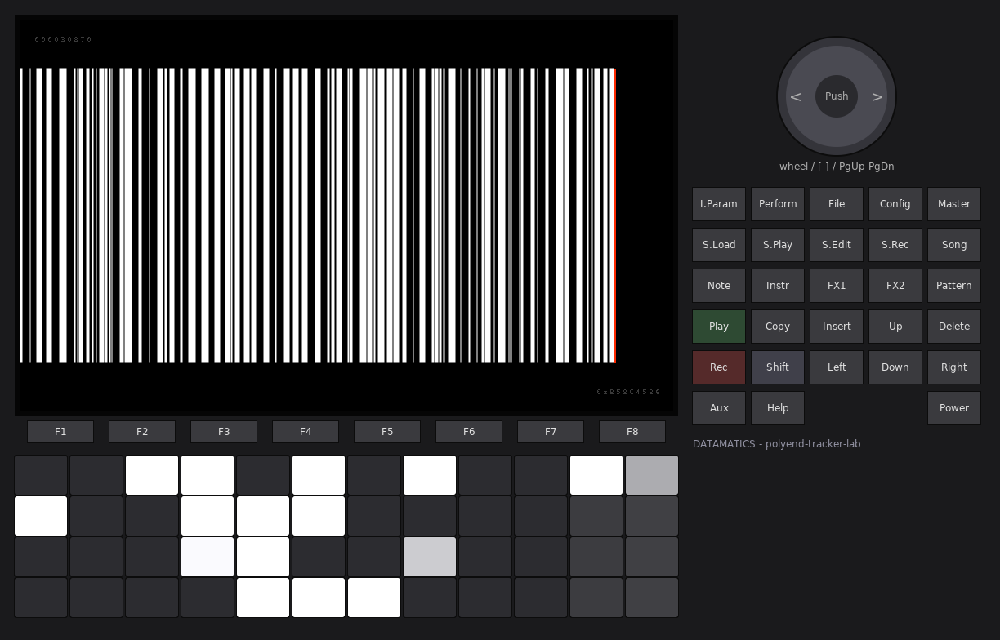
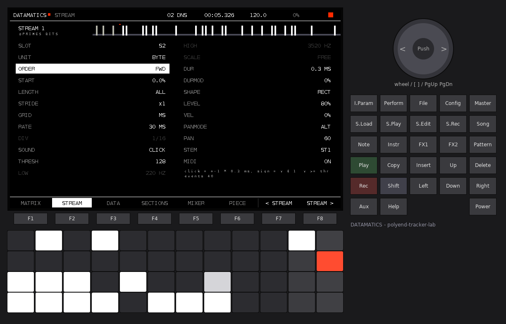
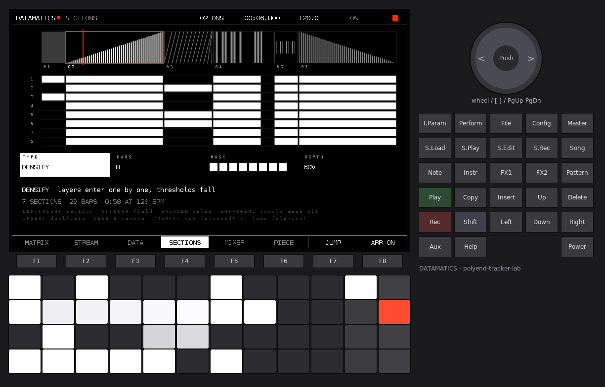
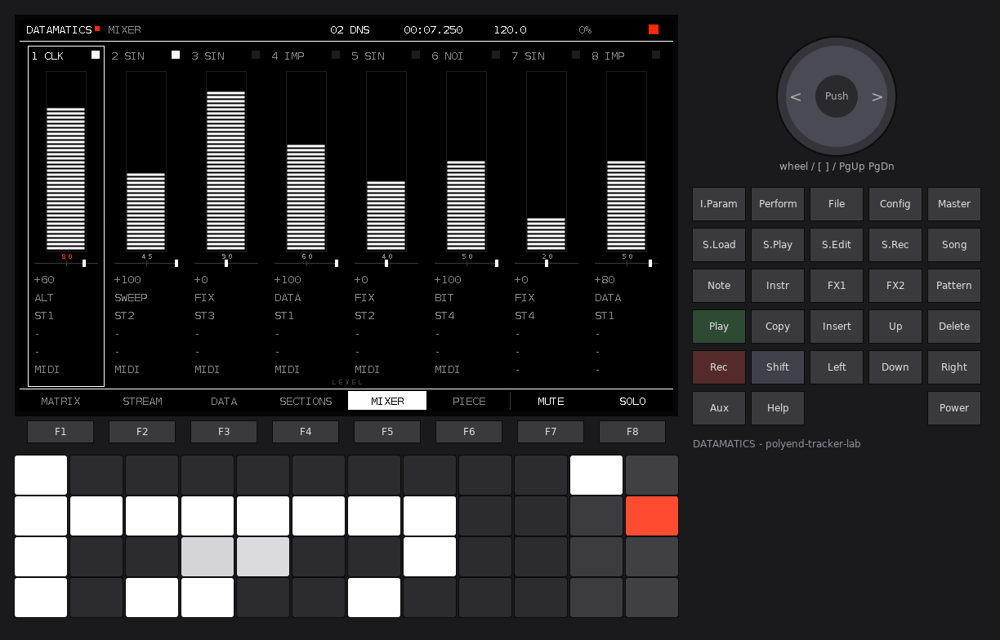
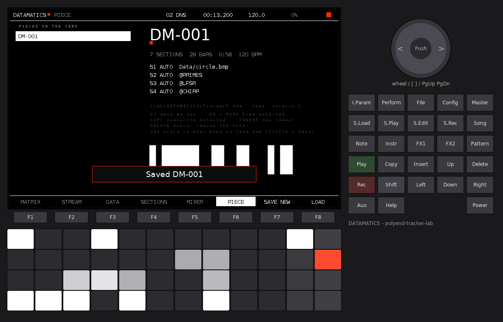

# DATAMATICS

A data-music workstation for the original Polyend Tracker, in the spirit of
Ryoji Ikeda's *datamatics*, *test pattern* and *data.matrix*. Any file on the SD
card becomes sequence data. Eight streams read it on millisecond-precise grids
and turn it into four kinds of sound: **sine tones, clicks, noise and
single-sample impulses**. Sections (scan, densify, thin, silence, cut, freeze)
arrange the streams into a whole piece. The screen is black and white with one
accent colour (signal red). It reacts to the data and to every event.



DATAMATICS is a polyend-tracker-lab firmware (`PolyendTrackerDATAMT.ptf`). The
lab Shell around it provides the boot intro, **Config** (settings, firmware
update, about), **Play** (transport), **Shift + Rec** (recorder with stems),
the input selection and MIDI.

---

## 1. Quick start

1. Copy `PolyendTrackerDATAMT.ptf` to `/Firmware` on the card and install it
   (from stock, or from any lab firmware: **Config > Firmware**).
2. Power on. After the intro you are on **MATRIX** with the demo piece loaded.
   It needs no files: its four data slots hold built-in data sets.
3. Press **Play**. Eight streams start: clicks, sines, impulses and noise,
   arranged in seven sections.
4. Press **F3 (DATA)**. Browse to any file on the card (a photo as `.bmp`, a
   `.wav`, a `.mid`, a text file, anything), choose a slot with **Left / Right**
   and press **F8 (LOAD)**. Every stream reading that slot now plays the file.
5. Press **F8 (VIEW)** on MATRIX for the full-screen waterfall.
6. **F6 (PIECE) > F7** saves the composition to the card.

---

## 2. Concepts

**Data slot.** Four slots (S1..S4) each hold one decoded file: up to 262,144
values from 0 to 255, plus a second value per entry (*aux*: a MIDI velocity, a
WAV brightness, the original byte...). A file is read into memory when it is
loaded, so playback never touches the card.

**Reading mode.** How a file becomes values: raw bytes, bits, image pixels, WAV
samples, MIDI events or text characters (section 4). **AUTO** chooses from the
file name, then from the first bytes.

**Stream.** Eight streams. Each one has a read head that walks one slot in its
own order and at its own rate. At every step it reads one *unit* (a byte or a
bit), compares the value with its **threshold** and, if the value passes, fires
one event of its sound. The value sets the pitch (sine), filter colour (noise)
or polarity (click / impulse). The aux value can set loudness, duration and
pan.

**Grid.** A stream steps either on a **millisecond grid** (1 to 2000 ms, exact
to the sample: 10 ms = 441 samples) or on a **beat grid** (1/128 note to 4
bars, exact at any tempo, no drift). Every event starts on its exact sample
inside the audio block (sample-accurate scheduling, 1/44100 s).

**Section.** A part of the piece: a type, a length in bars, a mask of the
streams that may sound in it, and a depth. Sections play in order and loop, or
stop at the end. Boundaries are hard cuts: streams that are not in the next
section stop on the boundary's exact sample.

**Piece.** The whole composition (all stream parameters, the sections, the
slots' file paths and reading modes, the tempo). It is saved as a small text
file that references the data files by their path.

---

## 3. Pages and controls

The eight keys under the screen are the same everywhere:

| Key | Function |
|---|---|
| F1 | MATRIX |
| F2 | STREAM |
| F3 | DATA |
| F4 | SECTIONS |
| F5 | MIXER |
| F6 | PIECE |
| F7, F8 | page actions (labelled on screen) |

Module keys are shortcuts: **Pattern** = MATRIX, **I.Param** = STREAM,
**File** / **S.Load** = DATA, **Song** = SECTIONS, **Master** = MIXER,
**Perform** = VIEW (full-screen waterfall, press again to return).
**Play** starts and stops the transport. **Config** opens the Shell settings.
**Shift + Rec** records.

### 3.1 Pads (all pages)

The 48 pads are a 12 x 4 matrix. Rows are the four streams of the current bank
(streams 1-4 or 5-8).

| Columns | Function | LEDs |
|---|---|---|
| 1-8 | the next 8 units under the stream's read head. Press = audition that unit now (velocity sets the level) | white = the unit will sound, brightness = its value; off = rest; column 1 flashes white on every event |
| 9 | mute | red = muted |
| 10 | solo | white = solo |
| 11 | select the stream (Shift: open STREAM) | white = selected |
| 12 | section launch: rows 1-4 = sections of the current group of four (the group of the selected section on SECTIONS). Playing: jump; stopped: start point. **Shift + col 12** switches the bank (streams 1-4 / 5-8) | red = playing section, grey = start point, white blink = jump pending |

Selecting a stream on MATRIX, STREAM or MIXER also moves the pads to its bank.

### 3.2 MATRIX (F1)


The barcode/matrix sequencer. One band per stream: 160 units, 16 already read
(left of the red playhead) and 144 ahead. A white bar is a unit that will
sound. A dark bar is a value under the threshold, its height being the value.
Muted streams and streams outside the current section are drawn dark. On the
left: stream number, sound, slot, rate and effective threshold. On the right:
the last value in hex, plus the frequency (sine) or the bits.

Below the bands: the section strip (current section white, red progress line),
then the six newest events as scrolling numbers (stream, sound, unit index in
hex, bits, value, frequency). On the right, the newest rows of the waterfall.

| Control | Action |
|---|---|
| Up / Down | select a stream |
| Encoder | density: lowers / raises the selected stream's threshold |
| Shift + encoder | rate (ms or division) |
| Left / Right (Shift: x10) | start point in the data (0.1 % steps) |
| Delete | cue the read head back to the start |
| Encoder push | open STREAM for the selected stream |
| F7 | mute / unmute |
| F8 | VIEW |

### 3.3 VIEW (F8 on MATRIX, or Perform)


The full-screen waterfall: the piece as a scrolling data image. Each of the
eight 100 px columns is one stream. Every row (every 20 ms, Settings >
Waterfall speed) draws the 48 units around the stream's read head as a
barcode: white when the stream sounded in that slice, grey when it read but
stayed silent, dotted when it is out of the section or muted. A red dot marks
the read head on each event. A full red line marks every section change. Any
F-key leaves VIEW.

### 3.4 STREAM (F2)



All parameters of the selected stream, with its band at the top and its
formula at the bottom. Rows that the current sound does not use are greyed.

| Control | Action |
|---|---|
| Up / Down | row |
| Encoder, Left / Right | value (Shift: coarse) |
| Delete | row back to its default |
| Encoder push | audition one event |
| Copy / Insert | copy / paste all parameters of a stream |
| F7 / F8 | previous / next stream |

| Parameter | Range | Meaning |
|---|---|---|
| SLOT | S1..S4 | the data slot it reads |
| UNIT | BYTE, BIT | a step reads one byte (value 0..255) or one bit (1 = 255, 0 = 0) |
| ORDER | FWD, REV, PING, COL, HOP | forward; reverse; back and forth; column order (reads the data as a raster of its natural width, top to bottom, so an image is read in columns); HOP = golden-ratio jumps through the range |
| START | 0.0..99.9 % | where the range starts in the data |
| LENGTH | ALL, 1..64K | units in the loop (from START) |
| STRIDE | x1..x64 | units skipped per step |
| GRID | MS, BEAT | millisecond or beat grid |
| RATE | 1..2000 ms | step length on the MS grid |
| DIV | 1/128 .. 4/1 | step length on the BEAT grid (1/12, 1/24, 1/48 and 1/6 are triplets) |
| SOUND | SINE, CLICK, NOISE, IMPULSE | section 5 |
| THRESH | 0..255 | a unit sounds when its value >= THRESH (with THRESH > 0 a zero never sounds; THRESH 0 = every step sounds) |
| LOW, HIGH | 1..21000 Hz | the value range mapped to frequency (sine) or filter cut-off (noise) |
| SCALE | FREE, HARM, OCT, 12TET | continuous exponential; harmonics of LOW; octaves of LOW; semitones |
| DUR | 0.1..2000 ms | event length (0.1 ms steps) |
| DURMOD | 0..100 % | the aux value scales the length (0.0x to 2.0x at 100 %) |
| SHAPE | RECT, FADE, DECAY | hard gate; 1 ms linear fade in/out (or half the event); exponential decay to -60 dB |
| LEVEL | 0..100 % | level (squared law) |
| VEL | 0..100 % | how much the aux value sets the loudness |
| PANMODE | FIX, DATA, BIT, ALT, SWEEP | fixed at PAN; aux value spreads left..right; data parity jumps hard left / right; alternates every event; sweeps over 64 steps |
| PAN | -100..+100 | position (FIX) or width (other modes) |
| STEM | ST1..ST4 | recorder stem it goes to |
| MIDI | ON/OFF | sends MIDI notes (section 8) |

### 3.5 DATA (F3) - the file browser


Left: the card. The root starts with the five built-in data sets (section 4.2),
then folders and files (folders first, alphabetical, size on the right; up to
160 entries per folder). Right: the four slots (with red marks for the streams
reading each), a preview of the target slot with a red dot at every read head,
and the target's size and mode.

| Control | Action |
|---|---|
| Encoder, Up / Down | browse (Shift + encoder: 8 at a time) |
| Encoder push / F8 | open a folder, or load the file into the target slot |
| Left / Right | target slot (opening DATA targets the selected stream's slot) |
| F7 | reading mode for the next load (AUTO, RAW, BITS, IMAGE, WAV, MIDI, TEXT) |
| Delete | re-read the target slot's file with the current mode |

Loading reads the file in 32 KB pieces across main-loop passes, so the sound
and the screen keep running. A slot reads nothing while its new data is
decoded, so the streams on it rest for that moment. Files larger than 4 MB are
read up to their first 4 MB.

### 3.6 SECTIONS (F4)



Top: the timeline, block widths proportional to bars, each type with its own
pattern (scan = diagonals, densify = rising ramp, thin = falling ramp, cut =
random gates, freeze = repeated short strokes, silence = empty). The selected
section is framed in red, the playing one has a red progress line, and the
start point has a white tick. Middle: the stream x section matrix (which
streams each section lets sound). Bottom: the selected section's fields.

| Control | Action |
|---|---|
| Left / Right | select a section |
| Up / Down | field: TYPE, BARS, MASK, DEPTH |
| Encoder | value. On MASK: moves the cursor over the 8 streams |
| Shift + encoder, or Note | on MASK: toggle the stream under the cursor |
| Insert | duplicate the section after it (max 24) |
| Delete | remove it (at least one stays) |
| Encoder push / F7 | stopped: start the piece here (CUE); playing: jump here (JUMP) |
| F8 | arrangement on / off (off = free run, every stream plays as set) |

Jumps happen on the next bar line, or at once with Settings > Section jump =
Immediate. The bottom line shows the piece's length in bars and minutes at the
current tempo.

### 3.7 MIXER (F5)



Eight strips: level (44-segment column), pan, pan mode, stem, mute, solo, MIDI.
The square at the top flashes on every event.

| Control | Action |
|---|---|
| Left / Right | stream |
| Up / Down | field |
| Encoder | value |
| Encoder push | audition |
| F7 / F8 | mute / solo |

### 3.8 PIECE (F6)



Left: the pieces in `/Lab/DATAMATICS/Pieces`. Right: the piece in memory, its
length, the four slots with their mode and path, and a barcode of its sections.

| Control | Action |
|---|---|
| Encoder, Up / Down | select |
| F7 | save as a new numbered piece (`DM-001.dmx`, `DM-002.dmx`...) |
| F8 / encoder push | load the selected piece |
| Copy | overwrite the selected piece with the one in memory |
| Delete (twice) | delete the selected file |
| Insert | new piece (the demo with built-in data) |

Loading a piece sets the tempo and reloads its files. A file that is no longer
on the card leaves its slot empty: the path stays, so the slot works again
once the file is back.

---

## 4. Reading modes

| Mode | Values | aux | Natural width |
|---|---|---|---|
| **RAW** | every byte, 0..255 | the same byte | 256 |
| **BITS** | every bit, MSB first: 1 = 255, 0 = 0 (8 values per byte) | the whole byte | 256 |
| **IMAGE** | luminance of every pixel, top-left first, row by row. BMP (1/4/8-bit palette, 16/24/32-bit, uncompressed or bit fields) and PGM/PPM/PBM (binary and ASCII). Large images are downsampled by a whole factor to fit 262,144 pixels | the same luminance | the image width |
| **WAV** | the peak of every 64-sample frame (1.45 ms at 44.1 kHz; longer files use 128, 256... samples per value to fit), 8/16/24/32-bit PCM and 32-bit float, mono or stereo | zero-crossing density of the frame (0 = dark, 255 = bright/noisy) | 256 |
| **MIDI** | every note-on of every track, in time order: value = note x 2. The gaps between notes become rests of zero, one per sixteenth (max 16) | velocity x 2 | 64 |
| **TEXT** | every printable character spread over 1..255 ('!' = 3 .. '~' = 255); spaces, tabs and line ends = 0 (rests). CR is dropped | the character code | 80 |

**AUTO** picks the mode from the extension (`.bmp .pgm .ppm .pbm .pnm` image;
`.wav .wave` WAV; `.mid .midi .smf` MIDI; `.txt .md .csv .json .xml .html .c
.h .cpp .py .lua .ini .log .cfg .yml .yaml .js .tsv .nfo` text). Otherwise it
checks the content (RIFF/WAVE, MThd, BM, P1-P6, or >= 95 % printable bytes =
text) and falls back to RAW. A forced mode that does not fit the file (IMAGE on
a text file, for example) falls back to RAW. JPEG, PNG and compressed BMPs are
not decoded as images (they play as RAW bytes, which sounds like compressed
data: dense and noisy).

**Units.** A stream with UNIT = BIT reads each value's 8 bits. On a BITS slot
the bits are already split: use BYTE there.

### 4.1 What to try

- A photo as BMP or PGM: ORDER = COL reads it in columns, so a vertical edge
  becomes a burst. THRESH sets which brightness sounds.
- A WAV of speech as WAV mode on a 1 ms grid: the rhythm of the syllables,
  with VEL 100 % following the loudness.
- A text file in TEXT mode with UNIT = BYTE and THRESH 1: words become bursts,
  spaces silences.
- Any program, archive or PDF as RAW on a 1 ms grid with UNIT = BIT: pure data
  noise, with structure where the file has headers and tables.

### 4.2 Built-in data sets

Listed at the top of DATA's root; they need no card.

| Name | Content |
|---|---|
| `@PRIMES` | 65,536 values: 255 on prime indices, 0 elsewhere |
| `@TESTCARD` | a 256 x 256 test card: barcode of widths 1..8, ramp, checkerboards, zone plate rings, fine grid |
| `@LFSR` | 65,536 bytes of a 16-bit maximal-length shift register |
| `@CHIRP` | 32,768 values: a triangle whose period shrinks from 256 to 2 values |
| `@FIBONACCI` | 65,536 values of the Fibonacci word (quasi-periodic 0/255) |

Loading a built-in with a forced mode (not AUTO) reads its values as a byte
file through that mode (for example `@LFSR` as BITS).

---

## 5. Sounds

Every event is one of four sounds. There are no other oscillators or effects.

| Sound | What it is | The value sets |
|---|---|---|
| **SINE** | a pure sine (interpolated 1024-point table) from LOW to HIGH, with DUR and SHAPE. Up to 21 kHz: near-ultrasonic tones the codec still passes; down to 1 Hz: subsonic pulses | the frequency (SCALE) |
| **CLICK** | a DC step of +1 or -1 for DUR (0.1 ms = 4 samples upwards) | the polarity (value parity) |
| **NOISE** | white noise through a one-pole low-pass at LOW..HIGH | the cut-off |
| **IMPULSE** | exactly one sample at +1 or -1 (22.7 us). DUR and SHAPE do not apply | the polarity |

Each stream has 4 voices: overlapping events (a long DUR on a fast grid) take
turns, and the oldest is cut.

With SHAPE = RECT the sound starts and stops on a sample with no ramp. This is
intended (the Ikeda hard edge). Use FADE for clean sine tones.

---

## 6. Sections

| Type | Effect | DEPTH |
|---|---|---|
| **PLAY** | the masked streams play as set | - |
| **SCAN** | every masked stream's read head sweeps through its data across the section (an offset grows from 0 to DEPTH % of the data) | sweep size |
| **DENSIFY** | the masked streams enter one by one (lowest number first) as the section progresses, and their thresholds fall | threshold fall at the end (100 % = everything sounds) |
| **THIN** | the reverse: streams leave one by one (highest first), thresholds rise | threshold rise |
| **SILENCE** | pure digital silence: every voice is cut on the boundary sample | - |
| **CUT** | a gate on a 1/16 grid driven by the data of stream 1's slot: a value under DEPTH % shuts the gate and cuts every voice at once | gate threshold |
| **FREEZE** | every read head loops a short window of units starting where it was at the section start | window: 100 % = 1 unit, 0 % = 17 units |

**MASK.** Streams outside a section's mask stop at the boundary and stay
silent. Their read heads keep moving, so the data moves on underneath.

**Arrangement off** (SECTIONS F8 or Settings > Arrangement = Free run): all
streams play as set and sections are ignored.

**End of the piece** (Settings > At the end of the piece): *Loop* restarts at
section 1, *Stop* stops the transport.

---

## 7. Recording and stems

**Shift + Rec** records the master to `/Lab/DATAMATICS/Rec/REC-nnnn.wav`.
With **Config > Record stems = On** it also writes four stereo stems
(`REC-nnnn-stem1.wav` .. `stem4`): every stream goes to the stem set by its
STEM parameter. The demo uses ST1 for clicks and impulses, ST2 for high sines,
ST3 for the bass sine and ST4 for noise and the 17-19 kHz layer.

---

## 8. MIDI

**Out.** Config > MIDI out of the streams: *Off*, *One channel* (the Shell's
MIDI out channel), or *Channel per stream* (out channel + stream - 1). A stream
sends only when its MIDI parameter is ON and its step is 10 ms or longer, so
DIN is never flooded. SINE sends the nearest note to its frequency; the other
sounds send note 36 + stream - 1. Velocity follows the event's level. The
note-off comes when the event ends (to within one 2.9 ms audio block), or
before the stream's next note.

**Clock.** Config > Clock: *Internal + send* sends MIDI clock and start / stop
with the transport; *Follow MIDI* follows an external clock and start / stop.

**In.**

| Message | Action |
|---|---|
| Note 36..43 | audition stream 1..8 (velocity = level) |
| Note 48..71 | section 1..24 (when it exists): jump while playing, start point while stopped |
| CC 1..8 | level of stream 1..8 |

---

## 9. Settings

**Config** opens the Shell settings (display, intro, tempo, clock, MIDI
channels, input, master level and limiter, record stems). DATAMATICS adds:

| Row | Values | Default |
|---|---|---|
| Arrangement | Free run, Sections | Sections |
| At the end of the piece | Loop, Stop | Loop |
| MIDI out of the streams | Off, One channel, Channel per stream | Off |
| Section jump | Next bar, Immediate | Next bar |
| Waterfall speed | Slow (40 ms/row), Normal (20 ms), Fast (10 ms) | Normal |
| Reload last piece at boot | Off, On | On |

The first four are part of the piece. The last two are kept in `ui.cfg`.
**Config > F6 Save** saves everything now. The Shell also saves every 5
minutes and at power off.

---

## 10. Files on the card

```
/Lab/DATAMATICS/
  settings.bin         Shell settings
  ui.cfg               waterfall speed, reload at boot
  last.dmx             the piece in memory (saved at power off / Config > Save)
  Pieces/DM-001.dmx    saved pieces
  Data/                a suggested place for data files (any folder works)
  Rec/REC-0001.wav     recordings (+ -stem1..4.wav)
```

A `.dmx` piece is plain text, version 1:

```
DATAMATICS 1
bpm 120.0
opt <arrangement> <end> <midi> <jump>
slot <0..3> <mode 0..6> <path or ->
stream <0..7> <25 values: the STREAM rows in page order, then MUTE, SOLO>
section <type 0..6> <bars> <mask 0..255> <depth>
end
```

Paths are relative to the card root. Unknown lines are ignored and out-of-range
values are clamped, so you can edit pieces on a computer.

---

## 11. Tips

- Start from silence: Insert on PIECE gives the demo; set every section's mask
  to one stream, then add streams section by section.
- The same file in two slots with different modes (RAW and BITS) gives two
  rhythms of one source.
- Two streams on one slot with STRIDE 1 and 2, or ORDER FWD and REV, make
  canons of the same data.
- A sine at HIGH = LOW = 19000 Hz on a slow grid is a "test tone" layer you
  feel more than hear. Keep LEVEL low.
- THRESH is the density control. On MATRIX the encoder moves it live.
- For hard Ikeda cuts use SILENCE sections of 1 bar between dense ones, and
  CUT with DEPTH 40-60 %.
- Sine with LOW 20 Hz, SHAPE DECAY, DUR 80 ms is a sub kick made of data.

---

## 12. Limits

- 8 streams, 4 voices each, 4 data slots of 262,144 values, 24 sections.
- Image decoding: BMP and PGM/PPM/PBM only (no JPEG, PNG or RLE BMP).
- Files are read up to their first 4 MB. A MIDI file is read up to 16,384
  note-ons.
- One file loads at a time (up to 8 queued). While a slot is decoded, its
  streams rest.
- The browser shows up to 160 entries per folder; names longer than 47
  characters are cut.
- MIDI out needs a stream step of 10 ms or more; note-offs have block (2.9 ms)
  resolution.
- No video or frame export.
- CPU: the densest case (8 streams x 4 long sines) uses about 72 % of the
  render budget. Faster grids with long events do not cost more (voices are
  reused), but MIDI on several fast streams adds DIN traffic.
