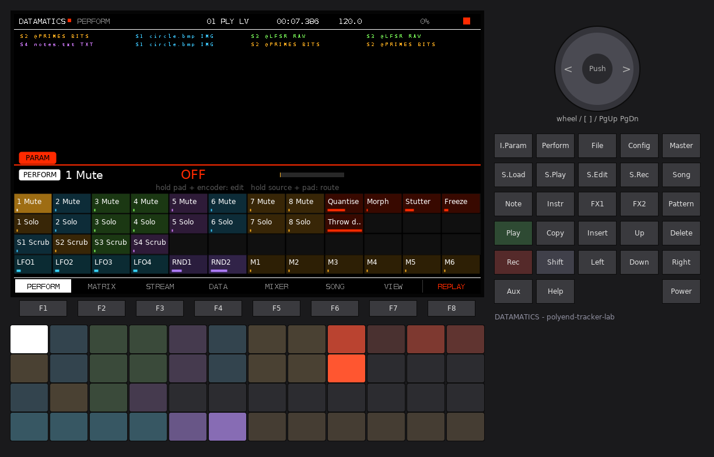
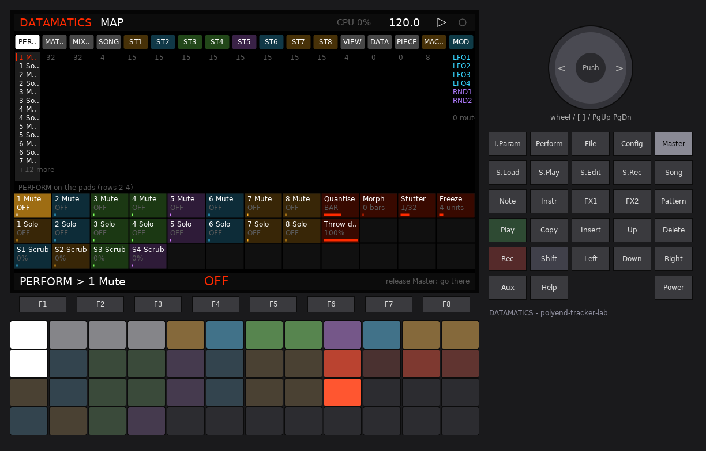
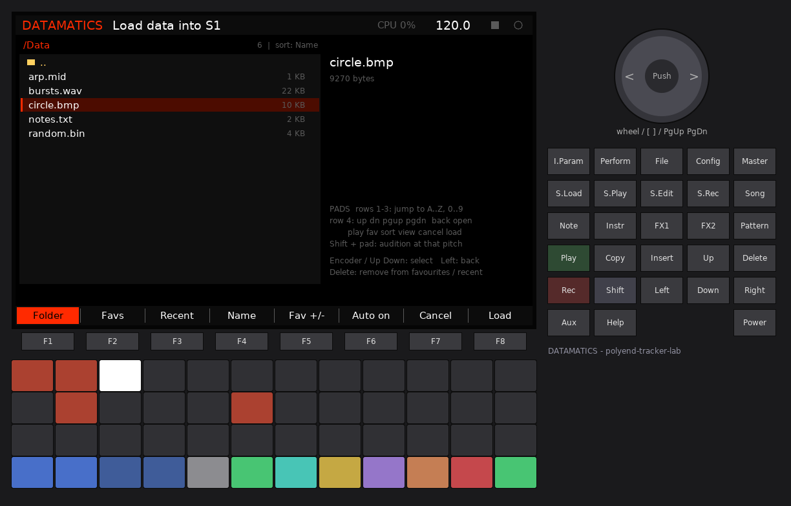
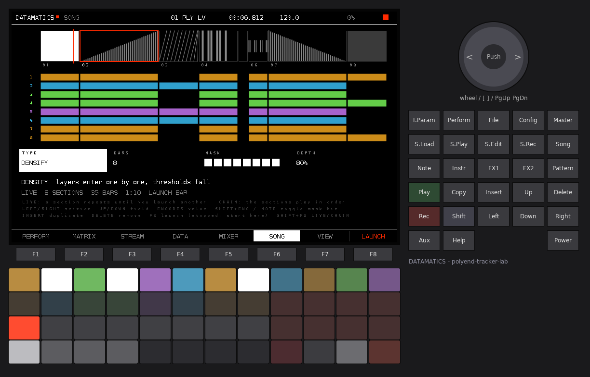
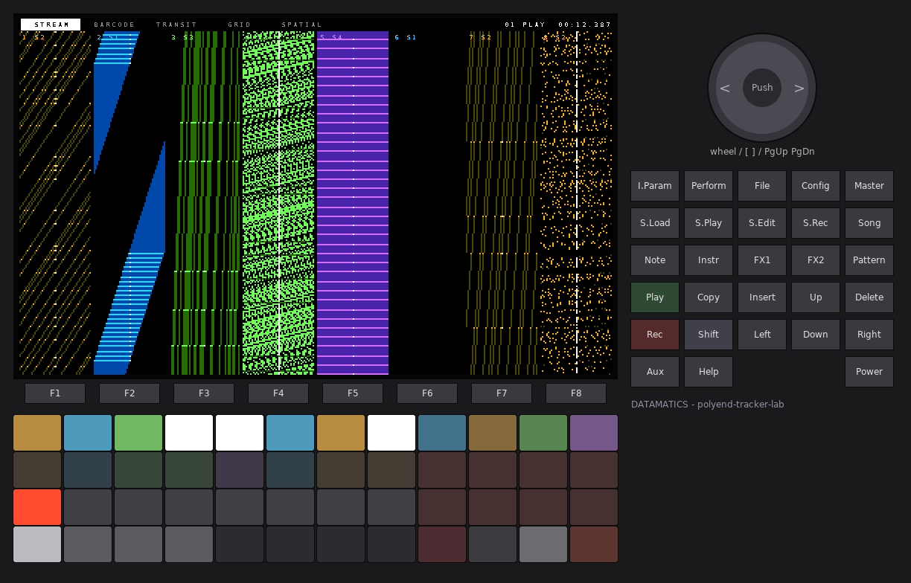
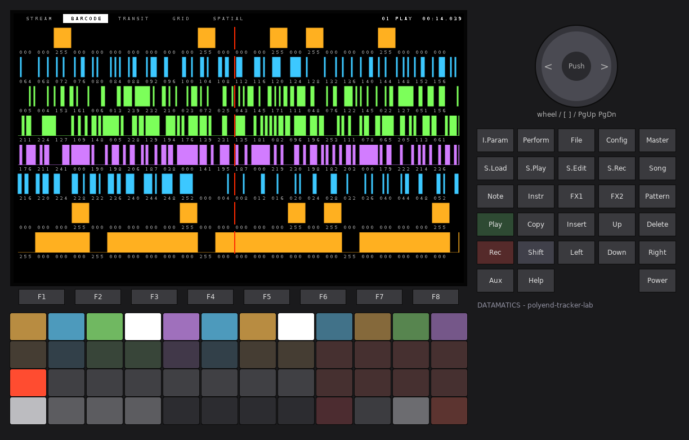
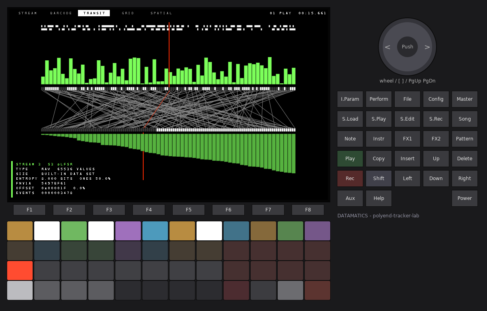
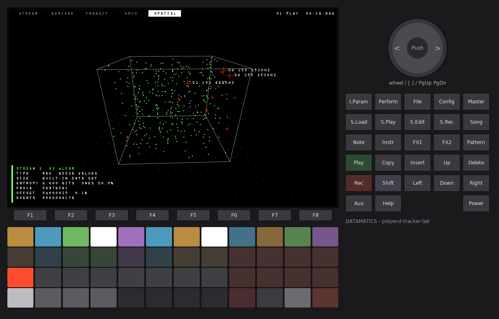

# DATAMATICS

A data-music workstation for the original Polyend Tracker, in the spirit of
Ryoji Ikeda's *datamatics*, *test pattern* and *data.matrix*. Any file on the SD
card becomes sequence data. Eight streams read it on millisecond-precise grids
and turn it into four kinds of sound: **sine tones, clicks, noise and
single-sample impulses**. You play it live from the pads: mute and fill
streams, launch sections, recall and morph scenes, hold throws (cut, freeze,
stutter, density), scrub through the data. You can record a performance and
replay it.

The screen is black and white with one accent (red: playheads, actions, CUT).
The only other colours are the **four slot colours**. They tell you which data
a stream reads, on every page, on every pad and in every visual.


DATAMATICS is a polyend-tracker-lab firmware (`PolyendTrackerDATAMT.ptf`). The
lab Shell around it provides the boot intro, **Config** (settings, firmware
update, about), **Play** (transport), **Shift + Rec** (recorder with stems),
the input selection, MIDI, and **LABKIT**: the navigation shared by every lab
firmware (PARAM pads, MAP, macros, modulation, help, browser; section 3.1).

**Keys on the original Tracker.** The original Tracker has no Aux, no Help and
no encoder push; the simulator draws them, but the hardware never sends them.
DATAMATICS uses none of them. Every action is on an F-key, Insert, Delete,
Copy, the arrows, the encoder or the pads.

---

## 1. Quick start

1. Copy `PolyendTrackerDATAMT.ptf` to `/Firmware` on the card and install it
   (from stock, or from any lab firmware: **Config > Firmware**).
2. Power on. After the intro you are on **PERFORM** with the demo piece. It
   needs no files: its four data slots hold built-in data sets.
3. Press **Play**. Eight streams start: clicks, sines, impulses and noise.
4. Play the pads. Top row: mute streams. Second row: hold to **fill** (the
   stream plays every unit). Right block: hold the **throws** (CUT, FREEZE,
   STUTTER, DENSE...). Third row: launch sections. Bottom row: recall scenes.
5. Press **F4 (DATA)**, pick a slot with **Up / Down** and press **F8**. The
   browser opens on `/Data`. Choose any file (a photo as `.bmp`, a `.wav`, a
   `.mid`, a text file, anything) and press **F8** again. Every stream patched
   to that slot now plays the file.
6. Patch streams to slots on the DATA pads (row = slot, column = stream), or on
   PERFORM: hold a slot pad (top right) and tap stream pads.
7. **F7 (VIEW)** is the full-screen visual; press F7 again for the next mode.
8. **File** opens PIECE. **Insert** saves the piece with its scenes, your
   recorded take and your macros / modulation.

---

## 2. Concepts

**Data slot.** Four slots, S1..S4, each with its own colour: S1 ice blue, S2
amber, S3 green, S4 violet. A slot holds one decoded file: up to 262,144
values from 0 to 255, plus a second value per entry (*aux*: a MIDI velocity, a
WAV brightness, the original byte...). A file is read into memory when it is
loaded, so playback never touches the card.

**Reading mode.** How a file becomes values: raw bytes, bits, image pixels, WAV
envelope, MIDI notes or text characters (section 5). **AUTO** chooses from the
file name, then from the first bytes.

**Stream.** Eight streams. Each one is *patched* to one slot. Its read head
walks that slot in its own order and at its own rate. At every step it reads
one *unit* (a byte or a bit), compares the value with its **threshold** and, if
the value passes, fires one event of its sound. The value sets the pitch
(sine), filter colour (noise) or polarity (click / impulse). The aux value can
set loudness, duration and pan. Wherever a stream appears, its label carries
the slot it reads, for example `S2 circle.bmp IMG`, in that slot's colour.

**Grid.** A stream steps either on a **millisecond grid** (1 to 2000 ms, exact
to the sample: 10 ms = 441 samples) or on a **beat grid** (1/128 note to 4
bars, exact at any tempo, no drift). Every event starts on its exact sample
inside the audio block (1/44100 s).

**Section.** A part of the song: a type (play, scan, densify, thin, silence,
cut, freeze), a length in bars, a mask of the streams that may sound in it,
and a depth. In **LIVE** mode (the default) a section repeats until you launch
another. In **CHAIN** mode the sections play in order. Launches are quantised
(NOW, BEAT, BAR, 2 BARS, 4 BARS).

**Scene.** A snapshot of every stream parameter (slot, grid, sound, levels,
mutes...) and the slot scrubs. Recalling a scene morphs to it over 0..16 bars.
Numbers glide; choices (sound, slot, mute...) switch half way.

**Throw.** A momentary performance effect held on a pad: CUT, FREEZE, STUTTER,
DENSE, THIN, REVERSE, INVERT, OCT+. Shift + pad latches it.

**Take.** A recorded performance: every pad action, launch, scene recall and
parameter change, with the sample clock, plus a snapshot of the start. A take
replays with the piece and is saved in it.

**Piece.** Everything: streams, sections, slot paths and modes, scenes, the
take, tempo, and the LABKIT chunk (macros, LFO routes, MIDI learn). It is
saved as a small text file that references the data files by their path.

---

## 3. Keys

| Key | Does |
|---|---|
| **F1** | PERFORM |
| **F2** | MATRIX |
| **F3** | STREAM (the selected stream) |
| **F4** | DATA (slots and patch) |
| **F5** | MIXER |
| **F6** | SONG (sections) |
| **F7** | VIEW (on VIEW: next visual mode) |
| **F8** | the page's action, labelled in red at the bottom right |
| **Play** | transport start / stop |
| **Rec** | arm the performance recorder (Play then records a take); while recording: stop the take |
| **Shift + Rec** | the Shell's audio recorder (master + stems) |
| **Config** | Shell settings, firmware update, about |
| Perform / Pattern / S.Edit / S.Load / Song / File / S.Play | PERFORM / MATRIX / STREAM / DATA / SONG / PIECE / VIEW |

### 3.1 LABKIT (the same on every lab firmware)

| Key | Does |
|---|---|
| **I.Param** | **PARAM pads**: the current page's parameters on the pads (tap: stays open, hold: while held) |
| **Shift + I.Param** | **MACRO** page: 8 macros, each driving up to 8 parameters |
| **Master** | **MAP**: hold to look at every page and its parameters, release to jump there; a tap keeps it open |
| **Shift + Master** | **MOD** page: 4 LFOs, 2 random sources, the routes |
| **Shift + Config** | **HELP**: what the page does and what its F-keys do |



On the PARAM pads, hold a pad and turn the encoder to edit; hold a source in
the bottom row (LFO 1-4, RND 1-2, macros) and tap parameter pads to route it.
Shift + a bottom pad shows the second source bank: M7, M8 and the DATAMATICS
sources **D1..D8** (the value each stream just read, 0..1), **DENS** (event
density), **SEC** (section progress), **HIT** (an event happened) and
**MORPH** (scene morph progress). Example: route D3 to the LEVEL of stream 5,
so stream 3's data plays stream 5's dynamics. Hold Shift + a parameter pad and
move a MIDI CC to learn it.



The MAP lists the pages in this order: PERFORM, MATRIX, MIXER, SONG, ST1..ST8
(one page per stream), VIEW, DATA, PIECE, MACRO, MOD. Its top pad row reaches
the first twelve; Left / Right reaches all of them. Any change from anywhere
shows a short `PAGE > Param value` line at the top (the HUD).

Where the parameters live:

| Page | Parameters |
|---|---|
| PERFORM | 1-8 Mute, 1-8 Solo, Quantise, Morph, Stutter, Freeze, Throw depth, S1-S4 Scrub |
| MATRIX | 1-8 Thresh, 1-8 Start, 1-8 Length, 1-8 Stride |
| MIXER | 1-8 Level, 1-8 Pan, 1-8 Pan mode, 1-8 Stem |
| SONG | Song mode, Arrangement, End, MIDI out |
| ST1..ST8 | Slot, Unit, Order, Grid, Rate, Division, Sound, Low, High, Scale, Duration, Dur mod, Shape, Velocity, MIDI |
| VIEW | Visual, Follow, Auto cycle, Waterfall |

On the PARAM pads and in the MAP a stream's parameters take its slot's colour.

---

## 4. Pages

### 4.1 PERFORM (F1)


The live page. Eight stream strips: the slot colour bar, number and sound, the
slot tag (`S2 @PRIMES BITS`), the units ahead of the read head (red line =
now), M / S / F for mute / solo / fill, the last value and its frequency or
bits, and a flash on every event. Below: the eight sections of the current
bank (white = playing, red underline = progress, blinking red = launch
pending), the eight scenes (red fill = morph progress), the eight throws
(white = held, red = latched), the field strip and the recorder.

**Pads (PERFORM, and on STREAM, MIXER, SONG, VIEW and PIECE):**

```
        col 1 ......................... 8 | 9      10      11      12
row 1   MUTE stream 1..8                  | SLOT 1 SLOT 2  SLOT 3  SLOT 4
row 2   FILL stream 1..8 (hold)           | CUT    FREEZE  STUTTER DENSE    (hold)
row 3   LAUNCH section 1..8 (bank)        | THIN   REVERSE INVERT  OCT+     (hold)
row 4   SCENE 1..8                        | REC    REPLAY  BANK    RELEASE
```

| Pad | Tap | Shift + tap | Hold |
|---|---|---|---|
| MUTE | mute / unmute | solo / unsolo | - |
| FILL | - | solo / unsolo | the stream plays every unit (threshold 0) |
| SLOT | select it for the SCRUB field | solo the slot (only its streams sound) | + encoder: **scrub** that slot's data; + MUTE pads: **patch** those streams to the slot |
| throw | - | latch / unlatch | the throw acts while held |
| LAUNCH | section of the bank, quantised (stopped: start point) | - | - |
| SCENE | recall (morph, quantised) | **store** the current state | - |
| REC | arm / disarm the recorder (recording: stop the take) | - | - |
| REPLAY | replay on / off | - | - |
| BANK | sections 1-8 / 9-16 / 17-24 | - | - |
| RELEASE | releases all throws, fills, slot solos and stream solos | - | - |

LEDs: MUTE pads glow in their slot's colour and flash white on events (dark =
muted). SLOT pads in their colour (white = held). Throws dim red, white when
held, red when latched. Sections red = playing. Scenes grey = stored, red =
morphing. REC blinks red when armed and glows when recording.

**Keys on PERFORM:**

| Key | Action |
|---|---|
| Left / Right | field: QUANTISE, MORPH, STUTTER, FREEZE, DEPTH, SCRUB |
| Encoder (Shift: fine) | the field's value; with a SLOT pad held: scrub that slot |
| Up / Down | select a scene |
| Insert | recall the selected scene |
| Copy | store into the selected scene |
| Delete | clear the selected scene |
| Note / Instr / Fx1 / Fx2 | hold CUT / FREEZE / STUTTER / DENSE (Shift: latch) |
| F8 | replay on / off |

**Throws:**

| Throw | While held |
|---|---|
| CUT | silence: every voice is cut on the next block, no new events. VIEW inverts (white frame) |
| FREEZE | every read head loops FREEZE units (1..32) from where it was |
| STUTTER | every stream repeats the unit it just played on the STUTTER grid (1/128 .. 4 bars, default 1/32). Press and release restart the grids at once |
| DENSE | thresholds fall by DEPTH % (100 % = every unit sounds) |
| THIN | thresholds rise by DEPTH % |
| REVERSE | read heads run backwards |
| INVERT | units under the threshold sound, the others rest |
| OCT+ | sines and noise filters one octave up |

**Fields:** QUANTISE (NOW, BEAT, BAR, 2 BARS, 4 BARS) quantises section
launches and scene recalls. MORPH (0..16 bars, 0 = instant) is the scene
morph time. STUTTER is the stutter grid, FREEZE the window, DEPTH the DENSE /
THIN amount. SCRUB (0..100 %) shifts the selected slot's read position: all
streams on the slot move together. Scrub is a parameter, so an LFO can scrub
too.

**Scenes.** The demo has four: BASE, SPARSE (thresholds up), DENSE
(thresholds down, 8-unit loops) and ULTRA (sines at 9..19 kHz, 0.1 ms
clicks). Shift + a scene pad stores the current state, a tap recalls it on
the next QUANTISE boundary and morphs over MORPH bars.

**Recorder (BLACKBOX-style).** Press **Rec** (or the REC pad): the recorder is
armed. **Play** starts the take. Everything you do is recorded with its sample
time: mutes, fills, throws, slot solos, launches, scene recalls and every
parameter change from any page, the PARAM pads, the MAP or MIDI CC. Stop ends
the take. With **REPLAY** on (F8 or the REPLAY pad), the next Play restores the
state at the start of the take and replays it. You can play on top; what you
add is not recorded. A take holds up to 8,192 events and is saved in the
piece. The SONG page shows it as a strip of red ticks.

### 4.2 MATRIX (F2)


The barcode sequencer. One band per stream, in its slot's colour: 160 units,
16 already read (left of the red playhead) and the units ahead. A coloured bar
is a unit that will sound. A dark stub is a value under the threshold, its
height being the value. The left column shows stream, sound, rate, effective
threshold and the slot tag. The right column shows the last value in hex and
its frequency or bits. Below: the section strip, the six newest events as
scrolling numbers, and the newest waterfall rows.

| Control | Action |
|---|---|
| Up / Down | select a stream |
| Encoder | density: lowers / raises the threshold (Shift: fine) |
| Left / Right | start point in the data, 1 % (Shift: 0.1 %) |
| Delete | cue the read head back to the start |
| Insert | open STREAM for the selected stream |
| F8 | mute / unmute |

MATRIX pads: rows = the four streams of the bank. Columns 1-8 are the next 8
units (brightness = value; tap = audition that unit). Column 9 = mute, 10 =
solo, 11 = select (Shift: open STREAM), 12 = fill (held; Shift: switch the
bank between streams 1-4 and 5-8).

### 4.3 STREAM (F3)


Every parameter of one stream in two columns, with its slot in the header
(`S2: @PRIMES (BITS)`) and its band at the top. A red mark after a value means
it is modulated. Rows that the current sound does not use are greyed.

| Control | Action |
|---|---|
| Up / Down | row |
| Encoder | value (Shift: fine) |
| Left / Right | previous / next stream |
| Delete | row back to its default |
| Copy / Insert | copy / paste all parameters of a stream |
| F8 | audition one event |

| Parameter | Range | Meaning |
|---|---|---|
| SLOT | S1..S4 | the data slot it reads (also patched on DATA and PERFORM) |
| UNIT | BYTE, BIT | a step reads one byte (value 0..255) or one bit (1 = 255, 0 = 0) |
| ORDER | FWD, REV, PING, COL, HOP | forward; reverse; back and forth; column order (the data as a raster of its natural width, top to bottom: an image is read in columns); HOP = golden-ratio jumps |
| START | 0..99.9 % | where the range starts in the data |
| LENGTH | ALL, 1..64K | units in the loop (from START) |
| STRIDE | 1..64 | units skipped per step |
| THRESH | 0..255 | a unit sounds when its value >= THRESH (with THRESH > 0 a zero never sounds; 0 = every step sounds) |
| GRID | MS, BEAT | millisecond or beat grid |
| RATE | 1..2000 ms | step on the MS grid |
| DIV | 1/128 .. 4/1 | step on the BEAT grid (1/12, 1/24, 1/48, 1/6 are triplets) |
| SOUND | SINE, CLICK, NOISE, IMPULSE | section 6 |
| LOW, HIGH | 1..21000 Hz | the value range mapped to frequency (sine) or filter cut-off (noise) |
| SCALE | FREE, HARM, OCT, 12TET | continuous; harmonics of LOW; octaves of LOW; semitones |
| DUR | 0.1..2000 ms | event length |
| DURMOD | 0..100 % | the aux value scales the length (0x to 2x at 100 %) |
| SHAPE | RECT, FADE, DECAY | hard gate; 1 ms linear fades; exponential decay to -60 dB |
| VEL | 0..100 % | how much the aux value sets the loudness |
| LEVEL, PANMODE, PAN, STEM | | see MIXER |
| MIDI | ON / OFF | sends MIDI notes (section 9) |
| MUTE, SOLO | | see PERFORM |

### 4.4 DATA (F4): slots and patch


Left: the four slots, each in its colour. A slot row shows the file name and
the mode it was read in, the size (image pixels, values, bytes), entropy (bits
per value), share of one bits, an FNV-1a hash, and the **whole slot as a
barcode** (top: values >= 128, bottom: value heights). White lines with
numbers mark where each stream's read head is, and READ BY lists the streams
patched to the slot. Right: the **patch**, slots x streams. A cell is filled in
the slot's colour when the stream reads that slot. The red frame is the
cursor.

| Control | Action |
|---|---|
| Up / Down | slot |
| Left / Right | stream (patch cursor) |
| Insert or Note | patch the stream under the cursor to the slot |
| Encoder | the slot's reading mode (the file is read again) |
| Shift + encoder | a built-in data set into the slot |
| F8 | **LOAD**: the shared browser, for the selected slot |
| Delete | empty the slot |

DATA pads: rows = slots S1..S4. Columns 1-8 = streams: tap patches the stream
to that row's slot (LEDs: the patch in slot colours, flashing on events).
Column 9 = open the browser for the slot. 10 = next reading mode (Shift:
previous). 11 = solo the slot while held. 12 = next built-in data set.

**The browser** (LABKIT, shared by every lab firmware) opens on `/Data` and
shows every file. It has folders, sizes, favourites, recent files, sort by
name / size / type, and letter jumps on the pads. A WAV previews as audio with
its waveform. Up / Down or the encoder select, **F8** loads, **F7** cancels.
Other file types show their size only; their barcode appears on DATA once
loaded.



Loading reads the file in 32 KB pieces across main-loop passes, so the sound
and the screen keep running. Files larger than 4 MB are read up to their
first 4 MB.

### 4.5 MIXER (F5)


Eight strips topped with the slot colour and the slot name: level (40
segments, the modulated value), pan, pan mode, stem, MIDI, and MUTED / SOLO.

| Control | Action |
|---|---|
| Left / Right | stream |
| Up / Down | field (LEVEL, PAN, PANMODE, STEM, MIDI) |
| Encoder | value (Shift: fine) |
| Delete | default |
| Insert | audition |
| F8 | mute (Shift + F8: solo) |

PANMODE: FIX (at PAN), DATA (aux value spreads left..right by PAN), BIT (data
parity jumps hard left / right), ALT (alternates every event), SWEEP (over 64
steps). Each stream goes to one of four recorder stems.

### 4.6 SONG (F6): sections



Top: the sections as blocks proportional to their bars, each type with its own
pattern (scan = diagonals, densify = rising ramp, thin = falling ramp, cut =
random gates, freeze = repeated strokes, silence = empty). The selected
section is framed red, the playing one has a red progress line, a pending
launch blinks red, the start point has a white tick. Middle: which streams
each section lets sound, in the streams' slot colours. Bottom: the selected
section's fields and the recorded take.

| Control | Action |
|---|---|
| Left / Right | section |
| Up / Down | field: TYPE, BARS, MASK, DEPTH |
| Encoder | value; on MASK: moves the cursor over the 8 streams |
| Shift + encoder, or Note | on MASK: toggle the stream under the cursor |
| Insert | duplicate the section after it (max 24) |
| Delete | remove it |
| F8 | launch it (quantised); stopped: start the song here |
| Shift + F8 | LIVE / CHAIN |

| Type | Effect | DEPTH |
|---|---|---|
| PLAY | the masked streams play as set | - |
| SCAN | read heads sweep through the data across the section | sweep size |
| DENSIFY | masked streams enter one by one, thresholds fall | threshold fall at the end |
| THIN | streams leave one by one, thresholds rise | threshold rise |
| SILENCE | pure digital silence, every voice cut on the boundary sample | - |
| CUT | a gate on a 1/16 grid driven by stream 1's slot data | gate threshold |
| FREEZE | read heads loop a short window | 100 % = 1 unit, 0 % = 17 units |

Boundaries are hard cuts: streams that are not in the next section stop on its
exact sample. In LIVE mode a DENSIFY / THIN / SCAN section restarts each time
it repeats. **Arrangement** off (Config) makes every stream play as set and
ignores the sections.

### 4.7 VIEW (F7)

Full-screen datamatics. **F7** again, **Left / Right** or the encoder change
the mode. **Up / Down** choose the stream VIEW follows (default 3). **F8**
cycles the modes every 8 s. The modes follow the user's IKEDAT visual engine,
redrawn for the Tracker's display.

| Mode | |
|---|---|
| STREAM | the waterfall: eight columns, one per stream, scrolling down; each row draws the 48 units around the read head in the slot colour (bright = it sounded, dim = read but silent, dots = muted / out). A red row marks a section change |
| BARCODE | eight rows of bits under each read head in slot colours, with the byte values below; a row turns solid on an event |
| TRANSIT | 128 bytes around the followed head on a rail, the same bytes sorted on a second rail, a fan of lines joining each byte to its sorted place; histograms above and below |
| GRID | the byte-pair network: every byte against the next, 320 pairs, the newest in red, a crosshair with offset and value |
| SPATIAL | byte triplets as a point cloud in a rotating cube; the streams are red crosses at (value, aux, step) |







The meta block (bottom left) shows the followed stream's file, type, size,
entropy, ones, hash, offset and the event count. Holding CUT inverts the
frame.

### 4.8 PIECE (File key)


| Control | Action |
|---|---|
| Encoder, Up / Down | select |
| Insert | save as a new numbered piece (`DM-001.dmx`, `DM-002.dmx`...) |
| F8 | load the selected piece |
| Copy | overwrite the selected piece |
| Delete (twice) | delete the file |
| Shift + Insert | new piece (the demo with built-in data) |

Loading a piece sets the tempo and reloads its files. A file that is no longer
on the card leaves its slot empty: the path stays, so the slot works again
once the file is back.

---

## 5. Reading modes

| Mode | Values | aux | Natural width |
|---|---|---|---|
| **RAW** | every byte, 0..255 | the same byte | 256 |
| **BITS** | every bit, MSB first: 1 = 255, 0 = 0 | the whole byte | 256 |
| **IMAGE** | luminance of every pixel, top-left first, row by row. BMP (1/4/8-bit palette, 16/24/32-bit, uncompressed or bit fields) and PGM/PPM/PBM (binary and ASCII). Large images are downsampled by a whole factor to fit 262,144 pixels | the same luminance | the image width |
| **WAV** | the peak of every 64-sample frame (1.45 ms; longer files use 128, 256... samples per value), 8/16/24/32-bit PCM and 32-bit float, mono or stereo | zero-crossing density (0 = dark, 255 = bright / noisy) | 256 |
| **MIDI** | every note-on of every track in time order: value = note x 2; gaps become rests of zero, one per sixteenth (max 16) | velocity x 2 | 64 |
| **TEXT** | printable characters spread over 1..255 ('!' = 3 .. '~' = 255); spaces, tabs and line ends = 0 (rests) | the character code | 80 |

**AUTO** picks the mode from the extension (`.bmp .pgm .ppm .pbm .pnm` image;
`.wav .wave` WAV; `.mid .midi .smf` MIDI; `.txt .md .csv .json .xml .html .c
.h .cpp .py .lua .ini .log .cfg .yml .yaml .js .tsv .nfo` text). Otherwise it
checks the content (RIFF/WAVE, MThd, BM, P1-P6, or >= 95 % printable bytes =
text) and falls back to RAW. A forced mode that does not fit the file falls
back to RAW. JPEG, PNG and compressed BMPs play as RAW bytes.

**Built-in data sets** (no card needed; Shift + encoder on DATA, or DATA pad
column 12):

| Name | Content |
|---|---|
| `@PRIMES` | 65,536 values: 255 on prime indices, 0 elsewhere |
| `@TESTCARD` | a 256 x 256 test card: barcode, ramp, checkerboards, zone plate, fine grid |
| `@LFSR` | 65,536 bytes of a 16-bit maximal-length shift register |
| `@CHIRP` | 32,768 values: a triangle whose period shrinks from 256 to 2 |
| `@FIBONACCI` | 65,536 values of the Fibonacci word (quasi-periodic 0/255) |

A built-in read with a forced mode is treated as a byte file (for example
`@LFSR` as BITS).

**What to try:** a photo as BMP with ORDER = COL (vertical edges become
bursts); a WAV of speech on a 1 ms grid with VEL 100 %; a text file with UNIT =
BYTE and THRESH 1 (words = bursts, spaces = silences); any program, archive or
PDF as RAW with UNIT = BIT (pure data noise, with structure in the headers).

---

## 6. Sounds

| Sound | What it is | The value sets |
|---|---|---|
| **SINE** | a pure sine from LOW to HIGH, with DUR and SHAPE; up to 21 kHz (near-ultrasonic), down to 1 Hz (subsonic pulses) | the frequency (SCALE) |
| **CLICK** | a DC step of +1 or -1 for DUR (0.1 ms = 4 samples upwards) | the polarity |
| **NOISE** | white noise through a one-pole low-pass at LOW..HIGH | the cut-off |
| **IMPULSE** | exactly one sample at +1 or -1 (22.7 us) | the polarity |

Each stream has 4 voices; overlapping events take turns and the oldest is cut.
With SHAPE = RECT a sound starts and stops on a sample with no ramp (the hard
edge is intended); use FADE for clean sine tones.

---

## 7. Modulation

Every parameter in section 3.1's table can be modulated (except STEM, the SONG
and VIEW settings). Route LFOs, random sources, macros or the DATAMATICS
sources (D1..D8, DENS, SEC, HIT, MORPH) on the PARAM pads or the MOD page.
Some useful routes:

- an LFO on **S1 Scrub**: the data under every S1 stream slides back and forth;
- **D2** on stream 6's **Thresh**: stream 2's data gates stream 6;
- **DENS** on a sine stream's **High**: the busier the piece, the higher the tone;
- a macro with windows on several **Thresh** params: one knob for density.

Modulated values show a red mark on STREAM, and the MIXER meters show the
modulated level.

---

## 8. Recording and stems

**Shift + Rec** records the master to `/Lab/DATAMATICS/Rec/REC-nnnn.wav`.
With **Config > Record stems = On** it also writes four stereo stems
(`REC-nnnn-stem1.wav` .. `stem4`); every stream goes to its STEM. Rec alone is
the performance recorder (section 4.1).

---

## 9. MIDI

**Out.** Config > MIDI out of the streams: *Off*, *One channel* (the Shell's
MIDI out channel), or *Channel per stream* (out channel + stream - 1). A stream
sends only when its MIDI parameter is ON and its step is 10 ms or longer. SINE
sends the nearest note to its frequency; the other sounds send note 36 +
stream - 1. Velocity follows the event's level. The note-off comes when the
event ends (within one 2.9 ms block) or before the stream's next note.

**Clock.** Config > Clock: *Internal + send* sends clock and start / stop with
the transport; *Follow MIDI* follows an external clock.

**In.** Note 36..43 auditions stream 1..8. Note 48..71 launches section
1..24 (quantised; stopped: start point). CC 1..8 sets the level of stream
1..8. Any other CC can be learned to any parameter (PARAM pads: Shift + hold
a pad, move the CC).

---

## 10. Settings (Config)

The Shell rows (display, intro, tempo, clock, MIDI channels, input, master,
limiter, record stems), then DATAMATICS:

| Row | Values | Default |
|---|---|---|
| Arrangement | Free run, Sections | Sections |
| At the end of the chain | Loop, Stop (CHAIN mode) | Loop |
| MIDI out of the streams | Off, One channel, Channel per stream | Off |
| Reload last piece at boot | Off, On | On |

The first three are also SONG-page parameters and are saved with the piece.
**Config > F6 Save** saves now; the Shell also saves every 5 minutes and at
power off.

---

## 11. Files on the card

```
/Data/                 data files (the browser starts here; any folder works)
/Lab/DATAMATICS/
  settings.bin         Shell settings
  labkit.bin           browser favourites / recent, LABKIT preferences
  ui.cfg               waterfall speed, reload at boot
  last.dmx             the piece in memory (power off / Config > Save)
  Pieces/DM-001.dmx    saved pieces
  Rec/REC-0001.wav     recordings (+ -stem1..4.wav)
```

A `.dmx` piece is plain text, version 2 (version 1 files still load: their
sections play in CHAIN mode):

```
DATAMATICS 2
bpm 120.0
opt <arrangement> <end> <midi> <quantise> <song mode>
slot <0..3> <mode 0..6> <path or ->
stream <0..7> <25 values in STREAM page order, then MUTE, SOLO>
section <type 0..6> <bars> <mask 0..255> <depth>
end
scene <0..7> <key hash>:<value x 65535 (hex)> ...
perf <length in samples> <start section> <start snapshot pairs ...>
pe <time hex> <type> <key hex> <value hex> <index>
kit <LABKIT chunk, hex, 64 bytes a line>
```

Paths are relative to the card root. Unknown lines are ignored and
out-of-range values are clamped.

---

## 12. Tips

- Build a set of sections that each work as a loop (LIVE mode), then perform
  by launching them with BAR quantise.
- Store a SPARSE and a DENSE scene, set MORPH to 8 bars, and recall them
  across a section change for slow transitions.
- Hold a slot pad and turn the encoder: every stream on that slot scrubs
  together, a live DJ move through the data.
- CUT on Note, FREEZE on Instr, STUTTER on Fx1, DENSE on Fx2: four throws
  under your fingers without looking at the pads.
- The same file in two slots with different modes (RAW and BITS) gives two
  rhythms of one source.
- A sine at LOW = HIGH = 19 kHz on a slow grid is a test-tone layer you feel
  more than hear. Keep the level low.

---

## 13. Limits

- 8 streams, 4 voices each, 4 slots of 262,144 values, 24 sections, 8 scenes,
  a take of 8,192 events.
- Image decoding: BMP and PGM/PPM/PBM only. Files are read up to 4 MB; MIDI
  up to 16,384 note-ons.
- One file loads at a time (up to 8 queued); while a slot is decoded, its
  streams rest.
- The shared browser previews WAV only; other files show their barcode on
  DATA once loaded.
- MIDI out needs a step of 10 ms or more; note-offs have block resolution.
- Scene morphs and replayed parameter changes run in the main loop (about
  1 ms steps); launches and throws act on the next audio block (2.9 ms).
- No video or frame export.
- CPU: the densest case (8 streams x 4 long sines) uses about 73 % of the
  render budget; held throws cost no more than normal play.
