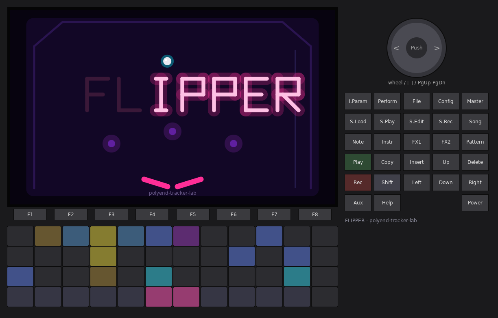
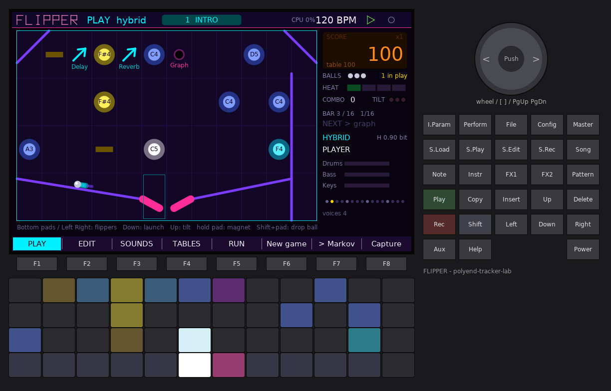
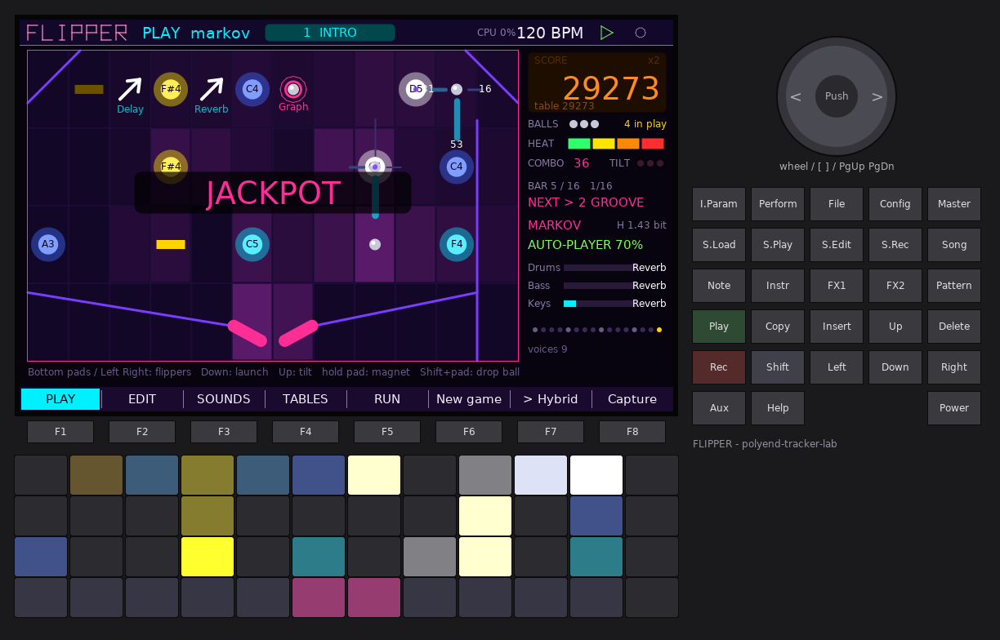
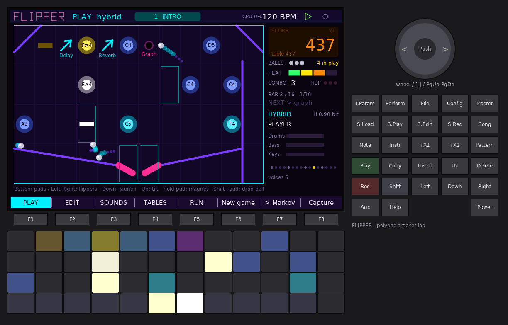
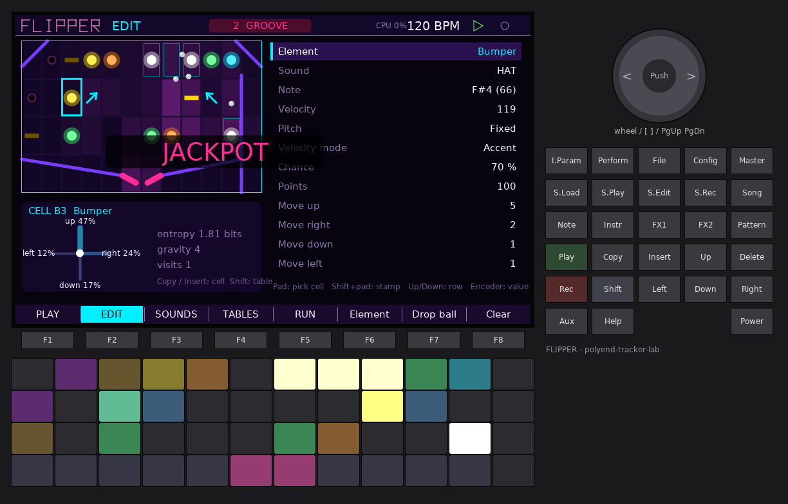
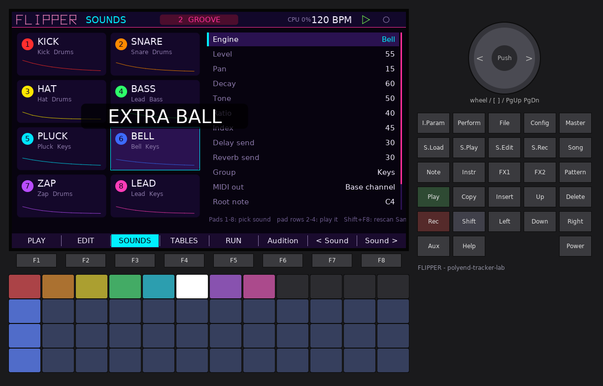
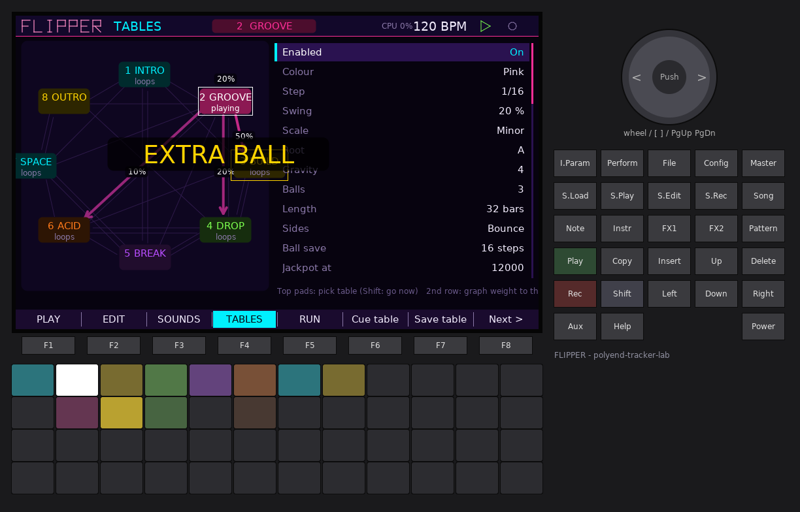
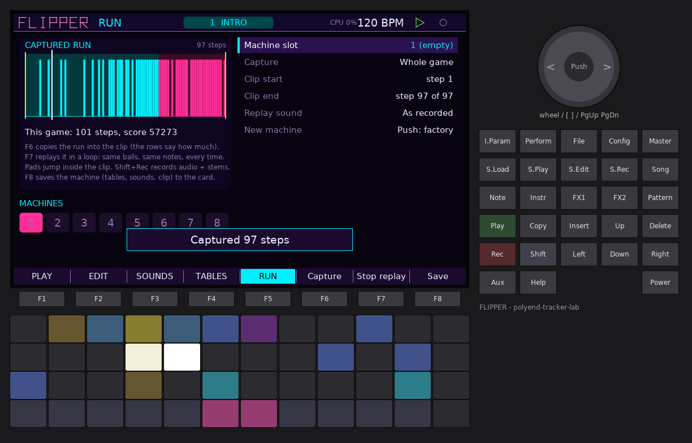
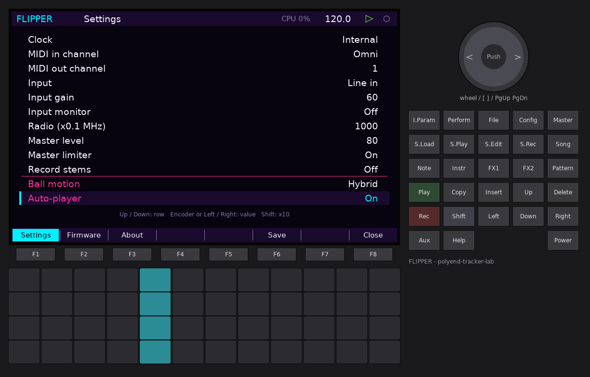

# FLIPPER: the song is a pinball machine

FLIPPER is a firmware for the **original Polyend Tracker** (polyend-tracker-lab, built on
OpenTracker). It turns the Tracker into a pinball workstation. Balls run over a table,
and everything they touch makes music:

- **Bumpers** are instruments. A hit plays an internal sound and sends a MIDI note.
- **Ramps** are effects. Passing a ramp sweeps a filter, crushes, stutters, or throws
  into the delay or reverb.
- **Holes and targets** are events: change the table, multiball, ball save, a score
  multiplier, mutation, an extra ball, a jackpot.
- **Flippers** are you. Play them on the pads; when you stop, an auto-player takes over.
- **Tables** are the parts of your song. A Markov graph between tables, plus game
  events, decides which part comes next.

The ball moves in one of two ways, chosen in Settings:

- **Hybrid.** On screen the ball is a real physical ball, with gravity, collisions,
  flipper impulses and bumper kicks. On the pad grid a "grid ball" jumps from cell to
  cell on the beat, using Markov probabilities that lean toward wherever the real ball is.
- **Markov only.** The ball steps one cell per musical step, locked to the tempo. Each
  cell has its own transition weights (up / right / down / left), like the Pinball 2
  Max for Live device.

---

## Contents

1. [Quick start](#1-quick-start)
2. [Concepts](#2-concepts)
3. [Controls on every page](#3-controls-on-every-page)
4. [PLAY page (F1)](#4-play-page-f1)
5. [EDIT page (F2): the table editor](#5-edit-page-f2-the-table-editor)
6. [SOUNDS page (F3)](#6-sounds-page-f3)
7. [TABLES page (F4): the song graph](#7-tables-page-f4-the-song-graph)
8. [RUN page (F5): capture, replay, machines](#8-run-page-f5-capture-replay-machines)
9. [Settings (Config button)](#9-settings-config-button)
10. [Sounds, effects and stems in detail](#10-sounds-effects-and-stems-in-detail)
11. [Game rules in detail](#11-game-rules-in-detail)
12. [MIDI](#12-midi)
13. [Files on the card](#13-files-on-the-card)
14. [Tips](#14-tips)
15. [Limits](#15-limits)

---

## 1. Quick start

1. Copy `PolyendTrackerFLIPPR.ptf` to `/Firmware` on the card and install it the way you
   install any Tracker firmware. You can always go back from **Config > Firmware**.
2. After the 2.7-second intro (a ball shot through the logo; any key skips it), you land
   on the **PLAY** page with the factory machine: eight tables called INTRO, GROOVE,
   BUILD, DROP, BREAK, ACID, SPACE and OUTRO.
3. Press **Play**. The auto-player launches the ball and starts playing the table.
4. Take over whenever you like: the **bottom pad row** (left half = left flipper,
   right half = right flipper) or **Left / Right**. **Down** launches a ball, **Up**
   nudges the table (tilt).
5. Hold any upper pad to pull the ball toward it with a magnet. Press **Shift + pad** to
   drop extra balls there (multiball).
6. Turn the **encoder** to cue the next table, or let the song graph pick it.
7. Liked that run? Press **F8 (Capture)**, then on **RUN (F5)** press **F7** to replay
   it as a fixed loop. **Shift + Rec** records the audio.
8. On the RUN page, **F8** saves everything (tables, sounds, clip) to the card.

## 2. Concepts

| Term | What it is |
| --- | --- |
| **Machine** | The whole song: 8 tables, 8 sounds, play settings and a captured clip. 8 machine slots on the card. |
| **Table** | One part of the song. A 12 x 4 grid of cells, the same layout as the pads. It has its own tempo division, swing, scale, gravity, ball count, length and graph. |
| **Cell** | One square of the table, holding an element (empty, bumper, ramp, hole, target, flipper, wall) and four Markov weights. |
| **Step** | The musical step of the table: 1/4, 1/8, 1/16, 1/32, 1/8T or 1/16T. Grid balls move once per step. |
| **Heat** | 0 to 4. Hits, ramps and multiball raise it; drains and time lower it. Rails (backbeat lanes) join as the heat rises, and velocities get louder. |
| **Rails** | Three Euclidean backbeat lanes per table (kick, hat, snare in the factory tables). Each one plays once the heat reaches its threshold. |
| **Graph** | The weights from each table to every table (0 to 9). When a table ends, the next one is drawn from these weights. |
| **Run** | Everything the game did, step by step, kept in memory (8192 steps). |
| **Clip** | A captured part of the run. It replays as a fixed sequence and is saved with the machine. |

### Hybrid and Markov only

**Hybrid.** The round ball is simulated: gravity (the table's *Gravity*), slopes,
bumpers that kick it away, targets, holes that catch slow balls, ramps that throw it
along their arrow, and flippers whose swing sets the impulse. Every real contact plays
the element at full velocity. A *Speed* velocity mode follows the impact speed.

The pads show the **grid ball** (also drawn on screen as a square outline). Each step it
jumps to a neighbouring cell, picked from that cell's Markov weights tilted toward the
real ball (Settings > *Hybrid: grid follows the ball*). When the real ball has moved far
away, the grid ball catches up in one jump. When the grid ball lands on a bumper or
target, it plays that element softer (Settings > *Hybrid: grid ball plays*). Together the
two views make a groove: hard hits from the physics, a steady pulse from the grid.

**Markov only.** No physics. Each step, the ball moves to a neighbour picked from the
cell's weights. *Gravity* makes down more likely and up less likely, and a ball that
keeps moving one way gets a little momentum. The arrows around the ball preview the next
step, labelled with percentages; the HUD shows the entropy of that choice in bits. A
move off the bottom row is a drain. On a flipper cell, a flip kicks the ball diagonally
up for a number of steps set by the flipper's *Power*.

## 3. Controls on every page

| Control | Action |
| --- | --- |
| **F1..F5** | Pages: PLAY, EDIT, SOUNDS, TABLES, RUN |
| **F6..F8** | Page actions (labelled at the bottom of the screen) |
| **Play** | Start / stop the transport. Starting also starts a game if none is running. |
| **Shift + Rec** | Record the master output (and stems) to the card (Shell recorder) |
| **Config** | Settings, firmware update, about |
| **Help** | A help card for the current page (Help again closes it) |
| **Note** (hold) | Filter sweep on all groups (performance effect) |
| **Instr** (hold) | Bit crush on all groups |
| **FX1** (hold) | Stutter: repeats the current slice |
| **FX2** (hold) | Delay throw |
| **Pattern** (hold) | Reverb throw |
| **MIDI notes in** | Notes 36..83 press pads 1..48 (Settings > *MIDI in notes play pads*) |

## 4. PLAY page (F1)

**Screen.** On the left is the playfield. Bumpers are coloured by their sound and labelled
with their note; ramps are cyan arrows labelled with their effect and glow white while
the effect sweeps; holes show their event; targets light yellow once hit; walls and
slopes are violet; the flippers are pink. The balls leave a short trail (Settings >
*Ball trails*). In Markov mode the cells darken or brighten with how often balls have
visited them (heat trail).

On the right is the HUD: a DMD-style score, the multiplier and the table score; balls
left and balls in play; the heat meter; combo and tilt warnings; the bar within the
section and the step rate; the **next** table if one is cued; the ball mode and entropy;
who is playing (PLAYER, AUTO-PLAYER and its skill, or REPLAY); level meters for the
Drums, Bass and Keys groups with the effect currently sweeping each; the step dots of the
bar; the number of voices sounding.

**Pads.** The pads mirror the table. Bumpers glow in their sound's colour and flash white
on a hit, ramps are blue, holes violet, targets amber (yellow when lit), flippers pink
(white while up). The ball is a white pad. The whole grid turns red while the table is
tilted.

| Control | Action |
| --- | --- |
| Bottom pad row, left half / right half | Left / right flipper (velocity sets the power in Markov mode) |
| A flipper's own pad (anywhere) | That flipper |
| Bottom-row pad of the plunger lane (column 12) | Launch |
| **Left / Right** | Left / right flipper |
| **Down** or **encoder push** | Launch a ball (when none is in play) |
| **Up** | Nudge (tilt). Scatters the balls and stutters the sound for a moment. Three nudges within a few bars tilt the table: the flippers die for one bar. |
| Hold an upper pad | Magnet: pulls the ball(s) toward that cell (physics and Markov) |
| **Shift + pad** | Drop an extra ball on that cell (up to 4 balls) |
| **Encoder** | Cue the next table (the switch happens at the next bar, see Settings > *Table change*) |
| **F6 New game** | A fresh game on the current table (starts the transport) |
| **F7** | Switch between Hybrid and Markov only |
| **F8 Capture** | Copy the run into the clip (the amount is set on the RUN page) |
| **Delete** | Remove the balls (the music keeps going on the rails); **Down** starts again |

**Auto-player.** Once you have not touched a flipper, the launch or the tilt for
*Auto-player takes over after* seconds (default 3), the auto-player plays: it launches
new balls and flips when a ball comes down onto a flipper. *Auto-player skill* sets how
well it aims and how often it misses. At 100 % it rarely drains; at 0 % it is clumsy. In
Markov mode, skill is the chance that it flips when a ball sits on a flipper. Any flipper
press hands control back to you at once.

## 5. EDIT page (F2): the table editor

The editor works on the table that is playing, and every change is live. The top left
shows a small copy of the table with the selected cell framed. Below it is the **compass**:
the move probabilities of the selected cell (including gravity, walls and the edge),
its entropy, the table's gravity and how often balls have visited the cell. On the right
is the list of the cell's values.

| Control | Action |
| --- | --- |
| **Pad** | Select that cell (and hear its sound) |
| **Shift + pad** | Stamp: copy the selected cell onto that pad's cell |
| **Shift + arrows** | Move the selection |
| **Up / Down** | Select a row |
| **Encoder**, **Left / Right** | Change the value (Shift: by octave / x10 where it applies) |
| **F6 Element** | Next element type (Shift + F6: previous) |
| **F7 Drop ball** | Drop a ball on the selected cell (starts the transport) |
| **F8 Clear** | Press twice: empty the whole table (name and rails stay) |
| **Copy** / **Insert** | Copy / paste a cell |
| **Shift + Copy** / **Shift + Insert** | Copy / paste a whole table (keeps the destination's name) |
| **Delete** | Empty the cell (keeps its Markov weights) |
| **Encoder push** | Audition the cell's sound |

### Elements and their rows

| Element | Rows |
| --- | --- |
| **Empty** | Move up / right / down / left |
| **Bumper** | Sound (one of 8, or None), Note, Velocity, Pitch, Velocity mode, Chance, Points, Move weights |
| **Ramp** | Effect, Amount, Sweep length, Effect on (groups), Throw direction, Sound, Note, Velocity, Points, Move weights |
| **Hole** | Event, Event table, Hold, Sound, Note, Velocity, Points, Move weights |
| **Target** | Event, Event table, Sound, Note, Velocity, Points, Move weights |
| **Flipper** | Side (left / right), Power (1..9), Sound, Note, Velocity, Points, Move up weight |
| **Wall** | Shape: Block, Slope \ (rolls the ball right), Slope / (rolls it left) |

- **Move up / right / down / left** (0..9): the Markov weights. 0 means never. Walls
  and the table edges block a direction whatever its weight. In physics mode these
  weights only steer the grid ball.
- **Pitch**: *Fixed* plays the note. *Walk* takes a random step up or down the table's
  scale on each hit. *Combo* climbs the scale with the combo count. *Ball* transposes by
  the ball number (each multiball ball plays its own line). *Random* picks one of five
  scale degrees above the note.
- **Velocity mode**: *Fixed*; *Speed* (ball speed in physics, momentum in Markov);
  *Accent* (loud on every 4th step); *Random*. Heat adds a little on top.
- **Chance**: the chance that a hit plays (scoring always counts).
- **Points**: points per hit before the multiplier and combo bonus.
- **Ramp**: *Effect* (Filter, Crush, Stutter, Delay, Reverb), *Amount* (depth), *Sweep
  length* (in steps: the envelope rises quickly, then falls over this length), *Effect
  on* (Drums / Bass / Keys groups, any mix), *Throw direction* (8 directions or *Keep*:
  the ball is thrown along the arrow in physics and is carried two steps that way in
  Markov mode).
- **Hole**: catches the ball for *Hold* steps, then spits it out diagonally down, and
  fires its *Event*.
- **Target**: lights up when hit and fires its *Event*. Lighting every target on the
  table scores a **bank bonus** (5,000 and heat).
- **Events**: see [Game rules](#11-game-rules-in-detail).

## 6. SOUNDS page (F3)

There are eight sounds per machine. Each card shows the sound's number, colour, name,
engine, group and a sketch of its decay.

| Control | Action |
| --- | --- |
| Pads 1..8 (top row) | Select a sound and hear it |
| Pads in rows 2..4 | Play the selected sound chromatically (36 notes from an octave below its root) |
| **Up / Down**, **Encoder**, **Left / Right** | Row and value (Shift: x10, or an octave on Root note) |
| **F6** or **encoder push** | Audition |
| **F7 / F8** | Previous / next sound |
| **Shift + F8** | Rescan `Samples/` and reload all samples |

Rows: **Engine**, **Level**, **Pan**, **Decay**, **Tone**, **Character A**, **Character B**
(the two character rows are renamed per engine), **Delay send**, **Reverb send**,
**Group** (Drums / Bass / Keys), **MIDI out** (Off, Base channel, or Channel 1..16),
**Root note**, **Colour**, **Sample**.

| Engine | Tone | Character A | Character B |
| --- | --- | --- | --- |
| **Kick**: sine with a pitch drop and soft clip | drive | punch (pitch drop depth) | sweep time |
| **Snare**: tuned body + band-passed noise | noise brightness | noise vs body | - |
| **Hat**: filtered noise / metallic squares | high-pass frequency | metal | - |
| **Zap**: pitch-swept FM blip (lasers, toms) | sweep speed | sweep depth | FM amount |
| **Pluck**: Karplus-Strong string | brightness | body | - |
| **Bell**: two-operator FM bell | index decay | ratio (8 ratios) | index |
| **Lead**: saw / square through a resonant low-pass with an envelope (bass, acid) | cutoff | saw -> square | resonance |
| **Sampler**: a WAV file from the card | low-pass | - | - |

**Sampler.** Put WAV files (any rate, 8 to 32 bit or float, mono or stereo) into
`Lab/FLIPPER/Samples/` on the card. Choose one in the *Sample* row; the sound's engine
switches to Sampler. Files are converted to 44.1 kHz mono (the left channel of a stereo
file), up to 6 seconds per sound. *Root note* is the note that plays the sample at its
own pitch. *Decay* 99..100 means **Hold**: the sample plays to its end. A sound set to
Sampler with no file stays silent ("no WAV" on its card).

## 7. TABLES page (F4): the song graph

On the left is the song as a graph: one box per table. The playing table is filled
bright, the selected table is framed white, and a table cued next is framed yellow. The
arrows leaving the selected table are drawn bright and labelled with their real
probabilities; the other tables' arrows are faint. "loops" means a table may repeat
itself.

| Control | Action |
| --- | --- |
| Pads 1..8 (top row) | Select a table (Shift: switch to it now) |
| Pads 13..20 (second row) | Graph weight from the selected table to that table: cycles 0, 3, 6, 9. The pads show the weights as brightness. |
| **Up / Down**, **Encoder**, **Left / Right** | Row and value |
| **F6 Cue table** | Cue the selected table for the next bar (Shift + F6: now) |
| **F7 Save table** | Save the selected table to `Tables/<NAME>.FPT` |
| **F8 Next** | Select the next table |
| **Encoder push** | On *Factory preset*: twice loads the preset into the selected table. On *Table file*: loads that file into it. |

Rows for the selected table:

| Row | Values |
| --- | --- |
| Enabled | Off tables are never picked by the graph (at least one table stays on) |
| Colour | Cyan, Pink, Yellow, Green, Violet, Orange |
| Step | 1/4, 1/8, 1/16, 1/32, 1/8T, 1/16T |
| Swing | 0..75 % (delays every second step) |
| Scale / Root | Chromatic, Major, Minor, Dorian, Phrygian, Lydian, Mixolydian, Harmonic minor, Pentatonic major / minor, Blues, Whole tone; the root note. Used by the Walk / Combo / Ball / Random pitch modes. |
| Gravity | 0..9 (physics: pull; Markov: chance of moving down) |
| Balls | Balls per game on this table, 1..9 or Endless |
| Length | Until game over, or 4 / 8 / 16 / 32 / 64 / 128 bars. When the length is up, the graph picks the next table. |
| Sides | Bounce off the side walls, or Wrap around (leave right, come back left) |
| Ball save | Steps after a launch during which a drain gives the ball back |
| Jackpot at | Table score that triggers the jackpot (x1000), or Off |
| On jackpot / Jackpot table | Stay, Graph, Go to (table), Multiball |
| On multiball / Multiball table | What happens when multiball starts: Stay, Graph, Go to |
| On game over / Game over table | When the last ball drains: Stay (restart this table), Graph, Go to |
| Graph -> 1..8 | Weights 0..9 to each table |
| Rail 1..3 | sound, note, hits (0..16), steps (1..16), rotate, from heat (0..4, or Off) |
| Factory preset | INTRO .. OUTRO: generates that style of table |
| Table file | The `.FPT` files in `Tables/` |

## 8. RUN page (F5): capture, replay, machines

FLIPPER records every step of the game in memory: the table, the heat, where each ball
was and what it played, and which ramp effect fired. **Capture** copies that into the
**clip**, which you can replay as a fixed sequence. That way a good run becomes a part
you can rely on in a set or edit further.

The timeline shows the clip coloured by table, with bars for note density. The yellow
markers are the loop start and end; the white line is the replay position.

| Control | Action |
| --- | --- |
| **F6 Capture** | Capture: whole game, or the last 4 / 8 / 16 / 32 / 64 bars (row *Capture*) |
| **F7 Replay / Stop replay** | Loop the clip between start and end. Balls, notes, table changes and ramp effects come back exactly. The rails keep playing, following the recorded heat. |
| **F8 Save** | Save the machine to the selected slot |
| Pads 1..48 | Jump: the loop starts at that 1/48 of the clip |
| Row *Machine slot* | 1..8. Push the encoder twice to **load** that machine. |
| Row *Clip start / Clip end* | The loop (Shift: steps of 16) |
| Row *Replay sound* | *As recorded*, or *Live table sounds*: each step plays the element's current sound and note, so you can re-voice a captured run on the EDIT and SOUNDS pages while it loops. |
| Row *New machine* | Push twice: load the factory machine. Autosave pauses until you save it to a slot with F8, so the slot you came from is not overwritten. |

**Recording audio.** **Shift + Rec** starts and stops the Shell recorder, which writes
`Lab/FLIPPER/Rec/REC-nnnn.wav`. With **Config > Record stems** on, four stereo stems are
written next to it: **stem1** drums group, **stem2** bass group, **stem3** keys group,
**stem4** delay + reverb returns. A run (or a replayed clip) recorded this way is ready
to mix in a DAW.

## 9. Settings (Config button)

The general rows come first: brightness, boot intro, tempo, clock (internal / send /
follow MIDI), MIDI channels, input, master, limiter, record stems. They are the same in
every lab firmware. FLIPPER's own rows are below the pink line:

| Row | Values | Default |
| --- | --- | --- |
| Ball motion | Hybrid / Markov only (same as F7 on PLAY) | Hybrid |
| Auto-player | On / Off | On |
| Auto-player takes over after | 1..10 s without player input | 3 s |
| Auto-player skill | 0..100 % | 70 % |
| Hybrid: grid follows the ball | 0..100 %: how strongly the grid ball chases the real ball | 70 % |
| Hybrid: grid ball plays | On / Off: the grid ball plays the bumpers and targets it lands on (softer) | On |
| Table change | Next bar / Every 2 bars / Every 4 bars: when cued or event table changes happen | Next bar |
| Bumper notes to MIDI out | On / Off | On |
| MIDI in notes play pads | On / Off | On |
| Ball trails | On / Off | On |
| Start table | 1..8: the table of a new game | 1 |
| Pad brightness | Low / Medium / High | High |

These rows are saved with the machine. **F6 Save** on the Settings page also saves the
machine to its slot.

## 10. Sounds, effects and stems in detail

- **Voices**: 10, shared by all sounds. Drums restart their own voice (a hi-hat chokes
  itself); a Bass-group sound is monophonic; otherwise the quietest or oldest voice is
  taken. Notes start at their exact sample position inside the audio block, so timing
  stays tight at any tempo.
- **Groups**: each sound belongs to Drums, Bass or Keys. Each group is a stereo bus with
  its own insert effects (filter, crush, stutter) and its own stem.
- **Ramp effects** (and the performance keys):
  - *Filter*: a resonant low-pass sweeping down and back up.
  - *Crush*: sample-rate reduction and quantisation.
  - *Stutter*: grabs the last 1/4, 1/2 or whole step (depending on the amount) and repeats it.
  - *Delay*: throws the group into the delay (dotted eighth, ping-pong, darkened repeats).
  - *Reverb*: throws the group into the reverb.
- **Delay / reverb sends** per sound: always-on sends. The two effects idle when nothing
  reaches them.
- The Shell adds the master level and limiter after FLIPPER's mix.

## 11. Game rules in detail

**Launch.** Balls start in the plunger lane (column 12) and shoot up. In Markov mode a
ball that steps back down into the lane is launched again.

**Drains and balls.** A ball leaving the bottom drains, unless *Ball save* is still
running for it (it comes back at once). When the last ball in play drains, the next one
launches after a short pause (by you, or by the auto-player). When no balls are left,
it is **game over**: the table's *On game over* action decides the next part (*Stay*
restarts this table with fresh balls). The music never stops for a game over.

**Score.** Points x 10 x multiplier, plus a combo bonus of up to 4x for fast strings of
hits. The table score triggers the **jackpot** at its threshold, once per visit to the
table.

**Heat** rises with every hit (ramps and holes count more), with bank bonuses and
multiball (+1 per extra ball), and cools down over time and with drains. Heat 1..4 brings
in the rails with a matching *from heat* value and adds velocity.

**Combo** counts hits that follow each other within a bar.

**Events** (holes and targets):

| Event | Effect |
| --- | --- |
| Graph | Cue the next table from this table's graph |
| Go to | Cue a specific table (*Event table*) |
| Multiball | Fill up to 4 balls, launched from the hole |
| Ball save | Every ball in play is saved for *Ball save* steps |
| Multiply | Score multiplier x2, up to x8 (for this game) |
| Mutate | Shuffles some Markov weights of this table and the bumpers' melodic walks. This changes the table, and the change is kept: copy the table first if you want to return to it. |
| Extra ball | One more ball |
| Jackpot | +20,000 and the table's *On jackpot* action |

**Table transitions** happen at the next bar (Settings > *Table change*). These cue a
transition:

- the end of the table's *Length* (the graph picks),
- events: Graph, Go to, Jackpot,
- the table's jackpot, multiball and game-over actions,
- you: the encoder on PLAY, F6 on TABLES, pads on TABLES (Shift: at once).

Balls in play stay where they are when the table changes. A ball that would end up
inside a wall moves up out of it.

**Tilt.** Each nudge scatters the balls (physics: a kick; Markov: a jump to a random
cell) and stutters the sound. A third nudge within a few bars **tilts**: the flippers are
dead for one bar and the pads flash red. The meter drains again slowly.

## 12. MIDI

- **Out** (DIN and USB): every bumper, ramp, hole, target, flipper and rail note is sent
  on the Settings > *MIDI out channel* (sounds set to *Base channel*) or on the sound's
  own channel. Each note lasts about 90 % of a step. The grid ball's notes in hybrid mode
  are sent too. Turn MIDI off per sound (*MIDI out: Off*) or for the whole machine
  (*Bumper notes to MIDI out*).
- **Clock**: Settings > *Clock* sends MIDI clock or follows an external one. FLIPPER
  follows the Shell's tempo and transport.
- **In**: notes 36..83 (C2..B5) act as pads 1..48 on every page, with velocity. On PLAY,
  this lets a MIDI keyboard or controller play the flippers, the magnet and multiball.

## 13. Files on the card

All files are in `Lab/FLIPPER/`:

| Path | Contents |
| --- | --- |
| `MACHINE1.FLP` .. `MACHINE8.FLP` | Machines: settings, 8 sounds, sample paths, 8 tables, the clip |
| `state.bin` | The slot that was used last (loaded at boot) |
| `Samples/*.wav` | Your WAV files for the sampler |
| `Tables/*.FPT` | Single tables saved from the TABLES page |
| `Rec/REC-nnnn.wav` (+ `-stem1..4`) | Recordings |
| `settings.bin` | The Shell's general settings |

The machine is saved automatically to its slot every 5 minutes, at power off and with
Config > F6. **F8** on RUN saves to the selected slot.

**File format** (`.FLP` and `.FPT`, version 1): the magic `FLPR`, a version number, then
tagged chunks (`GLOB`, `INST` x 8, `SMPL`, `TABL` x 8, `CLIP`, `END `), each with a
length. Unknown chunks are skipped and missing ones keep their defaults, so future
FLIPPER versions read these files and this version reads theirs. Every value is
range-checked on load. A `.FPT` file is the same format holding one table.

The card may be missing: FLIPPER then runs from the factory machine and simply cannot
save or load.

## 14. Tips

- **Build a song.** Make INTRO loop on itself with a little weight to GROOVE. Give GROOVE
  a jackpot that goes to DROP, and give DROP a short length and a strong arrow back to
  GROOVE. The game then decides *when* things happen; you decide *what can* happen.
- **Groove from geometry.** Place bumpers on the cells balls visit most (watch the heat
  trail in Markov mode) and high weights between them. Kick or snare bumpers next to the
  flippers make every flip a beat.
- **Melodies.** Use *Walk* or *Combo* pitch on a scale; *Ball* pitch with multiball gives
  every ball its own line.
- **Entropy.** Low entropy (one strong weight per cell) gives repeating riffs; even
  weights give chaos. Holes with *Mutate* slowly evolve a table during a set.
- **Live.** Let the auto-player run at 60..80 % skill, and step in for fills: hold a pad
  to magnet the ball onto a ramp, nudge for a stutter, or Shift + pad for multiball at
  the drop.
- **Capture often.** Capture (F8 on PLAY) costs nothing. Replay with *Live table sounds*
  turns a lucky run into a part you can re-voice.
- **Samples.** Short one-shots (drums, stabs, vocal chops) suit bumpers; set *Decay* to
  *Hold* for a full sample.

## 15. Limits

| | |
| --- | --- |
| Tables per machine | 8 (12 x 4 cells each) |
| Balls at once | 4 |
| Sounds | 8; 10 voices in total |
| Sample length | 6 s per sound, mono, converted to 44.1 kHz |
| WAVs listed | 48 from `Samples/`, path up to 63 characters |
| Table files listed | 16 from `Tables/` |
| Run memory | 8192 steps (512 bars of 1/16) |
| Clip | 4096 steps (256 bars of 1/16) |
| Rails | 3 per table, 16 steps max |
| Effects | Filter, crush and stutter per group; one delay and one reverb |

Not included in this version: velocity-sensitive pads in Hybrid mode (velocity sets the
flipper power in Markov mode only), recording player input into the clip separately from
the balls, and per-table tempo (the Shell's tempo applies to all tables; each table has
its own step rate and swing).
