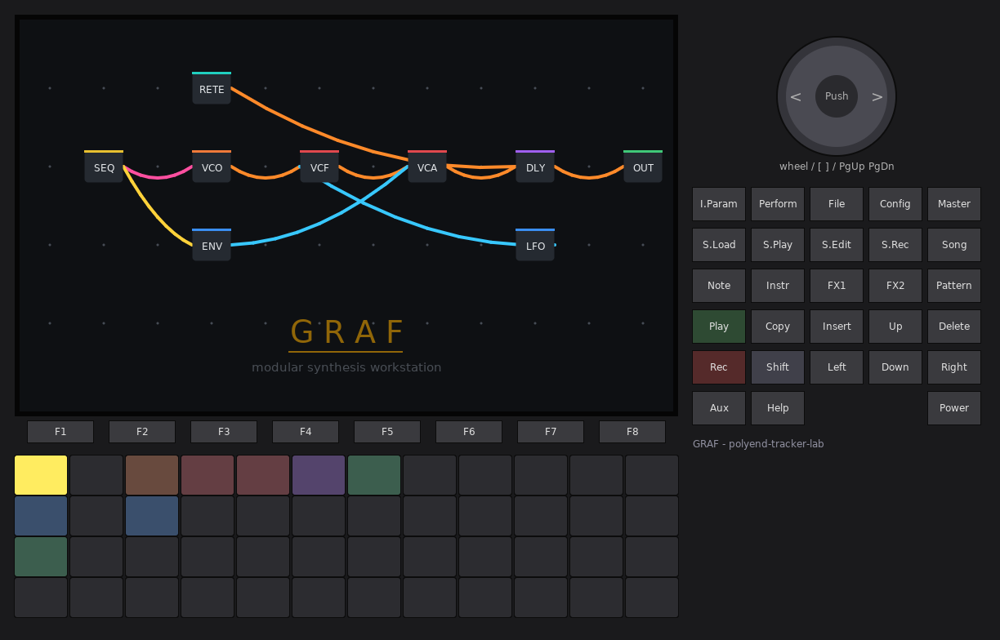
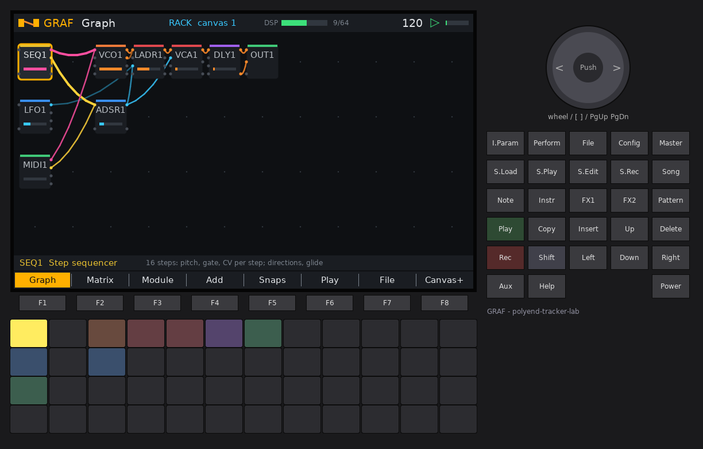
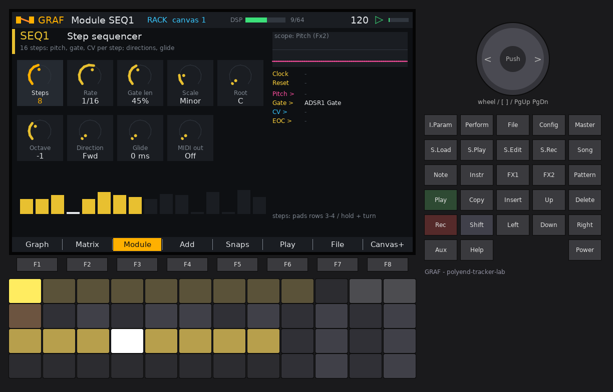
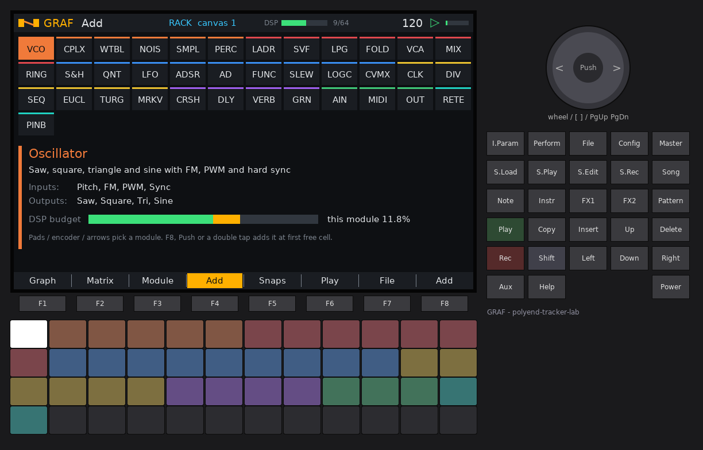
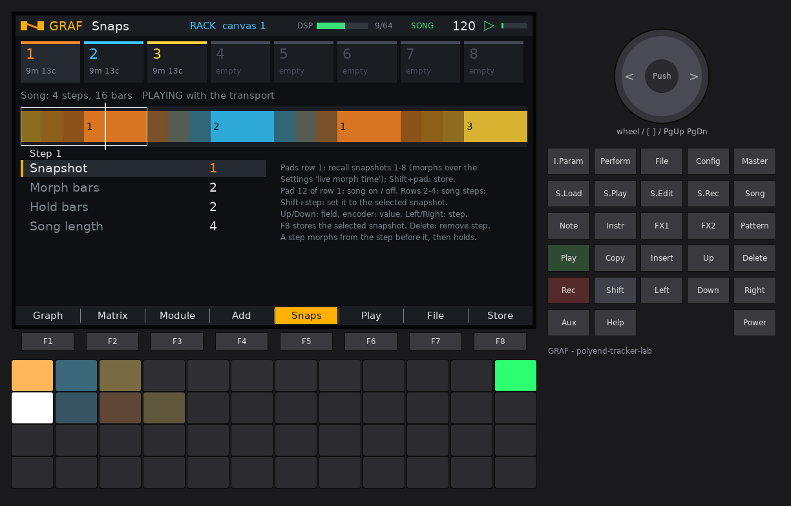
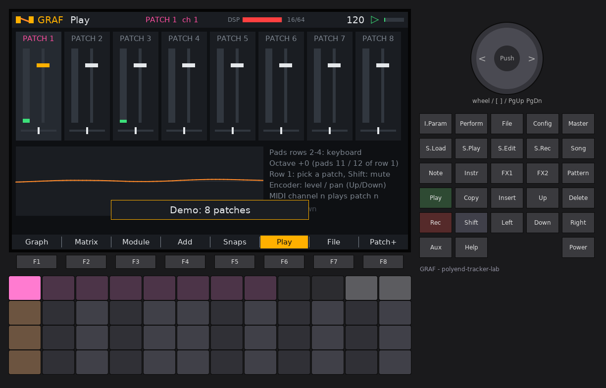
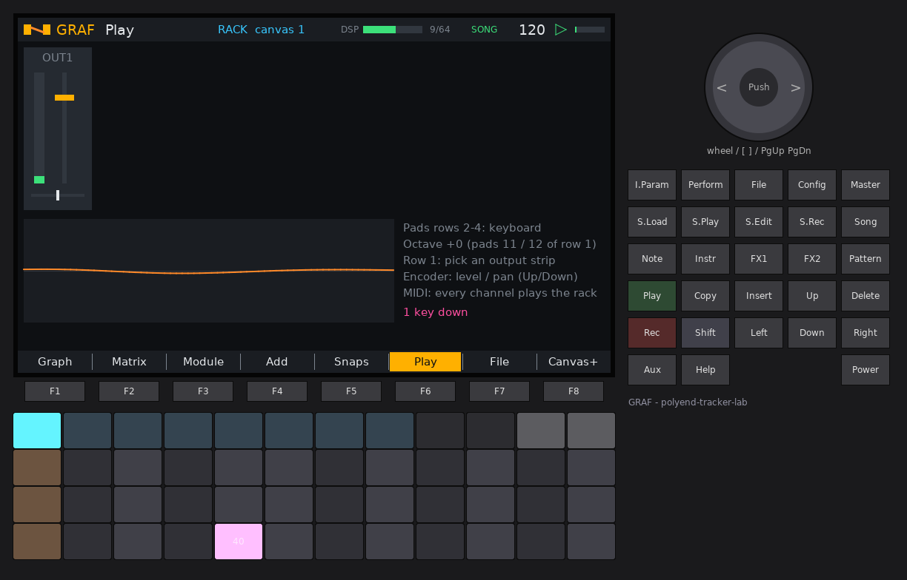
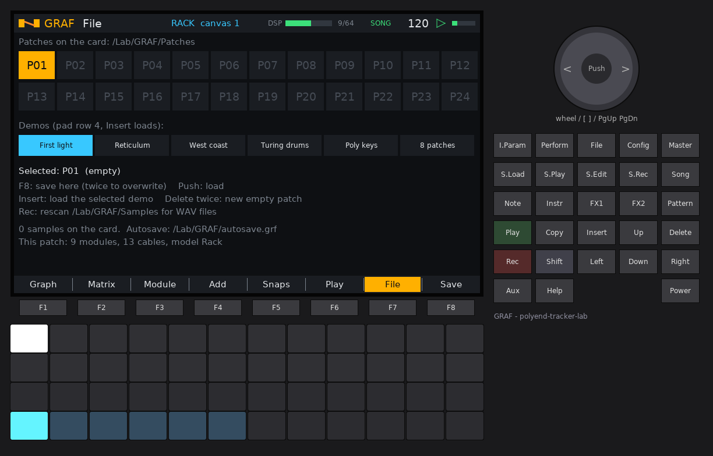
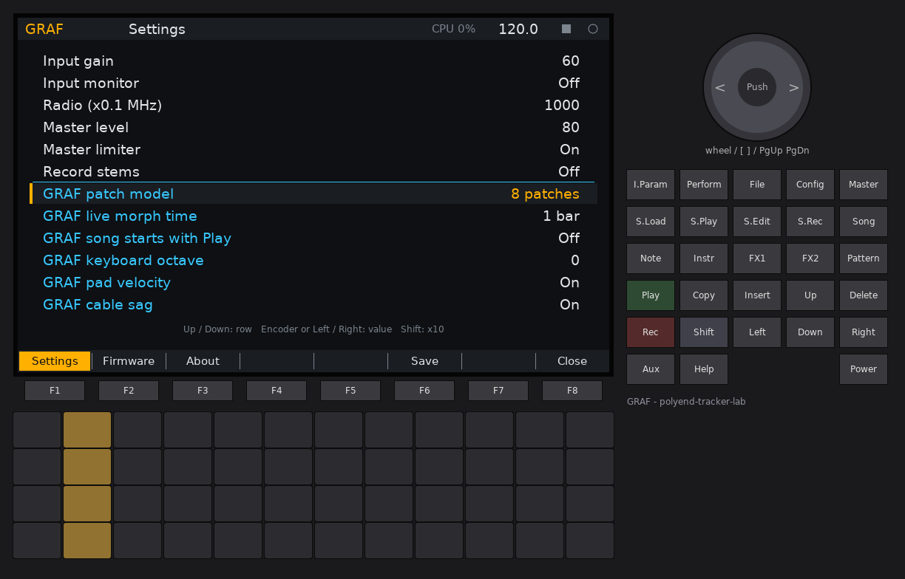

# GRAF -- user manual

GRAF turns the original Polyend Tracker into a **modular synthesizer**. You
place modules (oscillators, filters, envelopes, sequencers, effects, a
recurrent noise network, a pinball sequencer...) on a grid, patch them
together with virtual cables and play the result from the pads, from MIDI or
from its own sequencers. Patch states can be stored as **snapshots** and a
**song** morphs from one snapshot to the next along a timeline.

There are two ways to patch, and they always show the same patch:

- the **pin matrix** on the pads, like the pin boards of the EMS VCS3 / Synthi:
  rows are module outputs, columns are module inputs, a lit pad is a cable;
- the **graph** on the screen: modules are boxes, cables are lines from output
  jacks to input jacks, coloured by what they carry.

GRAF is a firmware of the polyend-tracker-lab family, built on OpenTracker.
The **Config** button (settings, firmware update, about), **Play** (transport)
and **Shift + Rec** (recorder) work the same way in every lab firmware.

## Contents

1. [Concepts](#concepts)
2. [Quick start: your first patch](#quick-start-your-first-patch)
3. [Controls at a glance](#controls-at-a-glance)
4. [The pages](#the-pages)
5. [Settings](#settings)
6. [Files on the card](#files-on-the-card)
7. [Modules](#modules)
8. [Tips](#tips)
9. [Limits](#limits)

## Concepts

**Modules and cells.** Every module sits in one of the 48 cells of a
**canvas** -- one cell per pad, 12 columns by 4 rows, so on the Graph page the
pad under your finger *is* the module on the screen. A module has input jacks
(left edge of its box), output jacks (right edge) and knobs. Modules are named
by type and number: `VCO1`, `VCO2`, `LADR1`...

**Signals.** Everything is a stream of numbers at 44.1 kHz, so any output can
go into any input. Jacks and cables are coloured by the kind of signal the
module expects or makes:

| Colour | Kind | Range |
| --- | --- | --- |
| orange | audio | about -1..+1 |
| blue | CV (control voltage) | -1..+1, or 0..1 for envelopes |
| yellow | gate / trigger | 0 or 1 (high above 0.5) |
| pink | pitch | 1.0 = one octave; 0 = middle C at an oscillator with Octave 0 |

**Cables.** A cable carries one output to one input, multiplied by its
**amount** (an attenuverter, -2..+2). Several cables into the same input are
added. Feedback loops are allowed: a module that is part of a loop hears the
other module's output from the previous block (2.9 ms later).

**Patch models** (Settings > GRAF patch model):

- **Rack** -- one big patch, like a Eurorack case. The 8 canvases are just 8
  pages of space (64 modules at most); cables may run between canvases. Each
  MIDI module chooses a voice, so a rack can hold one mono synth, a 4-voice
  poly synth, drums and effects at the same time. Every MIDI channel plays the
  rack.
- **8 patches** -- eight separate small patches, one per canvas, each with its
  own mixer strip (level, pan, mute) on the Play page. MIDI channel *n* plays
  patch *n*; the pad keyboard plays the patch you are looking at. Cables stay
  inside their patch (switching from Rack removes cables that cross canvases).

**DSP budget.** The audio processor has a fixed amount of time for every
block of 128 samples. Each module type and each cable has a measured cost, and
GRAF refuses to add a module or cable that would not fit -- it shows *CPU
budget full* instead of letting the audio break up. The **DSP** bar at the top
of every page shows how full it is.

**Snapshots** store the whole patch: which modules sit where, their knobs,
their sequences and every cable. Recalling a snapshot **morphs** to it:
knobs glide, cables fade in and out, modules that are only in the new
snapshot appear at the start, modules that are not in it disappear at the end.
Modules are matched by position (canvas and cell) and type.

**Song.** A list of up to 32 steps: *snapshot n, morph over M bars, then hold
H bars*. While the transport plays, the song follows the bar position and
loops at the end.

## Quick start: your first patch

This builds *sequencer -> oscillator -> VCA -> output* with an envelope, from
an empty canvas. (GRAF starts with the "First light" demo the first time; the
same patch with a filter and a delay.)

1. **Clear.** Press **F7** (File), then **Delete** twice: a new empty patch.
   Press **F1** (Graph).
2. **Add a sequencer.** Tap **pad 1** (top left) twice: the first tap puts the
   cursor there, the second opens the Add page for that cell. The Add page
   lists every module on the pads and the screen in the same layout; tap the
   **SEQ** pad (row 3, column 1) and press **F8** (Add). `SEQ1` appears in the
   top-left cell.
3. **Add an oscillator, an envelope, a VCA and an output** the same way:
   pad 2 (top row) -> **VCO** (row 1, column 1); pad 14 (row 2, column 2) ->
   **ADSR** (row 2, column 5); pad 3 -> **VCA** (row 1, column 11); pad 4 ->
   **OUT** (row 3, column 11). Each time: tap the empty pad twice, tap the
   module, **F8**.
4. **Patch.** Hold the **SEQ1** pad and tap the **VCO1** pad: GRAF connects
   the first matching jacks, *SEQ1 Pitch > VCO1 Pitch*, and says so. Still
   holding SEQ1, tap **ADSR1**: *SEQ1 Gate > ADSR1 Gate*. Then hold VCO1, tap
   VCA1 (*Saw > In 1*); hold ADSR1, tap VCA1 (*Env > CV 1*); hold VCA1, tap
   OUT1 (*Out 1 > L*).
5. **Play.** Press **Play**. The sequencer runs with the transport and you
   hear the melody.
6. **Tweak.** Select VCO1 (tap its pad) and press **F3** (Module): the top row
   of pads picks a knob, the encoder turns it. Try *Octave* and *PW*. Press
   **F2** (Matrix) to see every cable as a lit pin: tap an empty pin to add a
   cable (try *SEQ1 CV > VCO1 PWM*), hold a pin and turn the encoder to set its
   amount, tap a lit pin to remove it.
7. **Snapshot.** Press **F5** (Snaps), hold **Shift** and tap pad 1: snapshot
   1 stored. Change some knobs, store snapshot 2 with Shift + pad 2. Tap pad 1
   and pad 2 to morph between them.
8. **Save.** **F7** (File), pick a slot with the encoder, **F8** (Save).

## Controls at a glance

| Control | Everywhere |
| --- | --- |
| **F1..F7** | Pages: Graph, Matrix, Module, Add, Snaps, Play, File |
| **F8** | The page's action: Canvas+ / Patch+ (next canvas, Shift: previous), Add, Store, Save |
| **Play** | Transport start / stop (the Shell) |
| **Shift + Rec** | Record the master (and stems) to the card (the Shell) |
| **Config** | Settings, firmware update, about (the Shell) |
| **Insert** | Add page (on the File page: load the selected demo) |
| **Copy** | Duplicate the selected module, with the cables into its inputs |
| **FX1** | Randomize the selected module's knobs (levels, MIDI and sample choices stay) |
| **FX2** | Scope the next output of the selected module |
| **Delete** | Remove the selected module (Matrix page: the selected cable) |
| **Encoder** | Values; **Shift** = fine |

The header shows the patch model and canvas (RACK canvas n / PATCH n ch n),
the DSP budget bar, the module count, SONG or a morph in progress, the tempo,
the transport and the master level.

## The pages

### Graph (F1)

The canvas: up to 48 modules, one per pad, with their cables. Each box has a
coloured top edge for its category (orange sources, red shapers, blue
modulation, yellow sequencers, violet effects, green input / output, teal
macros) and a level bar showing its first patched output. Cables highlight
when they belong to the selected module. On a crowded canvas the boxes turn
flat and the cables straight so the frame stays fast.

The pads light in the colours of the modules (the selected one bright).

| Action | Does |
| --- | --- |
| tap a module pad | select it (the scope follows it) |
| hold module A, tap module B | patch A into B: the first output of A into the first input of B that takes the same kind of signal. If A and B are already connected, the Matrix opens on them instead |
| tap an empty pad twice | open the Add page for that cell |
| Shift + tap a pad | move the selected module there (swaps with a module already there) |
| arrows | move the cursor (selects what is under it); Shift + arrows move the selected module |
| encoder | step through the modules of the canvas |
| Push | Module page (on an empty cell: Add page) |
| Delete | remove the selected module and its cables |
| F8 | next canvas / patch (Shift + F8: previous) |

### Matrix (F2)

The pin matrix. Rows are outputs (sources), columns are inputs
(destinations); the pads show a 4 x 12 window of it and the screen shows the
same window with the names. A lit pin is a cable, its brightness and size its
amount, coloured by signal. In Rack mode the rows include the outputs of every
canvas (marked c2, c3...); the columns are always the inputs of the current
canvas. A dim red pad marks a module's own output into its own input.

| Action | Does |
| --- | --- |
| tap an empty pin | patch (amount 1.0, or 0.5 for a CV source) |
| tap a lit pin | unpatch |
| hold a pin + turn the encoder | set the amount (-2..+2), the cable stays |
| encoder | the amount of the last touched cable (Shift: fine) |
| Push | flip the last touched cable between +1 and -1 |
| Delete | remove the last touched cable |
| arrows | scroll the window by one row / column (Shift: by a page) |

The box at the bottom left is the whole matrix in miniature with the window
outlined; the box on the right names the selected cable and its amount.

### Module (F3)

One module up close: its knobs (up to 10, five per row), a scope of one of its
outputs (FX2 picks which), every jack with what it is connected to, and a live
view for modules that have one (sequencer steps, Euclidean circle, Turing
register, Markov states, Pinball table, RETICULUM nodes, sampler file).

| Action | Does |
| --- | --- |
| pads 1..10 of the top row | pick a knob |
| pads 11 / 12 of the top row | previous / next module on the canvas |
| pad rows 2-4 | keyboard (except on SEQ and PINB, below) |
| encoder | the knob's value (Shift: fine) |
| Left / Right, Up / Down | previous / next knob, a row of knobs up / down |
| Push | the knob back to its default |
| Rec | the module's "new" action: SEQ random pattern, PINB new table, MRKV new seed, RETE re-roll the net |
| Delete | remove the module |

**SEQ:** pad rows 3 and 4, columns 1..8, are steps 1..16. Tap a step to turn
its gate on / off; hold a step and turn the encoder to set its note (it turns
the gate on), Shift + encoder sets its CV.

**PINB:** all 48 pads are the table. Tap a pad to make it a note cell (blue),
Shift + tap to make it a bumper (pink); the balls are white.

### Add (F4)

Every module type, on the pads and on the screen in the same layout, grouped
by category. The panel below describes the selected one, lists its jacks and
shows its share of the DSP budget against what is used. Types that do not fit
any more are dimmed.

| Action | Does |
| --- | --- |
| tap a pad / encoder / arrows | pick a module |
| F8, Push, or a second tap on the same pad | add it -- in the cell you came from, else the first free cell -- and go back to the Graph |

### Snaps (F5)

Eight snapshot slots along the top, the song timeline below (each step drawn
as its morph -- a blend from the previous snapshot's colour -- then its hold),
and the selected step's fields.

| Action | Does |
| --- | --- |
| pads 1..8, row 1 | recall a snapshot: morph to it over Settings > live morph time (turns the song off) |
| Shift + pads 1..8 | store the current patch in that slot |
| pad 12, row 1 | song on / off (Push too) |
| pads of rows 2-4 | song steps 1..32 (tapping past the end lengthens the song) |
| Shift + a step pad | set that step to the selected snapshot |
| Up / Down | field: Snapshot, Morph bars, Hold bars, Song length |
| encoder | the field's value |
| Left / Right | previous / next step |
| Delete | remove the selected step |
| F8 | store the current patch in the selected snapshot slot |

While the song plays, the step being played lights white on the pads and a
line runs along the timeline. A step morphs **from the step before it** (step
1 from the last step, as the song loops). Morph bars 0 = a cut.

### Play (F6)

Playing and mixing. **8 patches:** one strip per patch (meter, level, pan,
mute). **Rack:** one strip per OUT module (its Level and Pan knobs). A scope
shows the master output.

| Action | Does |
| --- | --- |
| pads 1..8, row 1 | 8 patches: select the patch (the keyboard plays it); Shift: mute. Rack: select a strip |
| pads 11 / 12, row 1 | keyboard octave down / up |
| pad rows 2-4 | keyboard: chromatic, 12 notes per row, lower rows lower (C pads amber, white keys grey) |
| encoder | the selected strip's level or pan |
| Up / Down | switch between level and pan |
| Left / Right | previous / next strip |
| Push | mute (8 patches) |

The keyboard plays the MIDI modules of the patch (velocity from the pads when
Settings > GRAF pad velocity is on) and sends the notes to MIDI out too (on
the Shell's MIDI out channel, + the patch number in 8-patch mode).

### File (F7)

24 patch slots (pad rows 1-2), the six demos (pad row 4), and the card.

| Action | Does |
| --- | --- |
| pads of rows 1-2 / encoder / arrows | pick a slot P01..P24 (bright = saved) |
| F8 | save the patch in the slot (press twice to overwrite) |
| Push | load the slot |
| pads 1..6, row 4 | pick a demo |
| Insert | load the selected demo |
| Delete, twice | a new empty patch (all snapshots cleared) |
| Rec | rescan /Lab/GRAF/Samples for WAV files |

A patch file holds everything: model, modules, knobs, sequences, cables,
mixer strips, the eight snapshots and the song.

**Demos.** *First light* (sequenced subtractive voice with delay; the MIDI
module lets keys transpose it), *Reticulum* (the RETICULUM patch: clock and
Euclidean gates re-roll a rete net modulated by S&H and LFO, into granular and
plate reverb), *West coast* (Pinball into the complex oscillator and a pinged
low-pass gate), *Turing drums* (three Euclideans on drum voices, a Turing
machine on a wavetable bass), *Poly keys* (four-voice polyphony from MIDI or
the pads), *8 patches* (bass, pluck, rete and drums on separate patches).
Each demo comes with three snapshots and a four-step song.

## Settings

Press **Config**. The Shell's general rows come first (brightness, boot intro,
tempo, clock, MIDI channels, input, master level, limiter, record stems); the
GRAF rows follow below the coloured line:

| Row | Values | Does |
| --- | --- | --- |
| GRAF patch model | Rack, 8 patches | see [Concepts](#concepts) |
| GRAF live morph time | Cut, 1/4 bar .. 8 bars | how long a snapshot recall from the pads takes (at the current tempo) |
| GRAF song starts with Play | Off, On | On: pressing Play turns the song on (when it uses stored snapshots) |
| GRAF keyboard octave | -2..+2 | the pad keyboard's octave (also pads 11 / 12 on the Play page) |
| GRAF pad velocity | Off, On | Off: every pad note plays at velocity 100 |
| GRAF cable sag | Off, On | curved or straight cables on the Graph |

Settings > Input chooses what the **AIN** module hears (line in, FM radio,
mic). Settings > Record stems records the four stem outputs (see OUT) next to
the master.

## Files on the card

Everything lives in `/Lab/GRAF/` on the SD card:

| Path | What |
| --- | --- |
| `autosave.grf` | the current patch: saved at power off, with Settings > Save and every 5 minutes; loaded at boot |
| `graf.cfg` | the GRAF settings rows |
| `Patches/P01.grf` .. `P24.grf` | the File page slots |
| `Samples/*.wav` | sounds for the SMPL module: up to 32 files, names up to 39 characters, sorted by name |
| `Rec/REC-nnnn.wav` | recordings (Shift + Rec), `-stem1..4` with stems on |
| `settings.bin` | the Shell's settings |

Patch files are a versioned binary format (`GRAF`, version 1) with a checksum:
a damaged file is refused and the current patch stays. Samplers remember
their file by name, so adding or removing files in `Samples` does not change
which sound a saved patch plays. Without a card GRAF starts with the first
demo and saving is off.

## Modules

37 module types. In the tables, *Range* is what the knob covers and
*exponential* means it moves in equal ratios (good for times and
frequencies). The CPU figure is the module's measured worst case as a share of
the DSP budget; each cable costs about 0.6 %.

### Sound sources

#### VCO - Oscillator

Saw, square, triangle and sine with FM, PWM and hard sync. CPU: up to 15.5 % of the DSP budget (only patched outputs are computed, so usually much less).

Band-limited (polyBLEP) saw and square. Pitch is 1 V/oct style: 1.0 on the Pitch input = one octave up, 0 = the Octave / Tune setting (Octave 0, Tune 0 = middle C, 261.6 Hz). FM is linear-exponential: FM input x FM depth x 3 octaves. A rising edge on Sync resets the phase (hard sync). PWM adds to PW (+-0.45 at full CV).
- **Inputs:** Pitch (pitch), FM (audio), PWM (CV), Sync (gate)
- **Outputs:** Saw (audio), Square (audio), Tri (audio), Sine (audio)

| Knob | Range | Default |
| --- | --- | --- |
| Octave | -3, -2, -1, 0, +1, +2, +3 | 0 |
| Tune | -12 .. 12 st | 0 |
| FM depth | 0 .. 1  | 0.2 |
| PW | 0.05 .. 0.95  | 0.5 |

#### CPLX - Complex osc

West coast: modulator, FM index, timbre, wavefolder, order. CPU: about 9.0 % of the DSP budget.

Buchla 259-style: a sine modulator at Ratio x the pitch FMs the principal oscillator through zero (Index, plus the Index CV x 2). Timbre drives the sine into a soft clipper (sine to square-ish), Order adds even (positive) or odd (negative) harmonics, Fold runs the result through a sine wavefolder. Out = the full chain, Sine = the principal oscillator alone, Mod = the modulator.
- **Inputs:** Pitch (pitch), FM (audio), Timbre (CV), Fold (CV), Index (CV)
- **Outputs:** Out (audio), Sine (audio), Mod (audio)

| Knob | Range | Default |
| --- | --- | --- |
| Octave | -3, -2, -1, 0, +1, +2, +3 | 0 |
| Tune | -12 .. 12 st | 0 |
| Ratio | 0.25 .. 8 x (exponential) | 1.5 |
| Index | 0 .. 4  | 0.8 |
| Timbre | 0 .. 1  | 0.2 |
| Fold | 0 .. 1  | 0.3 |
| Order | -1 .. 1  | 0 |

#### WTBL - Wavetable

Four 8-frame wavetables, position scanning. CPU: about 7.9 % of the DSP budget.

Four tables of 8 frames each, computed at boot: Harm (adds partials frame by frame), Vocal (two formants sweep), Digi (stepped, bit-reduced sines), Pulse (band-limited pulse, width sweeps). Position (plus the Pos CV) morphs smoothly between frames.
- **Inputs:** Pitch (pitch), Pos (CV), FM (audio)
- **Outputs:** Out (audio)

| Knob | Range | Default |
| --- | --- | --- |
| Octave | -3, -2, -1, 0, +1, +2, +3 | 0 |
| Tune | -12 .. 12 st | 0 |
| Table | Harm, Vocal, Digi, Pulse | Harm |
| Position | 0 .. 1  | 0.3 |
| FM depth | 0 .. 1  | 0 |

#### NOIS - Noise

White, pink, brown and crackle noise. CPU: up to 6.1 % of the DSP budget (only patched outputs are computed, so usually much less).

White, pink (Paul Kellet filter), brown (leaky integrator) and Crackle (sparse random impulses; Density sets how many). Only the patched outputs are computed.
- **Inputs:** none
- **Outputs:** White (audio), Pink (audio), Brown (audio), Crackle (audio)

| Knob | Range | Default |
| --- | --- | --- |
| Density | 0 .. 1  | 0.3 |
| Level | 0 .. 1  | 0.7 |

#### SMPL - Sampler

Plays a WAV from the card (or the built-in bell). CPU: about 4.5 % of the DSP budget.

Plays a WAV file from /Lab/GRAF/Samples (8 to 32 bit, mono or stereo, any sample rate; resampled to 44.1 kHz). Up to 5.9 s mono / 2.9 s stereo per sampler; longer files are cut. Up to 8 samplers. A rising edge on Trig starts at Start; Length sets where it stops (or loops when Loop is on). Mode Gate stops (with a short fade) when the Trig input goes low. Pitch is 1 V/oct relative to Tune. With nothing on Trig and Loop on, it loops freely. Changing Sample loads the file in the background after 250 ms; the sampler is silent while loading.
- **Inputs:** Trig (gate), Pitch (pitch), Start (CV)
- **Outputs:** L (audio), R (audio)

| Knob | Range | Default |
| --- | --- | --- |
| Sample | Built-in, then the WAV files of /Lab/GRAF/Samples by name | Built-in |
| Tune | -24 .. 24 st | 0 |
| Start | 0 .. 1  | 0 |
| Length | 0.01 .. 1  | 1 |
| Loop | Off, On | Off |
| Mode | Trig, Gate | Trig |
| Level | 0 .. 1  | 0.8 |

#### PERC - Drum voice

Kick, snare, hat, clap, tom and zap. CPU: about 5.7 % of the DSP budget.

A small drum voice with six models: Kick (pitch-swept sine with a click), Snare (tone + high-passed noise), Hat (band-limited noise burst), Clap (three noise bursts and a tail), Tom (swept sine) and Zap (fast downward sweep). Trig fires it, Accent (CV) adds level, Pitch tunes it 1 V/oct, Tone shapes the brightness or sweep, Decay sets the length.
- **Inputs:** Trig (gate), Pitch (pitch), Accent (CV)
- **Outputs:** Out (audio)

| Knob | Range | Default |
| --- | --- | --- |
| Type | Kick, Snare, Hat, Clap, Tom, Zap | Kick |
| Tune | -12 .. 12 st | 0 |
| Decay | 0.02 .. 2 s (exponential) | 0.3 |
| Tone | 0 .. 1  | 0.5 |
| Level | 0 .. 1  | 0.8 |

### Shapers

#### LADR - Ladder VCF

4-pole ladder with drive: LP24, LP12, BP, HP. CPU: about 8.0 % of the DSP budget.

A four-pole ladder low-pass with resonance up to self-oscillation (Res above ~1.0) and an input Drive. Cutoff is moved by the Freq input (1 V/oct: patch a pitch here for key tracking) and by Mod x Mod depth octaves; Res CV adds to Res. LP24 / LP12 / BP / HP are taps of the same ladder.
- **Inputs:** In (audio), Freq (pitch), Mod (CV), Res (CV)
- **Outputs:** LP24 (audio), LP12 (audio), BP (audio), HP (audio)

| Knob | Range | Default |
| --- | --- | --- |
| Cutoff | 20 .. 18000 Hz (exponential) | 1200 |
| Res | 0 .. 1.05  | 0.3 |
| Mod depth | -8 .. 8 oct | 4 |
| Drive | 1 .. 8 x (exponential) | 1.2 |

#### SVF - State variable

12 dB SVF: LP, BP, HP, notch. CPU: about 3.0 % of the DSP budget.

A clean two-pole state-variable filter: low-pass, band-pass, high-pass and notch at once. Same cutoff modulation as LADR. Res goes from gentle to a whistling peak (it does not self-oscillate).
- **Inputs:** In (audio), Freq (pitch), Mod (CV), Res (CV)
- **Outputs:** LP (audio), BP (audio), HP (audio), Notch (audio)

| Knob | Range | Default |
| --- | --- | --- |
| Cutoff | 20 .. 18000 Hz (exponential) | 900 |
| Res | 0 .. 1  | 0.4 |
| Mod depth | -8 .. 8 oct | 4 |
| Drive | 1 .. 8 x (exponential) | 1 |

#### LPG - Low-pass gate

Vactrol low-pass gate: pluck it with Ping. CPU: about 5.5 % of the DSP budget.

A low-pass gate after the Buchla 292: a simulated vactrol reacts quickly to light and fades slowly and unevenly. CV (+ Offset) opens it; a trigger on Ping flashes it fully open, then it decays over Decay -- the classic plucked, woody west-coast sound. Mode LP = only the filter, VCA = only the level, Both = the real LPG. Res adds a little peak.
- **Inputs:** In (audio), CV (CV), Ping (gate)
- **Outputs:** Out (audio)

| Knob | Range | Default |
| --- | --- | --- |
| Mode | LP, VCA, Both | Both |
| Offset | 0 .. 1  | 0 |
| Decay | 0.03 .. 3 s (exponential) | 0.35 |
| Res | 0 .. 1  | 0.2 |

#### FOLD - Wavefolder

Sine wavefolder with symmetry. CPU: about 2.9 % of the DSP budget.

A sine wavefolder: In x (1 + 7 x Fold) plus Symmetry (an offset that brings in even harmonics) folded back on itself. Fold and Sym CVs add to the knobs.
- **Inputs:** In (audio), Fold (CV), Sym (CV)
- **Outputs:** Out (audio)

| Knob | Range | Default |
| --- | --- | --- |
| Fold | 0 .. 1  | 0.3 |
| Symmetry | -1 .. 1  | 0 |
| Level | 0 .. 1  | 0.8 |

#### VCA - Dual VCA

Two VCAs, linear or exponential response, and their sum. CPU: about 2.1 % of the DSP budget.

Two VCAs. With a CV patched the gain follows it (0..2, Lin or Exp response); unpatched the gain is 1. Level 1 / 2 scale each, Sum = Out 1 + Out 2.
- **Inputs:** In 1 (audio), CV 1 (CV), In 2 (audio), CV 2 (CV)
- **Outputs:** Out 1 (audio), Out 2 (audio), Sum (audio)

| Knob | Range | Default |
| --- | --- | --- |
| Level 1 | 0 .. 1  | 1 |
| Level 2 | 0 .. 1  | 1 |
| Response | Lin, Exp | Lin |

#### MIX - Mixer

Four-channel mixer with drive. CPU: about 0.9 % of the DSP budget.

Four inputs with levels, an optional Drive into a soft saturator, and an inverted copy.
- **Inputs:** 1 (audio), 2 (audio), 3 (audio), 4 (audio)
- **Outputs:** Mix (audio), Inv (audio)

| Knob | Range | Default |
| --- | --- | --- |
| Level 1 | 0 .. 1  | 0.8 |
| Level 2 | 0 .. 1  | 0.8 |
| Level 3 | 0 .. 1  | 0.8 |
| Level 4 | 0 .. 1  | 0.8 |
| Drive | 1 .. 4 x (exponential) | 1 |

#### RING - Ring mod

Ring modulator / AM with dry mix. CPU: about 0.9 % of the DSP budget.

Ring = X x (Y + Bias), mixed with dry X by Mix (Bias > 0 lets the carrier through: amplitude modulation). AM = X x (0.5 + 0.5 Y), the classic unipolar AM.
- **Inputs:** X (audio), Y (audio)
- **Outputs:** Ring (audio), AM (audio)

| Knob | Range | Default |
| --- | --- | --- |
| Mix | 0 .. 1  | 1 |
| Bias | 0 .. 1  | 0 |

### Modulation

#### S&H - Sample & hold

Sample & hold, track & hold, random. CPU: about 2.6 % of the DSP budget.

S&H samples In (or internal noise when In is unpatched) on each rising Trig. T&H follows In while Trig is high and holds while it is low. Random is a new random value on every trigger. Slew smooths all three outputs.
- **Inputs:** In (CV), Trig (gate)
- **Outputs:** S&H (CV), T&H (CV), Random (CV)

| Knob | Range | Default |
| --- | --- | --- |
| Slew | 0.0005 .. 1 s (exponential) | 0.0005 |

#### QNT - Quantizer

Pitch quantizer to 12 scales. CPU: about 1.1 % of the DSP budget.

Quantizes Pitch + Transp to the nearest note of Scale (relative to Root), then adds Octave. With Trig patched it only samples on triggers; otherwise it follows continuously. Trig out pulses whenever the quantized note changes.
- **Inputs:** Pitch (pitch), Trig (gate), Transp (pitch)
- **Outputs:** Pitch (pitch), Trig (gate)

| Knob | Range | Default |
| --- | --- | --- |
| Scale | Chrom, Major, Minor, Dorian, Phryg, Pent+, Pent-, Blues, HarmM, Whole, Hira, Maj7 | Major |
| Root | C, C#, D, D#, E, F, F#, G, G#, A, A#, B | C |
| Octave | -3, -2, -1, 0, +1, +2, +3 | 0 |

#### LFO - LFO

Sine, triangle, saw, square; free or tempo synced. CPU: about 4.8 % of the DSP budget.

Sine / triangle / saw / square. Free running at Rate (the Rate CV adds +-4 octaves), or with Sync locked to the transport (1/16 to 4 bars, phase follows the song position while playing). Polarity Uni gives 0..1 instead of -1..+1. Phase offsets the waveform; Reset restarts it.
- **Inputs:** Rate (CV), Reset (gate)
- **Outputs:** Sine (CV), Tri (CV), Saw (CV), Square (CV)

| Knob | Range | Default |
| --- | --- | --- |
| Rate | 0.01 .. 50 Hz (exponential) | 1 |
| Sync | Free, 4 bar, 2 bar, 1 bar, 1/2, 1/4, 1/8, 1/16 | Free |
| Polarity | Bi, Uni | Bi |
| Phase | 0 .. 1  | 0 |
| Level | 0 .. 1  | 1 |

#### ADSR - ADSR

Analog-style envelope. CPU: about 3.1 % of the DSP budget.

An exponential (analog-style) attack / decay / sustain / release envelope on Gate. Retrig restarts the attack while the gate is held. Inv = 1 - env.
- **Inputs:** Gate (gate), Retrig (gate)
- **Outputs:** Env (CV), Inv (CV)

| Knob | Range | Default |
| --- | --- | --- |
| Attack | 0.0005 .. 10 s (exponential) | 0.005 |
| Decay | 0.002 .. 10 s (exponential) | 0.25 |
| Sustain | 0 .. 1  | 0.6 |
| Release | 0.002 .. 15 s (exponential) | 0.4 |
| Level | 0 .. 1  | 1 |

#### AD - AD envelope

Attack / decay with curve and loop. CPU: about 2.8 % of the DSP budget.

A trigger envelope: linear attack and decay, bent by Curve (negative = log, positive = exp), Loop makes it cycle (an LFO with separate rise and fall). EOC pulses at the end.
- **Inputs:** Trig (gate)
- **Outputs:** Env (CV), EOC (gate)

| Knob | Range | Default |
| --- | --- | --- |
| Attack | 0.0005 .. 10 s (exponential) | 0.002 |
| Decay | 0.002 .. 10 s (exponential) | 0.3 |
| Curve | -1 .. 1  | 0.4 |
| Loop | Off, On | Off |

#### FUNC - Function

Maths-style rise/fall: slew, envelope or cycling LFO. CPU: about 4.6 % of the DSP budget.

A Maths-style function generator: a trigger starts a rise / fall cycle (Rise, Fall, Curve; Cycle repeats it), and In is slewed at the same rates (lag processor, portamento) -- the two add up. Rise / Fall CVs change the times exponentially (+-4 octaves). EOR is high during the fall and at rest, EOC pulses when a cycle ends.
- **Inputs:** Trig (gate), In (CV), Rise (CV), Fall (CV)
- **Outputs:** Out (CV), Inv (CV), EOR (gate), EOC (gate)

| Knob | Range | Default |
| --- | --- | --- |
| Rise | 0.0005 .. 10 s (exponential) | 0.05 |
| Fall | 0.0005 .. 10 s (exponential) | 0.3 |
| Curve | -1 .. 1  | 0 |
| Cycle | Off, On | Off |

#### SLEW - Slew

Rise / fall slew limiter (portamento, lag). CPU: about 1.4 % of the DSP budget.

Limits how fast a signal can rise and fall (Rise, Fall: time for a full 0..1 change). Shape Lin gives constant-rate glides, Exp gives RC-style lag.
- **Inputs:** In (CV)
- **Outputs:** Out (CV)

| Knob | Range | Default |
| --- | --- | --- |
| Rise | 0.0005 .. 5 s (exponential) | 0.05 |
| Fall | 0.0005 .. 5 s (exponential) | 0.05 |
| Shape | Lin, Exp | Lin |

#### LOGC - Logic

AND, OR, XOR and A > B comparator. CPU: about 1.5 % of the DSP budget.

Gate logic with a threshold (Thresh): AND, OR, XOR of A and B, and a comparator A > B (on the raw signals).
- **Inputs:** A (gate), B (gate)
- **Outputs:** AND (gate), OR (gate), XOR (gate), A>B (gate)

| Knob | Range | Default |
| --- | --- | --- |
| Thresh | -1 .. 1  | 0.3 |

#### CVMX - CV mixer

Attenuverters, offset, sum, inverse, abs, max. CPU: about 1.3 % of the DSP budget.

Three attenuverters (-2..+2) and an Offset. Sum = A + B + C + Offset; Inv = -Sum; Abs = |Sum| (full-wave rectifier); Max = the largest of A, B, C plus Offset.
- **Inputs:** A (CV), B (CV), C (CV)
- **Outputs:** Sum (CV), Inv (CV), Abs (CV), Max (CV)

| Knob | Range | Default |
| --- | --- | --- |
| A | -2 .. 2  | 1 |
| B | -2 .. 2  | 1 |
| C | -2 .. 2  | 1 |
| Offset | -2 .. 2  | 0 |

### Sequencing and clocks

#### CLK - Clock

Transport clock: rate, beat, bar and reset outputs, swing. CPU: about 7.0 % of the DSP budget.

A clock from the transport: Clock pulses at Rate (with Swing on every second pulse), Beat on every quarter note, Bar every 4 beats, Reset when Play starts. With Run = Transp it only runs while playing; Run = Always keeps it running (at the Shell's tempo) while stopped. Every sequencer also follows the transport on its own when its Clock input is not patched, so CLK is only needed for swing, divisions or gates.
- **Inputs:** none
- **Outputs:** Clock (gate), Beat (gate), Bar (gate), Reset (gate)

| Knob | Range | Default |
| --- | --- | --- |
| Rate | 1/1, 1/2, 1/4, 1/8, 1/16, 1/32, 1/8T, 1/16T | 1/16 |
| Swing | 0 .. 0.45  | 0 |
| Gate len | 0.05 .. 1  | 0.5 |
| Run | Transp, Always | Transp |

#### DIV - Clock divider

Divides a clock by 2, 4, N and M. CPU: about 5.0 % of the DSP budget.

Counts pulses on Clock (or 1/16 notes of the transport when unpatched) and outputs /2, /4, /N and /M. Reset restarts the count.
- **Inputs:** Clock (gate), Reset (gate)
- **Outputs:** /2 (gate), /4 (gate), /N (gate), /M (gate)

| Knob | Range | Default |
| --- | --- | --- |
| N | 2 .. 32 | 3 |
| M | 2 .. 32 | 8 |

#### SEQ - Step sequencer

16 steps: pitch, gate, CV per step; directions, glide. CPU: about 4.5 % of the DSP budget.

A 16-step sequencer. Each step has a note (a scale degree of Scale / Root, -14..+21), a gate on/off and a CV value (0..1). It advances on Clock (or at Rate with the transport), plays Steps steps Forward, Backward, Pendulum or Random, with Glide between notes and Gate len as a fraction of the step. EOC fires at the end of each forward cycle. MIDI out sends its notes on a MIDI channel. On its Module page pad rows 3-4 (left 8 columns) are the 16 steps: tap toggles a gate, hold a step and turn the encoder to set its note (Shift + encoder: its CV). Rec randomizes the pattern.
- **Inputs:** Clock (gate), Reset (gate)
- **Outputs:** Pitch (pitch), Gate (gate), CV (CV), EOC (gate)

| Knob | Range | Default |
| --- | --- | --- |
| Steps | 1 .. 16 | 8 |
| Rate | 1/1, 1/2, 1/4, 1/8, 1/16, 1/32, 1/8T, 1/16T | 1/16 |
| Gate len | 0.05 .. 1  | 0.5 |
| Scale | Chrom, Major, Minor, Dorian, Phryg, Pent+, Pent-, Blues, HarmM, Whole, Hira, Maj7 | Major |
| Root | C, C#, D, D#, E, F, F#, G, G#, A, A#, B | C |
| Octave | -3, -2, -1, 0, +1, +2, +3 | 0 |
| Direction | Fwd, Back, Pend, Rand | Fwd |
| Glide | 0.0005 .. 0.5 s (exponential) | 0.0005 |
| MIDI out | Off, 1, 2, 3, 4, 5, 6, 7, 8, 9, 10, 11, 12, 13, 14, 15, 16 | Off |

#### EUCL - Euclidean

Euclidean rhythm: steps, hits, rotation. CPU: about 4.1 % of the DSP budget.

A Euclidean rhythm: Hits pulses spread as evenly as possible over Steps, turned by Rotate. Gate fires on hits, Inv on the empty steps, Accent on the first hit of the cycle.
- **Inputs:** Clock (gate), Reset (gate)
- **Outputs:** Gate (gate), Inv (gate), Accent (gate)

| Knob | Range | Default |
| --- | --- | --- |
| Steps | 1 .. 32 | 16 |
| Hits | 0 .. 32 | 5 |
| Rotate | 0 .. 31 | 0 |
| Rate | 1/1, 1/2, 1/4, 1/8, 1/16, 1/32, 1/8T, 1/16T | 1/16 |
| Gate len | 0.05 .. 1  | 0.5 |

#### TURG - Turing machine

16-bit shift register, locked or random. CPU: about 3.1 % of the DSP budget.

A Turing Machine: a 16-bit shift register clocked by Clock (or at Rate). On each step the bit leaving the loop of Length bits is flipped with probability Prob (+ the Prob CV): 0 = a locked loop, 0.5 = random, 1 = a loop of twice the length that inverts. CV = the low 8 bits as 0..1; Pitch = CV x Range octaves quantized to Scale / Root; Gate fires when the newest bit is 1; Pulse on every step.
- **Inputs:** Clock (gate), Prob (CV)
- **Outputs:** Pitch (pitch), CV (CV), Gate (gate), Pulse (gate)

| Knob | Range | Default |
| --- | --- | --- |
| Prob | 0 .. 1  | 0.15 |
| Length | 2 .. 16 | 8 |
| Scale | Chrom, Major, Minor, Dorian, Phryg, Pent+, Pent-, Blues, HarmM, Whole, Hira, Maj7 | Major |
| Range | 0 .. 3 oct | 1.5 |
| Root | C, C#, D, D#, E, F, F#, G, G#, A, A#, B | C |
| Rate | 1/1, 1/2, 1/4, 1/8, 1/16, 1/32, 1/8T, 1/16T | 1/16 |
| Gate len | 0.05 .. 1  | 0.5 |
| MIDI out | Off, 1, 2, 3, 4, 5, 6, 7, 8, 9, 10, 11, 12, 13, 14, 15, 16 | Off |

#### MRKV - Markov

Markov chain over up to 8 scale degrees. CPU: about 4.9 % of the DSP budget.

A Markov chain over States scale degrees: each state has a row of transition weights (built from Seed: neighbouring degrees are likelier). Entropy blends the matrix towards uniform randomness. Rest is the chance of a step without a gate. State outputs the current state as 0..1. Rec picks a new Seed.
- **Inputs:** Clock (gate), Reset (gate)
- **Outputs:** Pitch (pitch), Gate (gate), State (CV)

| Knob | Range | Default |
| --- | --- | --- |
| States | 2 .. 8 | 6 |
| Entropy | 0 .. 1  | 0.25 |
| Scale | Chrom, Major, Minor, Dorian, Phryg, Pent+, Pent-, Blues, HarmM, Whole, Hira, Maj7 | Major |
| Root | C, C#, D, D#, E, F, F#, G, G#, A, A#, B | C |
| Octave | -3, -2, -1, 0, +1, +2, +3 | 0 |
| Rate | 1/1, 1/2, 1/4, 1/8, 1/16, 1/32, 1/8T, 1/16T | 1/16 |
| Rest | 0 .. 1  | 0.15 |
| Seed | 0 .. 99 | 7 |
| MIDI out | Off, 1, 2, 3, 4, 5, 6, 7, 8, 9, 10, 11, 12, 13, 14, 15, 16 | Off |

### Effects

#### CRSH - Bitcrusher

Bit depth and sample-rate reduction. CPU: about 2.8 % of the DSP budget.

Bit-depth reduction (1..16 bits) and sample-rate reduction (sample and hold at Rate Hz), with Mix. Rate CV changes the rate by +-4 octaves, Bits CV by +-8 bits.
- **Inputs:** In (audio), Rate (CV), Bits (CV)
- **Outputs:** Out (audio)

| Knob | Range | Default |
| --- | --- | --- |
| Bits | 1 .. 16  | 6 |
| Rate | 200 .. 44100 Hz (exponential) | 8000 |
| Mix | 0 .. 1  | 1 |

#### DLY - Delay

Stereo tape-ish delay: sync, ping-pong, tone, wow. CPU: about 6.7 % of the DSP budget.

A stereo delay with up to 2.9 s per side. Sync picks a note value at the current tempo (Free = the Time knob). Feedback above 1.0 grows into soft-clipped self-oscillation. Tone darkens the repeats; Wow adds slow tape-style pitch wobble. Ping-pong On bounces mono input between the sides. Time CV scales the time by +-2 octaves (pitch shifting while it moves), FB CV adds to the feedback. Uses one of the 6 big effect memories.
- **Inputs:** L (audio), R (audio), Time (CV), FB (CV)
- **Outputs:** L (audio), R (audio)

| Knob | Range | Default |
| --- | --- | --- |
| Time | 0.002 .. 2.9 s (exponential) | 0.35 |
| Sync | Free, 1/16, 1/8T, 1/8, 1/8D, 1/4, 1/4D, 1/2, 1 bar | 1/8D |
| Feedback | 0 .. 1.1  | 0.45 |
| Tone | 0 .. 1  | 0.6 |
| Mix | 0 .. 1  | 0.35 |
| Ping-pong | Off, On | On |
| Wow | 0 .. 1  | 0.1 |

#### VERB - Reverb

Plate reverb (Dattorro figure-eight tank). CPU: about 11.7 % of the DSP budget.

A Dattorro plate reverb (figure-eight tank, modulated all-passes) running at half rate internally for CPU, with Decay, Damp, Predelay (up to 0.25 s), Diffusion, Mod (tank modulation) and Mix (+ the Mix CV). Uses one of the 6 big effect memories.
- **Inputs:** L (audio), R (audio), Mix (CV)
- **Outputs:** L (audio), R (audio)

| Knob | Range | Default |
| --- | --- | --- |
| Decay | 0 .. 0.98  | 0.7 |
| Damp | 0 .. 1  | 0.4 |
| Predelay | 0 .. 0.25 s | 0.01 |
| Mix | 0 .. 1  | 0.35 |
| Diffusion | 0 .. 1  | 0.7 |
| Mod | 0 .. 1  | 0.3 |

#### GRN - Granular

Beads-like: up to 8 grains from a live 3 s buffer, freeze. CPU: about 17.9 % of the DSP budget.

A granular processor after Mutable Instruments Beads: the input is recorded into a 3 s stereo buffer; grains (up to 8 at a time, raised-cosine windows) start at Density per second -- or on each Trig when Trig is patched -- read Position back from the write head (+ random spread), last Size, are pitched by Pitch semitones (+ the Pitch input, 1 V/oct) and panned at random within Width. Feedback sends the grain output back into the buffer. Freeze stops recording, so the buffer becomes a sample to scan. Uses one of the 6 big effect memories.
- **Inputs:** L (audio), R (audio), Trig (gate), Pos (CV), Size (CV), Pitch (pitch)
- **Outputs:** L (audio), R (audio)

| Knob | Range | Default |
| --- | --- | --- |
| Size | 0.01 .. 0.6 s (exponential) | 0.12 |
| Density | 0.5 .. 60 Hz (exponential) | 10 |
| Position | 0 .. 1  | 0.2 |
| Pitch | -24 .. 24 st | 0 |
| Spread | 0 .. 1  | 0.3 |
| Feedback | 0 .. 0.9  | 0.1 |
| Freeze | Off, On | Off |
| Mix | 0 .. 1  | 0.6 |
| Width | 0 .. 1  | 0.6 |

### Input / output

#### AIN - Audio in

The Shell's input: line, FM radio or mic. CPU: about 2.8 % of the DSP budget.

The Shell's selected input (Settings > Input: line in, FM radio or mic) as audio, plus an envelope follower (Env, attack fast, release = Env speed). Set the input gain in Settings.
- **Inputs:** none
- **Outputs:** L (audio), R (audio), Env (CV)

| Knob | Range | Default |
| --- | --- | --- |
| Gain | 0 .. 4 x | 1 |
| Env speed | 0.002 .. 0.5 s (exponential) | 0.05 |

#### MIDI - MIDI to CV

Notes, gate, velocity and a CC from MIDI or the KEYS page. CPU: about 2.0 % of the DSP budget.

Turns notes from MIDI (DIN or USB) and from the pad keyboard into pitch / gate / velocity. Voice = which voice of the patch this module follows: with one MIDI module at Voice 1 the patch is monophonic (last-note priority, held notes come back); with modules at Voice 1..N the patch is N-voice polyphonic (oldest voice stolen). In Rack mode every MIDI channel plays the rack; in 8-patch mode channel n plays patch n (channels 9-16 play patches 1-8). CC = the value of the chosen controller (0..1). Pitch bend moves Pitch by up to Bend semitones. The gate drops for 1.5 ms on every new note so envelopes retrigger.
- **Inputs:** none
- **Outputs:** Pitch (pitch), Gate (gate), Vel (CV), CC (CV)

| Knob | Range | Default |
| --- | --- | --- |
| Voice | 1 .. 8 | 1 |
| CC | 0 .. 127 | 1 |
| Glide | 0.0005 .. 1 s (exponential) | 0.0005 |
| Bend | 0 .. 12 | 2 |

#### OUT - Output

To the mixer strip of its patch, the master and a stem. CPU: about 3.3 % of the DSP budget.

Sends L and R (R unpatched = L, mono) to its mixer strip, the master output and a stem. Level CV (0..1) multiplies the level: patch an envelope here for a VCA. Stem Auto = stem (patch number) in 8-patch mode, (OUT number) in Rack mode, both wrapping at 4; Off = master only; 1..4 = that stem. Stems are recorded as separate WAV files when Settings > Record stems is on.
- **Inputs:** L (audio), R (audio), Level (CV)
- **Outputs:** none

| Knob | Range | Default |
| --- | --- | --- |
| Level | 0 .. 1  | 0.8 |
| Pan | -1 .. 1  | 0 |
| Stem | Auto, Off, 1, 2, 3, 4 | Auto |

### Macro modules

#### RETE - Reticulum

Recurrent net of 4 resonant noise nodes (forsitan rete patch). CPU: about 17.9 % of the DSP budget.

RETICULUM, after the user's own Eurorack/VCV noise patch (forsitan rete with two Random Values on its node CVs, a Manual Gate hitting rete RND / the Random Values, MG-16 into excite, stereo out into artifex / Beads). Four resonant band-pass nodes form a recurrent network: each node hears noise, the Excite input and all four node outputs (saturated) through a random weight matrix. Gain scales the matrix (how much the nodes drive each other: low = filtered noise, high = self-sustaining squeals and chaotic ringing), Leak sets the resonance (high = longer ringing), Scale the base frequency (node frequencies are random ratios of it), Level the output, Noise the noise injection. Mod moves the node gains and frequencies: Random (a new random target each period), Walk (glides to targets that wander) or Drunk (a small random step every block); Mod rate and Mod depth set speed and amount. A rising edge on Gate (or Rec on its Module page) re-rolls the matrix, the node ratios, the stereo pans and the walk targets. Spread pans the nodes across the stereo field. Feed L/R into GRN and VERB to rebuild the original chain (the RETICULUM demo does exactly that).
- **Inputs:** Gate (gate), Excite (audio), Scale (CV), Gain (CV)
- **Outputs:** L (audio), R (audio), Mono (audio), Env (CV)

| Knob | Range | Default |
| --- | --- | --- |
| Gain | 0 .. 1.5  | 0.7 |
| Leak | 0 .. 1  | 0.75 |
| Scale | 30 .. 3000 Hz (exponential) | 220 |
| Level | 0 .. 1  | 0.6 |
| Noise | 0 .. 1  | 0.3 |
| Mod | Random, Walk, Drunk | Walk |
| Mod rate | 0.02 .. 20 Hz (exponential) | 0.4 |
| Mod depth | 0 .. 1  | 0.3 |
| Spread | 0 .. 1  | 0.7 |

#### PINB - Pinball

A ball bouncing over the 12x4 table: gates and pitches. CPU: about 3.5 % of the DSP budget.

A Pinball-style ball sequencer on the same 12 x 4 grid as the pads. On every clock the balls move one cell; walls reflect them; bumper cells (pink) send a ball off in a new direction, with Chaos deciding how random the new direction is; Gravity pulls balls downwards. A ball landing on a note cell (blue) fires a gate: column = scale degree, row = octave (top row +1, bottom row -2). X and Y output the position of the last hit (0..1). On its Module page the pads edit the table: tap = note cell on/off, Shift+tap = bumper on/off, Rec = a new random table.
- **Inputs:** Clock (gate), Reset (gate)
- **Outputs:** Pitch (pitch), Gate (gate), X (CV), Y (CV)

| Knob | Range | Default |
| --- | --- | --- |
| Rate | 1/1, 1/2, 1/4, 1/8, 1/16, 1/32, 1/8T, 1/16T | 1/16 |
| Chaos | 0 .. 1  | 0.25 |
| Gravity | 0 .. 1  | 0.2 |
| Scale | Chrom, Major, Minor, Dorian, Phryg, Pent+, Pent-, Blues, HarmM, Whole, Hira, Maj7 | Major |
| Root | C, C#, D, D#, E, F, F#, G, G#, A, A#, B | C |
| Gate len | 0.05 .. 1  | 0.5 |
| Balls | 1 .. 3 | 1 |
| MIDI out | Off, 1, 2, 3, 4, 5, 6, 7, 8, 9, 10, 11, 12, 13, 14, 15, 16 | Off |

## Tips

- **Unpatched clock inputs follow the transport.** Every sequencer (SEQ, EUCL,
  TURG, MRKV, PINB, DIV) steps at its own Rate while Play runs, so a
  sequencer straight into an oscillator is already a working patch. Patch a
  CLK, a DIV output or any gate into Clock to take over.
- **Pitch adds up.** Several cables into a Pitch input add, so a MIDI module
  and a sequencer into the same VCO transpose each other (that is how the
  *First light* demo lets the keys move the sequence).
- **Key tracking.** Patch the same pitch into a filter's Freq input to make
  the cutoff follow the notes.
- **Attenuverters everywhere.** A negative cable amount inverts: an envelope
  at -0.5 into a filter's Mod closes it as the note opens.
- **West coast pluck.** Any gate into an LPG's Ping, a CPLX into its In,
  Mode Both. Lower Decay for a drier pluck.
- **RETICULUM in practice.** Start with Gain around 0.7 and Leak 0.8. Raise
  Gain slowly: past a point the net sustains itself. A slow Euclidean or a
  CLK Bar into Gate re-rolls it musically; the Env output is handy for
  ducking or opening a filter elsewhere.
- **Freeze a moment.** Put a GRN after anything, then turn Freeze on: the
  last three seconds become a grain cloud you can scan with Position.
- **Morph in time.** Snapshots that differ only in knobs morph smoothly; use
  them for long filter sweeps and slow arrangement changes. Snapshots with
  different modules switch those modules at the morph's start (new ones) or
  end (removed ones).
- **Watch the DSP bar.** Effects (VERB, GRN, RETE, DLY) and oscillators cost
  the most; utilities, envelopes and sequencers are cheap. A VCO with only
  one output patched costs about a third of one with all four.
- **Scope.** FX2 cycles the scope through the selected module's outputs: the
  fastest way to see what an LFO or envelope is doing.
- **Recording stems.** In 8-patch mode each patch goes to its own stem
  (patches 5-8 share stems 1-4); in Rack mode set each OUT's Stem knob.

## Limits

- 64 modules, 160 cables in total; 48 modules per canvas.
- The DSP budget, not the module count, is the usual limit: roughly 12-20
  modules in a busy patch.
- 6 big effect memories shared by DLY, VERB and GRN (any mix, 6 at most).
- 8 samplers, each up to 262,144 samples (5.9 s mono, 2.9 s stereo); longer
  files are cut. 32 sample files listed.
- 8 voices per patch (MIDI modules Voice 1..8).
- A feedback loop adds one block (2.9 ms) of delay at the point where it
  closes; through-zero FM inside a loop sounds rougher than outside one.
- Snapshot morphs run at about 100 steps a second; very fast morphs (a quarter
  bar at high tempo) are stepped rather than perfectly smooth.
- Text on screen is ASCII only.
- GRAF is not affiliated with Polyend; it is an independent firmware on the
  clean-room OpenTracker base. Config > Firmware can always install another
  image (stock, OpenTracker, other lab firmwares) from `/Firmware`.
