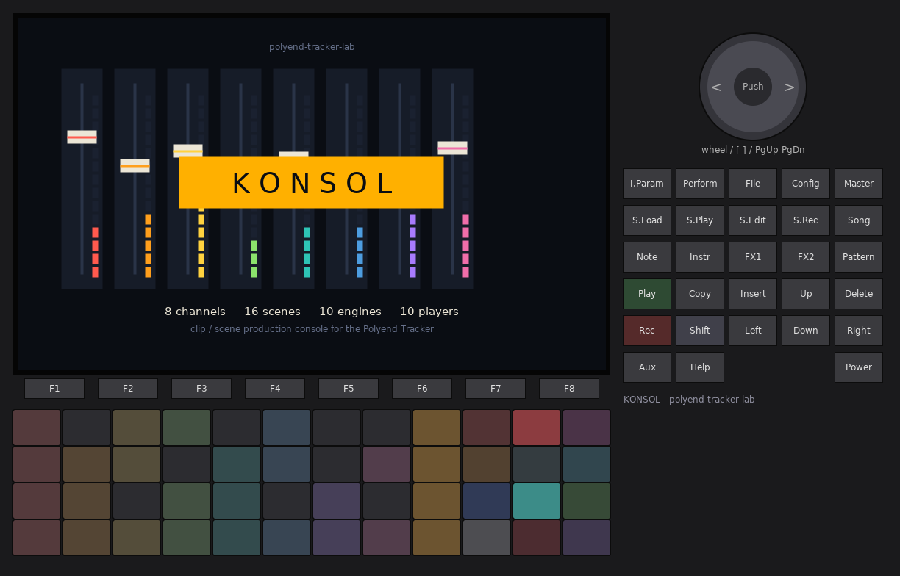
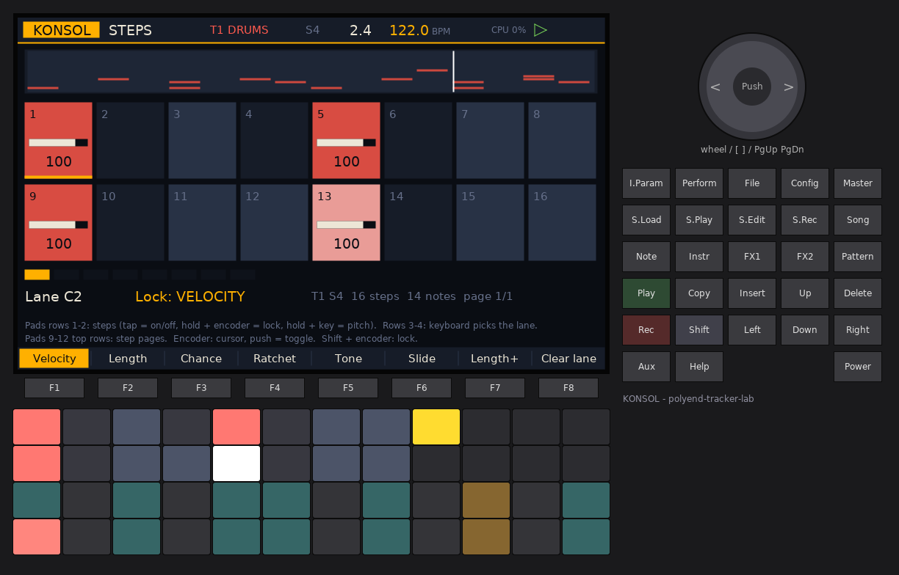
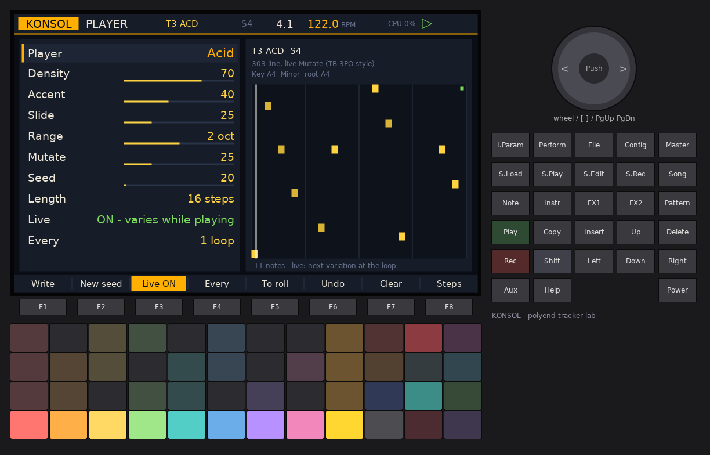
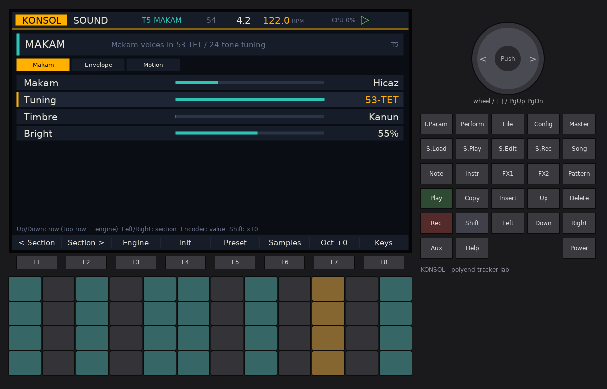
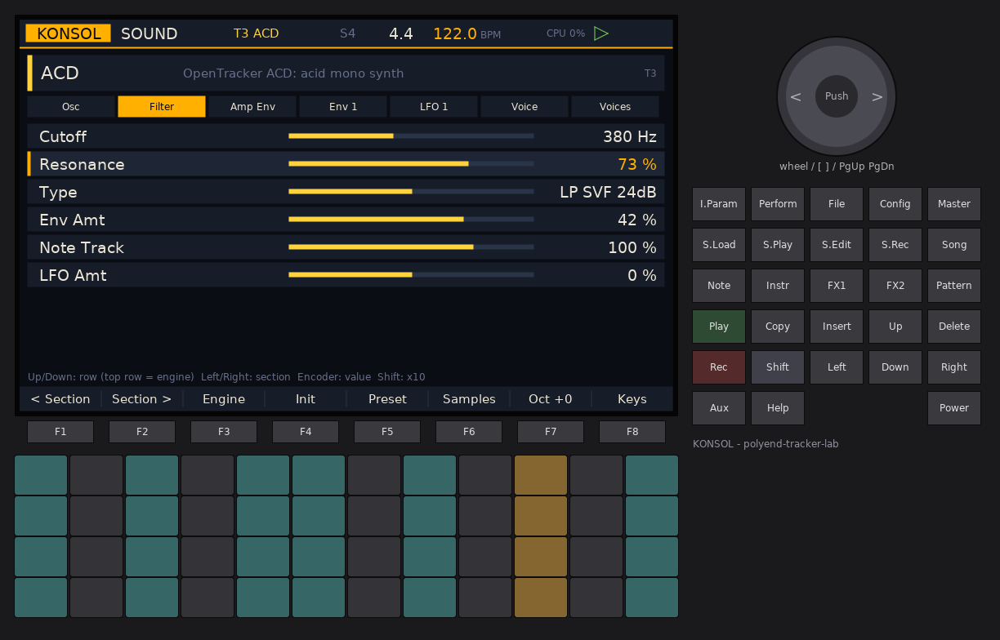
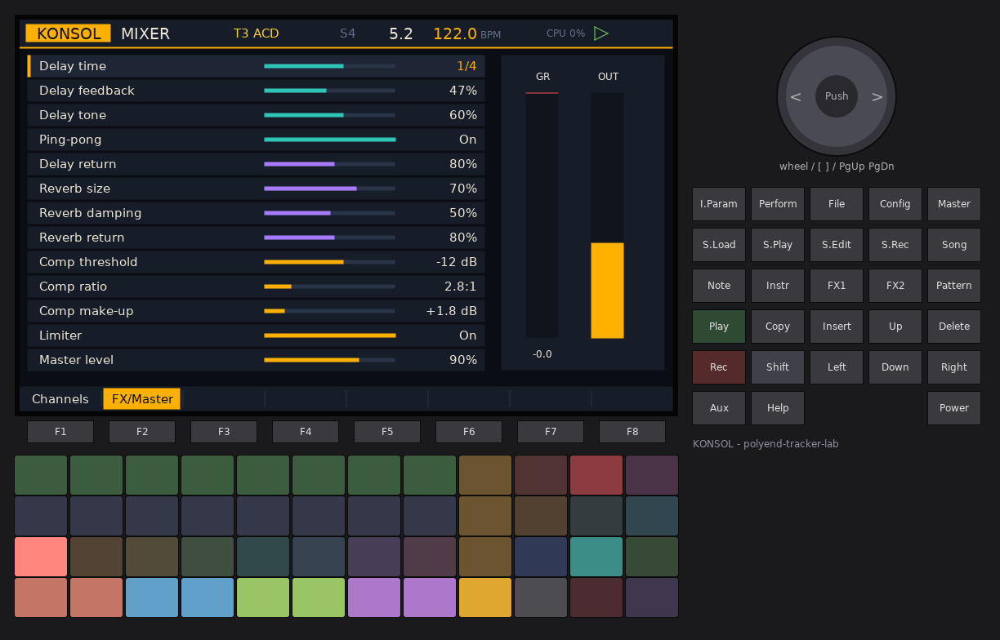
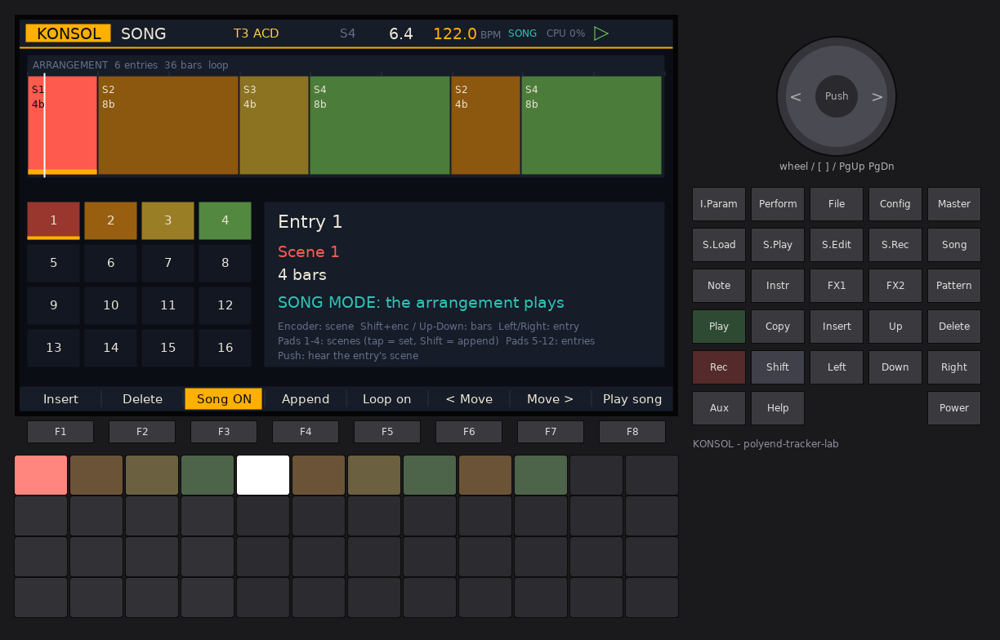
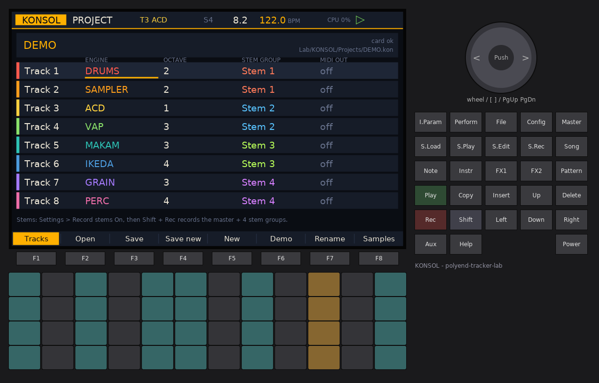

# KONSOL -- user manual

KONSOL turns the original Polyend Tracker into a **clip / scene production
console**. It is laid out like a mixing desk with a session view on top:
**8 channels** (tracks), each with its own **sound engine**, and a grid of
**16 scenes** of clips. You launch clips and whole scenes from the pads,
write notes with step pads, a piano roll or live recording, let
**players / generators** write or vary the notes for you, arrange scenes into
a **song**, and mix it all on a console with two send effects and a master
compressor and limiter.

There is no tracker grid anywhere in KONSOL: the pads are the clip grid, the
screen is a desk.

KONSOL is a firmware of the polyend-tracker-lab family, built on OpenTracker.
The **Config** button (settings, firmware update, about), **Play** (transport)
and **Shift + Rec** (master + stem recorder) work the same way in every lab
firmware.



## Contents

1. [Concepts](#concepts)
2. [Quick start: a first song](#quick-start-a-first-song)
3. [Controls at a glance](#controls-at-a-glance)
4. [The pages](#the-pages)
   - [Session](#session)
   - [Steps](#steps)
   - [Piano roll](#piano-roll)
   - [Player (generators)](#player-generators)
   - [Sound (engines)](#sound-engines)
   - [Mixer](#mixer)
   - [Song (arrangement)](#song-arrangement)
   - [Project](#project)
   - [Samples](#samples)
5. [Sound engines](#sound-engine-reference)
6. [Players and generators](#players-and-generators)
7. [Recording and export (stems)](#recording-and-export-stems)
8. [MIDI](#midi)
9. [Settings](#settings)
10. [Files on the card](#files-on-the-card)
11. [Tips](#tips)
12. [Limits](#limits)
13. [Credits](#credits)

---

## Concepts

**Track (channel).** KONSOL has 8 tracks. Each track has one **sound
engine** (chosen per track: SAMPLER, GRAIN, DRUMS, IKEDA, MAKAM, ACD, VAP,
FAT, WTFM, PERC) and a **mixer channel** (level, pan, delay send, reverb send,
mute, solo, stem group, MIDI out). Every engine keeps its own settings, so you
can switch a track between engines and come back without losing the sound.

**Clip.** A clip is a loop of notes for one track: 1 to 128 steps long (a step
is a 1/16 note), up to 128 notes, each note with its own start, length,
velocity, chance, ratchet, tone and slide. Each track has 16 clip slots, one
per scene.

**Scene.** A row of the clip grid: one clip slot per track. Launching a scene
starts all its clips together (and stops tracks that have no clip in it).

**Player.** What writes a clip's notes. Every clip has a player:
*Notes* (what you wrote by hand) or one of ten generators (Acid, Call+Resp,
BBCut, Turnaround, Genotype, Station, Euclid, Usul, Pinball, Markov). Any
player can drive any engine. A generator either **writes** its result into the
clip once (you can then edit it in the piano roll), or runs **live**: it
writes a new variation of the clip every loop (or every N loops) while it
plays. The change always lands exactly on the loop point.

**Session and song.** In *session mode* you launch clips and scenes by hand.
In *song mode* the **arrangement** (a list of scenes with a bar count each)
launches the scenes for you.

**Launch quantisation.** Launches and stops wait for the next beat, bar,
2 bars or 4 bars (Settings > KONSOL launch quantise, default 1 bar), so
everything stays in time. A queued clip blinks.

## Quick start: a first song

KONSOL boots with a **demo project** (8 tracks, 4 scenes, a 6-entry
arrangement) so there is something to hear straight away. To start from
nothing instead: **File** > **F5 New** (press twice).

1. **Hear the demo.** On the Session page press the amber **scene pad** in
   column 9, row 1 (or just press **Play**: with nothing launched, Play starts
   the selected scene). Try the other scene pads; the change waits for the
   next bar.
2. **Launch single clips.** Tap clip pads in columns 1-8. Tap an empty slot to
   stop that track.
3. **Make a drum clip.** Select an empty slot of track 1 with the arrows (or
   hold column 10 row 4 *Select* and tap the pad), press **Note** (Steps page).
   The bottom two pad rows are a keyboard: tap the lowest left pad (C2 =
   kick) to make it the lane, then tap step pads 1, 5, 9, 13 in the top two
   rows. Tap the second keyboard pad (the snare) and tap steps 5 and 13.
   Launch the clip (Session page) and press **Play** if the transport is
   stopped.
4. **Let a generator write a bass line.** Select an empty slot of track 3
   (ACD engine), press **FX2** (Player page). Turn the encoder on the first
   row to *Acid*, press **F1 Write**. Press **F3** to make it **Live**: it now
   mutates a little every loop. Press **F2 New seed** until you like it.
5. **Edit it in the piano roll.** Press **F5 To roll** on the Player page: the
   current take becomes plain notes and the piano roll opens. Move the cursor
   with the arrows, push the encoder to add / remove notes, choose **F2
   Length** and turn the encoder on a note to lengthen it.
6. **Change the sound.** Press **Instr** (Sound page): Left / Right picks a
   section (Osc, Filter, Amp Env...), Up / Down a row, the encoder the value.
   Go to the top row to change the track's engine.
7. **Mix.** Press **Master**: the encoder moves the selected strip's fader;
   Up / Down choose pan, delay send, reverb send. **F2** opens the send
   effects and the master compressor.
8. **Arrange.** Press **Song**: tap scene pads (columns 1-4) to append
   entries, set their bar counts with Up / Down, press **F8 Play song**.
9. **Record it.** Config > *Record stems* On, then **Shift + Rec** records the
   master plus four stem groups to the card. **Shift + Rec** again stops.
10. **Save.** **File** > **F3 Save** (KONSOL also saves when you power off and
    every 5 minutes).

## Controls at a glance

| Control | What it does |
| --- | --- |
| **Pattern** | Session page (clip grid) |
| **Note** | Steps page (step pads) |
| **FX1** | Piano roll |
| **FX2** | Player page (generators) |
| **Instr** / **I.Param** | Sound page (the selected track's engine) |
| **Master** | Mixer |
| **Song** | Song page (arrangement) |
| **File** | Project page |
| **S.Load / S.Play / S.Edit / S.Rec** | Samples browser |
| **Shift + F1..F8** | Jump to Session, Steps, Roll, Player, Sound, Mixer, Song, Project from any page |
| **Play** | Start / stop the transport (with nothing launched it starts the selected scene) |
| **Rec** | Arm / disarm recording into the selected track's playing clip |
| **Shift + Rec** | The Shell recorder: master WAV, plus 4 stems when enabled |
| **Aux** / **Perform** | Keys overlay: all 48 pads play the selected track (any page) |
| **Copy** | Session / Player: duplicate the selected clip into the next free scene |
| **Delete** | Session / Player: delete the selected clip (a playing clip stops first; press again). Roll: delete the note under the cursor. Song: delete the entry |
| **Insert** | Roll: add / remove a note. Song: insert an entry |
| **Help** | A one-screen map of the controls |
| **Config** | Settings (Shell), firmware update, about |
| **Encoder** | The page's value; **push** = the page's main action |
| **Shift + encoder** | Fine / coarse (x10) depending on the page; on Session: tempo |

The selected track and scene are shown in the header (for example `T3 ACD  S1`),
next to the bar.beat counter, the tempo and the transport state. `ARM` (red)
means recording is armed, `KEYS` the keyboard overlay, `SONG` song mode.

## The pages

### Session


The screen shows 8 channel strips with 8 scenes each (the 4 scenes on the
pads are marked by the amber bracket), the scene launch column on the right
and a meter bridge with mute / solo / stem indicators at the bottom. A
playing clip is bright and shows its progress; a queued clip blinks; a clip
labelled *LIVE* has a live generator.

**Pads (Session and Player pages):**

| Pads | Function |
| --- | --- |
| Columns 1-8 | Clip slots: column = track, row = scene (of the 4 shown). Tap = launch (quantised). Tap an empty slot = stop that track. The pad also selects the clip |
| Column 9 | **Scene launch** for the 4 rows |
| Column 10 row 1 | **Stop mode**: tap a track's pad to stop it |
| Column 10 row 2 | **Mute mode**: tap a track's pad to mute / unmute |
| Column 10 row 3 | **Solo mode** |
| Column 10 row 4 | **Select mode**: tap a pad to select the clip without launching it |
| Column 11 row 1 | **Stop all** (quantised) |
| Column 11 rows 2 / 3 | Scenes **up** / **down** (the 4 pad rows scroll through 16 scenes) |
| Column 11 row 4 | **Record arm** (same as Rec) |
| Column 12 row 1 | Hold: **stutter** (repeats the last 1/16 of the master) |
| Column 12 row 2 | Hold: **HP sweep** (a master high-pass rises while held, falls back on release) |
| Column 12 row 3 | Hold: **delay throw** (every track sends fully to the delay) |
| Column 12 row 4 | Hold: **reverb throw** |

Mode pads (column 10): **tap** latches the mode (tap again to leave it),
**hold** makes it momentary.

LED colours: each track has its colour (1 red, 2 orange, 3 yellow, 4 green,
5 teal, 6 blue, 7 violet, 8 pink). Dim = clip present, bright and pulsing on
the beat = playing, blinking white = queued, white = selected (Select mode).
In Mute mode muted tracks are orange, in Solo mode soloed ones are blue, in
Stop mode playing tracks are red. Scene pads are amber when every clip of
the scene is playing.

**Keys:** arrows move the selection (track, scene); the encoder scrolls the
scenes, **Shift + encoder** changes the tempo, **push** launches the selected
clip (**Shift + push** its scene). **F1** stops all; **F2..F8** open Steps,
Roll, Player, Sound, Mixer, Song, Project.

### Steps



Step programming for the selected clip, one **lane** (pitch) at a time, with
per-step parameter locks.

| Pads | Function |
| --- | --- |
| Rows 1-2, columns 1-8 | 16 steps of the current page. **Tap** = note on / off in the lane. **Hold** a step + **encoder** = edit the current lock of that step's note. **Hold** a step + a keyboard pad = change that note's pitch |
| Rows 1-2, columns 9-12 | Step pages 1..8 (16 steps each; a 128-step clip has 8) |
| Rows 3-4 | Keyboard: tapping a key plays it and makes it the lane |

The overview strip at the top shows every note of the clip; the playhead
runs across it. Step cells show the step number and, for a note in the lane,
the value of the selected lock as a bar and a number. Another note on a step
(a different pitch) shows the cell in grey.

**F1..F6** choose the lock the encoder edits: **Velocity**, **Length**
(1/4-step increments), **Chance** (0-100 %), **Ratchet** (2, 3, 4, 6, 8 or 16
hits per step across the note), **Tone** (a per-note brightness offset: the
filter cutoff of the synth engines, the sample filter, the drum pitch, the
Ikeda pitch), **Slide** (glide / legato into the note on mono synths and the
makam engine). **F7** cycles the clip length (8, 16, 32, 64, 96, 128 steps).
**F8** clears the lane.

Encoder without a held step: moves the step cursor (amber); **push** toggles
the step under the cursor; **Shift + encoder** edits the lock of the cursor's
note. Up / Down change the lane (Shift: octave), Left / Right the page.

### Piano roll


Notes as blocks over 16 pitches and up to 4 bars of the clip at a time (the
view follows the cursor). Rows in the project's scale are lighter, the key's
root rows are amber-tinted; on a DRUMS track the rows are named (KICK, SNARE,
...). Brighter blocks are louder; a white edge marks a slide.

- **Arrows**: move the cursor (Left / Right by the grid, Up / Down by a
  semitone, Shift + Up / Down by an octave). The view scrolls with it.
- **Encoder push** or **Insert**: add a note at the cursor (one grid unit long)
  or remove the note under it. **Delete** removes it.
- **F1 Cursor**: the encoder moves the cursor (Shift: by ticks).
- **F2 Length**, **F3 Velocity**, **F4 Move**, **F5 Pitch**: the encoder edits
  the note under the cursor (Shift: finer, or octaves for pitch).
- **F6** cycles the grid: 1/32, 1/16, 1/8, 1/4, 1 bar.
- **F7 Quantise**: moves every note of the clip onto the grid.
- **F8 Undo**: undoes the last edit of a clip (pressed again: redo).
- **Pads**: a keyboard; a pad sets the cursor's pitch and plays it.

Opening the roll centres it on the clip's notes.

### Player (generators)



The selected clip's player and its parameters, and a mini piano roll of the
clip's current notes (with the playhead, and a green dot while the next live
variation is waiting for the loop point).

Rows (Up / Down, encoder edits, Shift x10):

1. **Player**: Notes, Acid, Call+Resp, BBCut, Turnaround, Genotype, Station,
   Euclid, Usul, Pinball, Markov. Choosing one loads its default parameters.
2. **Parameters 1..6**: depend on the player (see
   [Players and generators](#players-and-generators)). The last one is always
   **Seed**: 0 = a new random result each time; 1..999 = the same result every
   time (for a live player the seed walks one step per variation, so the
   variations repeat in the same order).
3. **Length**: the clip length (4, 8, 12, 16, 24, 32, 48, 64, 128 steps;
   Shift: any length 1..128). Usul sets it from the cycle.
4. **Live**: off = write once; on = a new variation while the clip plays.
5. **Every**: a live player writes every 1..8 loops.

| Key | Function |
| --- | --- |
| **F1 Write** (or encoder push) | Run the player now and write its notes into the clip |
| **F2 New seed** | A new seed, then write |
| **F3 Live** | Live on / off |
| **F4 Every** | 1..8 loops between live variations |
| **F5 To roll** | Write one take, turn the clip into plain *Notes* and open the piano roll to edit it |
| **F6 Undo** | Undo the last write |
| **F7 Clear** | Remove all notes of the clip |
| **F8 Steps** | Open the Steps page |

The pads stay the clip grid (as on the Session page), so you can pick another
clip to work on without leaving the page.

### Sound (engines)




The selected track's engine. The top row is the **engine** itself (Up to it,
then the encoder chooses SAMPLER ... PERC). Below it the engine's sections as
tabs (Left / Right or F1 / F2) and their parameters with value bars (Up /
Down, encoder; Shift = x10 steps).

| Key | Function |
| --- | --- |
| F1 / F2 | Previous / next section |
| F3 | Go to the engine row |
| F4 **Init** | Every parameter of this engine to its default |
| F5 **Preset** | KONSOL's musical starting preset for this engine |
| F6 **Samples** | Open the sample browser for this track |
| F7 **Oct** | Keyboard octave offset -2..+2 for the pads |
| F8 **Keys** | Keys overlay on / off |

The pads are a keyboard for the track (4 rows of 12 semitones, the lowest row
at the track's octave; on DRUMS / PERC / sliced SAMPLER tracks the lowest pad
is the first drum / slice). Scale notes are teal, the key's root amber.

### Mixer


Eight channel strips and the master: pan, delay send (DLY, teal), reverb send
(REV, violet), the fader with a unity mark, a level meter, and the
**M**ute, **S**olo and **stem group** (1-4, or - for none) buttons. A green
line under a strip means its notes are sent on MIDI.

- **Left / Right** choose the strip (and select the track), **Up / Down** the
  row: Level, Pan, Delay send, Reverb send, Stem group, MIDI out (shown under
  the master as *edit: ...*). The **encoder** changes it (Shift: x10), push
  toggles mute (or MIDI out on that row).
- **F1** channels, **F2** FX / master, **F3** mute, **F4** solo, **F5** MIDI out
  of the strip, **F6** reset the strip (fader to unity, pan centre), **F7**
  unsolo all, **F8** unmute all.
- **Pads** columns 1-8: row 1 mute, row 2 solo, row 3 select the strip, row 4
  cycle the stem group (the pad shows the group colour). Columns 9-12 work as
  on the Session page (scene launch, modes, performance pads).



**FX / master** (F2): Up / Down choose, the encoder changes (Shift x10).

| Row | Range |
| --- | --- |
| Delay time | 1/16, 1/8, dotted 1/8, 1/4, dotted 1/4, 1/2 (tempo-synced) |
| Delay feedback | 0..95 % |
| Delay tone | dark .. bright (the feedback filter) |
| Ping-pong | Off / On |
| Delay return | 0..150 % |
| Reverb size, damping | 0..100 % |
| Reverb return | 0..150 % |
| Comp threshold | -30..0 dB |
| Comp ratio | 1:1 (off) .. 10:1 |
| Comp make-up | 0..+12 dB |
| Limiter | Off / On (the Shell's output limiter stays on as a safety net) |
| Master level | 0..125 % |

The right side shows the compressor's gain reduction and the master level.

### Song (arrangement)



The arrangement is a list of up to 64 entries; each plays one **scene** for
a number of **bars** (1..64). The timeline at the top shows the entries as
blocks in their scene's colour; the cursor entry is underlined, the playing
entry is bright with a white playhead in song mode.

- **Left / Right**: choose the entry. **Encoder**: its scene. **Up / Down** or
  **Shift + encoder**: its bars (Shift + Up / Down: 4 bars at a time).
  **Push**: hear the entry's scene (launches it like a scene pad).
- **Pads** columns 1-4 = scenes 1..16 (tap = set the cursor entry's scene;
  **Shift + tap** or an empty song = append a new entry). Columns 5-12 =
  entries 1..32 (tap = select).
- **F1 Insert** (a copy of the cursor entry after it), **F2 Delete**,
  **F3 Song mode** on / off, **F4 Append** the selected scene, **F5 Loop**
  on / off (when off, the song stops all clips at its end), **F6 / F7** move
  the entry earlier / later, **F8 Play song** (from the cursor entry; while
  playing, song mode joins at the next bar).

In song mode a track that already plays the next entry's clip keeps going
without restarting. You can still launch clips by hand on top of the song;
the next entry takes over again at its start. Turning song mode off leaves
whatever plays running.

### Project



The project name and file, and two tabs:

- **F1 Tracks**: one row per track: engine, octave (the generators' and the
  pads' base octave), stem group, MIDI out. Up / Down choose the track,
  Left / Right the column, the encoder changes it.
- **F2 Open**: the projects on the card. Encoder / Up / Down choose, **push**
  loads (the transport stops).

| Key | Function |
| --- | --- |
| F3 **Save** | Save under the current name |
| F4 **Save new** | Save as the next free SONGnn name |
| F5 **New** | (press twice) an empty project |
| F6 **Demo** | (press twice) the demo project |
| F7 **Rename** | Left / Right choose a letter, the encoder changes it, push = done |
| F8 **Samples** | The sample browser |

### Samples

The WAV files of the card, folders first (a folder shows as `/name`; `/..`
goes up). **F1** (or push) loads the selected file into the selected track (or
opens the folder); a track that is not SAMPLER or GRAIN switches to SAMPLER.
**F2** goes up a folder, **F3** loads the built-in break, **F4** selects the
next track, **F5** opens the Sound page. The right side shows the track's
current sample as a waveform.

Any WAV the Tracker reads works (8/16/24/32-bit PCM, 32-bit float, mono or
stereo, any rate); KONSOL keeps the left channel, resampled to 44.1 kHz, up
to 13.9 s per track. Put your samples anywhere on the card, for example in
`/Lab/KONSOL/Samples`. Each track has its own sample.

## Sound engine reference

| Engine | What it is | Notes / pads | Polyphony |
| --- | --- | --- | --- |
| **SAMPLER** | Plays the track's WAV. Modes: **One-shot** (pitched by the note, C4 = original), **Loop** (pitched, loops start..end while held), **Slices** (2..32 equal slices of start..end; C2 = slice 1, C#2 = slice 2...). Start, End, Pitch, Fine, Attack, Release, Voices (1-4), low-pass Cutoff / Resonance, Drive, Gain. A note with *Reverse* (generators) plays backwards | pitched / slices | 1-4 |
| **GRAIN** | A granular cloud over the track's sample: Position, Scan (drift through the sample), Spray, grain Size, Density (grains / s), Pitch, Pitch spread, Reverse chance, stereo Width, Attack / Release of the cloud, Gain. The cloud runs while a note is held | pitched (one cloud) | 8 grains |
| **DRUMS** | An analog-style kit, one drum per note: C2 kick, C#2 snare, D2 clap, D#2 closed hat, E2 open hat (choked by the closed one), F2 tom, F#2 rim, G2 cowbell; notes above G2 repeat the kit in groups of 8, each group with higher toms. Tune / Decay / Punch / Click / Snappy / Tone per drum, kit Drive, Pitch, Gain | 36..43 (and up) | 8 drums |
| **IKEDA** | Ikeda-style pure tones and data: **Sine** (with decay, octave), **Click** (length in samples, tone), **Noise** (high-passed burst), **Data** (random bits clocked by the note). Mode *By pitch*: notes below C3 click, C3-B4 sine, C5-B5 data, above noise. **Bits** reduces the resolution; **Spread** alternates hits left / right | any | 6 |
| **MAKAM** | Turkish makam voices: **Makam** (Rast, Ussak, Hicaz, Huseyni, Nihavend, Kurdi, Saba, Segah), **Tuning** (12-TET, 24-tone, 53-TET: notes on the makam's degrees are retuned to their Holdrian-comma pitches, relative to the project key), **Timbre** (Kanun plucked, Ney breathy flute, Saz bright pluck, Rebab bowed), Brightness, envelope, Vibrato depth / rate, Detune, Glide | pitched; play the makam's degrees | 4 |
| **ACD** | OpenTracker's acid mono synth (saw / square / sub / noise, 12/24 dB SVF or RD3 ladder, envelopes, LFO, glide). KONSOL's preset is a squelchy 303 voice with legato glide (slides) | pitched | 1-4 |
| **VAP** | OpenTracker's virtual analog poly (2 oscillators, 15 filter types, 3 envelopes, 2 LFOs, 6-slot mod matrix) | pitched | 1-4 |
| **FAT** | OpenTracker's supersaw (fatness, brightness, 3 filter models) | pitched | 1-4 |
| **WTFM** | OpenTracker's wavetable FM (2 operators, 48 ratios, characters, feedback, oversampling) | pitched | 1-4 |
| **PERC** | OpenTracker's synthesized drum kit: C4 kick, D4 snare, E4-G4 hats, A4 cymbal, B4 percussion, other notes toms, with per-drum mixer and the kit FX | 60..71 | one kit |

The OpenTracker engines show every parameter of the engine, grouped like the
Tracker Mini synth pages; **Voices** (the last tab) sets their polyphony
(ACD, VAP, FAT, WTFM: 1..4; a single voice glides / plays legato when notes
overlap).

**Velocity** (pad, MIDI or note velocity) scales every engine's level. The
note's **Tone** lock moves the brightness: the synth engines' cutoff by up to
+-2 octaves, SAMPLER's filter, DRUMS' pitch, IKEDA's sine pitch, MAKAM's
brightness.

## Players and generators

Every generator writes notes in the project **key / scale** (Settings, or
the Makam scale of the track's MAKAM engine) from the track's **octave**
(Project > Tracks). On DRUMS tracks the melodic players spread their notes
over the 8 drums; on PERC tracks over its kit.

| Player | Parameters | What it does | Live |
| --- | --- | --- | --- |
| **Notes** | - | The clip's own notes | - |
| **Acid** | Density, Accent, Slide, Range (1-3 oct), Mutate, Seed | A 303-style line in the TB-3PO manner: root bias on the beat, accents (velocity), slides (legato + glide) | The phrase **mutates**: each loop *Mutate* % of the steps re-roll their state or pitch (default 25 %) |
| **Call+Resp** | Style (46), Answer strategy (38), Density, Layout (Call+Answer, Answer mine, Two tracks), Seed | Nordl3's Call / Response generator: a call phrase and its answer | A new call and answer each time |
| **BBCut** | Proc (10 BBCut procedures), A / B (per procedure), Source (Auto, 1 beat .. 4 bars), Seed | Cuts the track's sample as a break: it writes slice notes, ratchets (rolls) and micro-timing. Best on a SAMPLER track in *Slices* mode (the slice count is taken from the engine) | A new cut sequence every loop: live cutting |
| **Turnaround** | Phrase (1-8 bars), Budget, Style (Rolls, Stutter, Drop, Reverse, Build, Mix), Intensity, Seed | Edits the ends of phrases of the clip's own notes on an edit budget: rolls, stutters, drops into the downbeat, reversed hits, builds | The clip's notes are learnt when it starts; each loop gets new turnarounds |
| **Genotype** | Mode (Markov, Ball, Ball+Markov), Identity, Order (1-2), Variety, Seed | Learns the clip's notes as a Markov chain and plays a variation (or a ball bouncing over the learnt steps) | Learns once when the clip starts, then walks a new variation each loop |
| **Station** | Source (Name, PI code, Frequency, All), Mode (Notes, Slices), Rate, Groups (fives), Repeat, Seed | A numbers-station line: the project name and the FM radio frequency read as digits, in groups of five | New digits when the radio is retuned |
| **Euclid** | Hits, Rotate, Note offset, Spread (scale degrees), Accent %, Seed | Euclidean hits over the clip length; with Spread > 0 each hit gets a random scale degree | New pitches / accents |
| **Usul** | Usul (Aksak 9/8, Curcuna 10/8, Devr-i Hindi 7/8, Turk Aksagi 5/8, Aksak Semai 10/8, Duyek 8/8, Sofyan 4/4), Repeats (1-4), Dum note, Tek note (0 = automatic), Fills %, Seed | Turkish rhythmic cycles of *dum* (low, accented), *tek* (high) and *ke* strokes, with ghost fills. The clip length follows the cycle (9/8 x 2 = 36 steps), so an usul runs in polymeter against 4/4 clips. Automatic notes: DRUMS kick / snare / closed hat, PERC kick / snare / hat, other engines root / fifth / octave | New fills |
| **Pinball** | Speed, Gravity, Bumpers, Range (1-3 oct), Gate %, Seed | A ball falls over the scale with gravity, bounces off the ends and is kicked by bumpers; bounces and kicks play the ball's height as a note | A new game every loop |
| **Markov** | Density, Stepwise %, Leaps %, Range (1-3 oct), Gate %, Seed | A melodic chain over the scale: steps, leaps, returns to the root and resolves phrase ends | A new phrase each time |

**Writing vs live.** *Write* (F1) puts the result into the clip once; edit it
with Steps / Roll as you like (a later Write replaces it; F6 undoes). With
**Live** on, the player writes a new variation into a second buffer while the
clip plays, and the audio switches to it exactly at the loop point, so
nothing glitches. *Every* sets how many loops each variation lasts. **To
roll** (F5) freezes the current take as plain notes and opens the piano roll:
this is how a generator writes "into the piano roll" for further editing.

## Recording and export (stems)

**Live recording into clips.** Press **Rec** (or pad column 11, row 4) to arm.
KONSOL records into the clip the selected track is playing (with nothing
playing it launches the selected slot, creating a 16-step clip, and starts
the transport). Play the pads (Aux keys overlay or the Sound page), or send
MIDI notes: every note is overdubbed with its velocity and length,
quantised to Settings > *KONSOL record quantise* (Off, 1/16, 1/8, 1/32).
Press **Rec** again to stop. **F8 Undo** on the roll page undoes the last
change of a clip.

**Audio export.** The Shell records the master to
`/Lab/KONSOL/Rec/REC-nnnn.wav` (**Shift + Rec** starts and stops). With
Config > *Record stems* On it also records **4 stem files**
(`REC-nnnn-stem1.wav` .. `-stem4.wav`): each track goes to the stem group set
in the Mixer (row *Stem group*) or Project > Tracks: 1..4, or none. The stems
are post-fader and post-pan, without the send effects (those are on the
master). Default groups: tracks 1-2 stem 1, 3-4 stem 2, 5-6 stem 3, 7-8
stem 4.

## MIDI

- **MIDI in** (DIN and USB, channel per Settings > MIDI in channel): notes
  play the **selected track** (and record when armed). CC 7 sets its fader,
  CC 10 its pan.
- **MIDI out per track**: Mixer row *MIDI out* (or F5, or Project > Tracks).
  The track's notes (clips, generators, pads) are sent on the Shell's MIDI out
  channel **+ the track number - 1** (track 1 on the base channel, track 2 on
  the next ...), on DIN and USB, with their velocity and lengths. The engine
  still sounds: turn the fader down to hear only the external instrument.
- **Clock**: Settings > Clock: internal, internal + send MIDI clock, or follow
  MIDI clock (the Shell).

## Settings

**Config** opens the Shell settings (brightness, boot intro, tempo, clock,
MIDI channels, input, master level and limiter, record stems) followed by
KONSOL's rows:

| Row | Values |
| --- | --- |
| KONSOL launch quantise | None, 1 beat, 1 bar (default), 2 bars, 4 bars |
| KONSOL record quantise | Off, 1/16 (default), 1/8, 1/32 |
| KONSOL swing | 50..75 % (delays every second 1/16) |
| KONSOL key | C .. B (default A) |
| KONSOL scale | Chromatic, Minor, Major, Dorian, Phrygian, Lydian, Mixolydian, Harmonic minor, Pentatonic minor, Pentatonic major, Blues, Makam (track) |
| KONSOL metronome | Off / On (a click on every beat, louder on the bar) |
| KONSOL song loops | Off / On |
| KONSOL pad brightness | Low, Medium, High |

Key, scale, swing, quantise, metronome, song loop and pad brightness are
stored in the project.

## Files on the card

```
/Lab/KONSOL/settings.bin          Shell settings
/Lab/KONSOL/last.txt              the project loaded at boot
/Lab/KONSOL/Projects/<NAME>.kon   projects
/Lab/KONSOL/Samples/              a place for your WAVs (any folder works)
/Lab/KONSOL/Rec/REC-nnnn*.wav     recordings and stems
/Firmware/*.ptf                   firmware images (Config > Firmware)
```

**Project format** (`.kon`, version 1): the text `KONSOL`, a 16-bit version,
then tagged chunks (`HEAD` tempo / key / scale / swing / quantise, `MFX`
effects, `TRK` mixer + sample path per track, `ENG` every parameter of every
engine of every track, `CLIP` one per clip with its player settings and
notes, `SONG` the arrangement, `MSTR` master level, `PREF` pad brightness).
Unknown chunks are skipped, so newer files load in older firmware as far as
possible. Samples are **referenced by path**: keep the WAV files where they
were. A missing sample falls back to the built-in break. Saving writes a
temporary file first and then replaces the old one.

Without a card KONSOL runs normally from the demo; saving is not possible.

## Tips

- **Build a scene, then vary it.** Duplicate a clip with **Copy**, then turn
  the copy's player to Turnaround or Genotype with Live on: the variation runs
  from your own notes.
- **Live BBCut** on a SAMPLER slices track is a break re-editor: load a break,
  set Slices to the number of 1/16s in it, pick a procedure, Live on.
- **Usul against 4/4.** An Aksak 9/8 usul on a PERC track against 16-step
  clips cycles back in phase every 9 bars.
- **Freeze a good take.** When a live player plays something you like, press
  **F5 To roll** on the Player page: it becomes plain notes immediately.
- **Performance pads** (column 12) work on the Session, Player and Mixer pages:
  hold stutter on the last beat of a phrase, sweep the high-pass into a drop.
- **Makam:** set the project scale to *Makam (track)* so the generators write
  on the makam's degrees, and Tuning to 53-TET so those degrees sound in comma
  tuning.
- **Mute with quantise:** Mute mode is immediate; to drop a track on the bar,
  use Stop mode (quantised) instead.

## Limits

- 8 tracks, 16 scenes, 128 steps and 128 notes per clip, 64 arrangement
  entries.
- **CPU governor.** Every engine has a CPU cost estimate; when a new note
  would exceed the budget, KONSOL steals the oldest voice (of the same track
  first, then of the busiest track). On the device the budget also follows the
  measured render load (it shrinks above 85 %, recovers below 60 %). Very
  heavy combinations (8 tracks of 4-voice WTFM) therefore play fewer voices
  than asked: one WTFM voice with oversampling alone costs about a fifth of
  the audio CPU. The header shows the CPU load.
- Samples: mono (left channel), up to 13.9 s per track, 8 tracks.
- No time-stretching; BBCut and slices follow the tempo through the clip
  steps.
- The FM radio has no RDS text in this hardware layer: Station's *Name*
  source reads the project name.
- MIDI out sends notes only (no CC / program changes).
- Stems are post-fader without the send effects.
- Undo keeps one step: the last edit of the last edited clip.

## Credits

- **Call & Response** generator: Nordl3's Call / Response Generator (MIT),
  github.com/Nordl3/Call-Response-Generator, ported to C++ in the
  polyend-tracker-re-semi fork.
- **BBCut** procedures: Nick Collins' BBCut library for SuperCollider, via
  bencodec's BBenCut.
- **Acid**: after the TB-3PO generator idea (density / accent / slide / mutate).
- **Turnaround, Genotype, Station, Pinball**: the user's own plug-in designs
  (TURNAROUND, GENOTYPE / TILT, CIPHER, Pinball 2).
- **ACD, VAP, FAT, WTFM, PERC** synth engines, delay, reverb, WAV import:
  OpenTracker.
- See `THIRD_PARTY.md` for the complete list.
