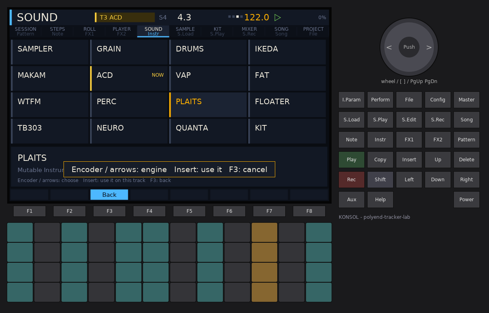
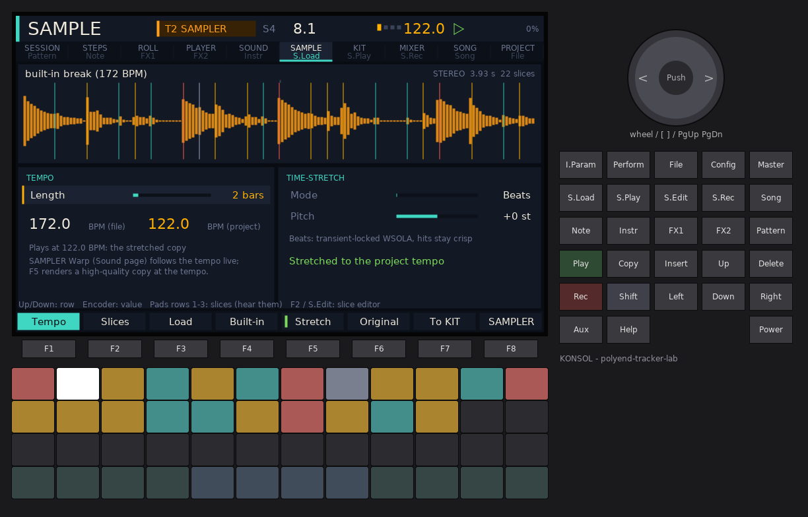
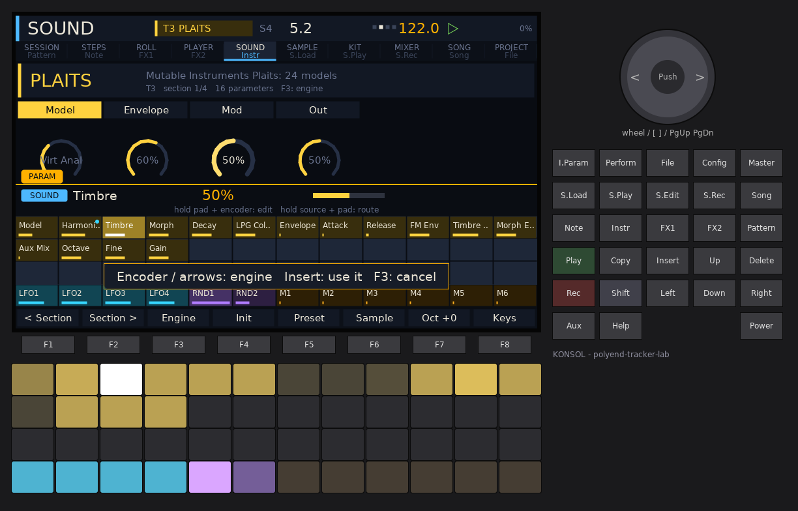
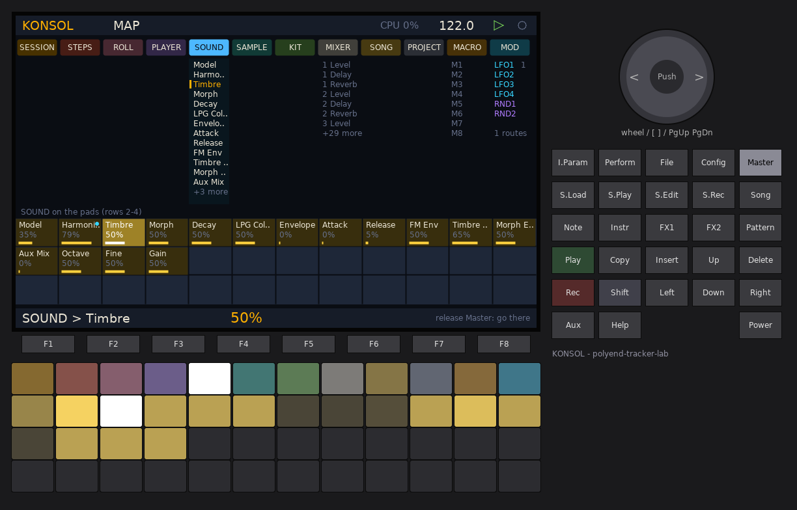
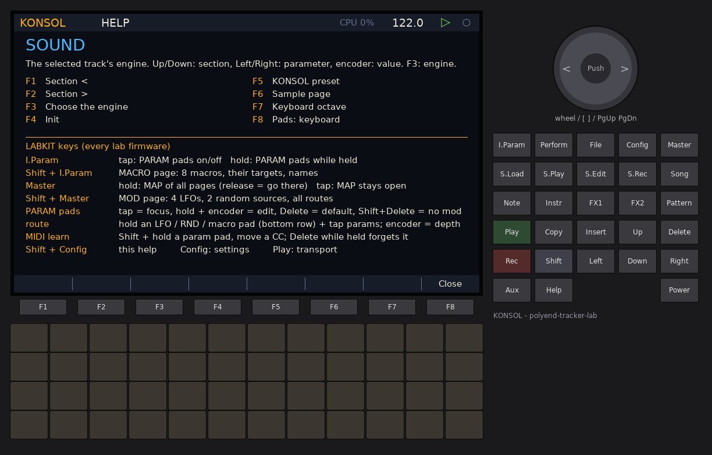

# KONSOL -- user manual

KONSOL turns the original Polyend Tracker into a **clip / scene production
console**. It is laid out like a mixing desk with a session view on top:
**8 channels** (tracks), each with its own **sound engine** (16 to choose
from: samplers, a 16-pad kit, Mutable Instruments Plaits, a 303, neuro bass,
microsound particles, drum machines and the OpenTracker synths), and a grid of
**16 scenes** of clips. You launch clips and whole scenes from the pads,
write notes with step pads, a piano roll or live recording, let
**players / generators** write or vary the notes for you, time-stretch loops
to the tempo, build drum kits from breaks or one-shots, arrange scenes into a
**song**, and mix it all on a console with two typed send effects and a
master compressor and limiter.

There is no tracker grid anywhere in KONSOL: the pads are the clip grid, the
screen is a desk.

KONSOL is a firmware of the polyend-tracker-lab family, built on OpenTracker,
and uses **LABKIT v2**, the navigation shared by every lab firmware: the
**PARAM pads** (I.Param), the **MAP** (Master), **macros** (Shift + I.Param),
**modulation** (Shift + Master), **HELP** (Shift + Config), the sample
browser and the on-screen keyboard. **Config** (settings, firmware update,
about), **Play** (transport) and **Shift + Rec** (master + stem recorder)
work the same way in every lab firmware.

Every function is on a key the original Tracker has. KONSOL never needs
**Aux**, **Help** or the **encoder push** (they exist only on other Tracker
models and in the simulator): **Insert** does what a push would do.


## Contents

1. [Concepts](#concepts)
2. [Finding your way: pages, keys, the MAP](#finding-your-way-pages-keys-the-map)
3. [Quick start: a first song](#quick-start-a-first-song)
4. [The pages](#the-pages)
   - [Session](#session) - [Steps](#steps) - [Piano roll](#piano-roll) -
     [Player](#player-generators) - [Sound](#sound-engines) -
     [Sample](#sample-tempo-time-stretch-slices) - [Kit](#kit) -
     [Mixer](#mixer) - [Song](#song-arrangement) - [Project](#project)
5. [LABKIT: PARAM pads, MAP, macros, modulation](#labkit-param-pads-map-macros-modulation)
6. [Sound engines](#sound-engine-reference)
7. [Samples: memory, stretch, warp, slices](#samples-memory-stretch-warp-slices)
8. [Players and generators](#players-and-generators)
9. [Recording and export (stems)](#recording-and-export-stems)
10. [MIDI](#midi)
11. [Settings](#settings)
12. [Files on the card](#files-on-the-card)
13. [Tips](#tips)
14. [Limits](#limits)
15. [Credits](#credits)

---

## Concepts

**Track (channel).** KONSOL has 8 tracks. Each track has one **sound
engine** and a **mixer channel** (level, pan, delay send, reverb send, mute,
solo, stem group, MIDI out, MIDI in channel). Every engine of every track
keeps its own settings, so you can switch a track between engines and come
back without losing the sound.

**Track sample.** Every track also has a **sample** (a stereo or mono WAV, or
the built-in jungle break) with its tempo, its slice points and, optionally,
a time-stretched copy at the project tempo. SAMPLER and GRAIN play it; a KIT
is usually built from it.

**Clip.** A loop of notes for one track: 1 to 128 steps (a step is a 1/16),
up to 128 notes, each with start, length, velocity, chance, ratchet, **trig
condition**, tone and slide. Each track has 16 clip slots, one per scene.
Clips of different lengths run in polymeter.

**Scene.** A row of the clip grid. Launching a scene starts all its clips
together (and stops tracks without a clip in it).

**Player.** What writes a clip's notes: *Notes* (written by hand) or one of
ten generators. A generator writes its result once or runs **live** (a new
variation every loop, switched exactly at the loop point).

**Session and song.** In *session mode* you launch clips and scenes by hand;
in *song mode* the **arrangement** launches scenes for you.

**Launch quantisation.** Launches wait for the next beat, bar, 2 or 4 bars
(Settings > KONSOL launch quantise, default 1 bar); a clip can have its own
(Player page, F8). A queued clip blinks.

## Finding your way: pages, keys, the MAP


Every screen has the same frame:

- **Header**: the page name (large, with the page colour on the left), the
  **selected track** chip (`T3 ACD`, in the track colour) and scene (`S4`),
  the bar.beat counter with four **beat lights**, the tempo, play / stop,
  badges (`ARM` recording armed, `KEYS` pads are a keyboard, `SONG` song mode)
  and the CPU load. A thin teal bar under the track chip shows a
  time-stretch job running.
- **Page rail** (under the header): all ten pages, each with **the key that
  opens it** underneath. The current page is underlined in its colour.
- **F-key bar** (bottom): the eight F-keys of the page as keycaps; the active
  mode is filled, a green mark shows a switch that is on.
- **Hint line** (above the F-keys): what the arrows, encoder and pads do here.

| Key | Page |
| --- | --- |
| **Pattern** | Session (clip grid) |
| **Note** | Steps |
| **FX1** | Piano roll |
| **FX2** | Player (generators) |
| **Instr** | Sound (the track's engine) |
| **S.Load** | Sample: file, tempo, time-stretch |
| **S.Edit** | Sample: slice editor |
| **S.Play** | Kit (16 pads) |
| **S.Rec** | Mixer (F2: send effects + master) |
| **Song** | Song (arrangement) |
| **File** | Project |
| **Shift + F1..F8** | Jump to Session, Steps, Roll, Player, Sound, Mixer, Song, Project from anywhere |

| Other keys | What they do |
| --- | --- |
| **I.Param** | LABKIT **PARAM pads**: the page's parameters on the pads (tap = stays open, hold = only while held) |
| **Shift + I.Param** | LABKIT **MACRO** page (8 macros) |
| **Master** | LABKIT **MAP**: every page and parameter on one screen; hold = look and jump, tap = stays open |
| **Shift + Master** | LABKIT **MOD** page (LFOs, random, every route) |
| **Shift + Config** | **HELP**: the page's help, its F-keys and the key card |
| **Play** | Start / stop (with nothing launched it starts the selected scene) |
| **Rec** | Arm / disarm recording into the selected track's playing clip |
| **Shift + Rec** | The Shell recorder: master WAV (+ 4 stems when enabled) |
| **Perform** | Keys overlay: all 48 pads play the selected track on any page |
| **Insert** | The page's "do it": launch the clip (Shift: the scene), toggle the step, add / remove the note, confirm the engine, hear the song entry, add a slice point, build the kit |
| **Delete** | Delete the clip / note / entry / slice point, a parameter to its default (Sound), clear the pad (Kit) |
| **Copy** | Duplicate the selected clip into the next free scene |
| **Shift + Copy** | **Undo** (16 levels, every clip edit) |
| **Shift + Delete** | **Redo** |
| **Encoder** | The page's value; **Shift + encoder**: fine / coarse; on Session: tempo |

**The MAP** (hold **Master**): the top pad row shows the ten pages plus
MACRO and MOD; tap one to jump there (releasing Master goes to it). The other
pad rows show that page's parameters; tap one to focus it and turn the
encoder. This is the fastest way to find a parameter you cannot place.

## Quick start: a first song

KONSOL boots with a **demo project** (8 tracks, 4 scenes, a 6-entry
arrangement). To start from nothing: **File** > **F5 New** (press twice).

1. **Hear the demo.** On the Session page press the amber **scene pad**
   (column 9) or just **Play**. Try the other scene pads; the change waits
   for the next bar.
2. **Launch single clips.** Tap clip pads in columns 1-8. An empty slot stops
   that track.
3. **Make a drum clip.** Select an empty slot of track 1 with the arrows,
   press **Note**. The bottom two pad rows are a keyboard: tap the lowest left
   pad (the kick) to make it the lane, then tap step pads 1, 5, 9, 13 in the
   top two rows. Tap the next key (the snare), tap steps 5 and 13. Back on the
   Session page press **Insert** to launch it.
4. **Let a generator write a bass line.** Select an empty slot of track 3,
   press **FX2**. Turn the encoder on the first row to *Acid*, **F1 Write**,
   **F3 Live** (it now mutates every loop), **F2 New seed** until you like it.
5. **Give it a 303.** Press **Instr**, **F3** (engine chooser), choose
   **TB303**, **Insert**. Cutoff, Resonance, Env Mod and Decay are the first
   knobs; accents come from loud notes, slides from the Slide lock.
6. **Bring in a break.** Press **S.Load** on track 2: **F3 Load** opens the
   sample browser (rows of pads jump by letter; the bottom-right pad loads).
   KONSOL detects the loop's bars and tempo and its hits. **F5 Stretch**
   renders it at the project tempo (or keep it and use the SAMPLER's Warp).
7. **Make a kit of it.** **S.Play**, **F2 By class**: the break's hits on 16
   pads, kicks first, then snares and hats. Play the 4 x 4 pads, tune a pad
   with the encoder, choke the hats together.
8. **Mix.** **S.Rec**: Left / Right choose a strip, the encoder its fader,
   Up / Down pan and sends. **F2** opens the send effects: try a **Shimmer**
   reverb and a **Tape** delay.
9. **Arrange and record.** **Song**: tap scene pads (columns 1-4) to append
   entries, set their bars with Up / Down, **F8 Play song**. **Shift + Rec**
   records the master (and stems).
10. **Save.** **File** > **F3 Save** (also on power off and every 5 minutes).

## The pages

### Session

The clip grid: 8 channel strips with 8 scenes each (the 4 scenes on the pads
are marked by the amber brackets), the scene column on the right, and a
status line with the grid mode and the selected clip. Each strip header shows
the track number, its engine, a live level meter and M / S badges. A playing
clip is lit in its track colour, pulses on the beat and shows its progress;
a queued clip blinks; *LIVE* marks a live generator.

**Pads (Session and Player pages):**

| Pads | Function |
| --- | --- |
| Columns 1-8 | Clip slots: column = track, row = scene. Tap = launch (quantised) and select. An empty slot = stop that track |
| Column 9 | **Scene launch** for the 4 rows |
| Column 10 rows 1-4 | Modes: **Stop**, **Mute**, **Solo**, **Select** (tap latches, hold = momentary) |
| Column 11 | Row 1 **stop all**, rows 2 / 3 scenes **up** / **down**, row 4 **record arm** |
| Column 12 | Hold: row 1 **stutter**, row 2 **HP sweep**, row 3 **throw** (every track fully into the delay and the reverb), row 4 **FILL** (notes with a *Fill* condition play, *!Fill* ones rest) |

**Keys:** arrows move the selection; the encoder scrolls the scenes,
**Shift + encoder** sets the tempo; **Insert** launches the selected clip,
**Shift + Insert** its scene; **Copy** duplicates, **Delete** deletes (a
playing clip stops first; press again). **F1** stops all; **F2..F8** open
Steps, Roll, Player, Sound, Mixer, Song, Project.

### Steps


Step programming of the selected clip, one **lane** (pitch) at a time, with
per-step locks.

| Pads | Function |
| --- | --- |
| Rows 1-2, columns 1-8 | 16 steps. **Tap** = note on / off in the lane. **Hold** + **encoder** = edit the current lock. **Hold** + a keyboard pad = that note's pitch |
| Rows 1-2, columns 9-12 | Step pages 1..8 |
| Rows 3-4 | Keyboard: plays and sets the lane |

**F1..F6** choose the lock: **Velocity**, **Length**, **Chance** (0-100 %),
**Ratchet** (2, 3, 4, 6, 8, 16 hits), **Condition** (always, 1:2, 2:2, 1:3,
2:3, 3:3, 1:4 .. 4:4, Fill, !Fill, First, !First: *A:B* plays on loop A of
every B loops of the clip), **Tone / Slide** (F6 toggles between them).
**F7** cycles the clip length, **F8** clears the lane. Without a held step
the encoder moves the cursor, **Insert** toggles it, **Delete** removes its
note, **Shift + encoder** edits its lock; Left / Right move the cursor
(Shift: a page), Up / Down the lane (Shift: octave).

### Piano roll


Notes over 16 pitches and up to 4 bars (the view follows the cursor). Scale
rows are lighter, the key's root rows amber; DRUMS rows are named, KIT rows
show the pad names. Brighter = louder; a white edge marks a slide, an amber
underline a trig condition.

- **Arrows**: cursor (Shift + Up / Down: octave). **Insert**: add / remove a
  note; **Delete**: remove.
- **F1 Cursor**, **F2 Length**, **F3 Velocity**, **F4 Move**, **F5 Pitch**:
  what the encoder does to the note under the cursor (Shift: finer).
- **F6** grid (1/32 .. 1 bar), **F7 Quantise**, **F8 Undo** (Shift + F8 redo).
- **Pads**: a keyboard (sets the cursor's pitch).

### Player (generators)


The selected clip's player, its parameters, and the clip's notes as a mini
roll (with a green dot while the next live variation waits for the loop).
With no player chosen, the left side lists them. Rows: **Player**, its
**parameters** (the last is always **Seed**), **Length**, **Live**,
**Every**. Up / Down choose, the encoder changes (Shift x10).

| Key | Function |
| --- | --- |
| **F1 Write** | Run the player and write its notes into the clip |
| **F2 New seed** | A new seed, then write |
| **F3 Live** | Live on / off |
| **F4 Every** | 1..8 loops between live variations |
| **F5 To roll** | Freeze one take as plain notes and open the piano roll |
| **F6 Undo** | Undo (Shift: redo) |
| **F7 Clear** | Remove the clip's notes |
| **F8 Launch Q** | The clip's own launch quantise: project setting, none, beat, bar, 2 bars, 4 bars |

The pads stay the clip grid, so you can pick another clip without leaving.

### Sound (engines)


The selected track's engine: its name and what it is, the **sections** as
tabs, and the section's parameters as **knobs** (up to 12 on screen; a
bipolar parameter is drawn from the centre; a white dot shows the value a
LABKIT modulation route is giving it right now). The bottom strip shows the
engine's voices, its share of the CPU budget and its level.

- **Up / Down** (or F1 / F2): section. **Left / Right**: parameter (amber).
  **Encoder**: value (Shift: coarse). **Delete**: back to its default.
- **F3 Engine**: the chooser (16 engines as cards). Encoder or arrows pick,
  **Insert** puts it on the track, F3 cancels.
- **F4 Init**, **F5 Preset** (KONSOL's starting sound), **F6 Sample** (the
  Sample page), **F7 Oct** (pad keyboard octave -2..+2), **F8 Keys**.
- **Pads**: a keyboard for the track (see [Settings](#settings) for the
  *In key* layout). On drum-like engines (DRUMS, KIT, FLOATER, PERC, sliced
  SAMPLER) the pads are 48 consecutive notes from C2 (C4 on PERC).
- **I.Param**: the same parameters on the pads (LABKIT), for hold-and-turn
  editing and modulation routes.



### Sample: tempo, time-stretch, slices



**S.Load** opens the track's sample: the whole waveform (stereo shown as the
louder side) with its slice points in hit colours (red kick, amber snare,
teal hat, grey other) and bar marks; the file name, mono / stereo, length and
slice count.

- **TEMPO** card: **Length** in bars (0 = detect), the file's tempo from its
  length and bars, the project tempo, and which version plays.
- **TIME-STRETCH** card: **Mode** (Beats, Tonal, Repitch) and **Pitch**
  (-24..+24 semitones; length stays). Up / Down choose the row, the encoder
  changes it.

| Key | Function |
| --- | --- |
| **F1 / F2** | Tempo / Slices tab (**S.Edit** opens Slices directly) |
| **F3 Load** | The sample browser (WAV files; auto-preview; letters on the pads) |
| **F4 Built-in** | The built-in stereo jungle break (2 bars, 172 BPM, 22 hits) |
| **F5 Stretch** (or Insert) | Render a copy at the project tempo (and pitch) in the background; the original keeps playing until it is done |
| **F6 Original** | Back to the original file |
| **F7 To KIT** | A kit from the slices (Shift: sorted by class), the track becomes KIT |
| **F8 SAMPLER** | Put the SAMPLER engine on the track |

Pads rows 1-3 select the slices and play them through a sliced SAMPLER;
row 4 is a keyboard.


**Slice editor** (S.Edit): the whole sample with every slice point (the
selected slice is shaded, its point white) and, below, a **zoom** of
+-68 ms around the selected point.

- **Left / Right** (Up / Down: 8 at a time) or a pad: select the point.
- **Encoder**: move it (Shift: 16 samples at a time). The first point stays
  at 0.
- **F5 Add point** (or Insert): a new point in the middle of the selected
  slice. **F6 Del point** (or Delete). **F7 To KIT**. **F8 Detect**: find the
  transients again; **Shift + F8** changes the sensitivity and detects.

### Kit


A 16-pad kit, pads 1-16 as a 4 x 4 grid (pad 1 bottom left, like a drum
machine), notes C2..D#3. Each pad is a slice of a sample or a whole one-shot,
with its own **Tune**, **Fine**, **Level**, **Pan**, **Decay** (100 % = the
whole hit), **Filter** (left of centre low-pass, right high-pass),
**Resonance**, **Choke** group (A-D: a pad cuts the others of its group, like
closed / open hats) and **Reverse**. The kit has 1-8 voices, velocity
sensitivity and a kit gain (the KIT engine's Sound page).

The pad cards show the number, the name, the hit class colour, the level and
a choke mark; the selected pad is framed and its sample range is drawn on the
right above its parameters.

- **Pads columns 1-4**: play and select a pad. **Columns 5-12**: tune the
  selected pad by ear (-12..+19 semitones, the pad plays at that tuning).
- **Left / Right**: pad. **Up / Down**: parameter row. **Encoder**: value.
- **F1 From slices** (or Insert): the track sample's first 16 slices in time
  order. **F2 By class**: kicks first, then snares, hats, other.
  **F3 Folder**: pick any WAV in a folder; up to 16 WAVs of that folder
  become the pads (file names with kick / bd / 808, snare / sd / clap / rim,
  hat / hh / oh / ch / ride / cym set the class, otherwise the sound decides;
  then sorted by class). **F4 Pad sample**: a WAV for the selected pad.
  **F5 Load kit**, **F6 Save kit** (named with the on-screen keyboard; F8
  confirms). **F7 Follow**: the selected pad follows what plays.
  **F8 Clear pad** (or Delete).

Kits are saved as `/Lab/KONSOL/Kits/<NAME>.kit` (the pads reference their
WAV files by path) and inside the project.

### Mixer


Eight strips and the master: pan, delay send (DLY, teal), reverb send (REV,
violet), the fader with a unity mark, a level meter with peak hold, **M**ute,
**S**olo and **stem group** (1-4 or -). A green line = the track's notes go
out on MIDI. The master shows OUT and the compressor's gain reduction.

- **Left / Right**: strip (selects the track). **Up / Down**: Level, Pan,
  Delay, Reverb, Stem group, MIDI out. **Encoder**: value (Shift x10).
  **Insert**: mute.
- **F1** channels, **F2** FX / master, **F3** mute, **F4** solo, **F5** MIDI
  out, **F6** reset the strip, **F7** unsolo all, **F8** unmute all.
- **Pads** columns 1-8: mute, solo, select, stem group; columns 9-12 as on
  the Session page.


**FX / master** (F2): three cards. Up / Down choose a row, Left / Right the
card, the encoder changes it; **F3** cycles the reverb type, **F4** the delay
type, **F5** ping-pong, **F6** the limiter.

| Card | Rows |
| --- | --- |
| **DELAY** | **Type**: Digital (clean, filtered repeats), **Tape** (wow and flutter, saturation, darker repeats, the time glides when the tempo changes), **Lo-fi** (sample-rate and bit crush in the feedback). Time (1/16 .. 1/2, tempo-synced), Feedback, Tone, Wow / Crush (the type's colour), Ping-pong, Return |
| **REVERB** | **Type**: **Plate** (the OpenTracker reverb), **Hall** (an 8-line feedback delay network, long and diffuse), **Shimmer** (the hall with an octave-up shifter in its loop), **Gated** (dense, cut by a gate that follows the send). Size, Damping, Pre-delay (0-120 ms, FDN types), Return |
| **MASTER** | Compressor threshold, ratio, make-up; master level; the gain-reduction and output meters; limiter on / off |

The FDN reverbs run at half the sample rate (22 kHz) to fit the CPU; they
are darker than the Plate above 11 kHz.
### Song (arrangement)


The arrangement is a list of up to 64 entries; each plays one **scene** for
a number of **bars** (1..64). The timeline at the top shows the entries as
blocks in their scene's colour; the cursor entry is underlined, the playing
entry is bright with a white playhead in song mode.

- **Left / Right**: choose the entry. **Encoder**: its scene. **Up / Down** or
  **Shift + encoder**: its bars (Shift + Up / Down: 4 bars at a time).
  **Insert**: hear the entry's scene (launches it like a scene pad).
- **Pads** columns 1-4 = scenes 1..16 (tap = set the cursor entry's scene;
  **Shift + tap** or an empty song = append a new entry). Columns 5-12 =
  entries 1..32 (tap = select).
- **F1 Insert** (the F-key) (a copy of the cursor entry after it), **F2 Delete** (or Delete),
  **F3 Song mode** on / off, **F4 Append** the selected scene, **F5 Loop**
  on / off (when off, the song stops all clips at its end), **F6 / F7** move
  the entry earlier / later, **F8 Play song** (from the cursor entry; while
  playing, song mode joins at the next bar).

In song mode a track that already plays the next entry's clip keeps going
without restarting. You can still launch clips by hand on top of the song;
the next entry takes over again at its start. Turning song mode off leaves
whatever plays running.

### Project


The project name (amber; *unsaved changes* when edited), the file, the card
state and the **sample memory** gauge, and the **track table**: engine,
octave (the generators' and pads' base octave), stem group, MIDI out, and
**MIDI in** (*selected* = plays the selected track on any channel, or
channel 1..16 = this track always). Arrows choose a cell, the encoder changes
it.

| Key | Function |
| --- | --- |
| **F1 Tracks** | The cursor to the selected track |
| **F2 Open** | The browser on `/Lab/KONSOL/Projects` (the transport stops) |
| **F3 Save** | Save under the current name |
| **F4 Save as** | A new name with the on-screen keyboard, then save |
| **F5 New** / **F6 Demo** | (press twice within 3 s) an empty project / the demo |
| **F7 Rename** | The on-screen keyboard |
| **F8 Clean up** | Free the sample memory of samples nothing uses any more |

## LABKIT: PARAM pads, MAP, macros, modulation



KONSOL registers its parameters with LABKIT, so they appear on the shared
views of every lab firmware (labkit/NAV.md has the full reference):

- **SOUND** page: the selected track's engine parameters, in the Sound page's
  order (up to 36). Every track has its own set: routes and macros on track 2
  keep working while you edit track 5.
- **MIXER** page: row 1 the 8 levels + master, delay return, reverb return,
  compressor; row 2 the 8 delay sends + delay feedback, tone, time, type;
  row 3 the 8 reverb sends + reverb size, damping, type, pre-delay.
- The other pages have no LABKIT parameters (they are note editors).

**PARAM pads** (I.Param): rows 1-3 are the page's parameters; tap one to
focus it, hold it and turn the encoder to change it. Row 4 holds the
modulation sources: LFO1-4, RND1-2 and macros M1-M6; Shift + a row-4 pad
shows the second bank: M7, M8 and **KONSOL's sources**: **T1 ENV .. T8 ENV**
(a decaying envelope on every note of that track, its height the velocity),
**BAR** (a ramp over every bar) and **BEAT** (a ramp over every beat).

**A modulation route** = hold a source pad and tap parameter pads; the
encoder sets the depth while you hold the source. For example hold **T1
ENV** and tap track 3's Cutoff: the bass ducks open on every kick. Delete
removes a route.

**Macros** (Shift + I.Param): eight faders, each with up to 8 targets
(add or window). **MOD** (Shift + Master): the LFO / random settings and every
route. **MIDI learn**: on the PARAM pads hold Shift + a parameter pad and
move a CC.



The **MAP** (hold Master) shows every page and parameter; **HELP**
(Shift + Config) shows the page's help text, its F-keys and the key card.



Macros, routes, MIDI learn and the LFO settings are saved in the project
(chunk `LKIT`).

## Sound engine reference

| Engine | What it is | Notes / pads | Voices |
| --- | --- | --- | --- |
| **SAMPLER** | Plays the track sample, **stereo**. Modes: **One-shot**, **Loop**, **Slices** (by **Transient** = the detected / edited slice points, or **Equal** = 2..64 equal slices of start..end; C2 = slice 1). **Warp** (One-shot and Loop): **Off** (speed = pitch), **Beats** (the loop follows the tempo live: each hit restarts at its time-scaled position, hits stay crisp, gaps when slower), **Texture** (two overlapping 46 ms grains: smooth for pads, smeary on drums). With Warp, the note changes only the pitch. Start, End, Pitch, Fine, Attack, Release, Voices, low-pass Cutoff / Resonance, Drive, stereo Width, Gain | pitched / slices | 1-4 |
| **GRAIN** | A stereo granular cloud over the track sample: Position, Scan, Spray, Size, Density, Pitch, Pitch spread, Reverse, Width, Attack, Release, Gain | one cloud | 8 grains |
| **KIT** | 16 pads from slices or one-shots ([Kit page](#kit)): per pad Tune, Fine, Level, Pan, Decay, Filter, Resonance, Choke, Reverse; kit Voices, Velocity sensitivity, Gain. The Sound page edits the selected pad | C2..D#3 (repeats every 16) | 1-8 |
| **DRUMS** | Analog-style kit: C2 kick, C#2 snare, D2 clap, D#2 closed hat, E2 open hat, F2 tom, F#2 rim, G2 cowbell | 36..43 (and up) | 8 drums |
| **FLOATER** | The FLOATER drum machine's voices: **kick** on C2 (B1, C1, C3): tune, triangle shape, pitch env and decay, FM ratio / index transient, click, decay, drive as **overdrive** or **wavefolder** (with fold table); **snare** on D2 (C#2, E2): tune, body (3 modal sines), body decay, noise colour white / pink, high-pass 12 / 24 dB, attack, decay, snap; **perc** on the other notes: pitch + note through a scale quantiser (chromatic, 24-tone, 19-tone, minor / major pentatonic), resonance (two high-Q band-passes), decay, bit and sample-rate crush | per drum | kick + snare + perc |
| **TB303** | Open303 (Robin Schmidt) as in the user's Schwung Acid: saw / square blend, the 303 diode-ladder model with its feedback high-pass, Cutoff 314..2394 Hz, Resonance, Env Mod, Decay, **Accent** (notes with velocity > 110 or the accent flag: the accent RC and envelope), **Slide** (Slide lock / legato: the pitch glides, the envelope does not restart), Devilfish: slide time, accent decay, feedback HPF; tuning, drive, volume. 2x oversampled | mono | 1 |
| **NEURO** | NEUROSTACK neuro bass: 12 models (Reese, Wobble, Growl, FM Stab, Hoover, Talk, Screech, Snarl, 808 Drop, Solid FM, Hollow, Semi Sines) on one master phase, **Tone / Motion / Grit**, LFO synced (1/32 .. 2 bars) or free, envelope decay, sub sine (0 / -1 oct, drive), drive, glide, attack, release | mono | 1 |
| **QUANTA** | Microsound particle clouds: **Grain**, **Glisson** (glides), **Grainlet** (length in cycles), **Trainlet** (impulse trains with a chroma tilt), **Pulsar** (pulse + silence by duty); density per second or synced (1/4 .. 1/32T), duration, wave (sine, saw, square, noise), window (Gauss, Hann, expodec, rexpodec, trapezoid, rect), jitter of pitch / time / amp, stereo spread, mask, attack, release | pitched cloud | 12 particles |
| **PLAITS** | Mutable Instruments Plaits, all **24 models**: VA VCF, Phase Dist, 6-Op FM A/B/C (DX7 banks), Wave Terrain, String Machine, Chiptune, Virtual Analog, Waveshaper, 2-Op FM, Formant, Harmonic, Wavetable, Chords, Speech, Swarm, Noise, Particle, String, Modal, Bass Drum, Snare Drum, Hi-Hat. **Harmonics / Timbre / Morph**, Decay, LPG Colour, Envelope **Pluck** (the low-pass gate pinged by every note) or **Gate** (attack / release, sustains), FM / Timbre / Morph envelope amounts, Aux mix (each model's second output), Octave, Fine, Gain | mono | 1 |
| **IKEDA** | Sine tones, clicks, noise bursts, data | any | 6 |
| **MAKAM** | Turkish makam voices in 12-TET, 24-tone or 53-TET | pitched | 4 |
| **ACD / VAP / FAT / WTFM** | OpenTracker's acid mono, virtual analog poly, supersaw and wavetable FM synths | pitched | 1-4 |
| **PERC** | OpenTracker's synthesized drum kit | 60..71 | one kit |

**Velocity** scales every engine; the note's **Tone** lock moves the
brightness (cutoff, Plaits Timbre, Neuro Tone, kit pitch...).

**CPU.** Each engine has a measured cost per voice (QEMU, M4 instructions per
128-frame block): PLAITS 15k (Speech) .. 86k (Modal), FLOATER kick 39k /
snare 30k / perc 11k, TB303 30k, NEURO 21k .. 39k per model, QUANTA 7k .. 20k
per particle, SAMPLER 9k (plain) / 13k (Beats) / 25k (Texture) per stereo
voice, KIT 7k (11k filtered) per voice. The governor keeps the sum under the
engine budget (which shrinks with each sounding track and with the heavier
send effects) by stealing the oldest voice; a PLAITS *Modal* alone uses most
of it, so heavy Plaits models play on fewer tracks at once.

**Plaits Speech** covers its formant, SAM and LPC-phoneme range (Harmonics is
scaled to that range). The upper half of the original, the LPC word banks,
is left out: choosing a bank decodes it in one audio block, longer than the
whole block budget, and would click.

## Samples: memory, stretch, warp, slices

- **Memory.** All samples share one pool of about 10.6 MB (about 120 s
  mono or 60 s stereo at 44.1 kHz). A file used by several tracks or pads is
  loaded once. Project > **F8 Clean up** frees what nothing uses. Any WAV the
  Tracker reads works (8-32 bit PCM, float, mono or stereo, any rate;
  resampled to 44.1 kHz), up to 60 s per file.
- **Tempo detection.** From the length: the bar count (1, 2, 4 .. 32) whose
  tempo is most plausible (85-180 BPM, near the project tempo) **and** whose
  1/16 grid the detected hits fall on (so a 172 BPM break is not read as
  86 BPM). Set the bars by hand on the Sample page if it guesses wrong.
- **Time-stretch** (F5) renders a new copy at the project tempo in the main
  loop (a few seconds for a break); the original plays meanwhile.
  **Beats** cuts the loop at its hits: every hit starts exactly at its
  time-scaled position with its attack untouched, and only the body between
  hits is stretched (WSOLA, 23 ms grains). **Tonal** is a phase vocoder (2048
  points, phase locking, phase reset at strong hits, stereo-coherent) for
  pads and melodies. **Repitch** resamples like tape. **Pitch** shifts
  without changing the length. The stretched copy's slice points follow.
  Projects store the original file plus the stretch settings and render the
  copy again after loading.
- **Warp** (SAMPLER, realtime): no rendering, follows tempo changes at once,
  cheaper sound. Use Beats for drums, Texture for sustained sounds.
- **Slices** come from a spectral-flux transient detector (the semi fork's
  *Breaks* auto-slice): up to 64 per sample, each classed as kick, snare, hat
  or perc from what it adds to the sound (low / high band energy against the
  23 ms before it). Edit them in the slice editor.
- **Stereo** is kept everywhere (SAMPLER, GRAIN, KIT, stretch).

## Players and generators

Every generator writes notes in the project **key / scale** (Settings, or
the Makam scale of the track's MAKAM engine) from the track's **octave**
(Project > Tracks). On DRUMS tracks the melodic players spread their notes
over the 8 drums; on PERC tracks over its kit.

| Player | Parameters | What it does | Live |
| --- | --- | --- | --- |
| **Notes** | - | The clip's own notes | - |
| **Acid** | Density, Accent, Slide, Range (1-3 oct), Mutate, Seed | A 303-style line in the TB-3PO manner: root bias on the beat, accents (velocity), slides (legato + glide) | The phrase **mutates**: each loop *Mutate* % of the steps re-roll their state or pitch (default 25 %) |
| **Call+Resp** | Style (46), Answer strategy (38), Density, Layout (Call+Answer, Answer mine, Two tracks), Seed | Nordl3's Call / Response generator: a call phrase and its answer | A new call and answer each time |
| **BBCut** | Proc (10 BBCut procedures), A / B (per procedure), Source (Auto, 1 beat .. 4 bars), Seed | Cuts the track's sample as a break: it writes slice notes, ratchets (rolls) and micro-timing. Best on a SAMPLER track in *Slices* mode (the slice count is taken from the engine) | A new cut sequence every loop: live cutting |
| **Turnaround** | Phrase (1-8 bars), Budget, Style (Rolls, Stutter, Drop, Reverse, Build, Mix), Intensity, Seed | Edits the ends of phrases of the clip's own notes on an edit budget: rolls, stutters, drops into the downbeat, reversed hits, builds | The clip's notes are learnt when it starts; each loop gets new turnarounds |
| **Genotype** | Mode (Markov, Ball, Ball+Markov), Identity, Order (1-2), Variety, Seed | Learns the clip's notes as a Markov chain and plays a variation (or a ball bouncing over the learnt steps) | Learns once when the clip starts, then walks a new variation each loop |
| **Station** | Source (Name, PI code, Frequency, All), Mode (Notes, Slices), Rate, Groups (fives), Repeat, Seed | A numbers-station line: the project name and the FM radio frequency read as digits, in groups of five | New digits when the radio is retuned |
| **Euclid** | Hits, Rotate, Note offset, Spread (scale degrees), Accent %, Seed | Euclidean hits over the clip length; with Spread > 0 each hit gets a random scale degree | New pitches / accents |
| **Usul** | Usul (Aksak 9/8, Curcuna 10/8, Devr-i Hindi 7/8, Turk Aksagi 5/8, Aksak Semai 10/8, Duyek 8/8, Sofyan 4/4), Repeats (1-4), Dum note, Tek note (0 = automatic), Fills %, Seed | Turkish rhythmic cycles of *dum* (low, accented), *tek* (high) and *ke* strokes, with ghost fills. The clip length follows the cycle (9/8 x 2 = 36 steps), so an usul runs in polymeter against 4/4 clips. Automatic notes: DRUMS kick / snare / closed hat, PERC kick / snare / hat, other engines root / fifth / octave | New fills |
| **Pinball** | Speed, Gravity, Bumpers, Range (1-3 oct), Gate %, Seed | A ball falls over the scale with gravity, bounces off the ends and is kicked by bumpers; bounces and kicks play the ball's height as a note | A new game every loop |
| **Markov** | Density, Stepwise %, Leaps %, Range (1-3 oct), Gate %, Seed | A melodic chain over the scale: steps, leaps, returns to the root and resolves phrase ends | A new phrase each time |

**Writing vs live.** *Write* (F1) puts the result into the clip once; edit it
with Steps / Roll as you like (a later Write replaces it; F6 undoes). With
**Live** on, the player writes a new variation into a second buffer while the
clip plays, and the audio switches to it exactly at the loop point, so
nothing glitches. *Every* sets how many loops each variation lasts. **To
roll** (F5) freezes the current take as plain notes and opens the piano roll:
this is how a generator writes "into the piano roll" for further editing.

## Recording and export (stems)

**Live recording into clips.** **Rec** (or pad column 11 row 4) arms
recording into the clip the selected track plays (with nothing playing it
creates and launches a 16-step clip and starts the transport). Play the pads
(Perform keys overlay, Sound or Kit page) or send MIDI: notes are overdubbed
with velocity and length, quantised to Settings > *KONSOL record quantise*.
On **drum-like engines** (DRUMS, KIT, FLOATER, PERC, sliced SAMPLER) with
Settings > *KONSOL drums record hits* On (default), every hit is written at
once with a 1-step length: no note-off is needed, so hits never hang or get
lost. A MIDI track (Project > MIDI in channel) records into its own clip.
**Shift + Copy** undoes a take.

**Audio export.** **Shift + Rec** records the master to
`/Lab/KONSOL/Rec/REC-nnnn.wav`; with Config > *Record stems* On also 4 stem
files, one per stem group (Mixer row *Stem group*). Stems are post-fader,
without the send effects.

## MIDI

- **MIDI in** (DIN and USB): a track whose **MIDI in** (Project page) is
  channel N plays (and records) the notes of channel N; notes on channels no
  track claims play the **selected track**. CC 7 / CC 10 set that track's
  fader / pan. LABKIT **MIDI learn** maps any CC to any registered parameter.
- **MIDI out per track** (Mixer F5, or Project): the track's notes on the
  Shell's MIDI out channel + the track number - 1, DIN and USB.
- **Clock**: Settings > Clock (the Shell).

## Settings

**Config** opens the Shell settings followed by KONSOL's rows:

| Row | Values |
| --- | --- |
| KONSOL launch quantise | None, 1 beat, 1 bar (default), 2 bars, 4 bars |
| KONSOL record quantise | Off, 1/16 (default), 1/8, 1/32 |
| KONSOL swing | 50..75 % |
| KONSOL key | C .. B (default A) |
| KONSOL scale | Chromatic, Minor, Major, Dorian, Phrygian, Lydian, Mixolydian, Harmonic minor, Pentatonic minor / major, Blues, Makam (track) |
| KONSOL metronome | Off / On |
| KONSOL song loops | Off / On |
| KONSOL pad brightness | Low, Medium, High |
| KONSOL pad keyboard | **Chromatic** (12 semitones per row, a row per octave) or **In key** (only the scale's notes, root at the left of each row: scale lock) |
| KONSOL drums record hits | On (default) / Off |

All of them are stored in the project.

## Files on the card

```
/Lab/KONSOL/settings.bin          Shell settings
/Lab/KONSOL/labkit.bin            browser favourites / recent files, keyboard names
/Lab/KONSOL/last.txt              the project loaded at boot
/Lab/KONSOL/Projects/<NAME>.kon   projects
/Lab/KONSOL/Kits/<NAME>.kit       kits
/Lab/KONSOL/Samples/              the browser starts here (any folder works)
/Lab/KONSOL/Rec/REC-nnnn*.wav     recordings and stems
/Firmware/*.ptf                   firmware images (Config > Firmware)
```

**Project format** (`.kon`, version 2): the text `KONSOL`, a 16-bit
version, then tagged chunks: `HEAD`, `MFX` (send effects incl. types),
`TRK` (mixer, sample path, MIDI in channel), `ENG` (every parameter of every
engine of every track), `TSMP` (bars, stretch mode / pitch, stretched or
not), `KIT` (16 pad records), `CLIP` (player settings, notes with trig
conditions), `XCLP` (a clip's own launch quantise), `SONG`, `MSTR`, `PREF`
(pad brightness, keyboard layout, hit recording) and `LKIT` (LABKIT macros,
routes, MIDI learn, values). Unknown chunks are skipped; version-1 projects
load (their SAMPLER settings reset, the parameter order changed). Samples
are referenced by path: a missing file falls back to the built-in break.

## Tips

- **Break workflow:** S.Load > F3 a break > F5 stretch to the tempo > S.Edit
  to fix a slice point > F7 To KIT > on the Steps page program the kit, or set
  the clip's player to **BBCut** (Live) on a sliced SAMPLER.
- **Kick-ducked bass without a compressor:** I.Param on the bass track's
  Sound page, hold the **T1 ENV** source pad (Shift + row 4), tap Cutoff, turn
  the encoder negative.
- **Fills:** give a few steps the *Fill* condition, hold pad column 12 row 4
  at the end of a phrase.
- **Polyrhythm:** different clip lengths per track run in polymeter (an Usul
  9/8 against 16-step clips).
- **Shimmer + Tape** on a pad track's sends: a lot of space for little CPU
  on the engines' side; the governor gives the rest to the voices.
- **Freeze a good take:** Player page **F5 To roll**.

## Limits

- 8 tracks, 16 scenes, 128 steps and 128 notes per clip, 64 arrangement
  entries, 16 undo levels.
- **CPU governor**: every engine has a measured cost; above the budget the
  oldest voice is stolen; clouds (GRAIN, QUANTA) are trimmed every block. On
  the device the budget also follows the measured render load. A PLAITS
  *Modal*, *Harmonic* or *Particle* voice costs half the engine budget or
  more.
- Samples: one ~10.6 MB pool shared by all tracks and pads, 60 s per file.
- Time-stretch renders one track at a time; SAMPLER Warp is realtime but
  simpler.
- PLAITS, TB303 and NEURO are mono (one voice per track).
- The FDN reverbs run at 22 kHz.
- No perform-scene morphing (SETBOOK) or event recorder (BLACKBOX) yet; no
  follow actions.
- MIDI out sends notes only. Stems are post-fader without the sends.

## Credits

- **Plaits** (all 24 models): Emilie Gillet, Mutable Instruments (MIT).
- **TB303**: Robin Schmidt's Open303 (MIT); parameter mappings from the
  user's Schwung Acid / schwung-303.
- **FLOATER, NEURO, QUANTA** voices, the onset detector: the user's FLOATER,
  NEUROSTACK, QUANTA plug-ins and OpenTracker semi fork.
- **Call & Response** generator: Nordl3 (MIT). **BBCut**: Nick Collins'
  BBCut via BBenCut. **Acid**: after TB-3PO.
- **ACD, VAP, FAT, WTFM, PERC** engines, Plate reverb, WAV import:
  OpenTracker. **LABKIT** navigation: polyend-tracker-lab.
- See `THIRD_PARTY.md` for the complete list and licences.
