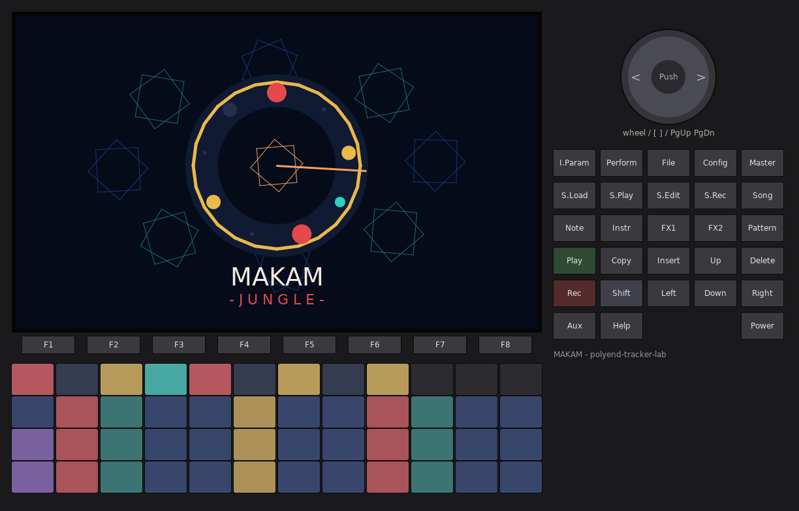
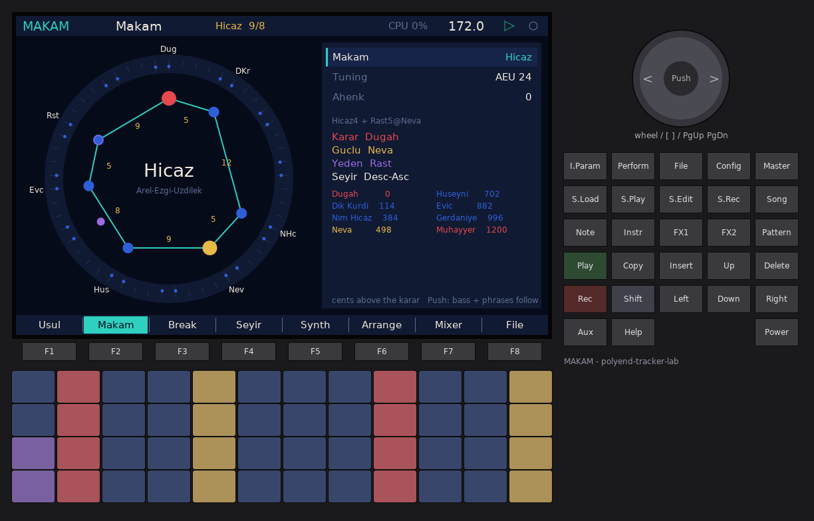
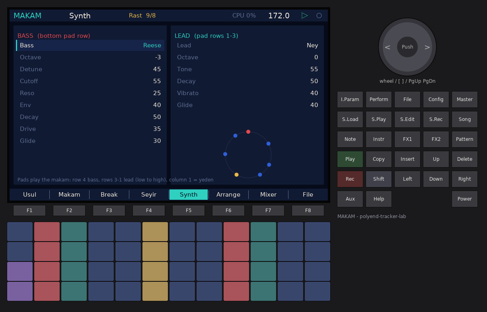
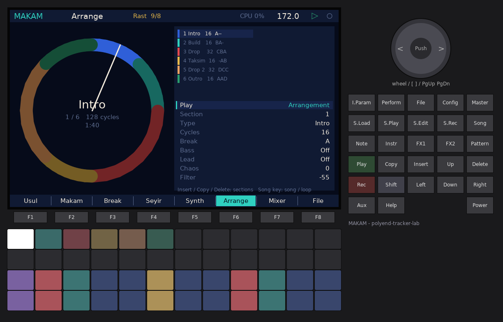
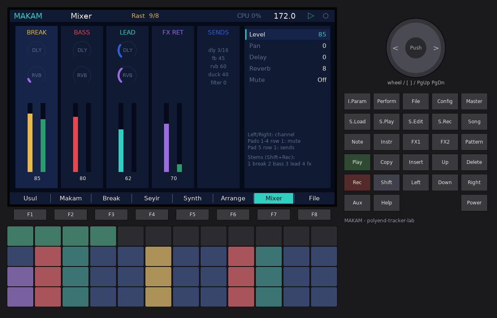
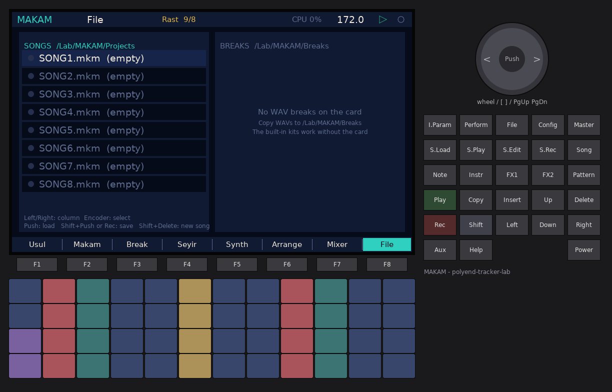

# MAKAM-JUNGLE — manual

**MAKAM** is a firmware for the original Polyend Tracker where Turkish makam
music meets jungle and drum & bass. A break (built in, or a WAV from the card)
is cut on the strokes of an **usul** (an aksak rhythmic cycle) at jungle tempo.
A reese/sub/growl **bass** and a ney/kanun/saz/zurna **lead** play in real
makam tuning (Arel-Ezgi-Uzdilek 24-tone, or 53-TET). A **seyir** generator
writes melodies that move through the makam the way the theory says they
should.

The screen is built around circles, not tracker rows. The usul is a clock dial
with its strokes on the rim, the makam is a ring of perdes (pitches) on the
53-comma circle, the melody is a rose, and the arrangement is a ring of
sections.



---

## 1. Quick start (2 minutes, no SD card needed)

1. Put `PolyendTrackerMAKAMJ.ptf` into `/Firmware` on the card and install it
   (Config > Firmware on any lab firmware, or the stock updater).
2. After the intro (any key skips it), press **Play**. The demo song starts:
   *Rast* makam over *aksak 9/8* at **172 BPM**, built-in break "Kirik", six
   sections (Intro, Build, Drop, Taksim, Drop 2, Outro).
3. Turn the **encoder** on the Usul page to change the usul. The break is
   re-cut on the new strokes immediately, and the bass and phrases follow.
4. **F2 Makam**: turn the encoder to change the makam (try *Hicaz*, *Saba*,
   *Huzzam*). Push the encoder to regenerate the bass and phrases in the new
   makam.
5. Play the **pads**. The bottom row is bass, the three rows above are the
   lead, from low to high. They are always in the makam, so there are no wrong
   notes.
6. **F3 Break**: hold the bottom-row pads for rolls, reverse, stutter, half
   speed and CHAOS.
7. Press **Shift + Rec** to record a WAV (plus 4 stems if Config > Record stems
   is On).

---

## 2. Concepts

| Term | Meaning |
|---|---|
| **Makam** | A melodic mode: a scale built from a dörtlü (tetrachord) and a beşli (pentachord), with a tonic, a dominant, typical cadences and a characteristic melodic path (seyir). |
| **Perde** | A named pitch (fret, "curtain"): Rast, Dügâh, Segâh, Çârgâh, Nevâ, Hüseynî, Eviç, Gerdâniye... Each one is a fixed position, not just a scale degree. |
| **Koma (comma)** | The Holdrian comma, 1/53 of an octave (22.64 cents). Turkish theory measures every interval in commas. |
| **Karar / durak** | The tonic, where the melody finally rests (tam karar = full cadence). |
| **Güçlü** | The dominant: the second centre, where the half cadence (yarım karar) lands. |
| **Yeden** | The leading tone just below the karar. |
| **Asma karar** | A suspended cadence on another perde (e.g. Çârgâh in Rast). |
| **Seyir** | The melodic course: *çıkıcı* (ascending: starts low, rises), *inici* (descending: starts at the upper tonic, falls), *inici-çıkıcı* (starts around the güçlü). |
| **Çeşni** | A "flavour": a characteristic fragment of another makam; MAKAM's ornaments (grace notes, glissandi) give the line its çeşni. |
| **Usul** | A rhythmic cycle of strong and weak strokes, often aksak ("limping", groups of 2 and 3). |
| **Düm / Tek / Ke** | Usul strokes: **düm** = strong low stroke (right hand) → **kick** slices; **tek** = light high stroke (left hand) → **snare** slices; **ke / ka / tekkâ** = small fill strokes → **ghost** slices. |

### Interval names (AEU)

| Name | Symbol | Commas | Real size in AEU (Pythagorean) |
|---|---|---|---|
| Koma (fazla) | F | 1 | 23.46 c |
| Bakiye | B | 4 | 90.22 c (256/243) |
| Küçük mücenneb | S | 5 | 113.69 c (2187/2048) |
| Büyük mücenneb | K | 8 | 180.45 c |
| Tanînî | T | 9 | 203.91 c (9/8) |
| Artık ikili | A | 12 / 13 | 271 / 294 c |

### Tetrachords and pentachords

| Çeşni | Dörtlü (4) | Beşli (5) |
|---|---|---|
| Çârgâh | T T B (9 9 4) | T T B T |
| Bûselik | T B T (9 4 9) | T B T T |
| Kürdî | B T T (4 9 9) | B T T T |
| Uşşak | K S T (8 5 9) | Hüseynî beşli K S T T |
| Hicaz | S A S (5 12 5) | S A S T |
| Rast | T K S (9 8 5) | T K S T |
| Segâh | — | S T K T (5 9 8 9) |
| Hüzzam | — | S T S A (5 9 5 12) |
| Nikriz | — | T S A S (9 5 12 5) |
| Sabâ | K S S (8 5 5, "eksik dörtlü") | — |

---

## 3. Tuning

**Settings row "MAKAM tuning"** (or the Makam page):

* **AEU 24** (default) — Arel-Ezgi-Uzdilek: 24 pitches per octave from a chain
  of pure fifths, from 12 fifths below to 11 fifths above Kaba Çârgâh. The
  comma counts name the steps; the frequencies are Pythagorean (pure fifths
  3/2, pure fourths 4/3, tanînî 9/8, bakiye 256/243). This is the official
  notation system of Turkish art music.
* **53-TET** — Holdrian comma tuning: every comma is exactly 1200/53 cents.
  Every AEU perde lies within 2 cents of its 53-TET position (table below).

The reference is **Dügâh = A4 = 440 Hz** (Bolahenk-style pitch names on a
Western reference). **Ahenk** (−12..+12 semitones) transposes everything, the
way a ney player picks a different ahenk (Kız, Mansur, Şah...).

### The 24 AEU pitch classes

Position in commas above Çârgâh (C), the chain-of-fifths position, and cents
in both systems. The perde names are those of the middle octave.

| Comma | Perde | Fifths | AEU cents | 53-TET cents |
|---|---|---|---|---|
| 0 | Çârgâh | 0 | 0.00 | 0.00 |
| 4 | Nîm Hicaz | −5 | 90.22 | 90.57 |
| 5 | Hicaz | +7 | 113.69 | 113.21 |
| 8 | Dik Hicaz | −10 | 180.45 | 181.13 |
| 9 | Nevâ | +2 | 203.91 | 203.77 |
| 13 | Nîm Hisar | −3 | 294.14 | 294.34 |
| 14 | Hisar | +9 | 317.60 | 316.98 |
| 17 | Dik Hisar | −8 | 384.36 | 384.91 |
| 18 | Hüseynî | +4 | 407.82 | 407.55 |
| 22 | Acem | −1 | 498.04 | 498.11 |
| 23 | Dik Acem | +11 | 521.51 | 520.75 |
| 26 | Eviç (Irak an octave down) | −6 | 588.27 | 588.68 |
| 27 | Mâhûr (Geveşt) | +6 | 611.73 | 611.32 |
| 30 | Dik Mâhûr | −11 | 678.49 | 679.25 |
| 31 | Gerdâniye (Rast) | +1 | 701.96 | 701.89 |
| 35 | Nîm Şehnaz (Nîm Zirgüle) | −4 | 792.18 | 792.45 |
| 36 | Şehnaz (Zirgüle) | +8 | 815.64 | 815.09 |
| 39 | Dik Şehnaz (Dik Zirgüle) | −9 | 882.40 | 883.02 |
| 40 | Muhayyer (Dügâh) | +3 | 905.86 | 905.66 |
| 44 | Sünbüle (Kürdî) | −2 | 996.09 | 996.23 |
| 45 | Dik Sünbüle (Dik Kürdî) | +10 | 1019.55 | 1018.87 |
| 48 | Tiz Segâh (Segâh) | −7 | 1086.31 | 1086.79 |
| 49 | Tiz Bûselik (Bûselik) | +5 | 1109.78 | 1109.43 |
| 52 | Tiz Dik Bûselik (Dik Bûselik) | −12 | 1176.54 | 1177.36 |

Absolute positions used below: Kaba Çârgâh = 0 (C4 in AEU notation), Rast =
31 (G), Dügâh = 40 (A), Çârgâh = 53, Nevâ = 62, Gerdâniye = 84, Muhayyer =
93.

---

## 4. The makams

25 makams. Degrees are absolute commas; steps are the commas between
neighbouring degrees. Where the descending scale differs, the "desc" note
gives the perde used when the melody falls (the lead and the generator use
it). Sources: the TDV İslâm Ansiklopedisi makam articles (İ. H. Özkan) and the
AEU dörtlü/beşli definitions above.

| Makam | Composition | Perdes (ascending) | Steps | Karar | Güçlü | Yeden | Seyir |
|---|---|---|---|---|---|---|---|
| Rast | Rast5 + Rast4 on Nevâ (desc Bûselik4: Acem) | Rast 31, Dügâh 40, Segâh 48, Çârgâh 53, Nevâ 62, Hüseynî 71, Eviç 79, Gerdâniye 84 | 9-8-5-9-9-8-5 | Rast | Nevâ | Irak | ascending |
| Uşşak | Uşşak4 + Bûselik5 on Nevâ | Dügâh 40, Segâh 48, Çârgâh 53, Nevâ 62, Hüseynî 71, Acem 75, Gerdâniye 84, Muhayyer 93 | 8-5-9-9-4-9-9 | Dügâh | Nevâ | Rast | ascending |
| Hüzzam | Hüzzam5 + Hicaz4 on Eviç | Segâh 48, Çârgâh 53, Nevâ 62, Hisar 67, Eviç 79, Gerdâniye 84, Sünbüle 97, Tiz Segâh 101 | 5-9-5-12-5-13-4 | Segâh | Nevâ | Kürdî | desc-asc |
| Hicaz | Hicaz4 + Rast5 on Nevâ (desc Acem) | Dügâh 40, Dik Kürdî 45, Nîm Hicaz 57, Nevâ 62, Hüseynî 71, Eviç 79, Gerdâniye 84, Muhayyer 93 | 5-12-5-9-8-5-9 | Dügâh | Nevâ | Rast | desc-asc |
| Sabâ | Sabâ4 + Hicaz on Çârgâh (no octave) | Dügâh 40, Segâh 48, Çârgâh 53, Hicaz 58, Dik Hisar 70, Acem 75, Gerdâniye 84, Şehnaz 89 | 8-5-5-12-5-9-5 | Dügâh | Çârgâh | Rast | ascending |
| Nihâvend | Bûselik5 on Rast + Hicaz4 on Nevâ (desc Kürdî4: Acem) | Rast 31, Dügâh 40, Kürdî 44, Çârgâh 53, Nevâ 62, Nîm Hisar 66, Eviç 79, Gerdâniye 84 | 9-4-9-9-4-13-5 | Rast | Nevâ | Irak | desc-asc |
| Kürdî | Kürdî4 + Bûselik5 on Nevâ | Dügâh 40, Kürdî 44, Çârgâh 53, Nevâ 62, Hüseynî 71, Acem 75, Gerdâniye 84, Muhayyer 93 | 4-9-9-9-4-9-9 | Dügâh | Nevâ | Rast | ascending |
| Segâh | Segâh5 + Hicaz4 on Eviç (desc Uşşak on Nevâ) | Segâh 48, Çârgâh 53, Nevâ 62, Dik Hisar 70, Eviç 79, Gerdâniye 84, Sünbüle 97, Tiz Segâh 101 | 5-9-8-9-5-13-4 | Segâh | Nevâ | Kürdî | ascending |
| Karcığar | Uşşak4 + Hicaz5 on Nevâ | Dügâh 40, Segâh 48, Çârgâh 53, Nevâ 62, Hisar 67, Eviç 79, Gerdâniye 84, Muhayyer 93 | 8-5-9-5-12-5-9 | Dügâh | Nevâ | Rast | desc-asc |
| Hüseynî | Hüseynî5 + Uşşak4 on Hüseynî (desc Acem) | Dügâh 40, Segâh 48, Çârgâh 53, Nevâ 62, Hüseynî 71, Eviç 79, Gerdâniye 84, Muhayyer 93 | 8-5-9-9-8-5-9 | Dügâh | Hüseynî | Rast | desc-asc |
| Muhayyer | as Hüseynî, centred on the upper tonic | same as Hüseynî | 8-5-9-9-8-5-9 | Dügâh | Muhayyer | Rast | descending |
| Hicazkâr | Hicaz5 on Rast + Hicaz4 on Nevâ (desc Acem) | Rast 31, Zirgüle 36, Segâh 48, Çârgâh 53, Nevâ 62, Hisar 67, Eviç 79, Gerdâniye 84 | 5-12-5-9-5-12-5 | Rast | Gerdâniye | Irak | descending |
| Sûzinak | Rast5 + Hicaz4 on Nevâ | Rast 31, Dügâh 40, Segâh 48, Çârgâh 53, Nevâ 62, Hisar 67, Eviç 79, Gerdâniye 84 | 9-8-5-9-5-12-5 | Rast | Nevâ | Irak | desc-asc |
| Nevâ | Uşşak4 + Rast5 on Nevâ (desc Acem) | Dügâh 40, Segâh 48, Çârgâh 53, Nevâ 62, Hüseynî 71, Eviç 79, Gerdâniye 84, Muhayyer 93 | 8-5-9-9-8-5-9 | Dügâh | Nevâ | Rast | desc-asc |
| Beyâtî | Uşşak4 + Bûselik5 on Nevâ (Eviç rising, Acem falling) | as Nevâ | 8-5-9-9-8-5-9 | Dügâh | Nevâ | Rast | desc-asc |
| Acemaşîran | Çârgâh5 on Acemaşîran + Çârgâh4 on Çârgâh | Acemaşîran 22, Rast 31, Dügâh 40, Kürdî 44, Çârgâh 53, Nevâ 62, Hüseynî 71, Acem 75 | 9-9-4-9-9-9-4 | Acemaşîran | Acem | Hüseynîaşîran | descending |
| Kürdîlihicazkâr | Kürdî4 on Rast + Bûselik5 on Çârgâh | Rast 31, Nîm Zirgüle 35, Kürdî 44, Çârgâh 53, Nevâ 62, Nîm Hisar 66, Acem 75, Gerdâniye 84 | 4-9-9-9-4-9-9 | Rast | Gerdâniye | Acemaşîran | descending |
| Hümâyun | Hicaz4 + Bûselik5 on Nevâ | Dügâh 40, Dik Kürdî 45, Nîm Hicaz 57, Nevâ 62, Hüseynî 71, Acem 75, Gerdâniye 84, Muhayyer 93 | 5-12-5-9-4-9-9 | Dügâh | Nevâ | Rast | desc-asc |
| Uzzâl | Hicaz5 + Uşşak4 on Hüseynî | Dügâh 40, Dik Kürdî 45, Nîm Hicaz 57, Nevâ 62, Hüseynî 71, Eviç 79, Gerdâniye 84, Muhayyer 93 | 5-12-5-9-8-5-9 | Dügâh | Hüseynî | Rast | desc-asc |
| Zirgüleli Hicaz | Hicaz5 + Hicaz4 on Hüseynî | Dügâh 40, Dik Kürdî 45, Nîm Hicaz 57, Nevâ 62, Hüseynî 71, Dik Acem 76, Nîm Şehnaz 88, Muhayyer 93 | 5-12-5-9-5-12-5 | Dügâh | Hüseynî | Rast | desc-asc |
| Bûselik | Bûselik5 + Kürdî4 on Hüseynî | Dügâh 40, Bûselik 49, Çârgâh 53, Nevâ 62, Hüseynî 71, Acem 75, Gerdâniye 84, Muhayyer 93 | 9-4-9-9-4-9-9 | Dügâh | Hüseynî | Nîm Zirgüle | ascending |
| Mâhûr | Çârgâh5 on Rast + Çârgâh4 on Nevâ (desc Acem) | Rast 31, Dügâh 40, Bûselik 49, Çârgâh 53, Nevâ 62, Hüseynî 71, Mâhûr 80, Gerdâniye 84 | 9-9-4-9-9-9-4 | Rast | Gerdâniye | Irak | descending |
| Nikrîz | Nikrîz5 on Rast + Rast4 on Nevâ (desc Acem) | Rast 31, Dügâh 40, Dik Kürdî 45, Nîm Hicaz 57, Nevâ 62, Hüseynî 71, Eviç 79, Gerdâniye 84 | 9-5-12-5-9-8-5 | Rast | Nevâ | Irak | ascending |
| Neveser | Nikrîz5 on Rast + Hicaz4 on Nevâ | Rast 31, Dügâh 40, Dik Kürdî 45, Nîm Hicaz 57, Nevâ 62, Hisar 67, Eviç 79, Gerdâniye 84 | 9-5-12-5-5-12-5 | Rast | Nevâ | Irak | desc-asc |
| Çârgâh | Çârgâh5 + Çârgâh4 on Gerdâniye | Çârgâh 53, Nevâ 62, Hüseynî 71, Acem 75, Gerdâniye 84, Muhayyer 93, Tiz Bûselik 102, Tiz Çârgâh 106 | 9-9-4-9-9-9-4 | Çârgâh | Gerdâniye | Bûselik | ascending |

Notes on the theory choices:

* **Hüzzam's Hisar** is played about 1–1.5 commas sharp in practice. AEU has
  no sign for that, so MAKAM uses the written Hisar (67), exactly as the
  notation does.
* **Sabâ** does not close at the octave: its 7th note is Şehnaz (89), 49
  commas above Dügâh. In practice Sabâ's Hicaz is also played 2–2.5 commas
  sharp; MAKAM uses the written Hicaz (58).
* **Muhayyer / Hüseynî** and **Nevâ / Beyâtî** share their scales. The
  difference is the seyir (where the melody starts and which perde it
  emphasises), which is exactly what the seyir generator changes.
* The **guclu** of descending makams (Muhayyer, Hicazkâr, Mâhûr,
  Kürdîlihicazkâr, Acemaşîran) is the upper tonic or the perde the TDV
  article names as first-degree güçlü.

### Cents above the karar

| Makam | AEU | 53-TET |
|---|---|---|
| Rast | 204, 384, 498, 702, 906, 1086, 1200 | 204, 385, 498, 702, 906, 1087, 1200 |
| Uşşak | 180, 294, 498, 702, 792, 996, 1200 | 181, 294, 498, 702, 792, 996, 1200 |
| Hüzzam | 114, 318, 431, 702, 816, 1110, 1200 | 113, 317, 430, 702, 815, 1109, 1200 |
| Hicaz | 114, 384, 498, 702, 882, 996, 1200 | 113, 385, 498, 702, 883, 996, 1200 |
| Sabâ | 180, 294, 408, 678, 792, 996, 1110 | 181, 294, 408, 679, 792, 996, 1109 |
| Nihâvend | 204, 294, 498, 702, 792, 1086, 1200 | 204, 294, 498, 702, 792, 1087, 1200 |
| Kürdî | 90, 294, 498, 702, 792, 996, 1200 | 91, 294, 498, 702, 792, 996, 1200 |
| Segâh | 114, 318, 498, 702, 816, 1110, 1200 | 113, 317, 498, 702, 815, 1109, 1200 |
| Karcığar | 180, 294, 498, 612, 882, 996, 1200 | 181, 294, 498, 611, 883, 996, 1200 |
| Hüseynî / Muhayyer / Nevâ / Beyâtî | 180, 294, 498, 702, 882, 996, 1200 | 181, 294, 498, 702, 883, 996, 1200 |
| Hicazkâr / Zirgüleli Hicaz | 114, 384, 498, 702, 816, 1086, 1200 | 113, 385, 498, 702, 815, 1087, 1200 |
| Sûzinak | 204, 384, 498, 702, 816, 1086, 1200 | 204, 385, 498, 702, 815, 1087, 1200 |
| Acemaşîran / Mâhûr / Çârgâh | 204, 408, 498, 702, 906, 1110, 1200 | 204, 408, 498, 702, 906, 1109, 1200 |
| Kürdîlihicazkâr | 90, 294, 498, 702, 792, 996, 1200 | 91, 294, 498, 702, 792, 996, 1200 |
| Hümâyun | 114, 384, 498, 702, 792, 996, 1200 | 113, 385, 498, 702, 792, 996, 1200 |
| Uzzâl | 114, 384, 498, 702, 882, 996, 1200 | 113, 385, 498, 702, 883, 996, 1200 |
| Bûselik | 204, 294, 498, 702, 792, 996, 1200 | 204, 294, 498, 702, 792, 996, 1200 |
| Nikrîz | 204, 318, 588, 702, 906, 1086, 1200 | 204, 317, 589, 702, 906, 1087, 1200 |
| Neveser | 204, 318, 588, 702, 816, 1086, 1200 | 204, 317, 589, 702, 815, 1087, 1200 |

---

## 5. The usuls

One character per time unit. By default one unit is a **16th note** at the
song tempo, so aksak 9/8 at 172 BPM is a 9-sixteenth jungle cycle, the
classic broken feel. Settings > "MAKAM usul unit" = 1/8 halves the speed.

`D` = düm (kick slices), `T` = tek (snare slices), `k` = ke/ka/tekkâ (ghost
slices), `.` = the playing slice keeps playing (chopped jungle). The stroke
strings follow the kudüm patterns (*Düm Te-ke Düm Tek Tek* for aksak...), with
long strokes ("düüm", "teek") written as the stroke followed by rests.

| Usul | Meter | Groups | Strokes |
|---|---|---|---|
| Aksak | 9/8 | 2+2+2+3 | `D.TkD.T.T` |
| Curcuna | 10/8 | 3+2+2+3 | `DTkD.T.T..` |
| Devr-i Hindî | 7/8 | 3+2+2 | `D.kT.T.` |
| Sofyan | 4/4 | 4+2+2 (in eighths) | `D...T.T.` |
| Düyek | 8/8 | 2+1+2+1+2 | `DT.TD.T.` |
| Semâî (yürük) | 6/8 | 3+3 | `D.kD.T` |
| Aksak Semâî | 10/8 | 3+2+2+3 | `D..TkD.T.T` |
| Devr-i Turan | 7/8 | 2+2+3 | `D.T.Tk.` |
| Türk Aksağı | 5/8 | 2+3 | `D.TT.` |
| Raks Aksağı | 9/8 | 2+3+2+2 | `D.TT.D.TT` |
| Müsemmen | 8/8 | 3+3+2 | `D.kD.kT.` |
| Tek Vuruş | 11/8 | 2+2+2+2+3 | `D.T.k.D.T.k` |
| Frenkçin | 12/8 | 3+3+2+2+2 | `D.kD.kT.T.k.` |

---

## 6. The pages

Every page: **F1..F8** pick the page. **Up / Down** move through the rows,
the **encoder** (or Left / Right where noted) changes the value, and
**Shift + encoder** moves by 10. **Push** runs the page action. **Play**
starts and stops. **Song** toggles Arrangement / Loop section. **Config**
opens the settings. **Shift + Rec** records.

The pads (outside the page-specific rows) always play the makam:

| Pad row | Plays |
|---|---|
| Row 1 (top) | lead, degrees 13..24 (two octaves up) |
| Row 2 | lead, degrees 6..17 |
| Row 3 | lead, degrees −1..10 (column 1 = yeden, column 2 = karar) |
| Row 4 (bottom) | bass, degrees −1..10 |

Pad colours: **red** = karar, **gold** = güçlü, **turquoise** = asma karar,
**violet** = yeden, **cobalt** = the other perdes, **cream** = sounding now.
Velocity sets the level. Up to 2 pad lead voices play over the sequenced
phrase.

### F1 — Usul


The usul as a clock dial. Each unit is a tick on the rim, with the groups
(2+2+2+3...) as alternating cobalt and turquoise arcs. The strokes of the
current break variation sit inside: big red = düm, gold = tek, small
turquoise = ke. Violet dots mark steps with edits (roll, reverse, stutter,
pitch), and the saffron hand sweeps with the playhead.

| Row | Range | |
|---|---|---|
| Usul | 13 usuls | Re-cuts all four break variations and regenerates bass and phrases |
| Tempo | 60..220 BPM | Same as the shell tempo (172 default) |
| Unit | 1/16, 1/8 | Length of one usul unit |
| Swing | 0..50 % | Delays every second unit |
| Break kit | Kırık Break, Sert Funk, Darbuka, Card WAV | |
| Edit variation | A..D | Which variation the Break page edits (and Loop mode plays) |
| Play | Loop section / Arrangement | |

Pads row 1: the usul steps (tap cycles the stroke). Push re-cuts the variation.

### F2 — Makam


The 53-comma circle with the karar at 12 o'clock. Long ticks mark the 24
AEU positions (dots on every comma in 53-TET). The makam's perdes form the
turquoise polygon, with the step size in commas written on each edge. Violet
dots show perdes that change when the melody descends, and the violet ring is
the yeden. The panel shows composition, karar, güçlü, yeden, seyir and every
degree with its cents above the karar in the active tuning.



| Row | Range |
|---|---|
| Makam | 25 makams (bass patterns and phrases follow automatically) |
| Tuning | AEU 24 / 53-TET |
| Ahenk | −12..+12 semitones |

Push: regenerate all bass patterns and the four phrases in this makam.

### F3 — Break


The waveform of the active kit with its 16 slices. The coloured bar under each
slice shows its class (red kick, gold snare, turquoise ghost) and lights up
while the slice plays. The dial is the variation being edited; the ringed
step is the step being edited.

| Row | Range | |
|---|---|---|
| Kit | 4 | |
| Variation | A..D | |
| Stroke | Rest, Dum, Tek, Ke | of the selected step |
| Slice | Auto, 1..16 | Auto = the n-th stroke of its kind takes the n-th slice of its class |
| Roll | 1..4 | hits inside the step (rolls of 4 rise in pitch) |
| Pitch | −12..+12 | semitones |
| Reverse / Stutter / Choke | Off/On | stutter loops the first quarter of the slice; choke stops the slice on a rest |
| Edit density | 0..100 | how many edits Push / the generated variations C and D add |
| Drive | 0..100 | break bus saturation |

Left / Right: select the step.

Pads:

| Row | Pads |
|---|---|
| 1 | usul steps: select (Shift: cycle the stroke) |
| 2 | slices 1..12 (audition; Shift = assign to the selected step) |
| 3 | slices 13..16, variation A..D, kit 1..4 |
| 4 (hold) | Roll 2, Roll 3, Roll 4, Roll 6, Reverse, Stutter, Half speed, Mute, CHAOS, Düm, Tek, Ke one-shots |

Push: re-cut this variation from the usul (new random edits). Copy: copy the
variation to the next one. Delete: clear the step.

The four generated variations are: **A** = plain strokes, **B** = + ghost
notes, **C** = + rolls and stutters in the last group (the turnaround),
**D** = + reversed teks and pitched hits. Every 4th cycle the CHAOS amount of
the section is doubled in the last three units (jungle turnaround).

### F4 — Seyir (melody generator)


The phrase as a rose: the angle is time (1–4 usul cycles, with spokes at the
cycle starts), the radius is the degree. Rings mark the karar (red), the güçlü
(gold), the tiz durak (grey) and the yeden (violet). Accented notes are drawn
larger.

| Row | Range | |
|---|---|---|
| Phrase | A..D | |
| Cycles | 1..4 | phrase length in usul cycles |
| Density | 0..100 | how many strokes get a note |
| Range | 4..14 degrees | highest degree above the karar |
| Ornament | 0..100 | glissandi and grace notes (çeşni) |
| Start | Seyir / Karar / Güçlü / Tiz durak | Seyir = from the makam's seyir |
| Seed | 1..999 | |
| Live | Off / On | On: a new phrase every time the playing one wraps |

How the generator walks the makam:

1. **Start region** from the seyir: ascending makams start around the karar,
   descending ones at the tiz durak (upper octave), desc-asc ones at the
   güçlü.
2. **Waypoints**: a **yarım karar on the güçlü** at about 40 % of the phrase
   (accented), an ascending makam's climb above the güçlü, an **asma karar**
   (the makam's suspended-cadence perde) at about 70 %, then the **approach**
   (the degree above the karar, or the **yeden** for makams that cadence from
   below: Rast, Nihâvend, Hüzzam, Segâh, Hicazkâr, Bûselik, Mâhûr...), and the
   **tam karar** on the last düm/tek of the last cycle, held to the end.
3. **Motion**: mostly by step, sometimes thirds, sometimes a turn back (the
   arabesque of a seyir). Notes go on düm strokes first, then tek, then ke.
4. **Ornaments**: glissando from the previous note, or a grace note from the
   degree above.

The host tests check every makam, usul and many seeds: notes stay in the
makam, the güçlü appears, and the phrase ends on the karar after a step
approach.

Editing (Live Off): pads rows 1–4 (as many columns as the usul has units)
select the step at the cursor. **Shift + pad** (lead rows) plays the note and
writes it at the cursor. **Shift + Up / Down** moves the note by a degree.
**Insert** toggles glissando (or turns a rest into a hold). **Delete** makes a
rest. **Copy** copies the phrase to the next one. **Left / Right** move the
cursor. **Push** generates a new phrase (next seed).

### F5 — Synth



| Bass | |
|---|---|
| Model | **Reese** (two detuned saws + sub octave, low-pass, drive), **Sub** (sine with a touch of octave, saturated), **Growl** (saws + pulse, 16th-note filter wobble, wavefolder) |
| Octave | −4..−1 octaves under the makam register |
| Detune, Cutoff, Reso, Env, Decay, Drive, Glide | 0..100 |

| Lead | |
|---|---|
| Model | **Ney** (breathy sine + 2nd harmonic + band-passed breath noise with a "chiff" at the attack), **Kanun** (plucked Karplus-Strong string), **Saz** (two courses, the second an octave up and slightly detuned, driven), **Zurna** (bright saw through a nasal formant, saturated) |
| Octave | −2..+1 |
| Tone, Decay (string sustain), Vibrato (delayed, after 250 ms), Glide | 0..100 |

The small ring shows the perde sounding now.

The bass is ducked by every düm (Mixer > Dum duck), so the kick slices punch
through the reese.

### F6 — Arrange



The song as a ring of sections (arc length = cycles), with the song
position hand. Up to 16 sections:

| Row | Range | |
|---|---|---|
| Play | Loop section / Arrangement | |
| Section | 1..n | selected section |
| Type | Intro, Build, Drop, Break, Taksim, Drop 2, Outro | |
| Cycles | 1..64 | usul cycles |
| Break / Bass / Lead | Off, A..D | variations and phrase |
| Chaos | 0..100 | live jungle edits (random rolls, reverse, pitch, stutter, slice swaps) |
| Filter | −100..100 | break DJ filter (low-pass below 0, high-pass above) |

Pads row 1 and the first 4 of row 2 select sections (in Loop mode the
selected section plays). **Insert** adds a section after the selected one,
**Copy** duplicates it, **Delete** removes it. Left / Right select.

The demo arrangement is Intro 16, Build 16, Drop 32, Taksim 16 (bass + a
sparse ornamented phrase, no break), Drop 2 32 (chaos 45), Outro 16. That is
128 cycles of aksak, about 1:40 at 172 BPM.

### F7 — Mixer



Four channels: **Break**, **Bass**, **Lead**, **FX return** (delay + reverb).
Each has level, pan, delay send, reverb send and mute. **Left / Right**
selects a channel; the fifth column holds the effects:

| Sends column | |
|---|---|
| Delay time | 1/16, 1/8, 3/16, 1/4, 3/8, 1/2 (tempo synced) |
| Feedback | 0..95 |
| Reverb size, Damping | 0..100 |
| Dum duck | how far bass and lead dip on every düm |
| DJ filter | −100..100, on the break bus (added to the section filter) |

The delay feeds a little into the reverb (dub tail). The delay and reverb are
OpenTracker's own effects (int16 rings in SDRAM). Pads 1–4 of row 1 mute the
channels.

**Stems**: with Config > Record stems On, Shift + Rec writes the master plus
four stereo stems: 1 Break, 2 Bass, 3 Lead, 4 FX return.

### F8 — File



Left column: 8 song slots in `/Lab/MAKAM/Projects/SONG1..8.mkm`. Right
column: WAV breaks in `/Lab/MAKAM/Breaks`. **Left / Right** pick the column,
the **encoder** picks the item.

* **Push**: load the song, or load and slice the WAV (it becomes kit 4,
  "Card WAV").
* **Shift + Push** or **Rec**: save the song to the slot.
* **Shift + Delete**: new song (defaults).

The current state is also saved to `/Lab/MAKAM/project.mkm` on power-off,
Config > Save and every 5 minutes, and loaded at boot.

---

## 7. Breaks

**Built-in (no card needed)**, synthesised at boot. Each is two bars at
170 BPM in 16 slices (eighth notes):

* **Kırık Break**: the classic broken break, with kicks on 1 and the "and of
  2", the late snare and ghost snares, under a ride.
* **Sert Funk**: tight funk with 16th hats, ghosts and an open hat.
* **Darbuka**: doum / tek / ka (deep membrane, rim crack, small slap) laid out
  like a break.

**Card WAVs**: any WAV OpenTracker reads (8/16/24/32-bit PCM or float, mono or
stereo (mixed to mono), any rate, resampled to 44.1 kHz), up to **12 s**.
MAKAM assumes 1, 2, 4 or 8 bars and picks the bar count that puts the break
nearest to 170 BPM. It cuts 16 equal slices and classifies each slice from the
energy of its first 25 ms (low band = kick, high band = snare, quiet =
ghost). Trim breaks to whole bars for clean slices.

**Break tempo** (Settings): *Follow tempo* (default) plays the slices at song
BPM / break BPM speed, like a sampler pitched to fit (the jungle way). *Cut
only* keeps the original speed and pitch.

---

## 8. MIDI

* **MIDI in** (Settings > MIDI in channel): notes below 48 play the bass,
  notes 48 and above play the lead. The note is quantised to the nearest
  makam degree (A4 = 69 = Dügâh).
* **MIDI out** (Settings > MAKAM MIDI notes out): the bass on the shell's
  MIDI out channel, the lead on the channel above. Each note-on is preceded by
  a **pitch bend** carrying the microtonal offset from the nearest 12-TET
  note.
  **Bend range**: Settings > "MAKAM MIDI bend range" (default **±2
  semitones**). Set the receiving synth's pitch-bend range to the same value.
  Example: Segâh (AEU) is 180.45 cents above Dügâh = A4 + 1.80 semitones, sent
  as B4 (71) with a bend of −0.195 semitones (value 7392 at ±2).
  Use a separate channel per voice (as MAKAM does) because the bend applies to
  the whole channel.
* **Clock**: Settings > Clock (internal / send / follow), from the shell.

---

## 9. Settings rows (Config)

The shell rows (brightness, intro, tempo, clock, MIDI channels, input, master,
limiter, record stems) come first, then MAKAM's:

| Row | Values | Default |
|---|---|---|
| MAKAM tuning | AEU 24, 53-TET | AEU 24 |
| MAKAM ahenk (transpose) | −12..+12 st | 0 |
| MAKAM usul unit | 1/16, 1/8 | 1/16 |
| MAKAM MIDI notes out | Off, Bass+Lead | Bass+Lead |
| MAKAM MIDI bend range | 1..24 st | 2 |
| MAKAM break tempo | Cut only, Follow tempo | Follow tempo |

These are stored in the song file, so each song keeps its own tuning.

---

## 10. Files on the card

```
/Lab/MAKAM/settings.bin           shell settings
/Lab/MAKAM/project.mkm            the current song (auto save)
/Lab/MAKAM/Projects/SONG1..8.mkm  song slots
/Lab/MAKAM/Breaks/*.wav           your breaks (create the folder or let MAKAM do it)
/Lab/MAKAM/Rec/REC-nnnn.wav       recordings (+ -stem1..4)
```

**Song file format** (`.mkm`, little endian): `"MKMJ"` magic, uint16 version
(1), uint16 reserved, uint32 payload size, payload, uint32 CRC-32 of the
payload. The payload is the break WAV name (40 bytes) followed by every song
value as int16 in a fixed order. New fields are only ever appended, so newer
firmwares load old files with defaults for the new fields; a file from a
newer version or with a bad CRC is refused (the song stays as it was).

---

## 11. Tips

* **Aksak at 172** is the sweet spot: 9 sixteenths against the 4/4 of a DJ
  mix shifts by one sixteenth per cycle, then comes back every 16 bars.
  Curcuna (10) and Devr-i Hindî (7) give the same tension with different
  periods.
* For a mix-friendly 4/4 section, switch the usul to **Sofyan** or **Düyek**
  for the drop, then back to aksak for the break. The phrases regenerate
  automatically.
* **Hicaz**, **Hümâyun** and **Zirgüleli Hicaz** are the "oriental" makams
  everyone recognises. **Uşşak** and **Hüseynî** sound typically Turkish and
  calmer. **Sabâ** is the darkest, with its narrow 5-comma step and no
  octave. **Segâh** and **Hüzzam** sit on the "neutral" Segâh perde and sound
  the most microtonal.
* Try 53-TET against AEU on Segâh / Hüzzam: the difference is up to about
  1 cent, but the 53-TET circle lets you hear every comma step of the ring.
* Hold **CHAOS** plus **Roll 6** on the last cycle of a section for an Amen-
  style fill, and **Half** for a half-time drop.
* **Taksim** section: break off, ney lead, ornament high, density low. That
  gives an improvisation feel over the reese.
* Live seyir On + Lead on a long section: a new phrase every pass, always
  cadencing on the karar.

---

## 12. Limits

* 4 break variations of up to 12 steps (the longest usul is 12 units), 4
  phrases of up to 48 steps, 4 bass patterns, 16 sections.
* 2 break voices (with a crossfade), 1 bass voice, 3 lead voices (1 for the
  phrase + 2 for pads / MIDI).
* Card WAV ≤ 12 s; built-in breaks are 2 bars.
* The asma-karar and yeden logic is per makam; çeşni modulations (geçki)
  between makams within a phrase are not generated.
* Hüzzam's raised Hisar and Sabâ's raised Hicaz use the written AEU positions.
* MIDI out is monophonic per part (bass, lead phrase); pad / MIDI-in lead
  notes are sent on the lead channel too.

---

## 13. CPU, memory, display (from the gate)

| Bench scenario (QEMU, M4 instructions per 128-sample block; limit 180,000) | avg | worst |
|---|---|---|
| idle (transport running, parts off) | 21,652 | 22,480 |
| breaks (aksak, variation D, CHAOS, roll 6, filter, drive, sends) | 58,486 | 64,240 |
| bass-lead (growl bass + saz phrase + 2 pad voices) | 126,011 | 138,360 |
| full (all of it + sends at 60 %, feedback 80) | 137,677 | 150,480 |
| full-kanun | 115,234 | 127,160 |

Flash: 317,020 B (limit 720,000). Arena: ~5.6 MB of the SDRAM. Largest
display list: 1,212 words of 1,800.
