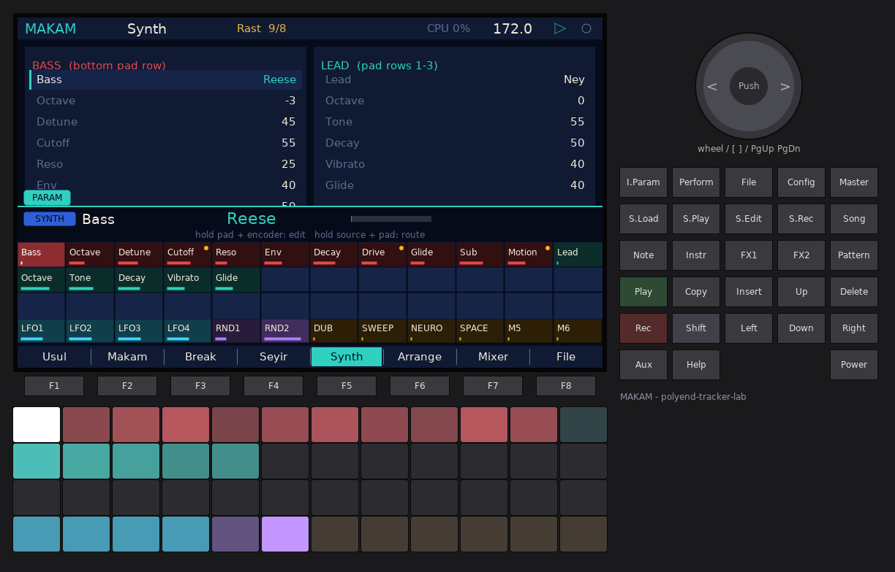
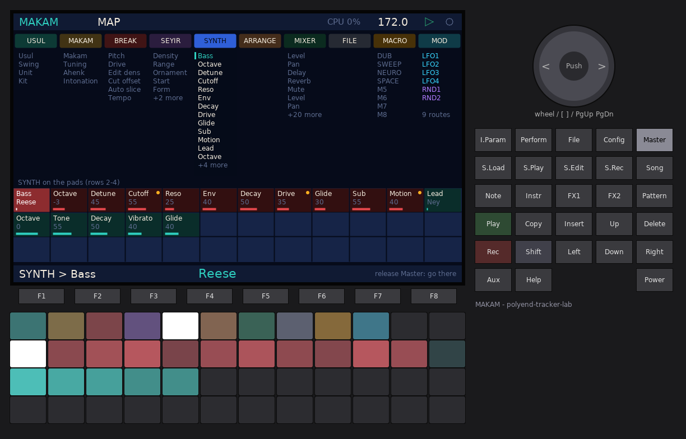
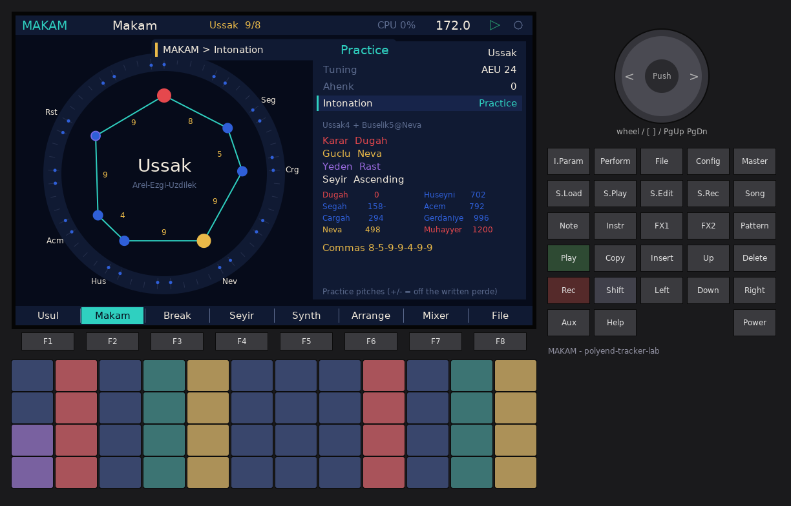
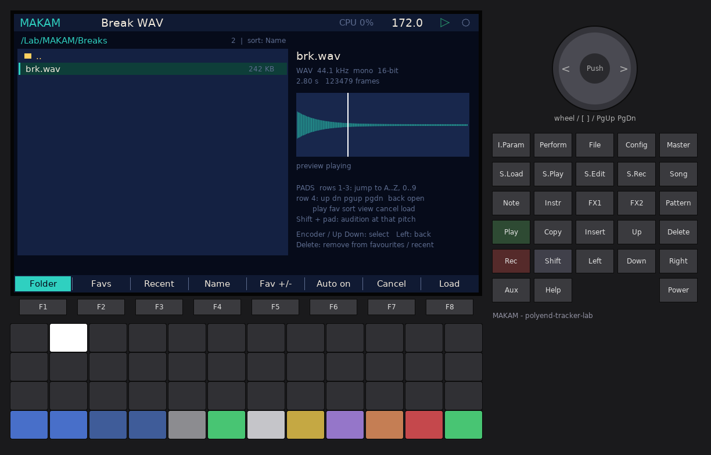

# MAKAM-JUNGLE — manual

**MAKAM** is a firmware for the original Polyend Tracker where Turkish makam
music meets jungle and drum & bass. A break (built in, or a WAV from the card)
is cut on the strokes of an **usul** (an aksak rhythmic cycle) at jungle tempo.
A reese/sub/growl **bass** and a ney/kanun/saz/zurna **lead** play in real
makam tuning (Arel-Ezgi-Uzdilek 24-tone, or 53-TET). A **seyir** generator
writes melodies that move through the makam the way the theory says they
should.

The screen is built around circles, not tracker rows. The usul is a clock dial
with its strokes on the rim, the makam is a ring of perdes (pitches) on the
53-comma circle, the melody is a rose, and the arrangement is a ring of
sections.


**New in round 2:** the shared LABKIT navigation (PARAM pads, MAP, macros,
LFO / random / MAKAM sources routed onto any value, MIDI learn, HELP); only
the keys the original Tracker really has (Insert is the page action); break
cut modes BBCut, Warp and DNA; TURNAROUND phrase-end fills; onset slicing of
card breaks and the break browser with preview; call + response seyir;
practice intonation; NEUROSTACK bass models (Talk, FM, Hoover) over a clean
sub; a dub delay (Clean, Tape, Lo-fi, Ping-pong) and Plate / Hall / Gated
reverb; eight scenes with morph, recalled by hand or by the arrangement.

---

## 1. Quick start (2 minutes, no SD card needed)

1. Put `PolyendTrackerMAKAMJ.ptf` into `/Firmware` on the card and install it
   (Config > Firmware on any lab firmware, or the stock updater).
2. After the intro (any key skips it), press **Play**. The demo song starts:
   *Rast* over *aksak 9/8* at **172 BPM**, the built-in break "Kirik", six
   sections (Intro, Build with BBCut cuts, Drop, Taksim, Drop 2 with Warp
   cuts, Outro with DNA cuts), each with its phrase-end fills.
3. **F1 Usul**: turn the **encoder** to change the usul. The break is re-cut on
   the new strokes immediately, and the bass and phrases follow.
4. **F2 Makam**: turn the encoder to pick another makam (try *Hicaz*, *Saba*,
   *Huzzam*). **Insert** regenerates the bass and phrases in it.
5. Play the **pads**. The bottom row is bass, the three rows above are the
   lead, from low to high. They are always in the makam.
6. **F3 Break**: hold the bottom-row pads for rolls, reverse, stutter, half
   speed and CHAOS.
7. Press **I.Param** to see this page's values on the pads, and hold
   **Master** for the MAP of every page and value. **Shift + Config** shows the
   help of the page you are on.
8. Hold **Perform** and press **Shift + pad 1** to store a scene. Change
   things, store scene 2 the same way, then **Perform + pad 1** morphs back.
9. Press **Shift + Rec** to record a WAV (plus 4 stems if Config > Record stems
   is On).

## 2. Concepts

| Term | Meaning |
|---|---|
| **Makam** | A melodic mode: a scale built from a dörtlü (tetrachord) and a beşli (pentachord), with a tonic, a dominant, typical cadences and a characteristic melodic path (seyir). |
| **Perde** | A named pitch (fret, "curtain"): Rast, Dügâh, Segâh, Çârgâh, Nevâ, Hüseynî, Eviç, Gerdâniye... Each one is a fixed position, not just a scale degree. |
| **Koma (comma)** | The Holdrian comma, 1/53 of an octave (22.64 cents). Turkish theory measures every interval in commas. |
| **Karar / durak** | The tonic, where the melody finally rests (tam karar = full cadence). |
| **Güçlü** | The dominant: the second centre, where the half cadence (yarım karar) lands. |
| **Yeden** | The leading tone just below the karar. |
| **Asma karar** | A suspended cadence on another perde (e.g. Çârgâh in Rast). |
| **Seyir** | The melodic course: *çıkıcı* (ascending: starts low, rises), *inici* (descending: starts at the upper tonic, falls), *inici-çıkıcı* (starts around the güçlü). |
| **Çeşni** | A "flavour": a characteristic fragment of another makam; MAKAM's ornaments (grace notes, glissandi) give the line its çeşni. |
| **Usul** | A rhythmic cycle of strong and weak strokes, often aksak ("limping", groups of 2 and 3). |
| **Düm / Tek / Ke** | Usul strokes: **düm** = strong low stroke (right hand) → **kick** slices; **tek** = light high stroke (left hand) → **snare** slices; **ke / ka / tekkâ** = small fill strokes → **ghost** slices. |

### Interval names (AEU)

| Name | Symbol | Commas | Real size in AEU (Pythagorean) |
|---|---|---|---|
| Koma (fazla) | F | 1 | 23.46 c |
| Bakiye | B | 4 | 90.22 c (256/243) |
| Küçük mücenneb | S | 5 | 113.69 c (2187/2048) |
| Büyük mücenneb | K | 8 | 180.45 c |
| Tanînî | T | 9 | 203.91 c (9/8) |
| Artık ikili | A | 12 / 13 | 271 / 294 c |

### Tetrachords and pentachords

| Çeşni | Dörtlü (4) | Beşli (5) |
|---|---|---|
| Çârgâh | T T B (9 9 4) | T T B T |
| Bûselik | T B T (9 4 9) | T B T T |
| Kürdî | B T T (4 9 9) | B T T T |
| Uşşak | K S T (8 5 9) | Hüseynî beşli K S T T |
| Hicaz | S A S (5 12 5) | S A S T |
| Rast | T K S (9 8 5) | T K S T |
| Segâh | — | S T K T (5 9 8 9) |
| Hüzzam | — | S T S A (5 9 5 12) |
| Nikriz | — | T S A S (9 5 12 5) |
| Sabâ | K S S (8 5 5, "eksik dörtlü") | — |

---

## 3. Tuning

**Settings row "MAKAM tuning"** (or the Makam page):

* **AEU 24** (default) — Arel-Ezgi-Uzdilek: 24 pitches per octave from a chain
  of pure fifths, from 12 fifths below to 11 fifths above Kaba Çârgâh. The
  comma counts name the steps; the frequencies are Pythagorean (pure fifths
  3/2, pure fourths 4/3, tanînî 9/8, bakiye 256/243). This is the official
  notation system of Turkish art music.
* **53-TET** — Holdrian comma tuning: every comma is exactly 1200/53 cents.
  Every AEU perde lies within 2 cents of its 53-TET position (table below).

The reference is **Dügâh = A4 = 440 Hz** (Bolahenk-style pitch names on a
Western reference). **Ahenk** (−12..+12 semitones) transposes everything, the
way a ney player picks a different ahenk (Kız, Mansur, Şah...).

### The 24 AEU pitch classes

Position in commas above Çârgâh (C), the chain-of-fifths position, and cents
in both systems. The perde names are those of the middle octave.

| Comma | Perde | Fifths | AEU cents | 53-TET cents |
|---|---|---|---|---|
| 0 | Çârgâh | 0 | 0.00 | 0.00 |
| 4 | Nîm Hicaz | −5 | 90.22 | 90.57 |
| 5 | Hicaz | +7 | 113.69 | 113.21 |
| 8 | Dik Hicaz | −10 | 180.45 | 181.13 |
| 9 | Nevâ | +2 | 203.91 | 203.77 |
| 13 | Nîm Hisar | −3 | 294.14 | 294.34 |
| 14 | Hisar | +9 | 317.60 | 316.98 |
| 17 | Dik Hisar | −8 | 384.36 | 384.91 |
| 18 | Hüseynî | +4 | 407.82 | 407.55 |
| 22 | Acem | −1 | 498.04 | 498.11 |
| 23 | Dik Acem | +11 | 521.51 | 520.75 |
| 26 | Eviç (Irak an octave down) | −6 | 588.27 | 588.68 |
| 27 | Mâhûr (Geveşt) | +6 | 611.73 | 611.32 |
| 30 | Dik Mâhûr | −11 | 678.49 | 679.25 |
| 31 | Gerdâniye (Rast) | +1 | 701.96 | 701.89 |
| 35 | Nîm Şehnaz (Nîm Zirgüle) | −4 | 792.18 | 792.45 |
| 36 | Şehnaz (Zirgüle) | +8 | 815.64 | 815.09 |
| 39 | Dik Şehnaz (Dik Zirgüle) | −9 | 882.40 | 883.02 |
| 40 | Muhayyer (Dügâh) | +3 | 905.86 | 905.66 |
| 44 | Sünbüle (Kürdî) | −2 | 996.09 | 996.23 |
| 45 | Dik Sünbüle (Dik Kürdî) | +10 | 1019.55 | 1018.87 |
| 48 | Tiz Segâh (Segâh) | −7 | 1086.31 | 1086.79 |
| 49 | Tiz Bûselik (Bûselik) | +5 | 1109.78 | 1109.43 |
| 52 | Tiz Dik Bûselik (Dik Bûselik) | −12 | 1176.54 | 1177.36 |

Absolute positions used below: Kaba Çârgâh = 0 (C4 in AEU notation), Rast =
31 (G), Dügâh = 40 (A), Çârgâh = 53, Nevâ = 62, Gerdâniye = 84, Muhayyer =
93.

### Practice intonation

Performers place a few perdes off their written AEU position.
**Intonation = Practice** (Makam page, Settings, or the registry) plays them
there, on the 53-comma grid:

| Makam | Perde | Shift | Source |
|---|---|---|---|
| Sabâ | Hicaz | +2 commas | TDV: "about 2–2.5 commas sharper" |
| Hüzzam, Karcığar | Hisar | +1 comma | TDV: "1–1.5 commas sharper" |
| Uşşak, Beyâtî, Hüseynî, Muhayyer, Nevâ, Karcığar, Sabâ | Segâh | −1 comma | the lowered Uşşak-family Segâh of performance practice |

The Makam page marks the shifted degrees with + or − next to their cents.
MIDI out carries the shifted pitch in its pitch bend.

---

## 4. The makams

25 makams. Degrees are absolute commas; steps are the commas between
neighbouring degrees. Where the descending scale differs, the "desc" note
gives the perde used when the melody falls (the lead and the generator use
it). Sources: the TDV İslâm Ansiklopedisi makam articles (İ. H. Özkan) and the
AEU dörtlü/beşli definitions above.

| Makam | Composition | Perdes (ascending) | Steps | Karar | Güçlü | Yeden | Seyir |
|---|---|---|---|---|---|---|---|
| Rast | Rast5 + Rast4 on Nevâ (desc Bûselik4: Acem) | Rast 31, Dügâh 40, Segâh 48, Çârgâh 53, Nevâ 62, Hüseynî 71, Eviç 79, Gerdâniye 84 | 9-8-5-9-9-8-5 | Rast | Nevâ | Irak | ascending |
| Uşşak | Uşşak4 + Bûselik5 on Nevâ | Dügâh 40, Segâh 48, Çârgâh 53, Nevâ 62, Hüseynî 71, Acem 75, Gerdâniye 84, Muhayyer 93 | 8-5-9-9-4-9-9 | Dügâh | Nevâ | Rast | ascending |
| Hüzzam | Hüzzam5 + Hicaz4 on Eviç | Segâh 48, Çârgâh 53, Nevâ 62, Hisar 67, Eviç 79, Gerdâniye 84, Sünbüle 97, Tiz Segâh 101 | 5-9-5-12-5-13-4 | Segâh | Nevâ | Kürdî | desc-asc |
| Hicaz | Hicaz4 + Rast5 on Nevâ (desc Acem) | Dügâh 40, Dik Kürdî 45, Nîm Hicaz 57, Nevâ 62, Hüseynî 71, Eviç 79, Gerdâniye 84, Muhayyer 93 | 5-12-5-9-8-5-9 | Dügâh | Nevâ | Rast | desc-asc |
| Sabâ | Sabâ4 + Hicaz on Çârgâh (no octave) | Dügâh 40, Segâh 48, Çârgâh 53, Hicaz 58, Dik Hisar 70, Acem 75, Gerdâniye 84, Şehnaz 89 | 8-5-5-12-5-9-5 | Dügâh | Çârgâh | Rast | ascending |
| Nihâvend | Bûselik5 on Rast + Hicaz4 on Nevâ (desc Kürdî4: Acem) | Rast 31, Dügâh 40, Kürdî 44, Çârgâh 53, Nevâ 62, Nîm Hisar 66, Eviç 79, Gerdâniye 84 | 9-4-9-9-4-13-5 | Rast | Nevâ | Irak | desc-asc |
| Kürdî | Kürdî4 + Bûselik5 on Nevâ | Dügâh 40, Kürdî 44, Çârgâh 53, Nevâ 62, Hüseynî 71, Acem 75, Gerdâniye 84, Muhayyer 93 | 4-9-9-9-4-9-9 | Dügâh | Nevâ | Rast | ascending |
| Segâh | Segâh5 + Hicaz4 on Eviç (desc Uşşak on Nevâ) | Segâh 48, Çârgâh 53, Nevâ 62, Dik Hisar 70, Eviç 79, Gerdâniye 84, Sünbüle 97, Tiz Segâh 101 | 5-9-8-9-5-13-4 | Segâh | Nevâ | Kürdî | ascending |
| Karcığar | Uşşak4 + Hicaz5 on Nevâ | Dügâh 40, Segâh 48, Çârgâh 53, Nevâ 62, Hisar 67, Eviç 79, Gerdâniye 84, Muhayyer 93 | 8-5-9-5-12-5-9 | Dügâh | Nevâ | Rast | desc-asc |
| Hüseynî | Hüseynî5 + Uşşak4 on Hüseynî (desc Acem) | Dügâh 40, Segâh 48, Çârgâh 53, Nevâ 62, Hüseynî 71, Eviç 79, Gerdâniye 84, Muhayyer 93 | 8-5-9-9-8-5-9 | Dügâh | Hüseynî | Rast | desc-asc |
| Muhayyer | as Hüseynî, centred on the upper tonic | same as Hüseynî | 8-5-9-9-8-5-9 | Dügâh | Muhayyer | Rast | descending |
| Hicazkâr | Hicaz5 on Rast + Hicaz4 on Nevâ (desc Acem) | Rast 31, Zirgüle 36, Segâh 48, Çârgâh 53, Nevâ 62, Hisar 67, Eviç 79, Gerdâniye 84 | 5-12-5-9-5-12-5 | Rast | Gerdâniye | Irak | descending |
| Sûzinak | Rast5 + Hicaz4 on Nevâ | Rast 31, Dügâh 40, Segâh 48, Çârgâh 53, Nevâ 62, Hisar 67, Eviç 79, Gerdâniye 84 | 9-8-5-9-5-12-5 | Rast | Nevâ | Irak | desc-asc |
| Nevâ | Uşşak4 + Rast5 on Nevâ (desc Acem) | Dügâh 40, Segâh 48, Çârgâh 53, Nevâ 62, Hüseynî 71, Eviç 79, Gerdâniye 84, Muhayyer 93 | 8-5-9-9-8-5-9 | Dügâh | Nevâ | Rast | desc-asc |
| Beyâtî | Uşşak4 + Bûselik5 on Nevâ (Eviç rising, Acem falling) | as Nevâ | 8-5-9-9-8-5-9 | Dügâh | Nevâ | Rast | desc-asc |
| Acemaşîran | Çârgâh5 on Acemaşîran + Çârgâh4 on Çârgâh | Acemaşîran 22, Rast 31, Dügâh 40, Kürdî 44, Çârgâh 53, Nevâ 62, Hüseynî 71, Acem 75 | 9-9-4-9-9-9-4 | Acemaşîran | Acem | Hüseynîaşîran | descending |
| Kürdîlihicazkâr | Kürdî4 on Rast + Bûselik5 on Çârgâh | Rast 31, Nîm Zirgüle 35, Kürdî 44, Çârgâh 53, Nevâ 62, Nîm Hisar 66, Acem 75, Gerdâniye 84 | 4-9-9-9-4-9-9 | Rast | Gerdâniye | Acemaşîran | descending |
| Hümâyun | Hicaz4 + Bûselik5 on Nevâ | Dügâh 40, Dik Kürdî 45, Nîm Hicaz 57, Nevâ 62, Hüseynî 71, Acem 75, Gerdâniye 84, Muhayyer 93 | 5-12-5-9-4-9-9 | Dügâh | Nevâ | Rast | desc-asc |
| Uzzâl | Hicaz5 + Uşşak4 on Hüseynî | Dügâh 40, Dik Kürdî 45, Nîm Hicaz 57, Nevâ 62, Hüseynî 71, Eviç 79, Gerdâniye 84, Muhayyer 93 | 5-12-5-9-8-5-9 | Dügâh | Hüseynî | Rast | desc-asc |
| Zirgüleli Hicaz | Hicaz5 + Hicaz4 on Hüseynî | Dügâh 40, Dik Kürdî 45, Nîm Hicaz 57, Nevâ 62, Hüseynî 71, Dik Acem 76, Nîm Şehnaz 88, Muhayyer 93 | 5-12-5-9-5-12-5 | Dügâh | Hüseynî | Rast | desc-asc |
| Bûselik | Bûselik5 + Kürdî4 on Hüseynî | Dügâh 40, Bûselik 49, Çârgâh 53, Nevâ 62, Hüseynî 71, Acem 75, Gerdâniye 84, Muhayyer 93 | 9-4-9-9-4-9-9 | Dügâh | Hüseynî | Nîm Zirgüle | ascending |
| Mâhûr | Çârgâh5 on Rast + Çârgâh4 on Nevâ (desc Acem) | Rast 31, Dügâh 40, Bûselik 49, Çârgâh 53, Nevâ 62, Hüseynî 71, Mâhûr 80, Gerdâniye 84 | 9-9-4-9-9-9-4 | Rast | Gerdâniye | Irak | descending |
| Nikrîz | Nikrîz5 on Rast + Rast4 on Nevâ (desc Acem) | Rast 31, Dügâh 40, Dik Kürdî 45, Nîm Hicaz 57, Nevâ 62, Hüseynî 71, Eviç 79, Gerdâniye 84 | 9-5-12-5-9-8-5 | Rast | Nevâ | Irak | ascending |
| Neveser | Nikrîz5 on Rast + Hicaz4 on Nevâ | Rast 31, Dügâh 40, Dik Kürdî 45, Nîm Hicaz 57, Nevâ 62, Hisar 67, Eviç 79, Gerdâniye 84 | 9-5-12-5-5-12-5 | Rast | Nevâ | Irak | desc-asc |
| Çârgâh | Çârgâh5 + Çârgâh4 on Gerdâniye | Çârgâh 53, Nevâ 62, Hüseynî 71, Acem 75, Gerdâniye 84, Muhayyer 93, Tiz Bûselik 102, Tiz Çârgâh 106 | 9-9-4-9-9-9-4 | Çârgâh | Gerdâniye | Bûselik | ascending |

Notes on the theory choices:

* **Hüzzam's Hisar** is played about 1–1.5 commas sharp in practice. AEU has
  no sign for that, so MAKAM uses the written Hisar (67), exactly as the
  notation does.
* **Sabâ** does not close at the octave: its 7th note is Şehnaz (89), 49
  commas above Dügâh. In practice Sabâ's Hicaz is also played 2–2.5 commas
  sharp; MAKAM uses the written Hicaz (58).
* **Muhayyer / Hüseynî** and **Nevâ / Beyâtî** share their scales. The
  difference is the seyir (where the melody starts and which perde it
  emphasises), which is exactly what the seyir generator changes.
* The **guclu** of descending makams (Muhayyer, Hicazkâr, Mâhûr,
  Kürdîlihicazkâr, Acemaşîran) is the upper tonic or the perde the TDV
  article names as first-degree güçlü.

### Cents above the karar

| Makam | AEU | 53-TET |
|---|---|---|
| Rast | 204, 384, 498, 702, 906, 1086, 1200 | 204, 385, 498, 702, 906, 1087, 1200 |
| Uşşak | 180, 294, 498, 702, 792, 996, 1200 | 181, 294, 498, 702, 792, 996, 1200 |
| Hüzzam | 114, 318, 431, 702, 816, 1110, 1200 | 113, 317, 430, 702, 815, 1109, 1200 |
| Hicaz | 114, 384, 498, 702, 882, 996, 1200 | 113, 385, 498, 702, 883, 996, 1200 |
| Sabâ | 180, 294, 408, 678, 792, 996, 1110 | 181, 294, 408, 679, 792, 996, 1109 |
| Nihâvend | 204, 294, 498, 702, 792, 1086, 1200 | 204, 294, 498, 702, 792, 1087, 1200 |
| Kürdî | 90, 294, 498, 702, 792, 996, 1200 | 91, 294, 498, 702, 792, 996, 1200 |
| Segâh | 114, 318, 498, 702, 816, 1110, 1200 | 113, 317, 498, 702, 815, 1109, 1200 |
| Karcığar | 180, 294, 498, 612, 882, 996, 1200 | 181, 294, 498, 611, 883, 996, 1200 |
| Hüseynî / Muhayyer / Nevâ / Beyâtî | 180, 294, 498, 702, 882, 996, 1200 | 181, 294, 498, 702, 883, 996, 1200 |
| Hicazkâr / Zirgüleli Hicaz | 114, 384, 498, 702, 816, 1086, 1200 | 113, 385, 498, 702, 815, 1087, 1200 |
| Sûzinak | 204, 384, 498, 702, 816, 1086, 1200 | 204, 385, 498, 702, 815, 1087, 1200 |
| Acemaşîran / Mâhûr / Çârgâh | 204, 408, 498, 702, 906, 1110, 1200 | 204, 408, 498, 702, 906, 1109, 1200 |
| Kürdîlihicazkâr | 90, 294, 498, 702, 792, 996, 1200 | 91, 294, 498, 702, 792, 996, 1200 |
| Hümâyun | 114, 384, 498, 702, 792, 996, 1200 | 113, 385, 498, 702, 792, 996, 1200 |
| Uzzâl | 114, 384, 498, 702, 882, 996, 1200 | 113, 385, 498, 702, 883, 996, 1200 |
| Bûselik | 204, 294, 498, 702, 792, 996, 1200 | 204, 294, 498, 702, 792, 996, 1200 |
| Nikrîz | 204, 318, 588, 702, 906, 1086, 1200 | 204, 317, 589, 702, 906, 1087, 1200 |
| Neveser | 204, 318, 588, 702, 816, 1086, 1200 | 204, 317, 589, 702, 815, 1087, 1200 |

---

## 5. The usuls

One character per time unit. By default one unit is a **16th note** at the
song tempo, so aksak 9/8 at 172 BPM is a 9-sixteenth jungle cycle, the
classic broken feel. Settings > "MAKAM usul unit" = 1/8 halves the speed.

`D` = düm (kick slices), `T` = tek (snare slices), `k` = ke/ka/tekkâ (ghost
slices), `.` = the playing slice keeps playing (chopped jungle). The stroke
strings follow the kudüm patterns (*Düm Te-ke Düm Tek Tek* for aksak...), with
long strokes ("düüm", "teek") written as the stroke followed by rests.

| Usul | Meter | Groups | Strokes |
|---|---|---|---|
| Aksak | 9/8 | 2+2+2+3 | `D.TkD.T.T` |
| Curcuna | 10/8 | 3+2+2+3 | `DTkD.T.T..` |
| Devr-i Hindî | 7/8 | 3+2+2 | `D.kT.T.` |
| Sofyan | 4/4 | 4+2+2 (in eighths) | `D...T.T.` |
| Düyek | 8/8 | 2+1+2+1+2 | `DT.TD.T.` |
| Semâî (yürük) | 6/8 | 3+3 | `D.kD.T` |
| Aksak Semâî | 10/8 | 3+2+2+3 | `D..TkD.T.T` |
| Devr-i Turan | 7/8 | 2+2+3 | `D.T.Tk.` |
| Türk Aksağı | 5/8 | 2+3 | `D.TT.` |
| Raks Aksağı | 9/8 | 2+3+2+2 | `D.TT.D.TT` |
| Müsemmen | 8/8 | 3+3+2 | `D.kD.kT.` |
| Tek Vuruş | 11/8 | 2+2+2+2+3 | `D.T.k.D.T.k` |
| Frenkçin | 12/8 | 3+3+2+2+2 | `D.kD.kT.T.k.` |

---

## 6. Keys (only what the original Tracker has)

The original Tracker has **no encoder push, Aux or Help key**. MAKAM uses
none of them: **Insert** is the page action everywhere.

| Key | Does |
|---|---|
| **F1 .. F8** | the pages: Usul, Makam, Break, Seyir, Synth, Arrange, Mixer, File |
| **Encoder** | the selected row's value (registered values: Shift = fine) |
| **Up / Down** | the row |
| **Left / Right** | step (Break), cursor (Seyir), section (Arrange), channel (Mixer), column (File) |
| **Insert** | the page action: re-cut the variation (Usul, Break), bass + phrases follow (Makam), new phrase (Seyir), loop the section (Arrange), load (File) |
| **Shift + Insert** | add: a section (Arrange), glissando / hold (Seyir), save (File) |
| **Delete** | clear the step (Break), rest (Seyir), remove a section (Arrange); Shift + Delete on File: new song |
| **Copy** | variation / phrase / section to the next |
| **Song** | arrangement / loop the playing (or selected) section |
| **Perform + pad 1..8** (top row) | recall (morph to) scene 1..8; **+ Shift**: store it |
| **Rec** | File page: save the song slot |
| **Play** | start / stop (Shell) |
| **Shift + Rec** | record the master (+ 4 stems) (Shell) |
| **Config** | Settings, Firmware update, About (Shell) |
| **I.Param** | LABKIT **PARAM pads** (tap = on/off, hold = while held); **Shift + I.Param** = MACRO page |
| **Master** | LABKIT **MAP** (hold = look and jump, tap = stays open); **Shift + Master** = MOD page |
| **Shift + Config** | **HELP**: the page's help, its keys, the key card |

### LABKIT (the navigation every lab firmware shares)

Every song-wide value of MAKAM is in the LABKIT registry: usul, swing, kit,
makam, tuning, ahenk, intonation, break pitch / drive / cut offset / slicing,
the seyir generator, all bass and lead values, the four channels (level, pan,
sends, mute) and the sends (delay type / time / feedback, reverb type / size /
damping, dum duck, DJ filter, scene morph). So all of them are on:

- **PARAM pads** (I.Param): rows 1–3 = this page's values (colour = group,
  brightness = value); tap = focus, hold + encoder = edit; row 4 = the sources
  (LFO 1–4, RND 1–2, macros; Shift + a bottom pad = macros 7–8 and MAKAM's own
  sources). **Hold a source pad + tap a value pad = a modulation route**, the
  encoder sets its depth.
- **MAP** (hold Master): every page with its values; pads jump to any of them.
- **MACRO** (Shift + I.Param): 8 macros. First boot brings four: **DUB**
  (break + lead delay sends, feedback), **SWEEP** (the DJ filter down to a deep
  low-pass), **NEURO** (bass motion, cutoff, drive), **SPACE** (lead reverb,
  reverb size).
- **MOD** (Shift + Master): the LFOs, the random sources and all routes.
- **MIDI learn**: on the PARAM pads hold Shift + a value pad and move a CC.
- The **HUD** shows `PAGE > Value  value` whenever something changes.

Per-step and per-section values (strokes, slices, phrase notes, section
settings) stay on their pages: they follow a cursor.




### MAKAM's modulation sources

| Source | 0..1 |
|---|---|
| **USUL** | the position in the usul cycle (a saw locked to the usul: one cycle of aksak = 9 units) |
| **DUM** | jumps to 1 on every düm hit, falls in ~140 ms |
| **TEK** | the same for tek (half for ke) |
| **SLICE** | the slice (or the position in the break) of the last hit |
| **ENERGY** | the break + bass level, rising fast, falling slowly |
| **SEYIR** | the height of the lead in the makam (the melody as a control) |
| **SECTION** | the progress through the playing section |
| **FILL** | 0 outside phrase-end fills, rising 0 → 1 across a fill tail |

Examples: DUM → bass drive (each düm growls), USUL → DJ filter (the filter
breathes with the aksak), SECTION → lead reverb (opens over the section),
FILL → break pitch (fills rise), SEYIR → delay send (high notes echo).

---

## 7. The pages

Pads outside the page-specific rows always play the makam:

| Pad row | Plays |
|---|---|
| Row 1 (top) | lead, degrees 13..24 (two octaves up) |
| Row 2 | lead, degrees 6..17 |
| Row 3 | lead, degrees −1..10 (column 1 = yeden, column 2 = karar) |
| Row 4 (bottom) | bass, degrees −1..10 |

Pad colours: **red** = karar, **gold** = güçlü, **turquoise** = asma karar,
**violet** = yeden, **cobalt** = the other perdes, **cream** = sounding now.

### F1 — Usul


The usul as a clock dial: unit ticks on the rim, the groups (2+2+2+3...) as
cobalt / turquoise arcs, the strokes of the variation inside (big red = düm,
gold = tek, small turquoise = ke), violet dots where a step has edits, the
saffron hand = the playhead.

| Row | Range | |
|---|---|---|
| Usul | 13 usuls | re-cuts the four variations, bass and phrases follow |
| Tempo | 60..220 BPM | the shell tempo (172 default) |
| Unit | 1/16, 1/8 | length of one usul unit |
| Swing | 0..50 % | delays every second unit |
| Break kit | Kırık, Sert Funk, Darbuka, Card WAV | |
| Edit variation | A..D | edited on Break, played in Loop mode |
| Play | Loop section / Arrangement | |

Pads row 1: the steps (tap cycles the stroke). **Insert**: re-cut the variation.

### F2 — Makam


The 53-comma circle with the karar at 12 o'clock: long ticks = the 24 AEU
positions (dots on every comma in 53-TET), the makam's perdes as the
turquoise polygon with **the step in commas on each edge**, violet dots =
perdes that change when the melody descends, the violet ring = the yeden.
The panel: composition, karar, güçlü, yeden, seyir, every degree with its
cents above the karar, and the **comma steps** of the scale (e.g. Rast
9-8-5-9-9-8-5).



| Row | Range |
|---|---|
| Makam | 25 makams |
| Tuning | AEU 24 / 53-TET |
| Ahenk | −12..+12 semitones |
| Intonation | Written / Practice (section 3) |

**Insert**: regenerate all bass patterns and the four phrases in this makam.

### F3 — Break


The waveform of the active kit with its 16 slices **where they really are**
(onsets on a card break), coloured by class (red kick, gold snare, turquoise
ghost; lit while playing). Top right: the section's **cut mode** and **fill**
amount, and a red badge naming the fill style while a fill plays. The dial is
the variation being edited.

| Row | Range | |
|---|---|---|
| Kit, Variation | | |
| Stroke | Rest, Dum, Tek, Ke | of the selected step |
| Slice | Auto, 1..16 | Auto = the n-th stroke of its kind takes the n-th slice of its class |
| Roll | 1..4 | hits inside the step |
| Pitch | −12..+12 | semitones |
| Reverse / Stutter / Choke | Off/On | |
| Edit density | 0..100 | edits of the generated variations C and D |
| Drive | 0..100 | break bus saturation |
| Break pitch | −12..+12 | the whole break (a modulation target: LFO wobbles, FILL risers) |
| Cut offset | 0..15 | where BBCut / Warp cuts start in the break |
| Card slicing | Equal 16 / Onsets | how a card WAV is cut (reloads it) |

| Pad row | Pads |
|---|---|
| 1 | steps: select (Shift: cycle the stroke) |
| 2 | slices 1..12 (audition; Shift = assign to the step) |
| 3 | slices 13..16, variation A..D, kit 1..4 |
| 4 (hold) | Roll 2, Roll 3, Roll 4, Roll 6, Reverse, Stutter, Half speed, Mute, CHAOS, Düm, Tek, Ke one-shots |

**Insert**: re-cut this variation. **Copy**: to the next variation.

#### Cut modes (Arrange page, per section)

| Cut | What cuts the break |
|---|---|
| **Usul** | the usul's strokes: düm takes kick slices, tek snare, ke ghosts (+ CHAOS edits) |
| **BBCut** | Nick Collins' BBCutProc11 on one usul cycle: blocks of odd unit lengths taken from where the cycle has reached in the break, repeated once or twice, a roll near the end now and then. The source walks through the break cycle by cycle. |
| **Warp** | BBCut's WarpCut: blocks of 1/2/4 units either straight or as rolls that speed up (or slow down), rising in pitch |
| **DNA** | GENOTYPE's idea: the break's own groove learned as a chain kick → snare → ghost; steps keep the usul (identity = 100 − 0.7 × chaos) or walk the chain, always to the next slice of the drawn class |

#### Phrase-end fills (TURNAROUND)

The end of every 4th cycle gets a short tail (a quarter of a cycle), every 8th
half a cycle, every 16th and the end of each section a whole cycle — scaled by
the section's **Fill** (0 none, 50 these lengths, 100 twice). Styles: quarter
ends Reverse / Rolls / Stutter, half ends Rolls / Stutter / Reverse, phrase
ends **Build** (every unit hits, rolls 1 → 6, pitch rising, velocity
swelling) or **Drop** (the wall: the break and the bass stop, a düm lands on
the downbeat).

### F4 — Seyir (melody generator)


The phrase as a rose: angle = time (1–4 cycles), radius = degree; rings for
karar (red), güçlü (gold), tiz durak (grey), yeden (violet).

| Row | Range | |
|---|---|---|
| Phrase | A..D | |
| Cycles | 1..4 | |
| Density, Ornament | 0..100 | |
| Range | 4..14 degrees | |
| Start | Seyir / Karar / Güçlü / Tiz durak | |
| **Form** | Seyir / Call+Resp | |
| Seed | 1..999 | |
| Live | Off / On | a new phrase every time it wraps |

The generator: start region from the seyir (ascending → karar, descending →
tiz durak, desc-asc → güçlü); a **yarım karar on the güçlü** (accented); an
ascending makam's climb; an **asma karar**; the approach (from above, or from
the **yeden** for Rast, Nihâvend, Hüzzam, Segâh, Hicazkâr, Bûselik, Mâhûr,
Çârgâh) and the **tam karar** on the last düm/tek, held. Mostly steps,
sometimes thirds, turns back; ornaments = glissando or a grace note from the
degree above.

**Call + response** (2–4 cycles): the first half is the **call**, which ends
on the güçlü (a yarım karar); the second half **answers with the call's
rhythm** and closes on the karar. The rose draws the CALL | RESP line.

Editing (Live Off): pads select the step at the cursor; **Shift + pad** writes
the note; **Shift + Up / Down** moves it a degree; **Shift + Insert** toggles
glissando (a rest becomes a hold); **Delete** = rest; **Copy** = to the next
phrase; **Insert** = a new phrase (next seed).

### F5 — Synth


| Bass | |
|---|---|
| Model | **Reese** (two detuned saws + sub octave, low-pass, drive), **Sub** (sine + octave), **Growl** (saws + pulse, 16th wobble, wavefolder), **Talk** (a saw through three formants sliding "o" → "i" after each note), **FM** (ratio-2 modulator, an index that falls after each note, feedback from Drive), **Hoover** (three detuned saws diving into the note) |
| Octave | −4..−1 |
| Detune, Cutoff, Reso, Env, Decay, Drive, Glide | 0..100 |
| **Sub** | a clean sine on its own phase under every model but Sub (NEUROSTACK: the low end never changes when the model does) |
| **Motion** | Growl wobble depth, Talk formant sharpness, Hoover dive, FM index |

| Lead | |
|---|---|
| Model | **Ney** (breathy sine + harmonic + band-passed breath, chiff), **Kanun** (Karplus-Strong string), **Saz** (two courses, the second an octave up, through one saturation), **Zurna** (saw through a nasal formant) |
| Octave | −2..+1 |
| Tone, Decay, Vibrato (delayed 250 ms), Glide | 0..100 |

### F6 — Arrange


The song as a ring of sections (arc length = cycles) with the position hand.
The list shows each section's type, cycles, break / bass / lead variation, cut
mode letter (U B W D) and scene (S1..S8).

| Row | Range | |
|---|---|---|
| Play | Loop section / Arrangement | |
| Section | 1..n | |
| Type | Intro, Build, Drop, Break, Taksim, Drop 2, Outro | |
| Cycles | 1..64 | |
| Break / Bass / Lead | Off, A..D | |
| **Cut** | Usul / BBCut / Warp / DNA | |
| **Fill** | 0..100 | phrase-end fills |
| Chaos | 0..100 | live jungle edits |
| Filter | −100..100 | break DJ filter |
| **Scene** | –, 1..8 | morph to this scene when the section starts (arrangement mode) |

Pads row 1 + the first 4 of row 2 select sections. **Insert** loops the
selected section, **Shift + Insert** adds one after it, **Copy** duplicates,
**Delete** removes.

### F7 — Mixer


Four channels (**Break, Bass, Lead, FX return**) with level, pan, delay and
reverb sends, mute, peak meters. The fifth column holds the sends and the
scenes:

| Sends | |
|---|---|
| **Delay** | **Clean**, **Tape** (wow 0.6 Hz + flutter 7 Hz on the read, a dark saturated feedback, the right side 1.3 % longer), **Lo-fi** (feedback held at 11 kHz and 6 bits: it crumbles with every repeat), **Ping-pong** (the input enters left, the sides feed each other) |
| Delay time | 1/16, 1/8, 3/16, 1/4, 3/8, 1/2 (tempo synced) |
| Feedback | 0..95 |
| **Reverb** | **Plate** (size, damping), **Hall** (bigger, 28 ms pre-delay, less damping), **Gated** (a big room opened by every düm / tek for 160 ms and shut hard: the jungle snare reverb) |
| Reverb size, Damping | 0..100 |
| Dum duck | how far bass and lead dip on every düm |
| DJ filter | −100..100 on the break bus |
| Scene morph | 0..16 usul cycles (0 = jump) |

The delay feeds a little into the reverb (dub tail). Pads 1–4 of row 1 mute
the channels, pad 5 shows the sends.

#### Scenes

A scene is a snapshot of every continuous value in the registry (levels,
sends, synth values, filter, drive, swing...). **Perform + Shift + pad 1..8**
(top row) stores, **Perform + pad** morphs there over *Scene morph* cycles;
the arrangement can recall one at a section start (Arrange > Scene). While
Perform is held the top row shows the scenes (saffron = stored, cream = the
last recalled). Scenes are saved in the song file.

**Stems** (Shift + Rec with Config > Record stems On): 1 Break, 2 Bass,
3 Lead, 4 FX return.

### F8 — File


Left: 8 song slots in `/Lab/MAKAM/Projects/SONG1..8.mkm`. Right: **"Browse
the card (preview)..."** then the WAVs in `/Lab/MAKAM/Breaks`.

* **Insert**: load the song / the WAV, or open the **browser**.
* **Shift + Insert** or **Rec**: save the song to the slot.
* **Shift + Delete**: new song.



The browser (LABKIT): any folder on the card, WAV length / rate / channels, a
thumbnail, **auto-preview**, favourites, recent files, pads as letters, Shift +
pad = audition at that pitch. **F8 / Insert** loads: the WAV is sliced
(onsets) and becomes kit 4.

The song (and its macros, routes, MIDI learn and scenes) is also saved to
`/Lab/MAKAM/project.mkm` on power-off, Config > Save and every 5 minutes, and
loaded at boot.

---

## 8. Breaks

**Built-in (no card needed)**, synthesised at boot, two bars at 170 BPM in 16
slices: **Kırık Break** (the classic broken break under a ride), **Sert Funk**
(tight funk, 16th hats, ghosts), **Darbuka** (doum / tek / ka laid out like a
break).

**Card WAVs**: anything OpenTracker reads (8–32-bit PCM or float, mono or
stereo (mixed to mono), any rate, resampled to 44.1 kHz), up to **12 s**.
MAKAM assumes 1, 2, 4 or 8 bars (the count nearest to 170 BPM). With
**Card slicing = Onsets** (default) it finds the hits with the semi fork's
"Breaks" spectral-flux detector (2.9 ms frames, 46 ms minimum spacing) and
keeps the **16 strongest**, in time order; with fewer than 16 hits the longest
gaps are split. **Equal 16** cuts 16 equal parts. Each slice is classified
kick / snare / ghost from the energy of its first 25 ms.

**Break tempo** (Settings): *Follow* (default) plays the slices at song BPM /
break BPM speed; *Cut only* keeps the original speed.

---

## 9. MIDI

* **MIDI in**: notes below 48 play the bass, 48 and above the lead, quantised
  to the nearest makam degree (A4 = 69 = Dügâh).
* **MIDI out** (Settings > MAKAM MIDI notes out): bass on the shell's MIDI out
  channel, lead on the channel above. Every note-on is preceded by a **pitch
  bend** carrying the microtonal offset from the nearest 12-TET note — in AEU,
  53-TET and practice intonation alike. **Bend range**: Settings > "MAKAM MIDI
  bend range" (default **±2 semitones**); set the receiver to the same. Example:
  Segâh (AEU) = A4 + 1.80 semitones → B4 (71) with a bend of −0.195 semitones
  (7392 at ±2).
* **MIDI learn** (LABKIT): any registered value from a CC.
* **Clock**: Settings > Clock (internal / send / follow).

---

## 10. Settings rows (Config)

After the shell rows (brightness, intro, tempo, clock, MIDI channels, input,
master, limiter, record stems):

| Row | Values | Default |
|---|---|---|
| MAKAM tuning | AEU 24, 53-TET | AEU 24 |
| MAKAM ahenk (transpose) | −12..+12 st | 0 |
| MAKAM usul unit | 1/16, 1/8 | 1/16 |
| MAKAM MIDI notes out | Off, Bass+Lead | Bass+Lead |
| MAKAM MIDI bend range | 1..24 st | 2 |
| MAKAM break tempo | Cut only, Follow tempo | Follow tempo |
| MAKAM intonation | Written, Practice | Written |
| MAKAM card break slicing | Equal 16, Onsets | Onsets |

They are stored in the song file.

---

## 11. Files on the card

```
/Lab/MAKAM/settings.bin           shell settings
/Lab/MAKAM/labkit.bin             browser favourites / recent, HUD
/Lab/MAKAM/project.mkm            the current song (auto save)
/Lab/MAKAM/Projects/SONG1..8.mkm  song slots
/Lab/MAKAM/Breaks/*.wav           your breaks (or browse anywhere)
/Lab/MAKAM/Rec/REC-nnnn.wav       recordings (+ -stem1..4)
```

**Song file** (`.mkm`, little endian): `"MKMJ"`, uint16 version (**2**),
uint16 reserved, uint32 payload size, payload (the break path, 96 bytes, then
every song value as int16 in a fixed order, new values appended), uint32
CRC-32 of the payload; then tagged blocks `[tag 4][length 4][data]`:
**LKIT** (the LABKIT chunk: base values, macros, routes, MIDI learn) and
**SCEN** (the 8 scenes as key-hash / value pairs). Version 1 files (round 1:
a 40-byte break name in `/Lab/MAKAM/Breaks`) still load; unknown blocks are
skipped; a newer version or a bad CRC is refused.

---

## 12. Tips

* **Aksak at 172** is the sweet spot: 9 sixteenths against a DJ's 4/4 shift by
  one sixteenth per cycle. Curcuna (10) and Devr-i Hindî (7) give the same
  tension with other periods; Sofyan / Düyek for a 4/4 drop.
* Give the Build a **BBCut** cut and Fill 60: classic cut-up into the drop.
  Drop 2 on **Warp** with CHAOS 45: accelerating rolls. The Outro on **DNA**:
  the break re-assembles itself.
* **Gated** reverb + Dum duck 40 + the **SPACE** macro: the 1994 snare.
* **Tape** delay on the lead, the **DUB** macro on a fader, **FILL → break
  pitch** as a route: rising fills that echo.
* **Talk** bass with **DUM → Motion** (or the NEURO macro on an LFO): a
  talking neuro line locked to the düm.
* **Call+Resp** on a 4-cycle phrase over Uşşak or Hicaz: question on the
  güçlü, answer on the karar — the shape of a Turkish song line.
* **Practice** intonation on Sabâ and Uşşak: the low Segâh and the high Hicaz
  are what make them sound "right" to Turkish ears.
* Store a calm scene and a heavy one; set Scene morph to 4 cycles and recall
  them from sections: the arrangement breathes.

---

## 13. Limits

* 4 break variations of up to 12 steps, 4 phrases of up to 48 steps, 4 bass
  patterns, 16 sections, 8 scenes (up to 80 values each).
* 2 break voices (crossfade), 1 bass voice, 3 lead voices (1 phrase + 2 pads
  / MIDI).
* Card WAV ≤ 12 s, summed to mono, 16 slices; built-in breaks are 2 bars.
* Loading and onset-slicing a card WAV blocks the main loop for a moment (the
  screen pauses; the audio keeps playing).
* Makam changes (geçki) inside a phrase are not generated.
* Practice intonation covers the three well-documented cases above.
* MIDI out is one note at a time per part.
* Per-step / per-section values are not in the LABKIT registry (no routes or
  MIDI learn on them).

---

## 14. CPU, memory, display (from the gate)

| Bench scenario (QEMU, M4 instructions per 128-sample block, LABKIT block included; limit 180,000) | avg | worst |
|---|---|---|
| idle | 22,629 | 24,880 |
| breaks (aksak, variation D, CHAOS, roll 6, filter, drive, sends) | 62,093 | 68,000 |
| bass-lead (Growl + Saz phrase + 2 pad voices) | 122,229 | 130,720 |
| full (all of it, sends 60 %, feedback 80, 8 LABKIT routes) | 133,263 | 144,840 |
| full-kanun | 116,571 | 127,320 |
| neuro-dub (Hoover, Tape delay 90 %, Gated reverb, Warp cuts, fills 100, practice intonation, routes) | 128,477 | 140,920 |
| dna-lofi (Talk, Lo-fi delay, Hall, DNA cuts at chaos 100, call + response, routes) | 112,559 | 124,600 |

Flash: 394,532 B (limit 720,000). Stack headroom 172.7 KiB. Arena: ~5.9 MB of
the SDRAM. Largest display list: 1,755 words of 1,800 (the LABKIT MAP);
MAKAM's own pages stay under 1,300.
