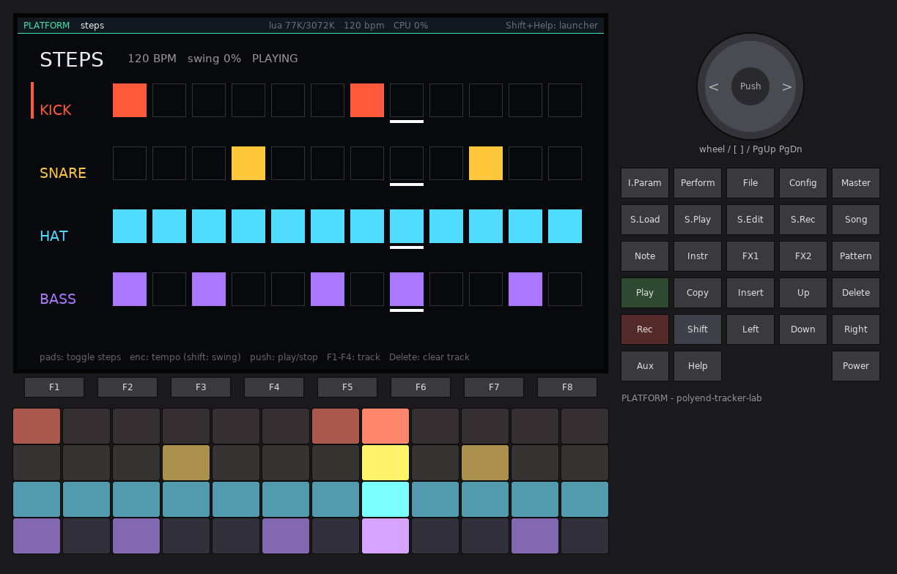
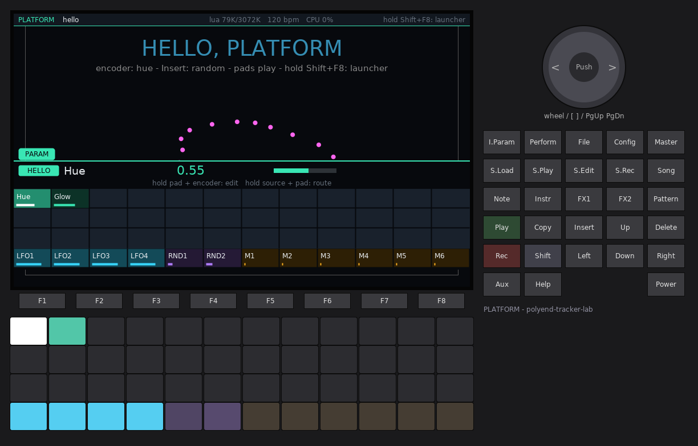
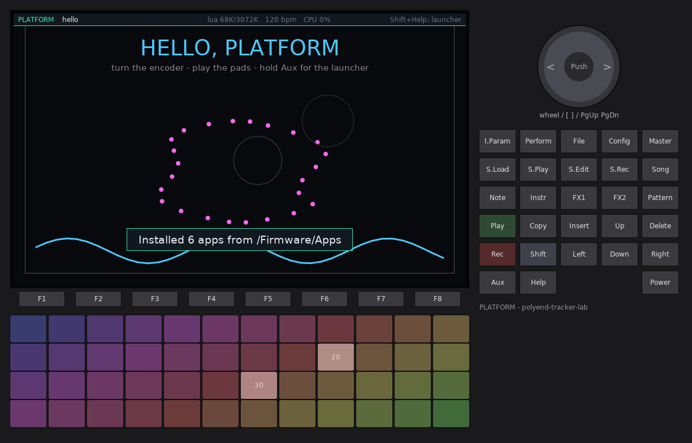
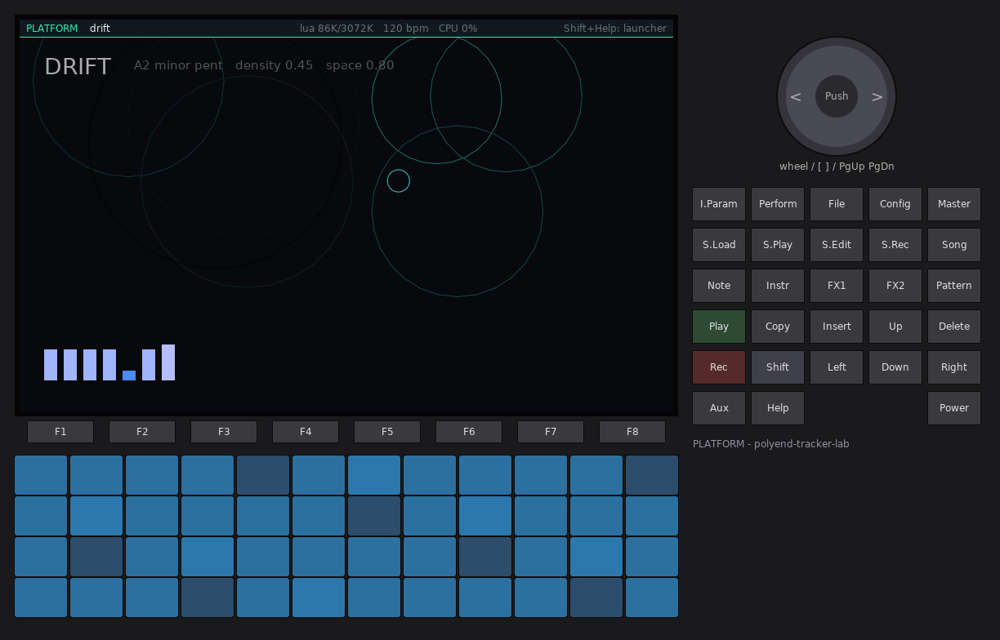
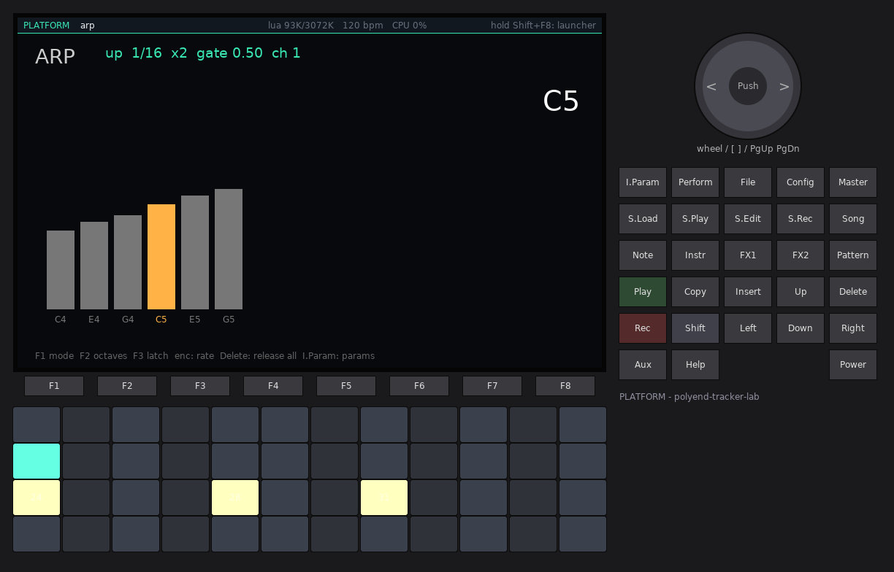
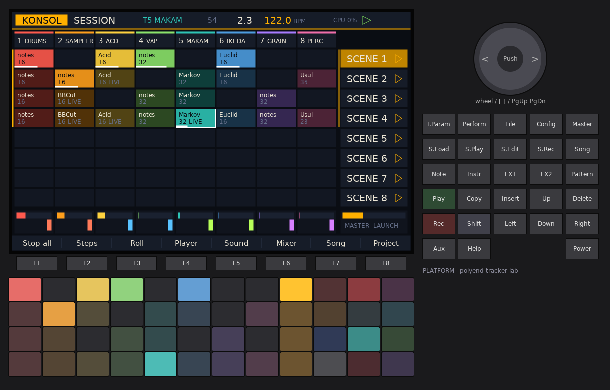
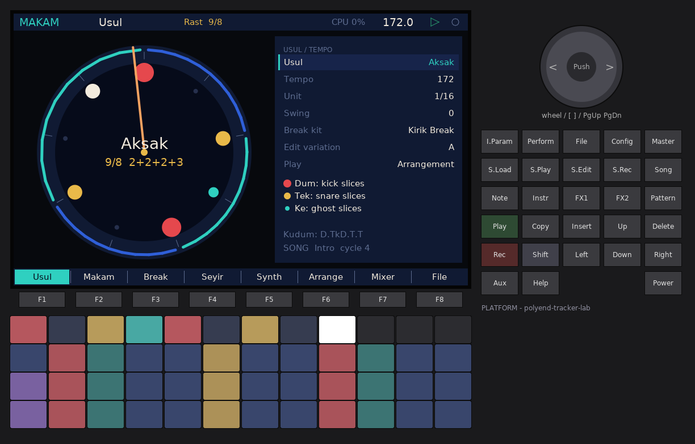
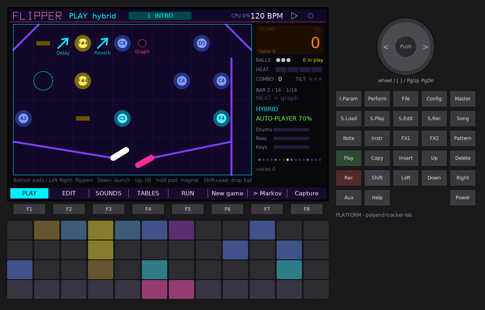
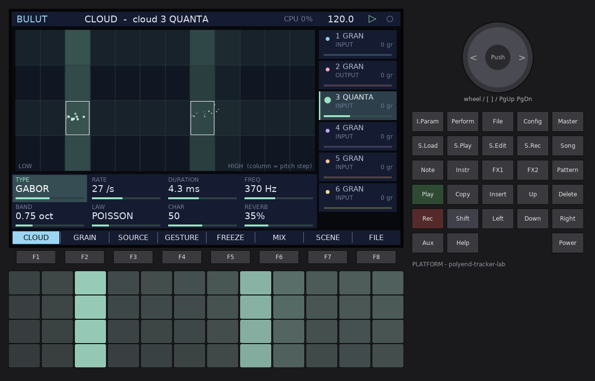
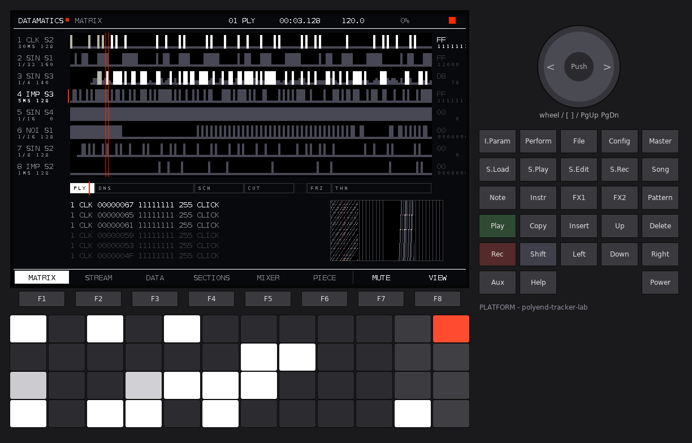

# PLATFORM: scripts and apps from the card

PLATFORM is a firmware for the **original Polyend Tracker** (polyend-tracker-lab, built on
OpenTracker). It doesn't play one instrument. It is a **platform**: it runs programs you put
on the SD card, much like monome norns or the 4ms MetaModule.

- **Lua scripts** (`.lua`): norns-style scripts. They draw the screen, read the pads, keys and
  encoder, send MIDI, schedule music on the clock, and play a built-in **voice engine**
  (16 voices: oscillators, FM, samples, grains, filter, envelopes, delay and reverb).
- **Native apps** (`.papp`): C or C++ compiled for the Tracker's Cortex-M4F with the
  PLATFORM SDK. They run at full speed and do their own DSP.
- **Stations**: the other polyend-tracker-lab workstations (FLIPPER, GRAF, BULUT,
  DATAMATICS, KONSOL...) built as native apps. They run inside PLATFORM, next to their own
  `.ptf` images.

A **launcher** lists everything on the card, with icons and descriptions. Opening an entry
runs it, and Shift + Help brings you back.


---

## Contents

1. [Quick start](#1-quick-start)
2. [Concepts](#2-concepts)
3. [The launcher](#3-the-launcher)
4. [Controls](#4-controls)
5. [Lua API reference](#5-lua-api-reference)
6. [Voice engine reference](#6-voice-engine-reference)
7. [The example scripts](#7-the-example-scripts)
8. [Native apps: the SDK](#8-native-apps-the-sdk)
9. [Stations: workstations as apps](#9-stations-workstations-as-apps)
10. [Safety: errors, hangs, safe boot](#10-safety-errors-hangs-safe-boot)
11. [Settings](#11-settings)
12. [Files on the card](#12-files-on-the-card)
13. [Limits](#13-limits)
14. [The simulator](#14-the-simulator)

---

## 1. Quick start

1. Copy the contents of `release/` to `/Firmware` on the card: `PolyendTrackerPLATFM.ptf`
   and the `Apps/` folder with the six stations. Install the `.ptf` with Config > Firmware
   from any lab firmware, or with the stock updater.
2. Boot. After the intro the launcher appears. On a fresh card PLATFORM writes five example
   scripts to `/Lab/PLATFORM/Scripts` and installs the station apps it finds in
   `/Firmware/Apps` (section 9).
3. Turn the encoder to choose an entry, then press the encoder (or F1, or the matching pad) to
   open it.
4. Play. **Shift + Help** (or holding **Aux** for one second) returns to the launcher.
5. **Shift + Aux** opens the params page of the running script.

To add your own script, put a `.lua` file in `/Lab/PLATFORM/Scripts`, then press **F5
Rescan** in the launcher. Section 5 has the complete API.

```lua
-- name: Beep
-- desc: one pad, one note
function pad(n, vel, z)
  if z == 1 then engine.note(1, 48 + n, vel / 127) else engine.off(1) end
end
function redraw()
  screen.font("huge")
  screen.text_center(400, 200, "press a pad")
end
```



---

## 2. Concepts

**One session at a time.** The launcher opens one script or app. It gets the screen, the
pads, the keys, the encoder, MIDI in and the audio output. Closing it stops its sound,
frees all its memory and returns to the launcher. Only one session exists; nothing keeps
running in the background.

**What PLATFORM keeps for itself.** The lab Shell owns some controls in every firmware:
**Config** opens Settings / Firmware / About, **Play** starts and stops the transport, and
**Shift + Rec** records the master output to `/Lab/PLATFORM/Rec`. On top of these, PLATFORM
keeps **Shift + Help** and **Aux held one second** (back to the launcher) and **Shift + Aux**
(params page of a script).

**Scripts never touch audio samples.** Lua runs in the main loop, never in the audio
interrupt, because it is far too slow for per-sample work on a 180 MHz M4. A script makes
sound by *commanding* the native voice engine: note on, note off, set a parameter. Each
command carries a time stamp on the transport beat, and the engine applies it at exactly
that sample. A clock coroutine is resumed slightly ahead of time (60 ms), so its notes land
exactly on the grid even though the screen and the card make the main loop uneven.

**Native apps run at full speed.** A `.papp` is loaded into the SDRAM, relocated and called
directly: its `render()` runs inside the audio interrupt like a firmware's own code. That
makes apps powerful, and also trusted (see section 10).

**Memory.** The Tracker has 16 MB of SDRAM. PLATFORM's fixed part (shell, voice engine, delay
and reverb lines, recorder buffers) uses about 2.5 MB. The remaining **~13.3 MB is the
session pool**: one script or app at a time gets all of it. A script's Lua heap is a
fixed slice of the pool (3 MB by default, Settings > Script memory). Its samples and screen
buffers are also in the pool.

---

## 3. The launcher

The launcher shows cards in a grid, three columns and two rows on screen, scrolling by row.
Each card shows:

- an **icon** (from the script's `-- icon:` line or the app's info),
- the **name** and **kind**: LUA SCRIPT (mint), NATIVE APP or STATION (amber),
- a two-line **description** and the **author**,
- the entry's **colour**: mint for scripts, amber for apps, and each station's own theme
  accent,
- **LAST** on the entry opened most recently.

Stations come first, then apps, then scripts, each group by name.

| Control | Action |
| --- | --- |
| Encoder, Up / Down | previous / next entry |
| Left / Right | six entries back / forward (two rows) |
| Encoder push, **F1 Open** | open the selected entry |
| Pad *n* | open entry *n* (the pads light one per entry; the selection is bright) |
| **F2** | filter: All / Scripts / Apps |
| **F5 Rescan** | read the card again (after copying files over USB storage) |
| **F6 Examples** | write the example scripts again (overwrites `hello.lua`, `steps.lua`, ...) |
| Config | Settings (section 11) |

**Script header.** The launcher reads up to 24 comment lines at the top of a `.lua` file.
Unknown lines are ignored, and the file name is used when there is no `name:`.

```lua
-- name: Drift                         (up to 23 characters)
-- author: you                          (up to 23)
-- desc: Generative ambient: ...        (up to 95; "description:" also works)
-- icon: drone                          (drone, seq, grid, euclid, arp, spark, wave, script, station, app)
```

**Reopening the last session.** At power-on the launcher counts down for 1.5 seconds
("Opening Drift in 1.2 s"), then reopens the entry that was open when the Tracker was
switched off. Any key or pad during the countdown cancels it (safe boot, section 10).
Settings > Reopen last script / app turns this off.

---

## 4. Controls

### Everywhere

| Control | Action |
| --- | --- |
| **Shift + Help** | close the session, back to the launcher |
| **Aux held 1 s** | the same (Aux pressed briefly still reaches the script / app) |
| **Shift + Aux** | params page of a script (open / close) |
| Play | transport start / stop (Shell) |
| Shift + Rec | master recorder (Shell) |
| Config | Settings, Firmware update, About (Shell) |

### In a script

A script receives everything else: all pads, the encoder, and every other button through
`key(name, z, shift)` (section 5.3). PLATFORM draws a thin bar at the top of the screen with
the script name, Lua memory used / available, tempo and CPU. Settings > Session top bar turns
it off. If the script prints with `print()`, the last line shows at the bottom of the screen.

### On the params page

| Control | Action |
| --- | --- |
| Up / Down | choose a parameter |
| Encoder, Left / Right | change it (Shift: x10 steps) |
| Encoder push | +1 step, or fire a trigger |
| Shift + Aux | close |

Values are saved to `params.txt` in the script's data folder when the script closes, and read
back the next time it opens.



### On the error page

| Control | Action |
| --- | --- |
| **F7 Retry** | open the same file again (after you fixed it) |
| **F8 Launcher**, encoder push | back to the launcher |

---

## 5. Lua API reference

The language is Lua 5.4 with **32-bit numbers**: integers are 32-bit (`math.maxinteger`
is 2147483647), and floats are single precision (about 7 significant digits). The libraries
are `string`, `table`, `math`, `utf8` and `coroutine`, plus the base functions (`print`,
`pairs`, `pcall`, `tostring`, `load` for text chunks...). Missing are `io`, `os`, `debug`,
`require`, `dofile` and `loadfile`; use `file.*` for the card. Screen text is ASCII 32..126.
Other characters show as `?`.

### 5.1 Callbacks (all optional)

| Function | When |
| --- | --- |
| `init()` | once, after the file ran. Set up voices, params and clocks here. |
| `redraw()` | to draw the screen: at `screen.fps()` frames a second (default 15), and right after any key / pad / encoder event or `screen.dirty()` |
| `key(name, z, shift)` | a button: `name` is a string (below), `z` is 1 press, 0 release, 2 hold (once, after 0.5 s), `shift` true while Shift is held |
| `enc(delta, shift)` | the encoder, `delta` in detents (+ clockwise) |
| `pad(n, vel, z)` | a pad: `n` 1..48 (row by row from the top left), `vel` 1..127 on press, `z` 1 / 0 |
| `grid_key(x, y, z)` | the same pad as x 1..12, y 1..4 (norns grid style); called after `pad` |
| `midi.event(msg)` | a MIDI message in: `msg = {status, d1, d2}` (DIN and USB, after the channel filter in Settings) |
| `clock.transport.start()` / `.stop()` | the transport started / stopped |
| `cleanup()` | the script is closing (save your own files here) |

Key names: `F1`..`F8`, `UP`, `DOWN`, `LEFT`, `RIGHT`, `ENC` (encoder push), `SHIFT`, `AUX`,
`HELP`, `COPY`, `INSERT`, `DELETE`, `REC`, `NOTE`, `INSTR`, `FX1`, `FX2`, `PATTERN`,
`SONG`, `PERFORMANCE`, `FILE`, `MASTER`, `INSTRPARAMS`, `SAMPLELOADER`, `SAMPLEPLAYBACK`,
`SAMPLEEDITOR`, `SAMPLERECORDER`. Play, Config, Shift + Rec, Shift + Help and Shift + Aux
never reach a script.

### 5.2 Screen

The screen is 800 x 480 pixels with (0, 0) at the top left. The session bar covers y 0..22
(when on), and the bottom 30 pixels are free (no F-key bar is drawn for scripts). Inside
`redraw()`, the drawing calls record a list. PLATFORM replays the last complete list every
frame through the display budget, so a slow `redraw()` never tears.

| Function | |
| --- | --- |
| `screen.color(r, g, b)` / `screen.color(0xRRGGBB)` | current colour |
| `screen.level(l)` | grey 0..15 (norns style) |
| `screen.alpha(a)` | 0..255 |
| `screen.line_width(px)` | for `line`, `lines`, `polyline` |
| `screen.rect(x, y, w, h)` | filled rectangle |
| `screen.frame(x, y, w, h)` | 1 px outline |
| `screen.round(x, y, w, h, r)` | filled, rounded corners |
| `screen.line(x0, y0, x1, y1)` | |
| `screen.circle(x, y, r)` | filled circle |
| `screen.ring(x, y, r [, segments])` | outline (default 24 segments, max 96) |
| `screen.arc(x, y, r, a0, a1 [, segments])` | angles in radians |
| `screen.points({x1, y1, x2, y2, ...} [, size])` | many dots in one batch (cheap) |
| `screen.lines({x1, y1, x2, y2, ...} [, width])` | separate segments, pairs of points |
| `screen.polyline({x1, y1, ...} [, width])` | connected line |
| `screen.rects({x1, y1, x2, y2, ...})` | many rectangles, corner pairs |
| `screen.font(f)` | `"tiny"` `"small"` `"body"` `"large"` `"title"` `"huge"` (or 1..6, or the FT81x ROM font 16..31) |
| `screen.text(x, y, s)` | text, top-left at (x, y) |
| `screen.text_center(x, y, s)` / `screen.text_right(x, y, s)` | centred / right-aligned at x |
| `screen.middle(true)` | text y is the vertical centre from now on |
| `screen.number(x, y, n)` | an integer |
| `screen.text_width(s)` | estimated width in pixels in the current font |
| `screen.clip(x, y, w, h)` / `screen.noclip()` | scissor |
| `screen.fps(n)` | redraw rate 0..30 (0 = only on events / `screen.dirty()`) |
| `screen.dirty()` | ask for a redraw now |
| `screen.update()` | commit what was drawn so far (normally automatic at the end of `redraw()`) |
| `screen.width`, `screen.height` | 800, 450 |

**Budget.** A script gets about 1,560 display-list words per frame (1,680 without the top
bar). Rough costs: `rect` 4 words, `line` 4, `circle` 4, text = its length + 4, `ring` =
segments + 3, and each batch is 3 + one word per vertex. Drawing past the budget is dropped,
never sent to the display chip. The top bar then shows `SCREEN FULL`. Use batches (`points`,
`lines`, `rects`) for anything numerous.

```lua
function redraw()
  screen.color(0x39E6B4)
  local pts = {}
  for i = 0, 63 do pts[#pts + 1] = 20 + i * 12; pts[#pts + 1] = 240 + 80 * math.sin(i / 5) end
  screen.polyline(pts, 2)
end
```

### 5.3 Pads (grid)

| Function | |
| --- | --- |
| `grid.led(x, y, level)` | x 1..12, y 1..4, level 0..15 in the grid colour |
| `grid.led(x, y, r, g, b)` | an RGB colour |
| `grid.all(level)` / `grid.all(r, g, b)` | every pad |
| `grid.color(r, g, b)` / `grid.color(0xRRGGBB)` | the colour `level` scales (default 0x40C0FF) |
| `grid.refresh()` | accepted for norns compatibility; the LEDs update ~30 times a second anyway |
| `pads.led(n, r, g, b)` | pad 1..48 by number |
| `grid.cols`, `grid.rows` | 12, 4 |

The LEDs keep their colour until you change them.

### 5.4 Engine (see section 6 for every parameter)

| Function | |
| --- | --- |
| `engine.note(voice, note [, vel])` | note on: `voice` 1..16, `note` MIDI number (fractions allowed), `vel` 0..1 (or 1..127) |
| `engine.hz(voice, hz [, vel])` | note on by frequency |
| `engine.off(voice)` | release (ADSR) |
| `engine.trig(voice, note [, vel [, dur]])` | note on now and off `dur` seconds later (default 0.1) |
| `engine.set(voice, "param", value)` | one parameter |
| `engine.set_all("param", value)` | the same parameter on all 16 voices |
| `engine.voice(voice, {param = value, ...})` | several parameters |
| `engine.fx("param", value)` | delay / reverb / master level |
| `engine.load(slot, "file.wav")` | load a WAV into sample slot 1..32: returns frames, or `nil, message` |
| `engine.level(voice)` | the voice's envelope level 0..1 right now (for meters) |
| `engine.panic()` | all voices silent at once |
| `engine.voices` | 16 |

Inside a clock coroutine every engine call is stamped with the coroutine's exact beat. Outside
one (in `key`, `pad`, `enc`, `redraw`, `init`) it plays at the start of the next audio block
(within 3 ms). `engine.load` looks for the file in the script's data folder first, then next
to the script. WAV files may be 8/16/24/32-bit PCM or float, mono or stereo, any sample
rate (resampled to 44.1 kHz), up to 60 seconds each. Samples take pool memory until the script
closes.

### 5.5 Clock

| Function | |
| --- | --- |
| `clock.run(f, ...)` | start a coroutine, returns an id |
| `clock.cancel(id)` | stop it |
| `clock.sync(beats [, offset])` | wait for the next multiple of `beats` (quarter notes) on the transport grid, plus `offset` beats |
| `clock.sleep(seconds)` | wait |
| `clock.get_beats()` | the current beat (fractional) |
| `clock.get_beat_sec()` | seconds per beat |
| `clock.get_tempo()` / `clock.set_tempo(bpm)` | tempo (20..400; the Shell's tempo, shared) |
| `clock.start()` / `clock.stop()` / `clock.playing()` | the transport |
| `clock.transport.start` / `.stop` | assign functions: called on transport changes |

The clock always runs. While the transport is stopped it follows a free-running beat at the
same tempo, and **Play** restarts the beat count at 0 (`sync` grids line up with the bar).
When following MIDI clock (Settings > Clock), the tempo follows the incoming clock.

```lua
clock.run(function()
  while true do
    clock.sync(1/4)                 -- every 16th note
    if math.random() < 0.6 then engine.note(1, 36) end
  end
end)
```

### 5.6 MIDI

| Function | |
| --- | --- |
| `midi.note_on(note, vel [, ch])` | `ch` 1..16; default = Settings > MIDI out channel |
| `midi.note_off(note [, vel [, ch]])` | |
| `midi.cc(cc, value [, ch])` | |
| `midi.send({status, d1, d2})` | any channel message |
| `midi.event = function(msg) ... end` | input (5.1) |

Output goes to DIN and USB together. Inside a clock coroutine, MIDI is held back until its
beat (main-loop accurate, about 1 ms). The engine's audio is exact to the sample.

### 5.7 Params

```lua
params:add_number(id, name, min, max, default [, formatter])
params:add_option(id, name, {"a", "b", "c"}, default_index)
params:add_control(id, name, min, max, default [, step [, units]])
params:add_toggle(id, name, default_bool)
params:add_trigger(id, name)
params:add_separator(name)
params:add{type = "number" | "option" | "control" | "toggle" | "trigger" | "separator", id = ..., name = ..., action = f, ...}
params:set_action(id, function(value) ... end)
params:get(id)        -- number, option index, or boolean for toggles
params:set(id, value [, silent])
params:delta(id, d)   -- d steps
params:string(id)     -- the text shown on the params page
params:bang()         -- run every action with the current value
params:write() / params:read()   -- params.txt (done for you on close / open)
```

After `init()`, PLATFORM reads `params.txt` and calls `params:bang()`, so the actions see the
saved values.

### 5.8 Files (the script's data folder)

Each script has `/Lab/PLATFORM/Data/<script name>/`. Names are relative to it, and `..` or
absolute paths are refused.

| Function | |
| --- | --- |
| `file.read(name)` | the whole file as a string (up to 256 KB), or `nil` |
| `file.write(name, s)` / `file.append(name, s)` | true on success |
| `file.exists(name)`, `file.remove(name)` | |
| `file.list([subfolder])` | names in the folder |

### 5.9 Utilities

| | |
| --- | --- |
| `metro.init(f, seconds [, count])` | `m:start()`, `m:stop()`: a repeating timer on the clock (norns style) |
| `util.clamp(x, a, b)`, `util.linlin(a0, a1, b0, b1, x)`, `util.round(x [, q])`, `util.wrap(x, a, b)`, `util.time()` | |
| `music.scale(root, name [, count])` | note list; names: major minor dorian phrygian lydian mixolydian pentatonic minor_pent whole chromatic hijaz |
| `music.note_to_hz(n)`, `music.note_name(n)` | `music.note_name(60)` = `"C4"` |
| `music.euclid(steps, hits [, rotate])` | list of booleans |
| `sys.toast(s)` | a short message on screen |
| `sys.memory()` | Lua heap used, heap size (bytes) |
| `print(...)` | to the script console: the last line shows at the bottom of the screen, the last three on the error page |

---

## 6. Voice engine reference

Sixteen voices, each with:

```
oscillator / sample / grains -> filter (SVF) -> drive -> envelope -> pan -> mix
                                                                     \-> delay send, reverb send
```

There is also a global **ping-pong delay** (up to 2 s) and a **reverb**, then the master level.
The Shell's limiter follows.

### Voice parameters (`engine.set`, `engine.voice`)

| Name | Range (default) | |
| --- | --- | --- |
| `wave` | `"sine"` `"tri"` `"saw"` `"square"` `"noise"` `"fm"` `"sample"` `"grain"` `"click"` (sine) | the sound source |
| `amp` | 0..2 (0.5) | level; times velocity |
| `pan` | -1..1 (0) | equal power |
| `pw` | 0.02..0.98 (0.5) | square pulse width |
| `fm_ratio` | 0.0625..16 (2) | modulator / carrier frequency |
| `fm_index` | 0..16 (1) | modulation depth (radians) |
| `cutoff` | 20..18000 Hz (18000) | filter frequency |
| `res` | 0.5..20 (0.7) | filter Q |
| `ftype` | `"lp"` `"bp"` `"hp"` `"off"` (lp) | 12 dB/oct state-variable filter |
| `fenv` | -8..8 (0) | octaves the envelope moves the cutoff at full level |
| `attack` | 0.0005..20 s (0.005) | 0.0005 = instant (percussion lands on its sample) |
| `decay` | 0.001..20 s (0.2) | time to fall 60 dB toward the sustain level |
| `sustain` | 0..1 (0.7) | |
| `release` | 0.001..30 s (0.3) | -60 dB time |
| `env_mode` | `"adsr"` `"perc"` (adsr) | perc: attack then decay to silence, ignores note off |
| `pitch_env` | -48..48 semitones (0) | pitch offset at note on, decaying to 0 |
| `pitch_decay` | 0.001..10 s (0.05) | (kick drums: `pitch_env = 24, pitch_decay = 0.04`) |
| `detune` | -1200..1200 cents (0) | |
| `glide` | 0..10 s (0) | portamento; legato notes don't retrigger the envelope |
| `drive` | 0..1 (0) | soft clip after the filter |
| `sample` | 1..32 (1) | sample slot for `sample` and `grain` |
| `rate` | -8..8 (1) | playback rate at note 60 (C4); the note transposes it; negative = reverse |
| `start`, `length` | 0..1 (0, 1) | region of the sample |
| `loop` | 0 / 1 or false / true (0) | loop the region |
| `grain_size` | 0.005..1 s (0.08) | grain length |
| `grain_density` | 0.5..200 /s (20) | new grains per second (up to 4 overlapping per voice) |
| `grain_pos` | 0..1 (0) | position in the sample |
| `grain_spread` | 0..1 (0.1) | random position jitter |
| `send_delay`, `send_reverb` | 0..1 (0) | effect sends |

Without a sample in its slot, a `grain` voice makes sine grains at the note's pitch. A
`click` voice makes one impulse plus a short noise burst (rim and hat sounds: filter it).

### Effects (`engine.fx`)

| Name | Range (default) | |
| --- | --- | --- |
| `delay_time` | 0.001..2 s (0.375) | glides smoothly when changed |
| `delay_feedback` | 0..0.98 (0.4) | |
| `delay_level` | 0..1 (0.3) | |
| `delay_tone` | 0..1 (0.6) | low-pass in the feedback |
| `reverb_size` | 0..1 (0.7) | |
| `reverb_damp` | 0..1 (0.4) | |
| `reverb_level` | 0..1 (0.3) | |
| `level` | 0..2 (1) | engine master level |

Closing a script resets every voice, effect and sample slot to the defaults.

### CPU and the voice governor

The engine budget is 150,000 Cortex-M4 instructions per 128-sample block, inside the
180,000 the gate allows for a firmware's `render()`. These are measured costs per voice per
block, under QEMU: sine / saw about 5,000, square 7,000, FM 9,000, mono sample 7,000, stereo
sample 11,000, grain voice with 4 grains 16,000, drive +3,000, filter +1,200. The delay and
the reverb cost about 20,000 together, and only while something is sent to them or still
echoing. Silence costs about 1,200.

When a block would cost more than the budget, the engine first lets grain voices overlap
fewer grains. If that is not enough, it stops the quietest sounding voices, so the audio
never drops out. Sixteen saw voices with filter and drive and both effects fit. Sixteen
grain or stereo-sample voices with effects get limited.

---

## 7. The example scripts

They are written to `/Lab/PLATFORM/Scripts` on a fresh card (and again with F6). Their
source is in `examples/scripts/` in the repository.

| Script | What it shows |
| --- | --- |
| **Hello** | drawing: text, points, polyline, rings, the encoder changes the colour, pads play sine voices, `print` |
| **Steps** | a 4-track x 12-step sequencer on the pads (kick, snare, hat, bass), `clock.sync`, swing, params, transport callbacks, MIDI out |
| **Drift** | generative ambient: 7 coroutines with `clock.sleep`, FM and sine clouds, a grain voice, long reverb, params with actions |
| **Euclid** | a Euclidean drum machine: 4 rings, hits / steps / rotation per track, `music.euclid`, `screen.points` |
| **Arp** | a MIDI arpeggiator: hold pads or play MIDI notes, 5 modes, rates, octaves, gate, latch, MIDI out + a voice |

|  |  |
|---|---|
|  |  |

---

## 8. Native apps: the SDK

`sdk/` holds everything needed to write an app:

```
sdk/include/platform_app.h     the C ABI: PlatHost (services), PlatApp (your callbacks), PlatInfo
sdk/include/platform_app.hpp   C++ helper: derive from plat::App, PLAT_APP(MyApp)
sdk/ld/papp.ld                 link script
sdk/runtime/                   the few runtime symbols an app needs (no heap)
sdk/examples/drone/            a 12-oscillator drone with filter and scope
sdk/examples/stepseq/          a 16-step drum sequencer with MIDI out, sample-accurate
sdk/station/                   build a lab workstation as an app (section 9)
tools/mkpapp.py                ELF -> .papp
```

### Building

```
make -C sdk                         # both examples: build/sdk/<name>.papp (device) + <name>.so (simulator)
make -C sdk APPS=/path/to/myapp     # every .cpp / .c in that folder is one app
make -C sdk install SD=/media/card  # copies the .papp files to /Lab/PLATFORM/Apps
make -C sdk host                    # only the simulator libraries
```

You need `arm-none-eabi-gcc` (the same as for the firmware), `python3`, and a host `g++` for
the simulator build. Copy the `.papp` to `/Lab/PLATFORM/Apps/` on the card and press **F5
Rescan**. The simulator loads the `.so` built from the same source.

### A minimal app

```cpp
#include "platform_app.hpp"

PLAT_APP_INFO("Tone", "me", "A sine on the pads", "wave", 16, 0);   // name, author, description, icon, KB needed, flags

class Tone : public plat::App {
public:
    volatile float hz_ = 0.0f;          // written by the main loop, read by render()
    float ph_ = 0.0f;
    void event(const PlatEvent& e) override {
        if (e.type == PLAT_EV_PAD_DOWN) hz_ = 110.0f * float(e.id + 1);
        if (e.type == PLAT_EV_PAD_UP) hz_ = 0.0f;
    }
    void render(const PlatTransport&, const int16_t*, float* l, float* r) override {
        for (uint32_t i = 0; i < PLAT_BLOCK; ++i) {
            ph_ += hz_ / 44100.0f;
            if (ph_ >= 1.0f) ph_ -= 1.0f;
            const float s = (ph_ < 0.5f ? 0.2f : -0.2f) * (hz_ > 0.0f);
            l[i] += s;
            r[i] += s;
        }
    }
    void draw() override {
        color(0xFFFFFF);
        text(400, 240, PLAT_FONT_HUGE, hz_ > 0.0f ? "tone" : "press a pad", PLAT_TEXT_CENTER);
    }
};
PLAT_APP(Tone)
```

### The ABI

PLATFORM calls your app only through the `PlatApp` table that `plat_app_entry()` returns. Your
app calls PLATFORM only through the `PlatHost` table it receives in `init()`. An app never
links against the firmware, so an app keeps working across firmware updates as long as
`PLAT_ABI_VERSION` matches. Both structs carry their `size`, and new fields are only ever
appended.

| PlatApp callback | Context | Mirrors |
| --- | --- | --- |
| `init(self, host)` | main loop, once. Allocate here with `host->alloc`. Return false to refuse (log why with `host->log`). | `Workstation::init` |
| `drawIntro(self, ms)` | not used by PLATFORM yet | `drawIntro` |
| `event(self, e)` | buttons / pads / encoder (`PlatEvent`, same values as `lab::Event`) | `onEvent` |
| `midi(self, status, d1, d2)` | MIDI in | `onMidi` |
| `update(self, ms)` | every main-loop pass | `update` |
| `draw(self)` | ~40 frames a second: only the `host` drawing calls | `draw` |
| `leds(self, rgb)` | 48 x {r, g, b}, ~30 times a second | `leds` |
| `render(self, t, in, l, r)` | **audio interrupt**: add into `l` / `r` (128 frames, already holding the engine's output); `in` = interleaved stereo int16 input or null | `render` |
| `transport(self, playing)` | Play / Stop | `onTransport` |
| `settings(self, rows, cap)` | rows for Config > Settings (`PlatSetting` = `lab::SettingRow`) | `settings` |
| `save(self)` | power off, Settings > Save, every 5 minutes, and before close | `save` |
| `close(self)` | the app is being unloaded | |
| `benchScenarios` / `benchName` / `benchSetup` | optional: CPU bench scenarios, run under QEMU by the hosted bench | `benchScenarios` ... |

`PlatHost` provides: memory (`alloc`, `memFree`), drawing (`color`, `fill`, `line`, `text`,
batches, `bitmap332` + `writeRamG` in RAM_G 0x000000..0x06CBFF), files (paths from the card
root; `host->home` is your data folder `Lab/PLATFORM/Data/<app>`), time and transport,
`midiOut`, `toast`, `log` (shown on the error page when `init` fails), `stem` (recorder stems,
inside `render`), the radio, and the Shell's state.

**Rules for apps.** These are the same as for firmware workstations
(`WORKSTATION_GUIDE.md`):

- **No heap.** There is no `malloc` or `new`; use `host->alloc` in `init()`. It returns
  zeroed memory from the session pool (13 MB) and is freed when the app closes. Static
  objects and constructors are fine, because the loader runs `.init_array`.
- **`render()` is the audio interrupt.** No host calls except `stem`, no files, no drawing,
  never wait. Pass data between the main loop and `render()` through plain fields written
  by one side.
- **Float only in per-sample code** (`sinf`, `expf`...). The M4F has no double-precision FPU.
- **CPU:** the voice engine and your `render()` share one audio block (522,000 cycles at
  180 MHz). Stay under about 150,000 instructions per block.
- `snprintf` with `%f` works (up to 32 KB of libc scratch), but there is no `printf` to a
  console.
- No exceptions, no RTTI, no thread-safe statics (the SDK flags turn them off).
- **Hot code:** mark functions `PLAT_FAST`. The loader copies them to SRAM_L, the fast RAM on
  the code bus (up to 24 KB per app); otherwise they run from SDRAM through the 8 KB cache.
  A station's `OT_FASTRUN_FN` functions go there too.

### The .papp format and the loader

`tools/mkpapp.py` turns the linked ELF (linked at address 0 with `--emit-relocs`) into:

```
PappHeader (64 B) + PlatInfo (180 B)        format version 2
fast segment    (PLAT_FAST code, linked at 0x40000000)
main segment    (.text .rodata .init_array .data, linked at 0)
relocations     one 32-bit word per absolute address in either segment
```

At load, PLATFORM streams the file from the card straight into place: the fast segment into
SRAM_L (or the pool), the main segment at its final SDRAM address, then the relocation words
into scratch memory. It checks a CRC-32 over the whole body and adds the load address to every
listed word. It then makes the new code visible: the LMEM system cache over the SDRAM is
invalidated for the range, the code cache is invalidated, and DSB + ISB follow. Finally it
runs the constructors and calls `plat_app_entry()`. A damaged file (bad CRC, a relocation
outside its segment, a wrong ABI version, or more memory than is free) shows an error page
and never runs. SDRAM at 0x70000000 lies in the ARMv7-M "external RAM" region, which is
executable.

`mkpapp.py` refuses images that would not survive relocation: an undefined symbol (an app
may only call the host table), a branch from one segment into the other without a linker
veneer, MOVW/MOVT absolute addresses, `R_ARM_REL32` (exception tables).

---

## 9. Stations: workstations as apps

The six other polyend-tracker-lab workstations run inside PLATFORM as **stations**:

| Station | What it is | `.papp` | Fast code | Needs |
| --- | --- | --- | --- | --- |
| **BULUT** | granular cloud workstation | 126 KB | 10 KB | 10.6 MB |
| **DATAMATICS** | data music: any file, sine / click / noise / impulse | 82 KB | 2.5 KB | 6.4 MB |
| **FLIPPER** | the song is a pinball machine | 124 KB | 6 KB | 6.3 MB |
| **GRAF** | modular synth: pin matrix + patch graph | 166 KB | 18.5 KB | 10.6 MB |
| **KONSOL** | clip / scene production console, 8 channels | 297 KB | 14 KB | 12.2 MB |
| **MAKAM** | MAKAM-JUNGLE: Turkish makam meets jungle / drum & bass | 114 KB | 16 KB | 3.9 MB |

Each one is the **same workstation** as in its own firmware, compiled unchanged from that
firmware's `src/ws/`, with the same pages, controls, sounds and files. It also keeps its own
`.ptf` image. Use the station when you want to switch between instruments without
reflashing. Use the firmware when you want an instrument alone on the Tracker.

| Station inside PLATFORM | |
|---|---|
|  |  |
|  |  |
|  |  |

### Installing

The stations are separate files in `release/Apps/` (`bulut.papp`, `datamatics.papp`,
`flipper.papp`, `graf.papp`, `konsol.papp`, `makam.papp`). They are not built into the
firmware image. Either:

- copy `release/Apps/` to **`/Firmware/Apps/`** on the card (together with the `.ptf`). At
  every boot PLATFORM copies each `.papp` there that is missing from `/Lab/PLATFORM/Apps/`,
  or has a different size (a newer build), and shows "Installed N apps". A card without
  `/Firmware/Apps` simply gets none. Or:
- copy the `.papp` files straight to **`/Lab/PLATFORM/Apps/`** and press F5 Rescan.

To remove a station, delete its file from `/Lab/PLATFORM/Apps/`. Delete it from
`/Firmware/Apps/` too, or the next boot installs it again.

### Using a station

Stations come first in the launcher, in their own colours, with their own tagline. Opening
one starts it as its firmware would, without the boot intro. Every control is the
station's own, including Aux pressed briefly and its own Help page. Two exceptions:

- **Shift + Help** (or **Aux held one second**) closes the station and returns to the
  launcher. The station saves first, like at power-off.
- **Config** opens the Settings page: the Shell rows, PLATFORM's rows, then the station's
  own rows.

**Play**, **Shift + Rec** (including the station's stems), MIDI in and out, the tempo and
the input selection are shared with PLATFORM's Shell and work exactly as in the firmware.
The header shows the station's name.

**Files.** A station uses `/Lab/<NAME>/`, the same folder as its own firmware. Projects,
kits and settings are shared: save in BULUT-the-station, open in BULUT-the-firmware.

**Memory.** A station gets all memory left in the session pool, 13.3 MB. The "Needs" column
is the minimum it starts with; with less, it refuses and the error page says how much is
free.

**CPU.** Hosting costs almost nothing. While a station runs, PLATFORM's voice engine is
skipped and `render()` goes straight to the station. `make lab-gate` runs every station's
own CPU bench scenarios inside PLATFORM under QEMU (the hosted bench) and fails above
180,000 M4 instructions per block. The worst block per station, hosted (with the station's
own firmware bench in brackets): BULUT 174,520 (174,520), KONSOL 170,760 (169,360), FLIPPER
166,200 (165,320), GRAF 158,880 (158,120), MAKAM 150,360 (150,480), DATAMATICS 130,920
(130,160). These are instruction counts. On the device the station's code runs from SDRAM
through the 8 KB cache, except its fast code in SRAM_L, so the real cycle cost can be
higher than the firmware's own.

### Building stations

```
make stations                 # all six: build/stations/<name>.papp (device) + <name>.so (simulator)
make release-apps             # + copy them to release/Apps/
sh tools/build_stations.sh graf konsol       # some of them
make -f sdk/station/station.mk FW=../<fw> NAME=<NAME> MEMKB=<min KB> [EXTRA="core/..."] [FW_EXTRA="core/..."]
```

A station is linked from:
- its firmware's `src/ws/`,
- PLATFORM's `src/lab/` (the Canvas, the drawing helpers, the `Context` services; all seven
  copies of `lab.h` are identical),
- the core sources it uses (`EXTRA` from PLATFORM's tree, `FW_EXTRA` from its own, e.g.
  KONSOL's `core/gen`),
- `sdk/station/station_glue.cpp`.

The glue gives the workstation its arena and the host's own Shell, Canvas, card and radio
objects through `PlatHost::lab*`. `PlatHost::labLayout` refuses a station built against
another `lab.h` layout. The station's calls to `drawHeader` are linked (`--wrap`) to a copy
that shows the station's name. After the build, `tools/station_info` boots the simulator
library headless to read the workstation's tagline and theme accent, and
`tools/patch_info.py` writes them into the launcher record of both files.

## 10. Safety: errors, hangs, safe boot

**Script errors.** Errors in a script (syntax, runtime, an error thrown inside a clock
coroutine) never crash the Tracker. The session stops, its voices go silent, and the error
page shows the message with `file:line` and up to five stack frames, plus the last lines the
script printed. Fix the file (on a computer, or over USB storage), then **F7 Retry**.


**Endless loops.** Every callback of a script may run at most 4,000,000 Lua VM instructions,
or 30,000,000 for loading and `init()`. A Lua instruction-count hook checks every 1,000
instructions, so a `while true do end` stops with "script ran too long".

**Out of memory.** The Lua heap is a fixed slice of the pool (Settings > Script memory, 1..8
MB) with its own allocator. A script that uses it up gets a Lua "not enough memory" error,
and nothing else is affected.

**Display.** Script and app drawing goes through a budgeted canvas, so no amount of drawing
can overflow the FT81x display list.

**Native apps are trusted code.** A `.papp` runs on the CPU directly with no memory
protection. An app that hangs inside `render()` or a callback, writes outside its memory, or
faults stops the whole Tracker until it is switched off. Install apps you trust. These
safeguards make that recoverable:

- **Crash guard.** Before PLATFORM opens a script or app it writes `open=<file>` to
  `/Lab/PLATFORM/state.txt`, and it clears the flag after 4 seconds of normal running. If
  the Tracker was switched off or crashed inside those 4 seconds, the next boot does **not**
  reopen that entry. It stays in the launcher with a message.
- **Safe boot.** Hold any key or pad at power-on, or press one during the 1.5 s "Opening ..."
  countdown, and PLATFORM stays in the launcher.
- **Firmware update.** Config > Firmware can always install another `.ptf`, even if every app
  on the card is broken: it belongs to the Shell, not to PLATFORM's launcher.
- Deleting or renaming the file on a computer also works.

---

## 11. Settings

Config opens the Shell's Settings (display, tempo, clock, MIDI channels, input, master,
limiter, stems). After a coloured line come PLATFORM's own rows:

| Row | |
| --- | --- |
| Reopen last script / app | On: the boot countdown reopens the last entry (default On) |
| Script memory (next open) | Lua heap 1..8 MB (default 3) |
| Session top bar | the thin bar with name / memory / CPU on top of scripts and apps |

A native app's or station's own rows follow, while it is open. F6 Save writes everything,
including the running session's state.

---

## 12. Files on the card

```
/Lab/PLATFORM/
  Scripts/*.lua          your scripts (the examples are written here on a fresh card)
  Apps/*.papp            native apps and stations (installed from /Firmware/Apps at boot)
  Data/<name>/           each script's / app's own folder: params.txt, samples, state
  state.txt              last entry, crash-guard flag, the PLATFORM settings
  settings.bin           the Shell's settings
  Rec/REC-nnnn.wav       master recordings (Shift + Rec)
/Lab/<STATION>/          a station's own files (shared with its own firmware)
/Firmware/*.ptf          firmware images for Config > Firmware
/Firmware/Apps/*.papp    apps shipped with the release (release/Apps): installed at boot
```

---

## 13. Limits

| | |
| --- | --- |
| Entries in the launcher | 64 (file names up to 47 characters) |
| Script file size | 512 KB |
| Lua heap | 1..8 MB (Settings) |
| Lua callback | 4 M VM instructions (30 M for load + `init`) |
| Screen per frame | ~1,560 display-list words for a script (1,680 without the top bar); 2,048 draw ops, 4,096 batch vertices, 12 KB of text per `redraw()` |
| Voices | 16; 32 sample slots, 60 s per sample |
| Engine CPU | 150,000 M4 instructions per block (governor) |
| Scheduled events | 512 in the command ring, 256 waiting beyond the current block, 128 MIDI messages waiting |
| Session pool | ~13.3 MB (scripts, samples, native apps, stations) |
| Native app fast code | 24 KB in SRAM_L |
| Apps installed from /Firmware/Apps | 24 per boot |
| Numbers in Lua | 32-bit integers, single-precision floats |

---

## 14. The simulator

```
make lab-sim                                         # build/sim/lab-sim
make sim-card SIM_SD=build/sim/platform-sd           # examples + test scripts + SDK apps (.so) on a sim card
build/sim/lab-sim --sd build/sim/platform-sd         # window: mouse on the panel, keys (Tab: pad / command mode)
```

The simulator runs the same PLATFORM code. Native apps are host shared libraries (`.so`)
built from the same sources by `make -C sdk host`. The launcher lists `.so` files instead of
`.papp` files, loads them through the card API (memfd + `dlopen`), and calls them through the
same ABI.

Gate and documentation commands:

```
make lab-gate          # image, flash / stack / libm, host tests, CPU bench (QEMU), loader test (QEMU),
                       # the six stations built and benched inside PLATFORM (QEMU), sim check
make -C tests hosted-bench [STATIONS="graf konsol"]   # the hosted bench alone (build/perf/lab_hosted.txt)
make lab-shots         # docs/screenshots/*.png
make -C tests papp-qemu [STATION=build/stations/flipper.papp]   # the ARM loader test alone
```
