# TILT: the 17 x 17 pinball

TILT is a firmware for the **original Polyend Tracker** (polyend-tracker-lab, built on
OpenTracker). It is the renewed **Pinball 2** (the Max for Live device by nouserid, as
reworked in the TILT project) as a standalone instrument:

- A **ball** walks over **16 steps**. Where it goes next is drawn from a **17 x 17
  probability matrix**: the row is where the ball is (S = before step 1, then steps 1-16),
  the columns are where it can go (D = the drain, then steps 1-16).
- Every step fires one of **8 channels**. Each channel is a **sample** (a WAV from the card or
  a built-in sample, one-shot or sliced) or a **synth** (Plaits analog / synthetic kick and
  snare, the Plaits 808 hi-hat, a 303-style ACID voice, a two-operator FM voice).
- Around the walk sits the pinball table: **flippers**, **bumpers**, **ramps**, **combos**,
  **multiball**, **tilt**, **ball save**, **gravity**, per-edge **properties**, **memory**,
  **mutation**, four matrix **pages** with a **meta** matrix, **melody** mode, **rules**, and
  a **randomizer** with locks.
- What you hear can be **captured** (the last 1, 2, 4 or 8 bars), **replayed**, and saved as a
  **MIDI file**.
- Patterns load and save as **JSON** (`/Lab/TILT/Patterns`), close to the TILT plug-in's model;
  the 15 factory patterns are written there as JSON too.
- **LABKIT v2**, shared by every lab firmware: every TILT parameter is on the **PARAM pads**,
  in the **MAP**, under **MIDI learn**, the **macros** and the **modulation** page (LFOs,
  random, and TILT's own sources: the ball, heat, entropy, multiball, tilt ...).

It works without a card: the factory patterns, the kit and its built-in samples are in the
firmware. Only the keys of the original Tracker are used: no Aux, Help or encoder push.

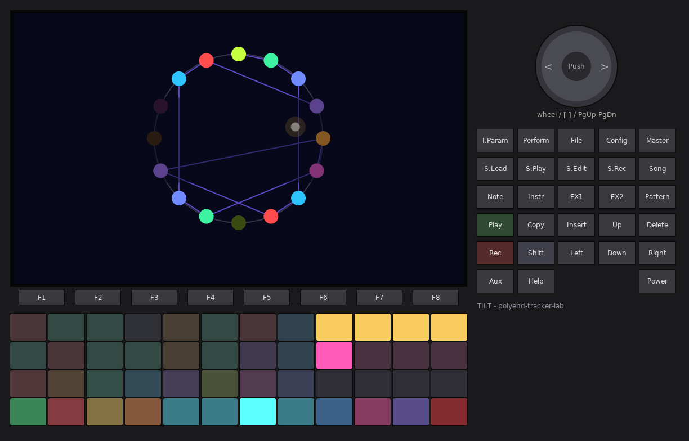

---

## Contents

1. [Quick start](#1-quick-start)
2. [How the ball moves](#2-how-the-ball-moves)
3. [Keys on every page](#3-keys-on-every-page)
4. [The perform pads](#4-the-perform-pads)
5. [GRAPH (F1)](#5-graph-f1)
6. [MATRIX (F2)](#6-matrix-f2)
7. [STEPS (F3) and melody](#7-steps-f3-and-melody)
8. [TABLE (F4)](#8-table-f4)
9. [EVOLVE (F5)](#9-evolve-f5)
10. [COMBOS (F6)](#10-combos-f6)
11. [CHANNELS (F7)](#11-channels-f7)
12. [MIX (F8)](#12-mix-f8)
13. [FILE: patterns, kits, capture, MIDI file](#13-file-patterns-kits-capture-midi-file)
14. [The table's rules in detail](#14-the-tables-rules-in-detail)
15. [Sound engines](#15-sound-engines)
16. [MIDI](#16-midi)
17. [Factory patterns](#17-factory-patterns)
18. [Settings, files on the card](#18-settings-files-on-the-card)
19. [LABKIT: PARAM pads, MAP, macros, modulation, MIDI learn](#19-labkit-param-pads-map-macros-modulation-midi-learn)
20. [Pattern JSON](#20-pattern-json)
21. [Differences from Pinball 2 and the TILT plug-in, limits](#21-differences-from-pinball-2-and-the-tilt-plug-in-limits)

---

## 1. Quick start

1. Copy `PolyendTrackerTILTPB.ptf` to `/Firmware` on the card and install it like any Tracker
   firmware. **Config > Firmware** takes you back to any other `.ptf` in `/Firmware`.
2. After the 2.7-second intro (a ball hopping through a growing Markov graph; any key skips
   it) you are on the **GRAPH** page with the factory pattern CHAIN: Pinball's default walk,
   1 > 2 > ... > 16, playing a two-step groove.
3. Press **Play**. The ball launches and walks; every step it lands on fires its channel.
4. Play the table: the **upper-left 16 pads** are the steps (tap one: the ball goes there
   next), **Note / Instr / FX1 / FX2** are the four flippers, **Song** nudges the table.
   Flip too often in one bar and the table **TILTs**.
5. Press **File**, tap one of the top pads to load another factory pattern (COMBOS,
   MULTIBALL, GRAVITY, META ...), close File and listen to what it does.
6. **F2 MATRIX**: change where the ball may go. **F3 STEPS**: change what each step plays.
   **F7 CHANNELS**: change the sounds.
7. Press **Rec** to capture the last bars and replay them; in **File**, **F7** saves the
   capture as a MIDI file.
8. Press **I.Param**: the page's parameters are on the pads (hold a pad, turn the encoder).
   Hold **Master** for the MAP of every page.

---

## 2. How the ball moves

The ball makes one **move** per grid unit (**Rate**, 1/16 by default; 1/64 to 1/2 and
triplets). On every move:

1. The ball **draws its next step** from the row it is in: each column's weight (0-100)
   divided by the row's sum is the chance. Column **D** is the drain.
2. It **lands** on that step. The step **fires** its channel (trig %, delay, velocity,
   length, bumper hits ...), the edge it took may transpose, delay and accent the note.
3. The step it landed on is now its row for the next draw.

On **Play** (and every **Reset** bars, and on RELAUNCH) the ball is put at row
`start step - 1` and its first move is drawn from there: with the default matrix and start
step 1 that is S > 1, exactly like the Max device. A row with no weights stops the ball
(again like the device). Drawing D **drains** the ball (see section 14).

Before the matrix gets a say, the table can decide the move, in this order:
**TILT freeze** (the ball repeats its step) > **shake** (any step) > **flipper** (the step
you flipped to) > **ramp** (the step's "ramp to") > **anchor rule** > **gravity** > the
**matrix**, shaped by the rules, memory and mutation.

---

## 3. Keys on every page

| Key | What it does |
| --- | --- |
| **F1 ... F8** | the pages GRAPH, MATRIX, STEPS, TABLE, EVOLVE, COMBOS, CHANNELS, MIX |
| **Shift + F1 ... F8** | the page's actions; while Shift is held the key strip turns cyan and shows them |
| **Play** | launch / stop (the Shell's transport; MIDI clock in / out in Config) |
| **Rec** | capture the last bars (1/2/4/8, chosen in File or on the pads) and replay them; again: stop the replay |
| **Shift + Rec** | the Shell's recorder (master WAV, and 4 stems when Settings > Record stems is on) |
| **Note, Instr, FX1, FX2** | flippers 1-4. With **Shift**: a hard flip (velocity 127, may TILT) |
| **Song** | nudge the table: one random kick of the ball. **Shift + Song**: a hard nudge (may TILT) |
| **Performance** (hold) | the perform pads on any page |
| **Pattern** | next matrix page (A > B > C > D) |
| **File** | the FILE overlay (patterns, kits, JSON, capture, MIDI file) |
| **S.Load** | CHANNELS with the sample browser for the selected channel |
| **Arrows, encoder** | move, change the value. **Shift + encoder**: bigger or finer steps |
| **Insert** | the page's main action (what the encoder push did on other Trackers): toggle, apply, audition, fire, open the browser |
| **Delete** | the value's default (on GRAPH: halt) |
| **Copy** / **Shift + Copy** | copy / paste (a step on STEPS); on GRAPH: one more ball |
| **I.Param** | LABKIT **PARAM pads** (tap = on / off, hold = only while held) |
| **Shift + I.Param** | LABKIT **MACRO** page |
| **Master** | LABKIT **MAP** (hold = look and jump, release goes there; tap = stays open) |
| **Shift + Master** | LABKIT **MOD** page (LFOs, random, every route) |
| **Shift + Config** | LABKIT **HELP**: the page's help, its F-keys and the key card |
| **Config** | the Shell's settings (tempo, MIDI, clock, input, recorder, TILT's own rows) |

The keys **Aux**, **Help** and the **encoder push** of other Tracker models are not used: the
original Tracker does not have them. MIX is on F8 (Master is the MAP).

---

## 4. The perform pads

On the **GRAPH** page (and on any page while **Performance** is held) the 48 pads are the
pinball table:

```
row 1   [ 1][ 2][ 3][ 4][ 5][ 6][ 7][ 8]   [F1][F2][F3][F4]   steps / flippers 1-4
row 2   [ 9][10][11][12][13][14][15][16]   [ A][ B][ C][ D]   steps / matrix pages
row 3   [c1][c2][c3][c4][c5][c6][c7][c8]   [K1][K2][K3][K4]   channels / combos 1-4
row 4   [RL][HL][+B][NG][C1][C2][C4][C8]   [RP][RN][UN][TL]   actions
```

| Pads | Tap | LED |
| --- | --- | --- |
| steps 1-16 | the ball's next move goes there (a flip: counts for TILT, the velocity matters) | the step's channel colour; brighter with heat and with the chance the ball goes there next; the main ball is red, extra balls blue |
| F1-F4 | the four flippers | gold; dark red while tilted |
| A-D | play matrix page A-D | the page being played is pink |
| c1-c8 | play the channel once. **Shift**: mute / unmute it | flashes on every hit; dark red when muted |
| K1-K4 | fire combo 1-4 now | brightness = how far the ball is into the combo's path |
| RL HL +B NG | relaunch, halt, one more ball (multiball), nudge (hard tap = TILT) | |
| C1 C2 C4 C8 | capture the last 1 / 2 / 4 / 8 bars and replay them | the chosen length is lit |
| RP | replay on / off | cyan while replaying |
| RN UN | randomize (matrix; **Shift**: steps and lanes) / undo | |
| TL | TILT the table now | red while tilted |

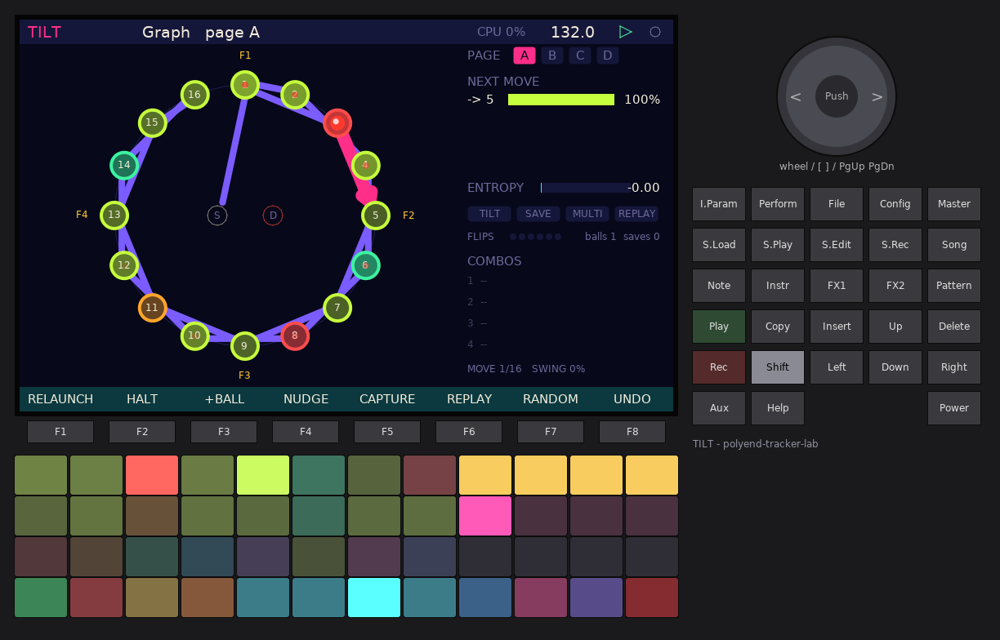

---

## 5. GRAPH (F1)


TILT's main view. The 16 steps sit on a circle; **S** (start) and **D** (drain) in the middle.

- **Arrows** are the matrix's moves, as thick as their weights (live: with mutation and
  memory). A forward and a backward move between the same two steps are drawn side by side.
  The ball's current row is drawn in **pink**, with arrow heads, thickness = probability.
  **Ramps** are cyan curves. Small rings outside a step are **self loops** (the step can
  repeat).
- **Steps**: the outer ring is the step's channel colour (dark = no trig, grey = MUTE step);
  the inside lights up with **heat** (how often the ball landed there lately). Gold dots are
  **bumpers** (one per extra hit). **F1-F4** mark the flippers' target steps.
- **Balls**: the main ball is **red**, extra balls (multiball) **blue**. A ball glides along
  the move it just made; the dots behind it are its **trail** (last 8 landings) in the
  ball's colour. A tilted ball has a white core.
- **Right panel**: the page being played (**META** when the meta matrix is on); **NEXT MOVE**,
  the five likeliest next steps with their chance (a flip, ramp, anchor or TILT shows as
  100 %); **ENTROPY** (0 = the next move is certain, 1 = all 17 equally likely); lamps
  **TILT**, **SAVE** (ball save window open), **MULTI**, **REPLAY**; **FLIPS** this bar
  against the tilt limit; **COMBOS** with their paths (the steps already matched are pink).
- Events show as a banner: TILT!, BALL SAVED, MULTIBALL, COMBO n + action, PAGE x, DRAIN,
  CAPTURED.

Keys: **encoder** = tempo (Shift: 0.1 BPM), **Left / Right** = move rate, **Up / Down** =
matrix page, **Insert** = relaunch, **Delete** = halt, **Copy** = one more ball.
Shift + F1-F8: RELAUNCH, HALT, +BALL, NUDGE, CAPTURE (no replay), REPLAY, RANDOM (the
randomizer's targets), UNDO.

---

## 6. MATRIX (F2)


The 17 x 17 matrix of the page being played. Rows: **S**, 1-16 (where the ball is).
Columns: **D**, 1-16 (where it goes). A cell's square grows and brightens with its weight
(four colour levels). The **gold band** is the ball's row, the **gold frame** its last move,
the **white frame** the cursor; cyan dots mark cells with edge properties. The D column is
tinted red.

Right panel: the cell (`row -> column`), the row's sum, the page tabs, the fields, and the
row's odds as a bar chart.

| Field | Range | |
| --- | --- | --- |
| WEIGHT | 0-100 | the chance of this move, relative to the row's sum (p %) |
| TRANSPOSE | -12..+12 | semitones added to the note fired when the ball takes this edge |
| DELAY | 0-11 twelfths of a move | the note comes this much later |
| VELOCITY | -64..+63 | added to the step's velocity |
| SHAPE | CHAIN, REVERSE, PINGPONG, DRUNK, JUMPS, EUCLID, STAY, HUB, RANDOM, CLEAR | **Insert** rebuilds the whole page |
| ROW FN | CLEAR, NEXT, EQUAL, RANDOM, STAY, BACK | **Insert** rewrites the cursor row |

Keys: arrows move the cursor, the **encoder** changes the field (WEIGHT in steps of 5,
Shift: 1), **Insert** toggles the weight 0 / 100 (or applies the shape / row function),
**Shift + Insert** sets 50, **Delete** clears the weight (or the edge's properties).
The matrix weights are not LABKIT parameters (they are not on the PARAM pads and cannot be
modulated: 4 x 289 cells, and the walk is the matrix's job).
Shift + F1-F6 pick the field, Shift + F7 = next page, Shift + F8 = VIEW: **stored** weights
or **live** (with mutation and memory).

Pads:

| Pads | |
| --- | --- |
| rows 1-2, columns 1-8 | the **columns 1-16** of the cursor row: tap toggles the weight (from the pad's velocity, 10-100); lit by weight |
| row 1, column 9 | column **D** |
| rows 3-4, columns 1-8 | pick the **row** 1-16 (the ball's row is gold) |
| row 3, column 9 | row **S** |
| row 2, column 9 / row 4, column 9 | the row EQUAL / CLEAR |
| column 10 | field WEIGHT / TRANSPOSE / DELAY / VELOCITY |
| column 11 | shapes CHAIN / DRUNK / JUMPS / RANDOM (whole page) |
| column 12 | play page A / B / C / D |

### The shapes

| Shape | Moves |
| --- | --- |
| CHAIN | 1 > 2 > ... > 16 > 1 (the device's default) |
| REVERSE | 16 > 15 > ... > 1 > 16 |
| PINGPONG | up the odd steps, down the even ones: 1 3 5 ... 15 16 14 ... 2 1 |
| DRUNK | one step left or right (45 / 45), or stay (10) |
| JUMPS | +1 (70), +4 (20), +8 (10) |
| EUCLID | towards the next quarter (1, 5, 9, 13) or one step on |
| STAY | stay (60) or one step on (40) |
| HUB | every step goes back to 1 or one on; 1 goes anywhere |
| RANDOM | 1-5 random moves per row (Randomizer > Density), sometimes a drain |
| CLEAR | nothing (the ball stops) |

S always goes to the start step (except CLEAR).

---

## 7. STEPS (F3) and melody

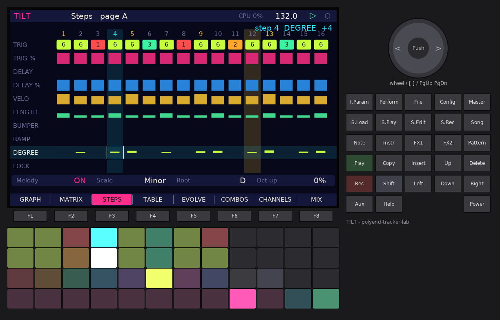

One column per step, one row per setting (Pinball 2's step controls plus TILT's):

| Row | Range | |
| --- | --- | --- |
| TRIG | none, 1-8, M | the channel the step fires; **M** (MUTE) cuts every channel that has a choke group |
| TRIG % | 0-100 | chance the trig fires |
| DELAY | 0-23 twelfths of a move | the note comes later ... |
| DELAY % | 0-100 | ... with this chance |
| VELO | 1-127 | |
| LENGTH | 1-64 quarter moves | note length (4 = one move); MIDI note-off and the synths' gate |
| BUMPER | 0-4 | extra **ratchet hits** inside the move, each at 0.8 x the last velocity |
| RAMP | off, 1-16 | the next move is **forced** to this step |
| DEGREE | -7..+21 | the scale degree played in melody mode (and the slice for "Slice by Degree") |
| LOCK | on / off | the randomizer leaves this step (and its matrix row) alone |

The cursor's value is spelled out top right. The ball's column is gold.

The bottom strip is **MELODY**: on / off, **Scale** (Major, Minor, Dorian, Phrygian,
Mixolydian, Harmonic minor, Pentatonic major, Pentatonic minor, Hijaz, Chromatic), **Root**
(the key, C-B) and **Oct up** (chance that a note jumps an octave). With melody on, every
channel whose **Follow** is on plays `channel note + root + scale(degree)`; drums usually
keep Follow off and play their own note.

Keys: arrows (Down past DEGREE / LOCK reaches the melody strip; there Left / Right pick the
field), **encoder** = value (Shift: x4), **Insert** = audition the step (on LOCK: toggle; on
the strip: melody on / off), **Delete** = the row's default, **Copy** / **Shift + Copy** =
copy / paste a step. Hold step pads and turn the encoder to edit several steps at once.
For LABKIT the rows are split into the pages STEPS (velocity, trig %), LANES (trig lane,
locks, melody), TIMING (delay, delay %), LENGTH (length, bumper) and PITCH (degree, ramp):
the PARAM pads follow the row the cursor is on.
Shift + F1-F8: RND TRIG (Pinball's Randomize Trigs: every unlocked step gets 0-9), CLR
STEPS, ROW=ALL (the cursor's value to every step), LOCK, ROT < / ROT > (rotate the steps),
COPY, PASTE.

Pads: rows 1-2 = steps (select; hold several to edit together), row 3 = channel 1-8,
none, MUTE for the selected / held steps (and audition), row 4 = the rows TRIG ... LOCK,
then the melody strip and "audition this step".

---

## 8. TABLE (F4)

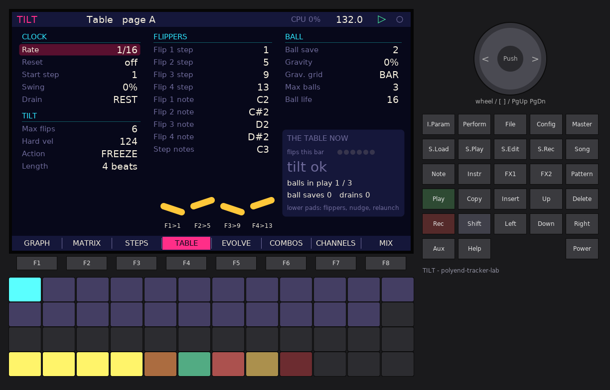

| Group | Parameter | Range | |
| --- | --- | --- | --- |
| CLOCK | Rate | 1/64, 1/32, 1/16, 1/8, 1/4, 1/2, 1/16T, 1/8T | one move |
| | Reset | off, 1-64 bars | relaunch every N bars of the transport (Pinball's Pattern Length) |
| | Start step | 1-16 | where a launch starts (Pinball's Starting Step) |
| | Swing | 0-75 % | odd moves are late by swing x half a move |
| | Drain | REST, HOLD | after a drain: one silent move, then from S / wait for a relaunch or a flip |
| FLIPPERS | Flip 1-4 step | 1-16 | where each flipper sends the ball |
| | Flip 1-4 note | MIDI note | the note that plays the flipper (C2, C#2, D2, D#2) |
| | Step notes | MIDI note | notes from here to +15 flip to steps 1-16 (C3) |
| TILT | Max flips | off, 1-16 | flips (and nudges) per bar; one more TILTs |
| | Hard vel | off, 1-127 | a flip / nudge / MIDI note this hard TILTs |
| | Action | FREEZE, SHAKE, BOTH | freeze: the ball repeats its step; shake: it jumps anywhere; both: shake, then freeze |
| | Length | 1-16 beats | how long a TILT lasts (the flippers are dead meanwhile) |
| BALL | Ball save | off, 1-8 bars | a drain this soon after a launch is saved |
| | Gravity | 0-100 % | chance the ball is pulled to the start step on the grid ... |
| | Grav. grid | BAR, HALF, BEAT | ... on every bar, half bar or beat |
| | Max balls | 1-4 | balls in play at once |
| | Ball life | 4-64 moves | how long an extra ball lives |

**THE TABLE NOW** shows the flips this bar against the limit, the TILT state, the balls in
play, saves and drains. Under the flipper column the four flipper bats show their targets.

Keys: Up / Down within a column, Left / Right between columns, **encoder** = value,
**Insert** = toggle an on / off value, **Delete** = default. Shift + F1-F4: RELAUNCH, HALT, +BALL, TILT!; Shift + F7: the table's
defaults. Pads: the upper two rows pick parameters (hold + encoder edits that one); row 4 =
flippers 1-4, nudge, relaunch, halt, +ball, TILT.

---

## 9. EVOLVE (F5)

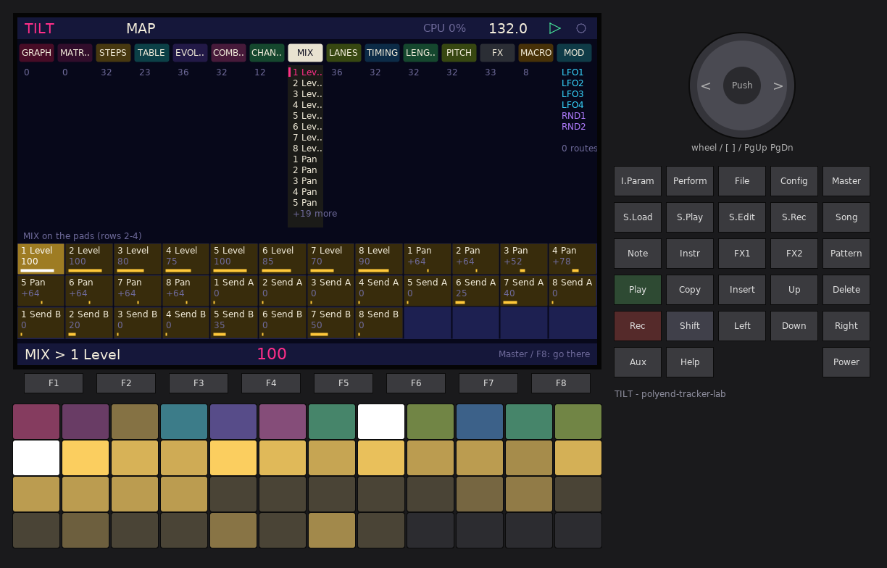

How the walk changes by itself.

| Group | Parameter | |
| --- | --- | --- |
| MEMORY | Fatigue | every time the ball takes an edge it gets weaker (x (1 - 0.6 % x fatigue)) |
| | Reinforce | ... or stronger (x (1 + 0.6 % x reinforce)); limits 0.05-4 |
| | Recover | at every bar, memory goes this % of the way back to neutral |
| MUTATION | Amount | every bar up to **24 weights** of the played page (24 x amount) drift by up to **+-30** (x amount), each weight at most once a bar, kept in 0-100 |
| | Home | ... and are pulled back to the stored weights by this much per bar (spread over the bar's moves) |
| | Spread | the drift also reaches empty cells (new moves appear) |
| RULES | Anchor / Every | every N moves the ball goes to the anchor step |
| | Max repeat | a step repeats at most N times in a row |
| | No bounce | never straight back to the step the ball came from |
| META | Meta / Every / Page | every N bars the next page (A-D) is drawn from the 4 x 4 **meta matrix** row of the current page |
| RANDOMIZER | Amount | how much changes (0 = nothing, 100 = everything unlocked) |
| | Density | how many moves a random row gets (1-5) |
| | Matrix, Steps, Lanes, Rules, Sound | what RANDOMIZE changes: the played page's rows; the step rows; the trig lanes; rules + gravity + mutation + memory; the channels' engine parameters |
| LOCKS | TRIG ... LOCK | step rows the randomizer never touches |

Memory and mutation are a live layer: the stored pattern never changes (VIEW: live in
MATRIX and the GRAPH show it). **EVOLUTION** maps it: pink = tired edges, cyan = stronger,
gold = drifted.

The **meta matrix** grid: rows = the page being played, columns = the next page.

Keys: as on TABLE; the meta cells take the encoder in steps of 10 (Shift: 1), **Insert**
toggles an on / off value or a lock. Shift + F1-F8: RANDOM (all chosen targets), UNDO, R MATRIX, R STEPS, R LANES,
R RULES, R SOUND, RESET MEM (memory and mutation back to neutral).
Pads: rows 1-2 left = **step locks** (the upper pads light gold when locked), rows 1-2 right =
meta cells; row 3 = **row locks**; row 4 = RANDOM, UNDO, R MATRIX, R STEPS, R LANES,
R RULES, R SOUND, RESET MEM, pages A-D. The undo keeps one step.

---

## 10. COMBOS (F6)

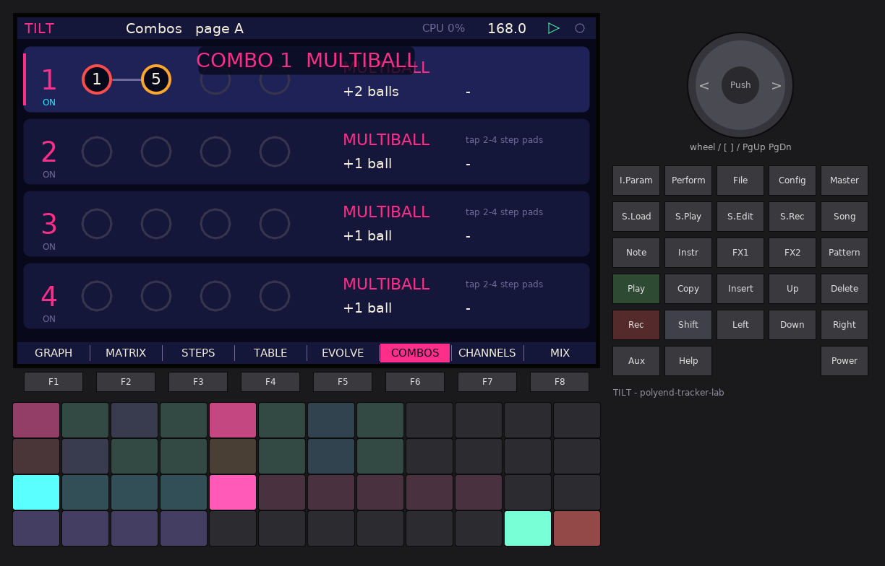

Four combos. A combo is a **path of 2-4 steps**: when a ball lands on them in that order,
the combo fires (and its path starts over). The circles fill pink as the main ball moves
along a path.

| Action | a | b |
| --- | --- | --- |
| MULTIBALL | +1 to +3 balls | - |
| FILL | for N moves (1-32) ... | ... every hit becomes 2-4 ratchet hits |
| NOTE | play this note ... | ... on channel 1-8 |
| CC | send MIDI CC number ... | ... with this value (on channel 1's MIDI channel) |
| SHAKE | N moves (1-32) of random jumps | - |
| SCENE | play page A-D, or the next page | - |

Keys: Up / Down = combo, Left / Right = field (on, path 1-4, action, a, b), **encoder** =
value (turning a path step below 1 ends the path there), **Insert** = fire, **Delete** =
clear the path. Shift + F1-F4 fire combos 1-4, Shift + F5 clears the path.
Pads: rows 1-2 = **tap steps to build the path** (a fifth tap starts a new one), row 3 =
pick combo 1-4, then the six actions, row 4 = fire combo 1-4, on / off, clear.

---

## 11. CHANNELS (F7)

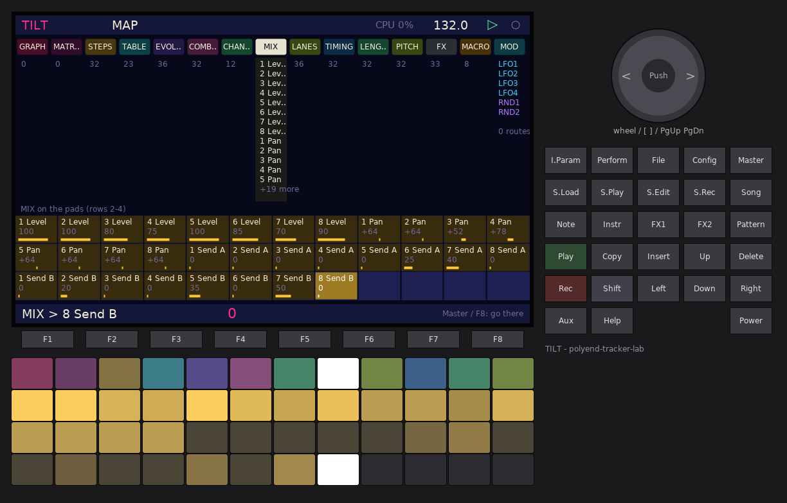

The eight channels along the top (colour, engine, note; they flash on every hit). Below,
the selected channel: its engine with eight knobs, and the channel settings:

| Setting | |
| --- | --- |
| Note | the channel's note: what it sends over MIDI, the drums' pitch reference, the melody's base |
| MIDI ch | off, 1-16 |
| Follow | play the steps' scale degrees in melody mode |
| Legato | ACID / FM: an overlapping note glides instead of retriggering (303 slide) |
| Choke | off, group 1-4: channels in one group cut each other |
| SAMPLE | the WAV (SAMPLE engine): **Insert** on this row, or **S.Load** on any page, opens the LABKIT browser in `/Lab/TILT/Samples` (Left goes up a folder, so `/Samples` is reachable; the browser auditions the file) |

SAMPLE channels show the waveform and the slice lines.

Keys: Up / Down = field, Left / Right = channel, **encoder** = value (Shift: bigger steps),
**Insert** = audition (on SAMPLE: the browser; **F8** there loads the file, **F7** cancels),
**Delete** = default (on SAMPLE: back to the built-in sample).
For LABKIT each channel has its own page of parameters (engine, its eight knobs, note,
MIDI channel, follow, legato, choke); the CHANNEL page shows the selected channel's. Shift + F1-F6 = KICK, SNARE, HAT, ACID, FM, SAMPLE (with
defaults), Shift + F7 / F8 = copy / paste a channel.
Pads: rows 1-3 = a **keyboard** for the channel (36 notes up from its note, in the scale
when melody and Follow are on), row 4 = pick channel 1-8, then KICK, SNARE, HAT, ACID.

---

## 12. MIX (F8)

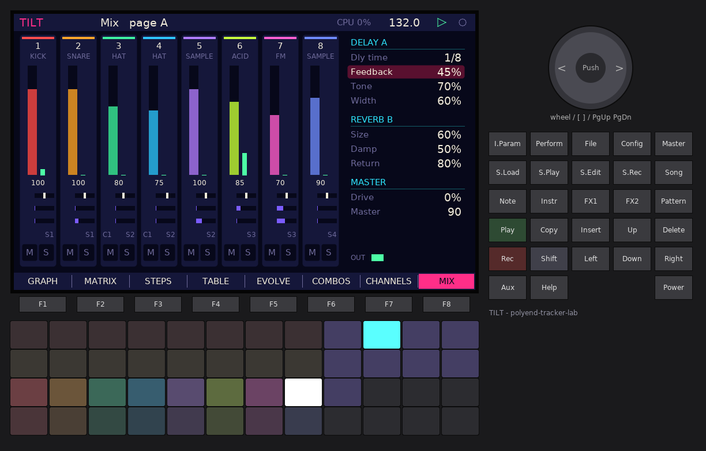

Eight strips: level fader with a meter, pan, send A (delay) and send B (reverb), choke
group, recorder stem (1-4), mute and solo. Right: the effects.

| FX | Parameter | |
| --- | --- | --- |
| DELAY A | Dly time | 1/32 ... 1/2 (with dotted), synced to the tempo |
| | Feedback, Tone, Width | width = ping-pong amount |
| REVERB B | Size, Damp, Return | four-line FDN |
| MASTER | Drive, Master | soft saturation, level (the Shell's limiter follows) |

Both sends run at 22.05 kHz (half the rate) to save CPU; they are interpolated back.

Keys: Left / Right = strip (right of strip 8: the FX list), Up / Down = row, **encoder** =
value, **Insert** = mute. Shift + F1 / F2 = mute / solo, Shift + F7 = FX focus, Shift + F8 =
PANIC (all notes off). Pads: row 1 = mutes, row 2 = solos, row 3 = select, row 4 =
audition; columns 9-12 = the FX parameters.

---

## 13. FILE: patterns, kits, capture, MIDI file

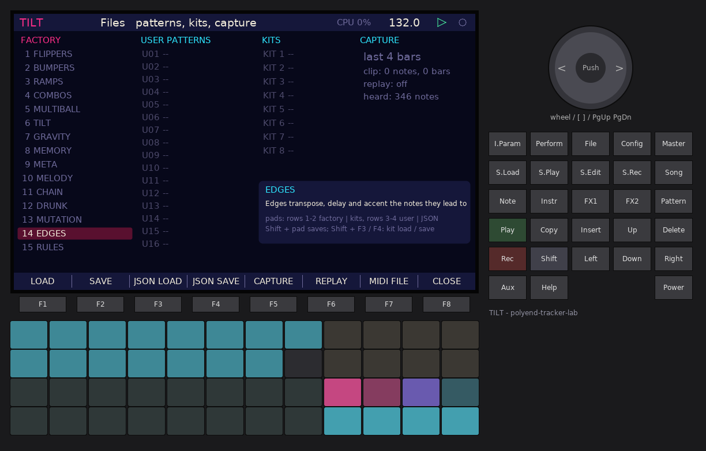

**File** opens it, **File** or **F8** closes it. Four columns:

- **FACTORY**: the 15 factory patterns (the box shows the selected one's idea).
- **USER PATTERNS**: 16 slots on the card (`U01`-`U16`, with their names; `*` = the one
  playing).
- **KITS**: 8 slots. A kit is the 8 channels and the FX; loading one keeps the walk going.
- **CAPTURE**: the length (encoder: 1, 2, 4, 8 bars), the clip, replay state, the notes heard
  so far, the last MIDI file.

| Key | |
| --- | --- |
| F1 / Insert | load (factory, user, kit) or capture |
| F2 | save the pattern into the selected user slot (or the one playing) |
| F3 | **JSON LOAD**: the browser in `/Lab/TILT/Patterns` (`.json`; the factory files are in `Factory/`); **F8** loads, **F7** cancels |
| F4 | **JSON SAVE**: the keyboard asks for a name (the pattern's name to start), **F8** saves `/Lab/TILT/Patterns/<name>.json` |
| Shift + F3 / Shift + F4 | load / save the selected kit |
| F5 | capture the last bars (no replay) |
| F6 | replay on / off |
| F7 | save the capture as a MIDI file |
| F8 | close |

Pads:

```
         cols 1-8                            cols 9-12
row 1    factory 1-8                         kits 1-4
row 2    factory 9-15                        kits 5-8      (Shift + kit pad saves)
row 3    user slots 1-8                      JSON load, JSON save, MIDI file, replay
row 4    user slots 9-16                     capture 1 / 2 / 4 / 8 bars
         (Shift + user pad saves there)
```

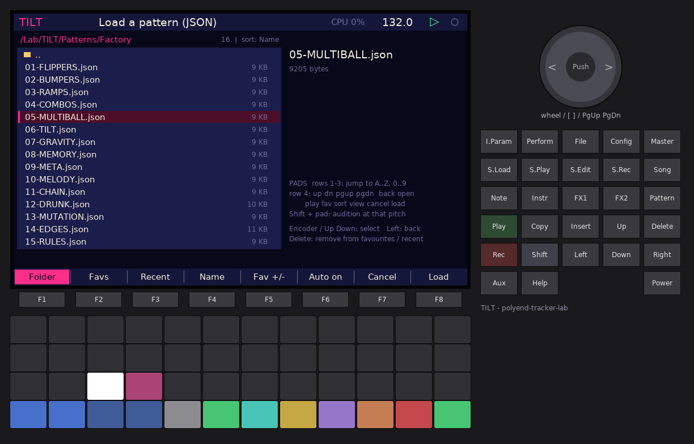

A pattern is everything: the four matrix pages, edge properties, steps, flippers, combos,
table, evolve, melody, randomizer settings, the 8 channels with their sample paths, the FX
and the tempo. Files carry a version and their size: a file from an older TILT loads (what
it lacks keeps its defaults), damaged values are clamped.

**Capture** records what is heard (every note, bumper hits included, with its time,
channel, note, velocity, length). Capturing takes the last N complete bars; **replay**
loops them in place of the ball, in the same place in the bar (the ball keeps walking
silently on the screen). The MIDI file (`/Lab/TILT/Midi/CAP-001.MID` ...) is format 0,
96 ppq, with the tempo, each note on its channel's MIDI channel.

---

## 14. The table's rules in detail

**Drain.** Drawing D drains the ball. Extra balls are gone. The main ball: inside the
**ball save** window (bars after its launch) it is saved: back to S and straight on, no move
lost (banner BALL SAVED). Otherwise **REST**: one silent move, then on from S; or **HOLD**:
it waits for a relaunch (Reset, RELAUNCH, Play) or a flip.

**Flippers.** A flip (step pad, flipper key, flipper or step MIDI note) sets the main ball's
next move. A flipped ball that was held comes back. Flips and nudges are counted per bar.

**TILT.** More than **Max flips** in a bar, or a flip / nudge / note at **Hard vel** or
harder, tilts the table for **Length** beats: the flippers are dead, and depending on
**Action** the ball freezes on its step (the step repeats every move), shakes (random
moves), or both (shake, then freeze).

**Nudge.** One random move (Song, the NG pad); it counts as a flip.

**Bumpers.** A step with bumper N plays N+1 hits spread evenly over the move, each at 0.8 x
the velocity of the one before, each no longer than the gap.

**Ramps.** When the ball lands on a step with a ramp, the next move goes to the ramp's step.

**Gravity.** At the end of every bar (half bar, beat: the move that lands on the downbeat)
the ball is pulled to the start step with this chance.

**Multiball.** Extra balls start where the main ball is, walk the same matrix, fire the
steps they land on at 0.85 x velocity, are not steered by the flippers, live **Ball life**
moves and vanish on a drain.

**Edge properties.** Per cell of each page: the move's note is transposed, delayed and
accented. Example (EDGES factory pattern): jumps of three steps go up a fifth with an accent.

**Memory, mutation, meta, rules**: section 9. **Melody**: section 7.

**Swing** pushes odd moves; **delay** moves a step's note inside (or past) its move; both
add up with the edge delay. **Choke**: section 11; a MUTE step chokes every grouped channel.

**Next-move odds and entropy** are computed from the row the main ball is in, with
everything above applied (a pending flip, ramp, anchor or freeze shows as 100 %).

---

## 15. Sound engines

Every channel is one voice (a new note restarts it, or glides with Legato). Built-in
samples: **BREAK** (one bar of Plaits drums at 170 BPM, made at boot; 16 slices = 16th
notes), **CLAP, RIM, TOM, BELL, ZAP, SHAKER, CHORD**.

| Engine | Knobs |
| --- | --- |
| **SAMPLE** | Source (built-in sample, or CARD), Slices 1-16, Slice by (Fixed, Step, Degree, Random), Slice, Pitch +-24, Decay (127 = the whole slice), Cutoff, Reso |
| **KICK** (Plaits) | Model (Analog = the 808-style bridged-T, Synth = the synthetic kick), Tune +-24, Decay, Tone, Punch (attack FM / FM envelope), Drive (self FM / dirt) |
| **SNARE** (Plaits) | Model (Analog / Synth), Tune, Decay, Tone (two modes below 2/3, up to five above), Snappy |
| **HAT** (Plaits) | Tune, Decay (closed ... open), Tone, Noise (metal ... noise) |
| **ACID** | Wave (Saw / Square), Cutoff, Reso, Env mod, Decay, Accent, Slide, Drive. A note with velocity 110 or more is accented (shorter, brighter, louder) |
| **FM** | Ratio (0.5 ... 7), Index, Idx decay, Decay, Feedback, Attack, Detune, Tone |

A channel's pitch follows the note it plays: drums and samples are transposed by
`note - channel note`, ACID and FM play the note.

User samples: WAV (8/16/24/32-bit, float, any rate, mono or stereo; resampled to 44.1 kHz;
a stereo file plays its left channel), up to 10 seconds per channel. Put them in `/Lab/TILT/Samples` or `/Samples`.

**Default kit**: 1 KICK (C2), 2 SNARE (D2), 3 HAT closed (F#2) and 4 HAT open (A#2) in choke
group 1, 5 SAMPLE CLAP (D#2), 6 ACID (C2, Follow, Legato), 7 FM (C4, Follow), 8 SAMPLE BREAK
(16 slices by step). Drums send on MIDI channel 10, ACID on 2, FM on 3.

---

## 16. MIDI

**Out** (DIN and USB): every note on its channel's MIDI channel, with its velocity and a
note-off after its length; combo CC messages; clock when Config > Clock is "Internal + send".
Muted channels send nothing.

**In**: the four **flipper notes** (default C2-D#2) play the flippers; the **step notes**
(default C3 to D#4) flip to steps 1-16 (Settings can turn this off); a note at **Hard vel**
or harder tilts. Any other note plays the channel selected on the CHANNELS page.
**Clock**: Config > Clock "Follow MIDI" follows the tempo and start / stop of an external
clock.

---

## 17. Factory patterns

The first ten are the TILT readme's ideas, one feature each; the last five are more
grooves. Each is built into the firmware and written to the card as
`/Lab/TILT/Patterns/Factory/NN-NAME.json` (only when the file is missing, so your edits
stay).

| # | Name | The idea |
| --- | --- | --- |
| 1 | FLIPPERS | the ball stays put (85 % self loops): steer it with the flippers |
| 2 | BUMPERS | jungle hats and snares: bumpers ratchet inside the move, the break sliced by step |
| 3 | RAMPS | ramps force the next move: 8 > 1 and 16 > 9 loops, a reset every 4 bars |
| 4 | COMBOS | 1-5-9 = MULTIBALL, 4-8 = FILL, 13-14-15-16 = next page, 3-7 = SHAKE |
| 5 | MULTIBALL | four balls on a jumping table: every 1-5 adds two more (blue on the GRAPH) |
| 6 | TILT | a twitchy table: 3 flips a bar tilt it (shake, then freeze), a 4-bar ball save |
| 7 | GRAVITY | a random walk, gravity pulls the ball home at every bar end |
| 8 | MEMORY | fatigue: used edges tire, the ball finds new routes |
| 9 | META | four pages (chain, jumps, drunk, reverse), the meta matrix picks one every 2 bars |
| 10 | MELODY | up the odd steps, down the even: an acid line in melody mode (D minor) |
| 11 | CHAIN | Pinball's default: 1 > 2 > .. > 16, a plain groove (the boot pattern) |
| 12 | DRUNK | a drunk walk, one step left or right, FM in Hijaz |
| 13 | MUTATION | up to 24 weights drift every bar and are pulled back home |
| 14 | EDGES | edges transpose, delay and accent the notes they lead to |
| 15 | RULES | anchor on 1 every 8 moves, no bounce back, max 2 repeats |

---

## 18. Settings, files on the card

**Config** opens the Shell's settings (brightness, intro, MIDI channels, clock, input,
master, limiter, record stems, tempo) and TILT's rows:

| Row | |
| --- | --- |
| TILT: load last session | boot into the pattern that was playing at power-off |
| TILT: MIDI notes out | send notes (off = TILT stays quiet on MIDI) |
| TILT: MIDI step notes flip | incoming step notes flip the ball |
| TILT: ball trails | draw the trails on the GRAPH page |

Files (all optional; without a card TILT runs from its factory patterns):

```
/Lab/TILT/state.tlt            the last session (saved at power-off and every 5 minutes)
/Lab/TILT/labkit-patch.bin     LABKIT: macros, LFOs, routes, MIDI learn of the session
/Lab/TILT/tilt.cfg             TILT's settings rows
/Lab/TILT/Patterns/PAT01.TLT   user patterns 1-16 (with their LABKIT routes)
/Lab/TILT/Patterns/*.json      patterns as JSON (File > F3 / F4)
/Lab/TILT/Patterns/Factory/    the 15 factory patterns as JSON (01-FLIPPERS.json ...)
/Lab/TILT/Kits/KIT01.TLK       kits 1-8
/Lab/TILT/Midi/CAP-001.MID     captures saved as MIDI files
/Lab/TILT/Samples/*.wav        samples for the SAMPLE channels (also /Samples)
/Lab/TILT/Rec/REC-0001.wav     the Shell's recorder (stems: each channel's Stem 1-4)
```

---

## 19. LABKIT: PARAM pads, MAP, macros, modulation, MIDI learn

TILT uses **LABKIT v2**, the navigation every lab firmware shares (`WORKSTATION_GUIDE.md`,
`src/lab/`). The same keys open the same views on every firmware:

| Key | View |
| --- | --- |
| **I.Param** | **PARAM pads**: rows 1-3 = this page's parameters (up to 36), row 4 = sources (LFO 1-4, RND 1-2, macros M1-M6; Shift: M7, M8 and TILT's sources). Hold a pad and turn the encoder to edit; hold a source and tap a parameter to route it (encoder = depth, **Delete** removes the route). Tap I.Param = stays open, hold = only while held |
| **Shift + I.Param** | **MACRO** page: 8 macros, each with up to 8 targets |
| **Master** | **MAP**: row 1 of the pads = the pages, rows 2-4 = the parameters of the page picked. Hold Master, tap a page (and a parameter), release: TILT goes there |
| **Shift + Master** | **MOD** page: 4 LFOs, 2 random sources, every route |
| **Shift + Config** | **HELP**: the page's help, its F-keys and the key card |
| MIDI CC | **MIDI learn**: in the PARAM pads, Shift + hold a parameter pad and move a CC; it moves that parameter from then on (Delete while held forgets it) |

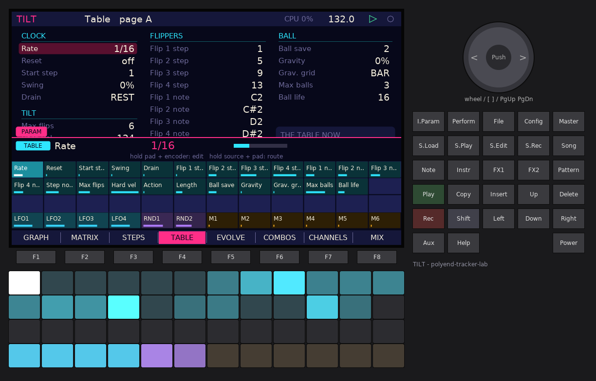


**Pages** (the MAP's columns). The PARAM pads show the page TILT is on; on STEPS and MIX the
page follows the cursor's row.

| Page | Parameters |
| --- | --- |
| GRAPH, MATRIX | none (the matrix weights are not parameters, see below) |
| STEPS | velocity 1-16, trig % 1-16 |
| TABLE | the 23 TABLE parameters (clock, flippers, tilt, ball) |
| EVOLVE | memory, mutation, rules, meta on / bars / page, the randomizer, the 4 x 4 meta matrix |
| COMBOS | combos 1-4: on, path 1-4, action, a, b (no modulation) |
| CHANNEL | the selected channel: engine, its 8 knobs (named after the engine; unused knobs are empty), note, MIDI channel, follow, legato, choke. Each channel keeps its own parameters, so routes and learned CCs stay with their channel |
| MIX | level, pan, send A, send B of channels 1-8 |
| LANES | the trig lane of steps 1-16, melody on / scale / root / octave up, the step locks |
| TIMING | delay and delay % of steps 1-16 |
| LENGTH | length and bumper of steps 1-16 |
| PITCH | degree (bipolar) and ramp of steps 1-16 |
| FX | delay A, reverb B, drive, master; mute, solo, stem of channels 1-8 |

**What can be modulated**: every number (velocities, chances, delays, lengths, degrees,
the TABLE and EVOLVE values, the meta cells, the engine knobs, levels, pans, sends, FX).
Not modulated: choices and switches (trig lanes, ramps, engines, on / off values, MIDI
channels, the combos) and the **17 x 17 matrix weights**: 1,156 cells are not exposed as
parameters at all; the walk itself is their modulation (memory, mutation, meta).

**TILT's sources** (Shift row of the PARAM pads, and on the MOD page), all 0..1:

| Source | |
| --- | --- |
| BALL | the main ball's step (1-16 > 0..1) |
| BALL X, BALL Y | where the main ball is on the GRAPH circle (left > right, top > bottom) |
| HEAT | the heat of the step under the ball |
| ENTROPY | the entropy of the next move |
| BALLS | balls in play (1-4) |
| TILT | 1 while the table is tilted |
| PAGE | the matrix page played (A-D) |
| VELO | the last velocity fired |

The routes, macros, LFOs and learned CCs are saved with the session
(`labkit-patch.bin`) and with each user pattern (a chunk at the end of `PATnn.TLT`). An LFO
on a step's velocity changes what the step plays, never the walk; the matrix is never
regenerated by modulation.

---

## 20. Pattern JSON

**File > F4** writes the pattern as JSON, **File > F3** loads one through the browser. The
format follows the TILT plug-in's model as its readme describes it (the plug-in's own
`FORMAT.md` could not be reached when this was written, so this is TILT-for-Tracker's
format, "tilt-pattern" version 1; the reader is lenient so a file from another TILT can be
adapted by hand):

```json
{
  "format": "tilt-pattern", "version": 1, "name": "COMBOS", "bpm": 124.0, "page": 0,
  "clock": {"rate": "1/16", "reset": 0, "start": 1, "swing": 12},
  "steps": [ {"trig": 1, "trigProb": 100, "delay": 0, "delayProb": 100, "velocity": 100,
              "length": 1, "bumper": 0, "ramp": 0, "degree": 0, "lock": false}, ... 16 ],
  "pages": [ {"name": "A", "matrix": [[...17], ... 17 rows],
              "edges": [{"from": 3, "to": 6, "transpose": 7, "delay": 0.25, "velocity": 20}]},
             ... 4 pages ],
  "flippers": [{"step": 1, "note": 36}, ... 4],
  "combos": [{"on": true, "path": [1, 5, 9], "action": "MULTIBALL", "a": 2, "b": 0}, ... 4],
  "tilt": {"maxFlips": 6, "hardVelocity": 124, "action": "FREEZE", "beats": 4},
  "ball": {"drain": "REST", "save": 2, "gravity": 0, "gravityGrid": "BAR", "maxBalls": 4,
           "life": 16, "stepNotes": 48},
  "memory": {"fatigue": 0, "reinforce": 0, "recover": 10},
  "mutation": {"amount": 0, "home": 20, "spread": 0},
  "meta": {"on": false, "bars": 2, "matrix": [[...4], ... 4]},
  "rules": {"anchor": 0, "anchorEvery": 8, "maxRepeat": 0, "noBounce": false},
  "melody": {"on": false, "scale": "Minor", "root": "D", "octaveUp": 0},
  "randomizer": {"amount": 50, "density": 2, "matrix": true, "steps": false, "lanes": false,
                 "rules": false, "sound": false, "rowLocks": 0},
  "lanes": [{"note": 36, "midiChannel": 10, "choke": 0, "mute": false}, ... 8],
  "tracker": {
    "channels": [{"engine": "KICK", "params": [...8], "level": 100, "pan": 0, "sendA": 0,
                  "sendB": 0, "stem": 1, "solo": false, "follow": false, "legato": false,
                  "sample": ""}, ... 8],
    "fx": {"delayTime": "3/16", "delayFeedback": 40, ...}
  }
}
```

- **Matrix**: rows S, 1-16; columns D, 1-16; weights 0-100. **Edges** list only the cells
  with properties (`from` / `to` 0-16 as in the matrix; `delay` in moves).
- **Steps**: `trig` 0 = none, 1-8 = lane, -1 = MUTE; `delay` and `length` in moves.
- **Lanes** are the eight trig lanes (note, MIDI channel, choke group, mute); `tracker` holds
  what only this firmware has (engines, knob values 0-127, mix, sample paths, FX).
- **Reading**: missing keys keep their defaults, unknown keys are skipped, names (rate,
  action, scale, engine ...) are matched as written above or given as their index, numbers
  are clamped to their ranges, a single top-level `"matrix"` (17 x 17) is used for all four
  pages. Files up to 48 KB (the factory files are 9-11 KB). A file TILT cannot read shows
  the reason ("not JSON (or too big)", "not a tilt-pattern", "no steps / matrix") and
  leaves the pattern alone.
- Loading a JSON pattern is like loading a factory pattern: the walk restarts on the new
  table, the LABKIT routes stay.

---

## 21. Differences from Pinball 2 and the TILT plug-in, limits

- **The ball stays on the grid.** In the Max device a step's delay also delays the next
  move, so delays add up until the next reset; in TILT a delay only moves that step's note
  (as in GENOTYPE). Moves are exactly on the Rate grid.
- **D is a drain**, handled by ball save and Drain REST / HOLD; an empty row stops the ball
  as in the device.
- **Halt** stops every ball until a relaunch or a flip (the device's "Hault").
- One voice per channel (no polyphony inside a channel); a channel's new note restarts it
  with a short declick, Legato glides ACID and FM.
- Memory and mutation are live layers that reset on Play; the stored matrix only changes
  when you edit, shape or randomize it.
- The randomizer has one undo step.
- Samples: 10 s per channel, mono (the left channel of a stereo file).
- The capture holds the last 2048 notes (8 bars of a busy multiball table fit).
- The GRAPH draws at most 190 arrows (the lightest go first) to stay inside the display
  budget; the matrix is always complete on the MATRIX page.
- CPU (render per 128-sample block under QEMU, limit 180,000 instructions, LABKIT's block
  included): CHAIN 73,800; eight channels busy 114,520; multiball (four balls, ratchets)
  139,960; every send, drive and evolve option at 1/64 156,040; **eight channels +
  multiball + 48 LABKIT routes at 1/32 162,600** (the worst, 90 %).
- Pattern files are version 2 (sample paths up to 127 characters); version-1 files from the
  first TILT load and are converted.
- The MAP shows every page's name, but lists the parameters of the first few columns only:
  with 13 pages and up to 36 parameters each, LABKIT stops filling the columns at the
  display budget. The page picked on the pad row always shows all its parameters in rows
  2-4.
